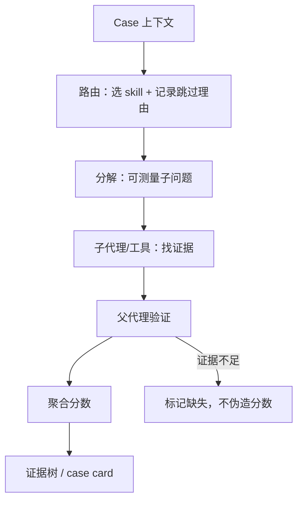

# 智能体化评测

**一句话：把“打分”从一个固定公式变成一个有路由、有分解、有工具、有证据链的评估程序。** 传统基准算一个标量；智能体化评测让一个 planner 读 case 上下文、选评估 skill、把问题拆成可测量子问题、派子代理找证据、验证后聚合，最后留下可审计的推理树。核心不是“用 LLM 当评委”，而是**把人类评估的工作流显式化**。

## 为什么固定量规不够

世界模型的评测高度依赖上下文：同一个“动作遵循”分数，在导航场景里看的是视角变化，在操作场景里看的是物体关系，在物理场景里看的是接触后果。固定 rubric 会遇到两种失败：

- 问了与 case 无关的问题（例如对没有遮挡的短 rollout 评“离屏演化”）；
- 漏掉 case 特有的关键证据（例如多出一个夹爪、物体身份被换掉）。

[[harnesseval-w-agentifying-evaluation-of-visual-worlds|HarnessEval-W]] 的做法是先按 case 路由到能合法评估它的 skill，并**为跳过的 skill 记录理由**；路由只依赖 case 上下文，不依赖被评模型，因此同一 case 对所有模型问同样的问题。

## 机制：三层分解

1. **轴 → skill**：按世界模型的能力分解选评估轴。HarnessEval-W 用 $P(o_{1:t}\mid o_{-T:0};a_{0:t-1})\propto P(s_0)\prod_i S(o_i\mid s_i)T(s_i\mid s_{i-1},a_{i-1})$ 拆出 Observation Quality（$S$）、Transition Correctness（$T$）、World Persistence（$\{s_i\}$ 的长期一致），再展开成 8 个指标与 9 个 skill。
2. **skill → 子问题**：每个 skill 把评估问题拆成可测量的子问题。例如 Intentional Change Verifier 拆成目标可见、转移可见、意图改变、目标特异性、最终状态、锚点保持、无额外事件、可判断性；每个子问题由一个子代理看帧、跟踪、测深度/速度后给出离散分与理由。
3. **证据 → 分数**：父代理先验证子代理的证据是否真的回答了问题，再聚合；完整 case card 记录问题、答案、分数与支持帧。分数因此可以回溯到“哪一帧、哪个工具、哪条判断”。

图为依据 HarnessEval-W §3–§4 重画的机制图，不是原文插图。

## 它测到了什么，没测到什么

**能测到的。** 评测的**区分度**与**可重复性**可以量化：HarnessEval-W 与人类 Bradley–Terry 排序的 Spearman 相关为 0.93（Intentional）与 0.87（Physical）；与同一批视频上的 WBench 协议相比，Physical 的 pairwise accuracy 从 31.9% 提到 71.7%，draw rate 从 52.2% 降到 1.8%。同一后端重复三次，拟合包络比 WBench 窄 4.9 倍。说明“分解 + 证据”不仅更可解释，也更稳定。

**没测到的。** 评测器仍是 VLM，子代理共享同一后端与帧采样；分解降低单次判断的负担，但不消除视觉模型的系统偏差。人类效度只覆盖两条轴、9 个模型；其余指标与另外 9 个模型没有人类锚点。路由可能漏掉该问的 skill，而 skip rate 没有报告。case 由 taxonomy 与生成模型构造，不等于真实部署的长尾。

## 成立需要哪些假设

1. **可分解性**：复杂判断能拆成相对独立的子问题，且子问题的答案能组合回原判断。若子问题强耦合（例如“物理合理”依赖“目标身份”），独立打分可能重复或冲突。
2. **证据可定位**：每个子问题都有可检查的视觉/工具证据，而不是只靠语言直觉。HarnessEval-W 用 bbox、时序交集、速度、深度等工具；没有工具的 skill 仍靠 VLM 看帧。
3. **路由与模型无关**：同一 case 对所有模型走同一路线，否则分数不可比。这条在实现上靠“路由只看 case 上下文”保证。
4. **聚合可解释**：子分数到 case 分数的聚合规则要固定、可复算。HarnessEval-W 用算术平均，等权；不同应用可能需要不同权重，但权重必须显式。

## 常见失败情形

- **评委偏差被分解掩盖**：把一个大判断拆成八个小判断，每个仍由同一个 VLM 做；如果它对某种材质/机器人形态有系统偏好，八个子问题会一起偏。
- **锚定效应**：先让子代理预测“期望结果”，再对照打分，可能把不符合预期的正确行为判错。需要“无先验”对照。
- **标签泄漏**：case 自带 evaluation setting，planner 知道该看哪一轴；这降低了难度，也让“自主判断该问什么”没有被测。
- **把缺失当通过**：证据不足的测量被排除后，分数可能只在高置信样本上平均；必须同时报告 skip rate 与覆盖。
- **成本不可比**：每个 case 跑 planner + 多 skill + 多子代理，比 FVD 贵几个数量级；没有成本曲线，就无法判断“更准”是否值得。
- **递归自评的循环**：如果评测器也由被评模型家族驱动，或者评测器用自己的标准改进自己，需要独立锚点，否则会收敛到自我一致而非真实。

## 实践含义

1. **先冻结 case 与路由**：case 集、skill 库、路由规则版本化；同一实验内不随模型变化。
2. **把证据树当一等产物**：保存问题、工具输出、支持帧、跳过理由；没有证据的分数不进入主表。
3. **人类效度分层报告**：至少报告“与人类排序相关”“pairwise 准确率”“draw rate”“逐 case 一致率”，不要只报一个相关系数。
4. **报告 skip 与成本**：每个 skill 的触发率、证据不足率、单 case token/时间；否则无法区分“更准”与“更少测”。
5. **用干预做压力测试**：在 case 里注入一个明确的物理错误（多一个物体、错误接触、身份替换），看评测器是否能定位；这比自然样本更能暴露路由与证据缺口。

## 与库内工作的关系

[[harnesseval-w-agentifying-evaluation-of-visual-worlds|HarnessEval-W]] 是这一机制在世界模型上的完整实现；[[vista-a-visual-harness-for-reasoning-in-an-interactive-world|VISTA]] 把 harness 用在交互式推理（视觉记忆、`inspect`/`read_pixels`），[[tycho-active-abstraction-with-programmatic-world-models|Tycho]] 把 harness 用在“何时建/修世界模型”的调度。三者共享 [[AgentHarness|Agent Harness]] 的上下文、工具与验证接口，但产物不同：VISTA 产出任务轨迹，Tycho 产出模型维护决策，HarnessEval-W 产出评测证据。

评测对象的基础分类见 [[WorldModelEvaluation|World Model 评测]]；研究入口见 [[topics/executable-world-representations|可执行世界表示与智能体化评测]]。
