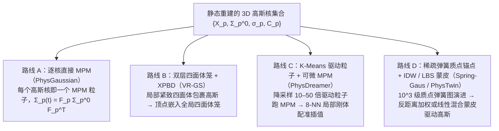

# 物理集成 3D 高斯与连续介质仿真

三维高斯溅射（3D Gaussian Splatting，3DGS）用一组显式的三维各向异性高斯核 $\{\mu_p, \Sigma_p, \sigma_p, C_p\}$ 表征场景辐射场。与隐式神经辐射场（NeRF）相比，3DGS 的拉格朗日粒子属性使其天然适合与物质点法（MPM）、扩展位置动力学（XPBD）或三维弹簧质点系统（Spring-Mass）耦合，实现**“所见即所仿（What You See Is What You Simulate，$\text{WS}^2$）”**的物理真实运动合成、材料参数系统辨识（System Identification）与机器人柔性物体数字孪生（Real2Sim）。

本页提炼自 [[physgaussian-physics-integrated-3d-gaussians-for-generative-dynamics|PhysGaussian]]（及其 [[physgaussian-repository|开源代码]]）、[[pac-nerf-physics-augmented-continuum-neural-radiance-fields|PAC-NeRF]]、[[vr-gs-physical-dynamics-aware-interactive-gaussian-splatting|VR-GS]]、[[spring-gaus-reconstruction-and-simulation-of-elastic-objects|Spring-Gaus]]、[[physdreamer-physics-based-interaction-with-3d-objects|PhysDreamer]]、[[gic-gaussian-informed-continuum-physical-property-identification|GIC]] 与 [[phystwin-physics-informed-reconstruction-and-simulation-of-deformable-objects|PhysTwin]] 的共享数学结构与工程机制。

## 1. 核心架构光谱：物理自由度如何绑定到 3D 高斯核？

尽管所有工作都以 3DGS 作为最终光栅化渲染原语，但由于单物体或单场景往往包含 $10^5 \sim 10^6$ 个高斯核，**直接在每个高斯核上求解物理 PDE** 与 **通过稀疏物理代理驱动高斯核** 构成了四类不同的耦合机制：

| 耦合架构 | 代表来源 | 物理求解器与自由度规模 | 高斯中心 $\mu_p(t)$ 与协方差 $\Sigma_p(t)$ 更新法则 | 优势与适用边界 |
| --- | --- | --- | --- | --- |
| **逐核直接连续介质 MPM** | [[physgaussian-physics-integrated-3d-gaussians-for-generative-dynamics|PhysGaussian]]、[[physgaussian-repository|Code]] | 显式 APIC-MPM，$10^5$ 级粒子 + $50^3 \sim 200^3$ 网格 | $\mu_p(t) = \phi(X_p, t)$；$\Sigma_p(t) = F_p \Sigma_p^0 F_p^T$ 或率形式增量更新 | 无需建网，天然支持大变形、塑性、沙土坍塌与撕裂；但百万核场景单帧需 $112\text{--}390\text{ ms}$，且逐核反演物理参数自由度过高 |
| **双层四面体笼 + XPBD** | [[vr-gs-physical-dynamics-aware-interactive-gaussian-splatting|VR-GS]] | 有限元应变能约束 XPBD，$1\text{万}\sim 3\text{万}$ 网格顶点 | 局部四面体 4 顶点由全局笼重心插值，算出平滑 $F_{\text{local}}$ 更新 $\Sigma_p = F_{\text{local}}\Sigma_p^0 F_{\text{local}}^T$ | 比 PhysGaussian 快 $6.6\text{--}18.6\times$（单帧 $17\text{--}22\text{ ms}$），支持百万核 VR 实时交互；但受固定拓扑笼网格限制，不支持流体/沙土溃散 |
| **K-Means 驱动粒子 + 可微 MPM** | [[physdreamer-physics-based-interaction-with-3d-objects|PhysDreamer]] | 可微 Fixed-Corotated MPM，驱动粒子数为高斯数的 $1/50 \sim 1/10$ | 8 个最近邻驱动粒子做局部 Procrustes 刚体配准 $(R_{\text{sim}}, t_{\text{sim}})$，$\Sigma_p^t = R_{\text{sim}}\Sigma_p^0 R_{\text{sim}}^T$ | 大幅降低可微 MPM 反向传播的显存与计算成本，使穿过 768 子步蒸馏三平面材料场 $E(\mathbf{x})$ 成为可能 |
| **稀疏弹簧质点 + IDW / LBS** | [[spring-gaus-reconstruction-and-simulation-of-elastic-objects|Spring-Gaus]]、[[phystwin-physics-informed-reconstruction-and-simulation-of-deformable-objects|PhysTwin]] | 3D Spring-Mass，$N_A \approx 2048$ 个质点 | Spring-Gaus 用 IDW 纯平移 $\mu_i^{t+1}$；PhysTwin 用 8-NN 质点求解局部旋转并做四元数 LBS 蒙皮 | 无需预设连续介质本构类别，支持逐锚点/逐弹簧异质刚度反演与 57 FPS 实时机器人规划；但仅限弹性/准弹性可变形体 |

## 2. 3D 高斯在变形场中的运动学推导

设静态 3DGS 中第 $p$ 个高斯核在初始物质空间 $\Omega^0$ 的中心为 $X_p$、协方差矩阵为 $A_p = R_p^0 S_p^0 (S_p^0)^T (R_p^0)^T$、不透明度为 $\sigma_p$、球谐系数为 $C_p$。

### 2.1 一阶局部仿射近似与协方差变形

当物体经连续变形映射 $x = \phi(X, t)$ 运动到世界空间 $\Omega^t$ 时，非线性映射下的精确核函数不再是高斯分布。[[physgaussian-physics-integrated-3d-gaussians-for-generative-dynamics|PhysGaussian（§3.4，式 6–8）]] 在每个核中心 $X_p$ 处对 $\phi(X, t)$ 取一阶泰勒展开（局部仿射近似）：

$$\tilde{\phi}_p(X, t) = x_p(t) + F_p(t)(X - X_p), \qquad F_p(t) = \nabla_X \phi(X_p, t).$$

将 $X - X_p = F_p^{-1}(x - x_p)$ 代入初始高斯指数项 $-\frac{1}{2}(X - X_p)^T A_p^{-1}(X - X_p)$，立即得到变形后世界空间的高斯协方差矩阵：

$$a_p(t) = F_p(t)\,A_p\,F_p(t)^T.$$

**两个直接推论：**

1. **为什么仅平移或刚性旋转高斯核会在拉伸时破裂？** 若令 $a_p(t) = A_p$（Fixed Covariance）或仅用极分解旋转部分 $R_p$ 令 $a_p(t) = R_p A_p R_p^T$（Rigid Covariance），则当局部发生面积/体积拉伸（$\sigma_{\max}(F_p) > 1$）时，核中心间距变大但椭球半径不变，相邻高斯核之间必然裂开空隙（[[physgaussian-physics-integrated-3d-gaussians-for-generative-dynamics|PhysGaussian 图 5]]）。
2. **为什么需要各向异性正则化与双层嵌入？** 若静态重建出的初始高斯核存在极端细长针状核（$\max(S_p)/\min(S_p) \gg 1$），一旦 $F_p$ 含有局部剪切或跨四面体单元的分段常数跳变，$F_p A_p F_p^T$ 会将该长轴急剧放大并刺出物体表面。静态训练时施加轴比约束 $\mathcal{L}_{\text{aniso}}$（[[physgaussian-physics-integrated-3d-gaussians-for-generative-dynamics|PhysGaussian 式 12]]）、限制各向同性高斯（[[spring-gaus-reconstruction-and-simulation-of-elastic-objects|Spring-Gaus]]、[[gic-gaussian-informed-continuum-physical-property-identification|GIC]]、[[phystwin-physics-informed-reconstruction-and-simulation-of-deformable-objects|PhysTwin]]）或采用局部—全局双层四面体平滑（[[vr-gs-physical-dynamics-aware-interactive-gaussian-splatting|VR-GS]]），都是为了抑制这一数值伪影。

### 2.2 球谐函数旋转与无总变形梯度 $F_p$ 的率形式更新

- **球谐视线逆旋转：** 对 $F_p$ 做极分解 $F_p = R_p S_p$（在 [[physgaussian-repository|PhysGaussian 源码]]中通过 $F_p = U \Sigma V^T \implies R_p = U V^T$ 并修正行列式正负号实现），将相机指向粒子的单位视线向量 $d$ 变换为 $R_p^T d$ 后再求值球谐基函数 $f_t(d) = f_0(R_p^T d)$，即可在不修改底层 CUDA 光栅化器 SH 基的前提下令高光随物体表面一起旋转。
- **速度梯度率形式更新：** 当模拟流体或大塑性变形而不显式维护总变形梯度 $F_p$ 时，利用欧拉网格速度梯度 $\nabla v_p$ 按率形式 $\dot{a}_p = (\nabla v_p)a_p + a_p(\nabla v_p)^T$ 增量更新协方差：
  $$a_p^{n+1} = a_p^n + \Delta t\bigl(\nabla v_p a_p^n + a_p^n (\nabla v_p)^T\bigr).$$

## 3. 跨越“视觉表面空壳”与“体积物理实体”的鸿沟

多视角图像只能观测到不透明物体的外表面，因此标准 3DGS 训练出的高斯核天然聚集在薄壳表面，内部是空腔；同时底部接触面或手部遮挡区往往缺失。要将其转化为物理可仿真的三维体积，文献发展出三代内部填充与几何补全方法：

| 方法 | 核心算法 | 依赖条件与优缺点 |
| --- | --- | --- |
| **不透明度场六向射线搜索 + 奇偶计数**（[[physgaussian-physics-integrated-3d-gaussians-for-generative-dynamics|PhysGaussian]]、[[physgaussian-repository|Code]]、[[vr-gs-physical-dynamics-aware-interactive-gaussian-splatting|VR-GS]]） | 将高斯不透明度体素化为 $d(x)$，对空网格先检查 6 个轴向射线是否均击中高密度表面（条件 1），再沿单方向统计穿越表面次数是否为奇数（条件 2） | 纯几何启发式、速度快（Taichi 核数秒完成）；但对表面高斯分布噪声敏感，需手工调节 `density_threshold`、`search_threshold` 与 `boundary` 框 |
| **多视角深度过滤 + 由粗到细迭代密度场**（[[gic-gaussian-informed-continuum-physical-property-identification|GIC 算法 1]]） | 先用各视角高斯渲染深度图 $\tilde{D}_i$ 过滤出位于所有视角表面后方的内部点 $P_{\text{in}}$，再经 4 轮“2 倍上采样 $\to$ 均值滤波平滑 $\to$ 粒子占据体素重置为 1”提取连续体与表面 | 兼顾内部连通性与精细表面边界（避免均值滤波腐蚀表面），无需手工调射线方向；但仍需环绕物体的多视角（如 10–11 视角）覆盖 |
| **单图 3D 生成先验（TRELLIS）+ SuperGlue/PnP/ARAP 配准**（[[phystwin-physics-informed-reconstruction-and-simulation-of-deformable-objects|PhysTwin]]） | 从单张分割前景图用 TRELLIS 生成完整水密网格，经球面虚拟相机 SuperGlue 2D 匹配、PnP 位姿精化、射线深度尺度对齐与 ARAP 非刚性配准贴合实测 RGB-D 点云 | 在仅 **3 个固定 RGB-D 视角且存在严重手部遮挡**的真实机器人操作台下仍能恢复完整背面与内部体积；依赖预训练 3D 生成先验的类别泛化能力 |

## 4. 逆问题：如何从视觉观测或视频先验辨识物理参数？

这批工作与 [[SystemIdentificationForSimulation|系统辨识]] 和 [[DifferentiablePhysics|可微物理]] 直接交汇，揭示了从视觉反演连续介质/弹簧参数的四个关键机制：

1. **分阶段解耦优化（几何 $\to$ 初速度 $\to$ 本构参数）：** 几乎所有方法（[[pac-nerf-physics-augmented-continuum-neural-radiance-fields|PAC-NeRF]]、[[spring-gaus-reconstruction-and-simulation-of-elastic-objects|Spring-Gaus]]、[[physdreamer-physics-based-interaction-with-3d-objects|PhysDreamer]]、[[gic-gaussian-informed-continuum-physical-property-identification|GIC]]）都严格避免从零同时优化几何、初速度 $v_0$ 和材料刚度 $E$。标准流程是：先锁定静态/动态几何，再用碰撞或外力作用前的**最初 2–3 帧**单独辨识初始速度场 $v_0$，最后冻结 $v_0$ 在长序列上反演本构参数（杨氏模量 $E$、泊松比 $\nu$、屈服应力 $\tau_Y$、摩擦角 $\theta_{\text{fric}}$、黏度 $\mu$ 等）。
2. **为什么大变形下“2D 掩码 + 3D 表面”优于直接比对 RGB 像素？** 在小幅振动（如 [[physdreamer-physics-based-interaction-with-3d-objects|PhysDreamer]] 的花朵微晃）中，直接最小化渲染 RGB 与参考视频的 $\mathcal{L}_1 + \mathcal{L}_{\text{D-SSIM}}$ 损失非常有效；但在经历剧烈挤压、撕裂或流体飞溅（如 [[gic-gaussian-informed-continuum-physical-property-identification|GIC §5.1]] 的橡皮泥与流体）以及跨时间光照变化的真实拍摄（[[spring-gaus-reconstruction-and-simulation-of-elastic-objects|Spring-Gaus]] 式 19）中，静态外观在大变形下的纹理扭曲与曝光漂移会产生错误的色彩梯度。此时用高斯引导连续体渲染 **2D 物体掩码（Mask）** 配合 **3D 提取表面 Chamfer 距离**（[[gic-gaussian-informed-continuum-physical-property-identification|GIC 式 6]]）或 **CoTracker3 三维跟踪点损失**（[[phystwin-physics-informed-reconstruction-and-simulation-of-deformable-objects|PhysTwin 式 3]]），能显著提升参数辨识精度。
3. **非可微拓扑与稠密刚度的“零阶 + 一阶”协同（[[phystwin-physics-informed-reconstruction-and-simulation-of-deformable-objects|PhysTwin]]）：** 弹簧连接半径、邻居数上限等离散结构参数无法求导，而数万根弹簧的异质刚度又无法仅靠零阶采样搜索。先用 CMA-ES 零阶优化确定拓扑超参数与均质刚度初值，再用可微物理一阶梯度精化稠密异质刚度，在重建与未来预测上显著优于任一单一优化器（PhysTwin 表 3）。
4. **当没有真实交互视频时：蒸馏视频扩散模型先验（[[physdreamer-physics-based-interaction-with-3d-objects|PhysDreamer]]）：** 利用图生视频模型生成受扰动参考视频，再通过可微 MPM 反演三平面材料场 $E(\mathbf{x})$，为仅有静态扫描的 3DGS 资产赋予合理的交互刚度分布。

## 5. 来源支持的失效情形与工程实践含义

- **空壳坍塌（Hollow-Shell Collapse）：** 未做内部填充直接对表面 3DGS 运行体积 MPM，物体在重力下必然瘪塌（[[physgaussian-physics-integrated-3d-gaussians-for-generative-dynamics|PhysGaussian 图 6]]）。
- **细长核毛刺与跨单元畸变（Spiky / Burr Artifacts）：** 缺少各向异性正则化或直接将跨界高斯核单层嵌入单个四面体，会在大扭转/拉伸时产生尖刺伪影（[[physgaussian-physics-integrated-3d-gaussians-for-generative-dynamics|PhysGaussian 图 8]]、[[vr-gs-physical-dynamics-aware-interactive-gaussian-splatting|VR-GS 图 3]]）。
- **网格加密反而变软（Overly Soft Artifacts under Fixed Solver Budget）：** 在实时 XPBD 仿真中，若将四面体笼加密到数十万单元却受帧率限制无法增加迭代次数，约束不收敛会导致物体表观刚度严重下降（[[vr-gs-physical-dynamics-aware-interactive-gaussian-splatting|VR-GS §6.1]]）。
- **大变形放大高斯尺度糊弄渲染损失：** 动态 3DGS 在拟合流体或沙土大变形时若不加尺度正则化 $\mathcal{L}_1(s(t))$，网络会放大高斯核半径掩盖几何误差（[[gic-gaussian-informed-continuum-physical-property-identification|GIC 附录 A.1.2]]）。
- **长时域 MPM 反向传播的显存爆炸与梯度消失：** 帧间数百个 MPM 子步（如 $\Delta t \approx 4\times 10^{-5}\text{--}10^{-4}\text{ s}$）直接展开反传会导致显存溢出与梯度病态，需结合状态检查点重计算（checkpointing）、驱动粒子降采样与帧间梯度截断（[[physdreamer-physics-based-interaction-with-3d-objects|PhysDreamer §4.2–5.2]]）。
- **主观视觉偏好不等同于物理真值：** MPM 网格数值阻尼会使薄叶片运动变慢变平滑，人类受试者可能以 86% 比例认为其比真实视频“更自然”（[[physdreamer-physics-based-interaction-with-3d-objects|PhysDreamer §5.3]]）；用于机器人操作与抓取时，必须像 [[gic-gaussian-informed-continuum-physical-property-identification|GIC（§5.3）]] 与 [[phystwin-physics-informed-reconstruction-and-simulation-of-deformable-objects|PhysTwin（§5.2–5.3）]] 那样通过三维点云误差、跟踪点误差以及真机夹爪闭合形变/运动规划闭环来独立验证。
