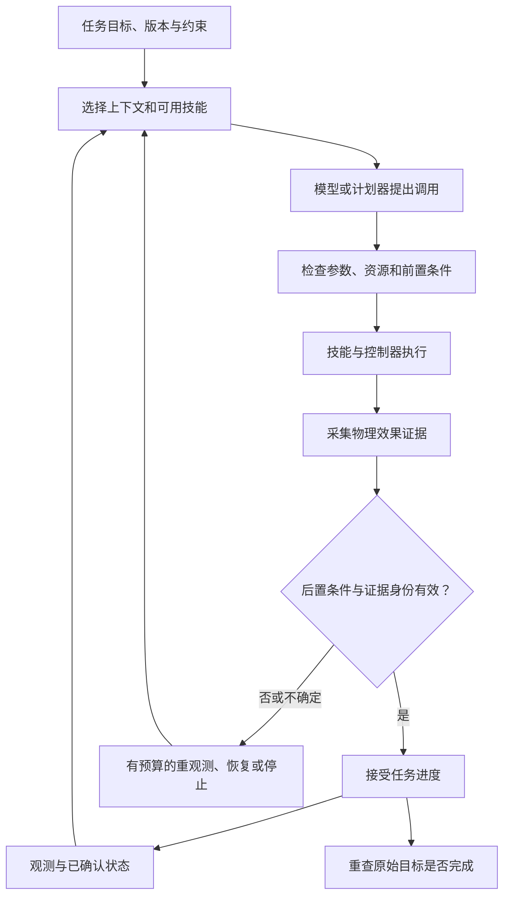

# 机器人 Harness

机器人 Harness 是围绕模型、技能和控制器组织任务执行与反馈的系统层：把任务条件变成可调用接口，提供恰当的观测与记忆，监督执行，验证物理效果，再决定继续、恢复或结束。这是依据 [[gap-graph-as-policy|GaP]]、[[regenharness-evidence-gated-self-improvement|RegenHarness]] 与 [[robofoundry-system-as-policy|RoboFoundry]] 提炼的共同口径；各论文用词范围不同，并不存在统一标准接口。通用的历史、上下文和状态基础见 [[AgentHarness|Agent Harness]]。

## 三个需要分开的层次

| 层次 | 主要问题 | 代表机制 |
| --- | --- | --- |
| 执行 Harness | 这次任务如何调用能力、确认效果、处理失败？ | [[gap-graph-as-policy|技能图]]、[[regenharness-evidence-gated-self-improvement|证据提交门]]、[[nvlabs-aspire-repository|System 2 原生 MCP 紧凑终端反馈]] |
| 改进 Harness | 下一版策略／系统如何生成、测试和保留？ | [[aspire-agentic-skills-discovery-for-robotics|原语级多模态追踪 + 演化搜索]]、[[nvlabs-aspire-repository|盲测技能验证器（Skill Verifier）]]、[[enpire-agentic-robot-policy-self-improvement|真实实验循环]]、[[racap-evolvable-robot-learning|候选配对比较]] |
| 低层控制与约束 | 指令如何及时作用到机器人，哪些约束必须始终满足？ | 连接器、轨迹执行、限位、碰撞与力反馈；高频交互例子见 [[kpi-promptable-kernel-physical-interaction|KPI]] |

同一项目可覆盖多个层次；不能把外层语言推理速度等同电机控制频率。Harness 也不必训练模型：它可以调用冻结的 [[VisionLanguageActionModels|VLA]]、传统规划器和固定控制器，把学习留给技能库或上下文规则。

## 从动作请求到可信进度

以下是依据 RegenHarness 与 GaP 的教学结构图，不是任何单篇论文的完整实现：

物理动作常是异步且有副作用的：收到请求、规划完成、控制器停止都可能正常返回，却不表示杯子已在抽屉里。因而需要把“提出效果”与“观测到效果”分开，证据要带任务、尝试、状态版本、时间戳和坐标系；旧尝试的成功不能授权新任务继续。[[regenharness-evidence-gated-self-improvement]]

一个可复用技能契约至少应说明输入／输出、坐标单位、前置条件、期望效果、资源占用、超时和取消语义、证据要求与恢复预算。这是综合工程建议。它的作用不是让文本描述自动保证正确，而是使调度器、验证器和操作者可以检查同一组条件。真实例子见 [[gap-runtime-repository|GaP 接口与检查点]]。

## 模块化究竟节省了什么

技能图把全任务分成局部生成和可定位的失败；共享技能接口把对象中心与末端目标转换封装起来；上下文规则使模型只看到当前阶段所需的信息。这些分别减少接口混乱、重复几何估计与历史污染，但收益依赖既有工具能力和调用约定。[[gap-graph-as-policy|GaP]] 与 [[robofoundry-system-as-policy|RoboFoundry]] 给出不同改进面，不能仅把提示变长就称作更强 Harness。

状态存储也不是环境回滚。机器人已经松手，恢复旧日志不能让物体自动回到夹爪；跨崩溃重发需要后端去重，资源释放需要真正停止的确认。RegenHarness 明示其取消返回即停止的假设，提醒实现者检查物理后端是否满足。[[regenharness-evidence-gated-self-improvement]]

## 验证强度要沿证据链检查

| 检查 | 能支持什么 | 不能自动支持什么 |
| --- | --- | --- |
| 图结构／类型检查 | 引用、连接及部分接口约束合法 | 轨迹可达、抓持稳定、对象关系正确 |
| 仿真状态检查点 | 该仿真状态满足配置中的谓词 | 仿真与现实一致，或谓词等同真实目标 |
| 同模型视觉自检 | 多一个可疑失败检测信号 | 与计划器独立的语义真值 |
| 身份与版本绑定 | 证据确实属于这次决策 | 传感器本身没有错 |
| 独立物理验收 | 指定条件下的实际结果 | 未测环境下的无限可靠性 |

表格是综合解释。[[gap-runtime-repository|GaP 固定代码]] 的检查点在无仿真真值接口时跳过，告警模式也继续执行；[[regenharness-evidence-gated-self-improvement|RegenHarness]] 则规定无足够证据不接受可信进度。[[nvlabs-aspire-repository|NVlabs/ASPIRE v1.0 实现]] 进一步给出两项具体工程实践：一是在仿真侧通过 AST 沙盒与 `ToolRegistry` 彻底剥离生成代码对特权状态（`qpos`、`reward`、`success`）的访问，同时在主机侧绑定仅对评测器可见的特权协议见证器（如检查双臂锤柄接触与交接完成的 `RobosuiteBimanualProtocolEvaluator`）；二是在真机双臂 YAM 的药瓶装药拧盖任务中，显式要求智能体区分“药片入瓶”、“瓶盖入扣就位（seated）”与无力矩传感器下不可妄称的“瓶盖拧紧（snug）”。不同系统的检查服务于不同用途，字段同名不意味着验收强度相同。

评测应固定模型、后端、任务与预算，分别记录物理成功、误报完成、恢复成本、人工介入、重复调度和耗时。若还更新配置，应另分冻结前后和在线累计表现；若更新生成更新的方法，则进入 [[PhysicalRecursiveSelfImprovement|Physical RSI]] 的证据问题。具体比较与未解问题见 [[topics/robot-harness-and-physical-rsi|研究专题]]。
