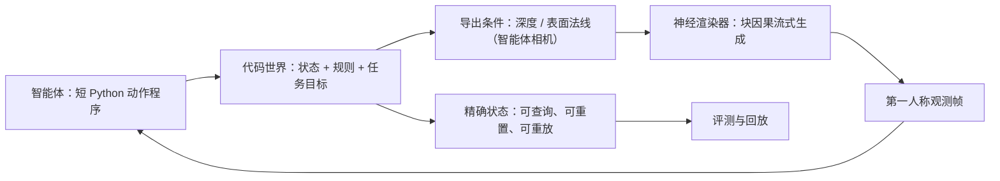

# AgentGarten：代码世界与实时神经渲染器

## 一屏概览

**研究问题。** 智能体通过交互学习，但“能学到什么”受限于它练习的环境。环境要同时满足两个条件：**faithful**（状态、规则、动力学一致，动作后果可信）与 **realistic**（观测落在真实世界的视觉分布里）。纯代码世界 faithful 但画面简陋；纯视频世界模型 realistic 但状态藏在生成历史里，难以查询和编辑。AgentGarten 的分工是：**代码世界决定世界怎样变，神经渲染器学习它看起来怎样**。

**系统。** 模拟器或游戏引擎维护持久状态、执行程序化规则，把智能体相机视角下的深度/表面法线导出为条件；一个共享的实时神经渲染器把这些几何条件变成第一人称观测。渲染器基于 Cosmos3-Nano，经三阶段训练：几何条件化、块因果自回归、Adversarial Forcing 少步蒸馏。单张 H100 上 480×832 输出达到 **36.5 帧/秒**，一个 16 帧块约 **438.8 ms**。

**智能体循环。** 一轮 = 读 `task.md`（只给目标、动作、限制，不给解法）→ 多个智能体在固定步数/时间内并行玩（只看相机帧，不给坐标、地图或分数）→ 写 `playbook.md`（试了什么、看到什么、还不确定什么、下一步测什么）→ 冻结归档；下一轮的新智能体在全新对话里继承这些 playbook。

**结果。** 在 hide-and-seek 中，只通过神经渲染器看第一人称帧的预训练智能体（GPT-6 Astra），**第 4 轮**学会用挡板搭掩体、**第 10 轮**学会搬斜坡翻墙；2019 年从零自对弈 RL 的对应里程碑约为 **2,500 万**与 **1 亿**个训练回合。另外四个世界各跑四轮：陪伴狗互动分 13→19，单车道桥对向通行 71→41 秒，牧羊 60→88.3，采石场装载 30→90.9。作者明确说这不是样本效率比，而是两种学习范式的对照。

**版本。** MirroS、清华大学、北京大学；Jiawei Chi、Shangchen Miao、Zhiyuan Shi、Kailu Wu、Hanyang Wang 等，Jiangran Lyu、Jialong Wu、Fangfu Liu 为项目负责人；arXiv `2610.12374v1`，2026-10-08，26 页；代码开源，渲染器权重见仓库 README 的 Hugging Face 链接。

## 架构：状态与外观分开

论文把这套接口写成两式：

$$
(s_{t+1},\pi_{t+1})=f_p(s_t,\pi_t,a_t),\qquad c_t=h_p(s_t,\pi_t),\qquad x_t=R_\theta(x_{<t},c_{\le t},x_0,y),
$$

其中 $s_t$ 是代码世界状态，$\pi_t$ 是任务进度，$a_t$ 是动作，$f_p$ 是规则；$c_t$ 是相机几何条件，$R_\theta$ 是渲染器，$x_0$ 是参考帧，$y$ 是文本。关键在 $f_p$ **不接收渲染观测**：渲染误差不会进入状态，录制的状态轨迹可以用不同参考帧或相机重渲而不改变事件。

图为依据论文 Figure 1 与 §2 重画，不是原文插图。关键点是**动作先改变代码世界，渲染器只负责外观**：智能体做一个短动作，代码世界更新状态并导出新的几何条件，渲染器生成下一段观测；智能体看到后果后再决定下一步。因此未来条件依赖智能体对已见观测的回应，而不是预先给定的一整段视频。

条件选深度/法线，而不是 RGB 或文本，原因是获取成本：仿真器可以直接导出；真实视频可以用深度估计器（ViPE）与法线估计器（NormalCrafter）估计；推理时任何有 3D 场景的代码世界都能廉价渲染。代价是几何条件不包含全部状态：一个旋转对称的物体可以自转而不改变深度/法线，材质、颜色、身份也不由几何决定。

## 渲染器：三阶段训练

**阶段 1：几何条件化。** 从 Cosmos3-Nano 出发（视频流 36 层 Transformer、隐藏宽度 4096、32 个 query 头、8 个 KV 头），分离冻结的文本塔与可训练的视频塔；只更新自注意力投影、q/k norm 与条件嵌入，让模型接受深度/法线条件；Wan 视频 VAE 保持冻结（时间压缩 4×、空间 16×）。条件 token 与 RGB token 共享 Transformer 与 RoPE，经 4× 池化后每个 latent 帧约 28 个 token，模态嵌入零初始化，且不加扩散时间步；模型只预测含噪 RGB 的速度。训练窗口先 5 秒（81 帧 = 1 参考 + 20 个 latent，5 个目标块），再 15 秒（241 帧 = 1 参考 + 60 个 latent，15 个目标块），时间栅格按 16 fps。

**阶段 2：块因果自回归。** 把参考帧之后的 latent 切成固定长度的块，每块只能看参考、已完成的块与自己的几何条件。训练时用同一 Transformer 的两份拷贝：干净的 $P_j$ 表示历史，带噪的 $Q_j$ 被去噪：

$$
P_j \to A_0 \cup P_{\le j},\qquad Q_j \to A_0 \cup P_{<j} \cup Q_j .
$$

带噪块能看到干净的历史块，但在块内双向、且永远看不到自己的干净目标；因此所有目标块可以并行训练，各自采样流时间。损失是流匹配：

$$
\mathcal{L}_{\text{TF}}=\mathbb{E}\left[\frac1M\sum_{j=1}^{M}\left\|v_\theta(z_{j,t_j},t_j\mid z_{<j},\mathcal{C})-(\epsilon_j-z_j)\right\|_2^2\right],
$$

其中 $z_{j,t_j}=(1-t_j)z_j+t_j\epsilon_j$，$\mathcal{C}=(x_0,y,c)$ 是参考帧、文本与条件。

**阶段 3：Adversarial Forcing。** 把教师模型蒸馏成少步渲染器，同时在自己的 rollout 上训练。三个部件：

1. **分布匹配（DMD）**：学生从阶段 2 初始化，少步生成每块；冻结的阶段 1 教师给整段打分，辅助 fake-score 模型学习学生分布。学生目标为
$$
g=\frac{f_\psi(y_\tau,\tau\mid\mathcal{C})-f_T(y_\tau,\tau\mid\mathcal{C})}{a},\qquad
\mathcal{L}_{\text{DMD}}=\mathbb{E}\left[\frac1{2N}\|\tilde z_\theta-\operatorname{sg}(\tilde z_\theta-g)\|_2^2\right].
$$
2. **精确重放（exact replay）**：标准 Self Forcing 把已生成块写进 detached KV cache，后续损失只监督“从 cache 预测”，不监督“写 cache 的历史编码”。两遍训练：第一遍无梯度 rollout，记录每块输入 $U_j$ 与干净输出 $Z_j$；第二遍在计算图内重算历史 K/V，但用与 rollout 相同的 SDPA 核、相同 K/V 顺序与调用形状，逐块执行。结果 replay 与 rollout **逐位相同**；SGF 风格的全序列 FlexAttention replay 有 **3.99%** 相对 L2 误差。代价很小：replay 前向 2.79 s vs 2.95 s（−5.4%），峰值显存 50.92 GiB（+0.2%）。
3. **真实数据对抗 + 精确 R1/R2**：DMD 只比较教师与 fake-score 在生成样本上的估计，没有直接对比真实视频；加一个可训练判别头聚合冻结教师中间特征，并用前向-反向（JVP）计算精确的 R1/R2 正则，避免近似正则带来的偏差。

**实时执行。** 手写 Triton 核融合 RMSNorm、RoPE、门控激活，CUDA graph 捕获消除启动开销，蒸馏的小解码器把 VAE 解码压到 10 ms 内；一个 16 帧块的总墙钟时间 438.8 ms（条件编码 10.6 ms、四步去噪与 cache 发布 414.4 ms、解码与主机传输 8.8 ms），吞吐 36.5 帧/秒。交互部署通过 WebRTC 把帧流给浏览器或智能体，队列有界。

## 世界与智能体实践

**hide-and-seek。** 序贯一藏一找：藏者先布置场景，再交给找者；双方只接收神经渲染器生成的第一人称帧，动作是短 Python 程序（移动、转向、抓取、放置），从不接收物体坐标、隐藏状态或对手私有观测。每轮 5 局，布局与种子采样；每轮结束后各自回看自己的动作程序与被允许看的视觉证据，把失败与成功都写成 skill 文件（一个文件一条经验，Markdown，可含代码）。下一轮的新智能体在全新对话里拿到累积的 skill，自己判断当前场景该用哪条。

**另外四个世界。** 每个世界有自己的动作、时限与评分，各跑四轮，每轮一个 episode：

| 世界 | 目标 | 度量 | 第 1 轮 → 第 4 轮 |
| --- | --- | --- | --- |
| 陪伴狗 | 60 秒内让狗舒适且愿意互动 | engagement score | 13 → 14 → 19 → 19 |
| 单车道桥 | 两车对向通过仅容一车的桥，120 秒内 | 两车都到达的秒数（越低越好） | 71 → 41（68、45、41） |
| 牧羊 | 两只狗把四只羊赶进围栏并保持 5 秒 | score /100 | 60 → 88.3（90.1、87.6、88.3） |
| 采石场装载 | 推两块石头到暂存区、把一块绕墙送进料仓、停回车位 | score /100 | 30 → 0 → 30 → 90.9（末轮 329/360 秒） |

表：论文 Table 4（第 14 页）。注意每格是**一个 episode**，没有种子重复与误差棒；第 2 轮采石场得 0 分，说明过程并非单调。

hide-and-seek 的里程碑对照更醒目：挡板掩体第 4 轮、斜坡翻墙第 10 轮，对照 2019 年自对弈 RL 的约 2,500 万与 1 亿回合。论文自己加了限定：两者不是同一种学习——RL 从随机权重、用真值坐标从零学动力学与对抗；这里的预训练智能体已有物体、工具、几何的先验，难的是把先验落到闭环感知运动、只凭合成视觉诊断失败、跨轮精炼战术。所以“4 轮 vs 2,500 万回合”不能读成样本效率提升几个数量级。

**视觉质量。** 论文用 30 秒 rollout 对比 Self Forcing 与 Adversarial Forcing：前者出现重复表面纹理、细节随长度流失；后者保留自然纹理与细节（Figure 8）。这是定性比较，没有 FVD、用户偏好或逐帧指标。

## 局限与未回答的问题

作者在 Future Work 中承认的：

- **几何条件不完整。** 深度/法线无法表达旋转对称物体的自转、材质、颜色、身份；长遮挡或超出记忆窗口后，视觉历史也可能丢失这些属性。更紧凑的条件（结构化文本、隐特征）与代码世界状态的对齐仍是开放问题。
- **世界要手写。** 本报告的每个世界都是一个个写出来的；下一步才让编码智能体生成/修改世界，而且“世界是否值得智能体练”需要自动检查（任务能否从可见信息解决、粗心策略是否会失败、是否有可迁移的学习）。
- **经验规模。** 每个 playbook 只属于一个世界、短到能全文读完；跨很多世界时，哪些经验保留、合并、丢弃，如何检索，都还没有解决。

阅读后还应补上：

- **每个世界每轮只有一个 episode**（Table 4），没有重复、方差或显著性；“第 4 轮更好”可能包含布局/种子运气。
- **智能体只有 GPT-6 Astra 一个模型**，没有跨模型对照；“预训练先验 + playbook”与“RL 从零”是范式差异，不能拆出 playbook 的净贡献。
- **没有 playbook 消融**（空 playbook、只给上一轮、给全部历史、禁止写代码），因此无法判断收益来自“写下来”、来自“更多轮交互”，还是来自“模型本身更强”。
- **视觉质量没有定量指标**；实时性是在单张 H100、480×832、四步采样下测的，换分辨率、步数、消费级 GPU 后是否仍实时未知。
- **渲染器可能不忠实执行条件**：生成帧不必完美实现代码世界导出的状态；论文没有报告条件跟随误差（例如深度/法线与生成帧的一致性）。
- **不是真实机器人。** 所有世界都是代码世界，没有真实传感器噪声、执行器延迟、接触不确定性；结论不能直接外推到物理部署。

## 在知识库里的位置

AgentGarten 与 [[code-as-world-executable-world-representations|Code-as-World]] 共享“代码管状态、渲染管外观”的分工，但目标相反：Code-as-World 用发现的 EWR 生产**物理监督**（训练 VLM），AgentGarten 用代码世界生产**练习环境**（训练/演化智能体）。两者合起来，才是 MirroS 提纲里“世界模型与 Actor 共同进化”的两条腿。

它也与 [[topics/simulation-ready-worlds|Simulation-ready Worlds]] 的“可执行生成世界”相邻：[[magicsim-a-unified-infrastructure-for-executable-embodied-interaction|MagicSim]] 关心回合执行与数据对齐，AgentGarten 关心**实时视觉接口**与跨世界共享渲染器；[[embodiedgen-v2-an-agentic-simulation-ready-3d-world-engine-for-embodied-ai|EmbodiedGen V2]] 关心资产生成，AgentGarten 干脆绕过精细资产，用几何条件 + 学习渲染。差异是证据类型：前者多为系统描述与定性案例，后者给出了吞吐、重放误差与四轮行为曲线。

对 [[WorldModelEvaluation|World Model 评测]]，它提了一个尖锐问题：如果环境状态是代码，评测应该看**代码世界的真值**（动作是否改变了该改变的状态），而不是只看生成视频像不像。HarnessEval-W 的 transition correctness 是这个方向的评测侧对应物，但两者还没有接在同一世界上。

共享机制见 [[ExecutableWorldRepresentation|可执行世界表示]] 与 [[RobotHarness|机器人 Harness]]。

## 证据定位

- 摘要与贡献：第 1–2 页；架构与条件接口：第 3–4 页。
- 阶段 2 掩码与损失：第 4–5 页，Eq. 5–6；Adversarial Forcing：第 5–7 页，Eq. 7–8。
- 精确重放与开销：第 9 页 Table 1；吞吐：第 9 页 Table 2。
- hide-and-seek 设置与里程碑：第 10–11 页 Table 3；四世界结果：第 13–14 页 Table 4。
- 训练细节：附录 A，Table 5（32×H100、三阶段学习率）。
- 未来工作：第 15–16 页 §7。
