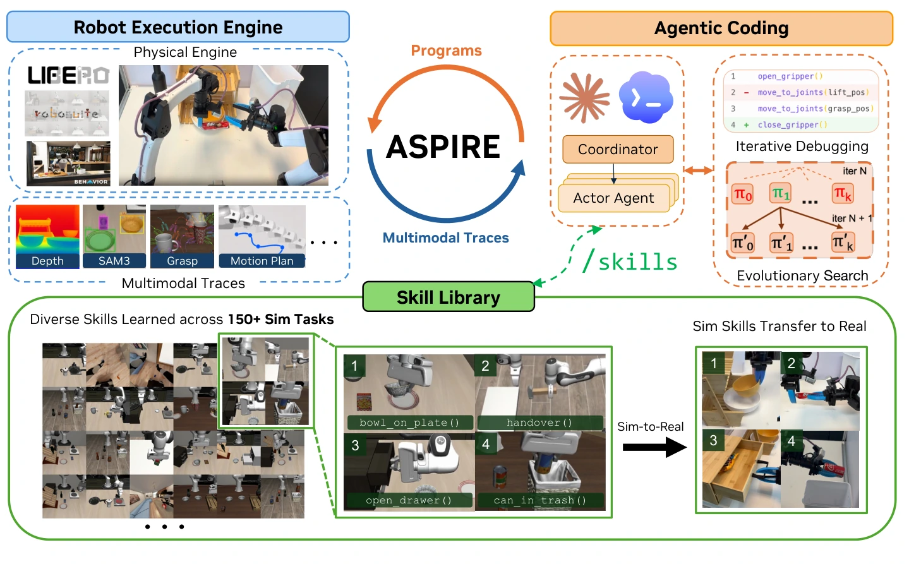
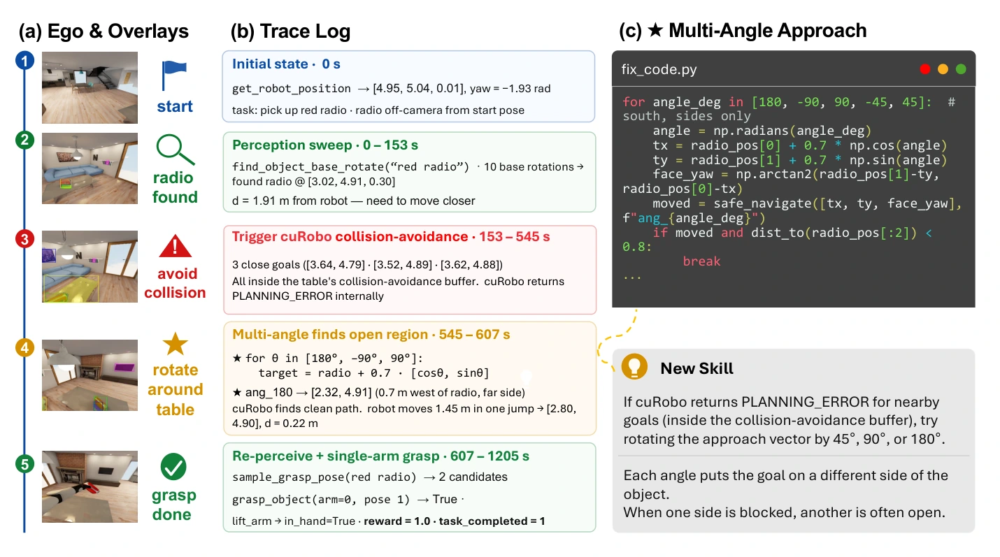
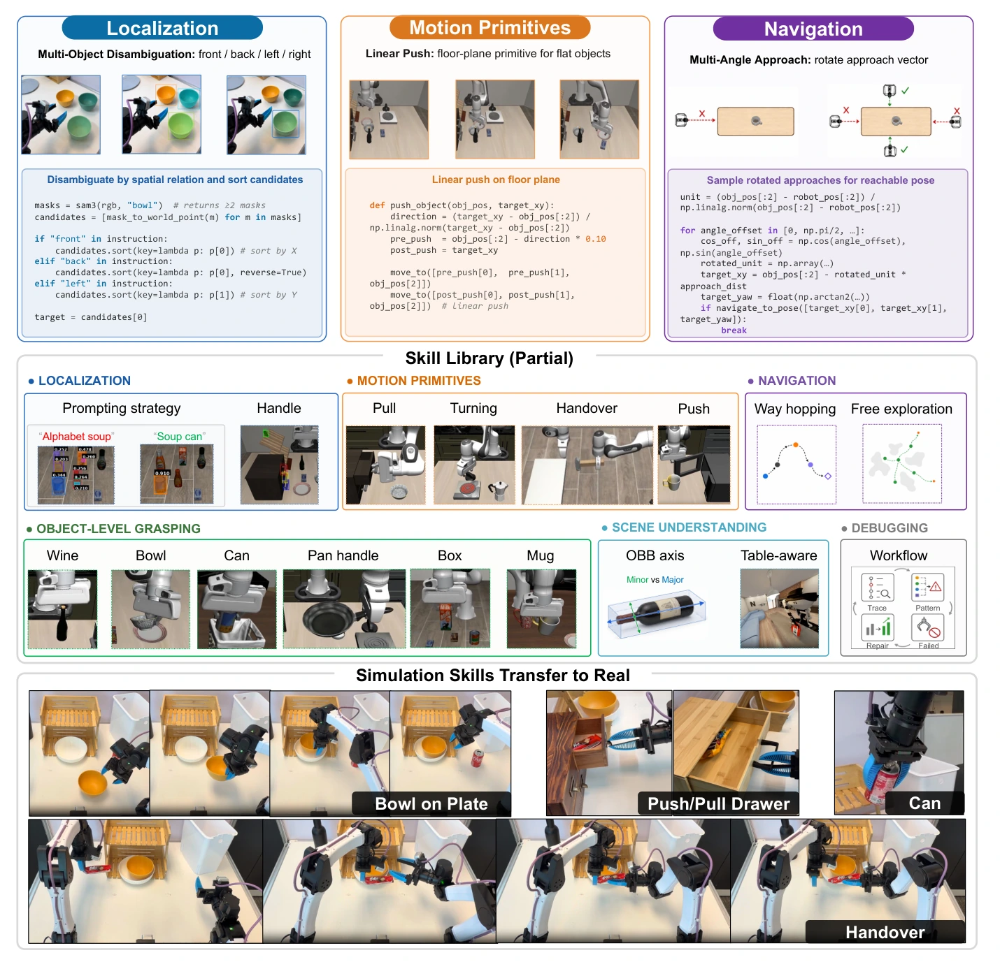
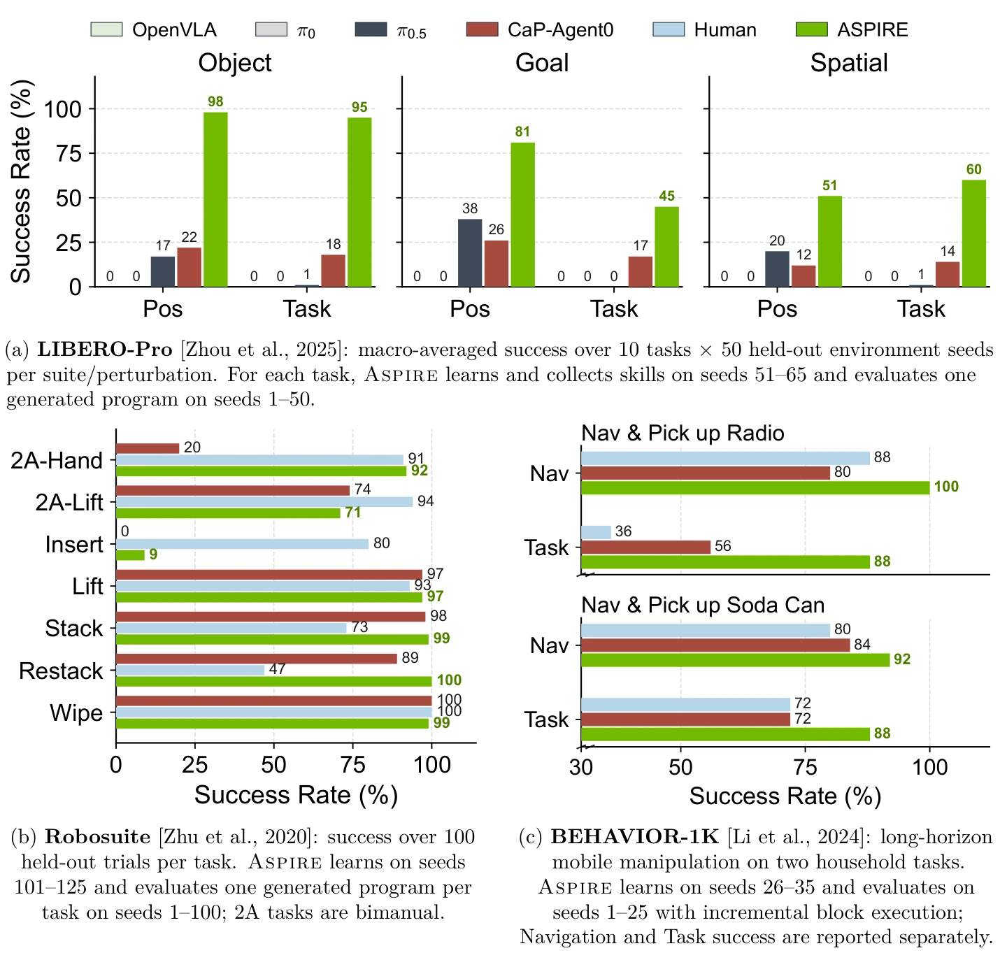
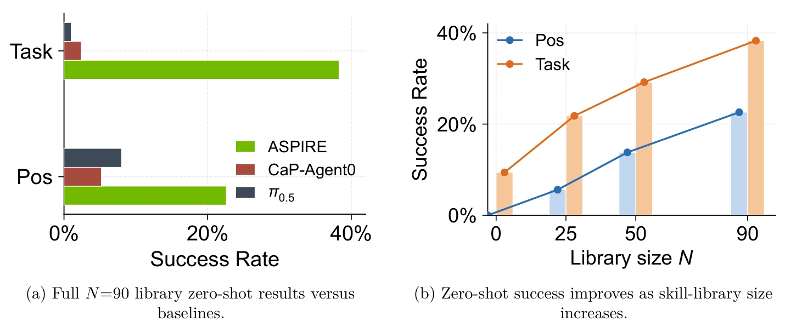
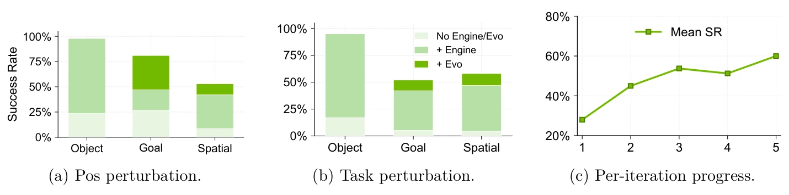

# ASPIRE：面向机器人的智能体技能发现与经验复利框架

## 一屏概览

**研究问题。** 代码即策略（Code-as-Policy，CaP）让语言模型通过组合感知、规划与控制原语来编写可执行机器人程序，但现有机器人编码智能体受困于两个根本瓶颈：一是执行环境仅返回粗粒度的任务成败信号，无法定位跨感知、抓取、运动规划与接触动力学的故障根因；二是任务间不积累经验，解决第 100 个任务时的智能体与解决第 1 个任务时一样生疏。ASPIRE（论文标题作 *Agentic /Skills Discovery for Robotics*，摘要中展开为 *Agentic Skill Programming through Iterative Robot Exploration*）将机器人的持续学习重定义为“用程序精化替代梯度下降、用传感器运动技能库（`/skills`）替代浮点权重、用多智能体并行练习不同技能替代分片小批量训练”。[论文 §1–2](https://arxiv.org/abs/2607.00272)

原文图 1：ASPIRE 系统总览。中央协调器（Coordinator）为每个任务派发一个执行智能体（Actor coding agent），实现跨任务并行学习。每个执行智能体在机器人执行引擎（Robot Execution Engine）中通过迭代调试（Iterative Debugging）精化并验证机器人程序；执行引擎暴露逐原语多模态追踪（深度图、SAM3 分割、抓取候选、运动规划轨迹等）以支持故障归因与修复。演化搜索（Evolutionary Search）采样多样化候选程序 $(\pi_0, \dots, \pi_k)$，送入引擎评测后，以幸存程序与残余故障追踪为条件生成下一代候选 $(\pi'_0, \dots, \pi'_k)$。协调器将验证通过的修复蒸馏进共享技能库（Skill Library），供后续任务作为上下文指导检索复用；从 150 余项仿真任务中学到的技能还可跨本体迁移，指导真机编程（Sim-to-Real）。来源：论文 PDF，第 2 页。[查看原始来源](https://arxiv.org/pdf/2607.00272v1#page=2)

**机构与版本。** NVIDIA（GEAR 实验室）、密歇根大学（UMich）、伊利诺伊大学厄巴纳-香槟分校（UIUC）、加州大学伯克利分校（UC Berkeley AUTOLab）与卡内基梅隆大学（CMU）联合发布；arXiv `2607.00272v1`（提交日期 2026-06-30，PDF 首页印记为 2026-07-02）。需要注意，arXiv v1 正文署名 14 位作者（Runyu Lu、Yubo Wu、Ethan Kou 等），而 2026-10 公开仓库 v1.0 的 BibTeX 增列了论文致谢中提及的 Haotian Lin 与 Jan Kautz 共 16 位作者。配套开源仓库的底层实现、沙盒与验证器机制及 `v0.1 → v1.0` 演进见 [[nvlabs-aspire-repository|NVlabs/ASPIRE 代码核查]]。

**核心贡献与实验范围。** （1）提出暴露**逐原语多模态追踪（per-primitive multimodal traces）**的闭环机器人执行引擎，使编码智能体能按需检查感知叠加图、抓取候选、规划返回码与关键帧以精确定位故障；（2）构建从归因失败与已验证修复中自发归纳的**持续增长异构技能库**，在协调器审计后以紧凑上下文指导（`/skills`）跨任务复用；（3）结合维护持久任务分析文档 $A_i$ 的**程序演化搜索**，跳出单轨迹局部修补陷阱；（4）使用 Claude Opus 4.6（1M 上下文）在 LIBERO-Pro 扰动基准上最高超越先前方法 77 个百分点，在 Robosuite 双臂交接上提升 72 个百分点（20% → 92%），在 BEHAVIOR-1K 长时域移动操作上提升最高 32 个百分点；将在 LIBERO-90 上累积的技能库零样本迁移至未见长时域 LIBERO-Pro Long 达到 30.5% 平均成功率（基线仅 3.8%–5.0%）；并在双臂 YAM 真机上验证了 Franka 仿真技能的跨本体迁移，显著降低真机自主调试 Token 消耗并解锁无技能基线 0/20 的抽屉操作任务（§1、§3）。

## 问题与设计动机：为什么机器人程序调试需要原语级证据与跨任务记忆

在机器人操作中，代码即策略（CaP）将感知模块、运动规划 API 与控制原语组合为显式 Python 程序。虽然程序天生可读、可编辑，但现有机器人编码智能体（如 CaP-Agent0）在实际闭环中面临三道障碍（§1–2）：

1. **粗粒度反馈掩盖跨子系统因果链。** 一次失败的回合只能表明最终任务谓词未满足，却无法区分根因是文本分割提示词漏检、点云包围盒估计偏斜、抓取姿态滑脱、逆运动学（IK）不可达、碰撞缓冲拒绝规划，还是下游交接/放置阶段把物体碰倒。
2. **证据过少与上下文过载的两难。** 先前方法往往依赖人工预设的场景摘要或固定观测集：信息过少会隐藏真正出错的原语调用；而若将完整视频流或全量模拟器日志全部塞入上下文，过多的原始视觉帧又会淹没导致失败的因果链。
3. **单任务闭环缺少跨任务经验复利。** 人类机器人工程师在调试失败时会回放轨迹、检查感知与规划输出、定位故障子系统，并将有效的恢复启发式（如多物体空间消歧、圆筒侧抓、薄物体平面推动、绕桌多角度导航、调试检查流）内化为可迁移工程经验；而现有智能体在单个任务调通后便丢弃修复过程，导致每次面对新任务都要从零试错。

## 系统架构与三大核心机制

ASPIRE 采用**协调器—执行器（Coordinator–Actor）**解耦架构（§2，图 1、附录 E.1–E.3）：中央协调器管理共享技能库 $\mathcal{L}$ 并按空闲计算设备向单个任务派发 Actor 编码智能体；每个 Actor 在分配的 GPU 上独立编写、执行、诊断和修复机器人程序。**Actor 之间不直接交换完整聊天历史或原始轨迹**，可迁移经验仅通过协调器审计后蒸馏入库，从而让每个 Actor 的上下文窗口聚焦于当前任务规范、当前代码与故障原语追踪。

### 1. 机器人执行引擎：逐原语多模态追踪与闭环验证（§2.1）

机器人执行引擎将每次感知、抓取、规划与控制原语调用包装为结构化追踪记录（`trace.json` 与关键帧目录）。对于每个原语调用，引擎记录调用函数名、输入参数摘要、返回值、耗时（毫秒）、执行状态以及**紧邻调用前后的 RGB/深度关键帧与视觉叠加图（overlays）**，而不向智能体灌输整段完整视频（§2.1，附录 E.2）。

同时，为保证学到的程序与技能具备真机可迁移性，系统通过 `CLAUDE.md` 与子智能体契约严格执行**特权 API 封禁规则（Forbidden APIs，附录 E.2–E.3）**：严禁生成的修复代码访问模拟器内部物理状态（如 `env.handle.env.sim`、`sim.data.body_xpos`）、隐藏成功谓词或直接读取 `.bddl`、`.xml`、`.urdf` 资产文件推断几何；所有目标指令必须从运行时 `env.task_language` 读取，所有物体定位与几何估计必须源自相机观测与公开感知原语。

原文图 2：机器人执行引擎在 BEHAVIOR-1K `navigate-and-pick-up-radio` 任务上的追踪引导调试过程。（a）第一视角关键帧与视觉叠加图显示机器人成功定位红色收音机，但多次尝试接近均告失败；（b）原语级追踪日志将失败精确定位到连续的 `PLANNING_ERROR`：候选导航目标落入桌子边缘的碰撞规避缓冲区内；（c）智能体据此为程序打补丁，加入多角度逼近例程（Multi-Angle Approach），从无遮挡一侧重新靠近并重新感知收音机，最终完成单臂抓取。验证通过的修复被接纳为可复用的 `Multi-Angle Approach` 技能。来源：论文 PDF，第 4 页。[查看原始来源](https://arxiv.org/pdf/2607.00272v1#page=4)

论文图 2 完整展示了这一机制如何避免盲目修改代码：

- **步骤 1–2（0–153 s，感知成功）：** 机器人从初始位姿 `[4.95, 5.04, 0.01]` 出发，调用 `find_object_base_rotate("red radio")` 旋转底盘 10 次，在 `[3.02, 4.91, 0.30]` 处成功检测到红色收音机（距离底盘 $d = 1.91\text{ m}$）。
- **步骤 3（153–545 s，原语追踪定位规划故障）：** 智能体连续尝试 3 个近距离导航目标（`[3.64, 4.79]`、`[3.52, 4.89]`、`[3.62, 4.88]`），均无法接近。若只看最终任务失败，智能体极易误判为感知漏检或抓取姿态错误；但查看原语追踪后发现，感知早已返回正确三维坐标，真正报错的是 `navigate_to_pose` 内部由 cuRobo 返回的 `PLANNING_ERROR`——生成的导航目标距桌面边缘不足 $20\text{ cm}$，全部落入桌子的碰撞规避缓冲区（collision-avoidance buffer）。
- **步骤 4–5（545–1205 s，针对性修复与技能蒸馏）：** 智能体保持感知与抓取代码不变，专门编写多角度逼近循环，围绕收音机以半径 $0.7\text{ m}$ 依次采样 $\theta \in [180^\circ, -90^\circ, 90^\circ, -45^\circ, 45^\circ]$ 的逼近方向；在 $\theta = 180^\circ$（收音机西侧 `[2.32, 4.91]`）处找到无碰撞路径，一次移动 $1.45\text{ m}$ 到达 `[2.80, 4.90]`（距离收音机 $0.22\text{ m}$），随后重新感知并调用 `grasp_object` 成功抓起收音机（`reward = 1.0, task_completed = 1`）。

### 2. 持续增长的异构技能库：从归因失败到上下文知识（§2.2）

跨任务重复出现的往往不是整段任务程序，而是局部的故障模式与恢复模式。ASPIRE 不预先硬编码技能分类，而是由智能体在修复调试种子并完成留出验证后，按结构化报告模板（`findings.md`，记录根因、修复方案、有效 SAM3 提示词优先级表、可泛化模式、任务特有癖性及 Stage 2 验证成功率）提交给协调器；协调器审计其可复用性与非特权 API 合规性后，将通过验证的模式写入 `.claude/skills/<name>/SKILL.md`（§2.2，附录 A、E.1–E.5）。

原文图 3：ASPIRE 技能库结构与跨本体迁移。ASPIRE 将智能体自主发现并验证通过的修复知识存储为可复用的上下文技能，而非固定的人工手写原语集。上排：代表性技能条目，涵盖多物体空间关系消歧（Localization）、平面线性推动原语（Motion Primitives）与绕障多角度导航恢复（Navigation）。中排：技能库在六个异构类别上持续扩展，包括定位、运动原语、导航、物体级抓取、场景理解与调试工作流。下排：从仿真中发现的技能作为上下文指导迁移到双臂真机，支撑跨本体编程。来源：论文 PDF，第 5 页。[查看原始来源](https://arxiv.org/pdf/2607.00272v1#page=5)

每条技能条目由四部分组成（附录 A）：**触发故障签名（Problem）**、**适用条件守卫（When to Apply）**、**修复策略与代码骨架（Strategy & Validated Snippet）**以及**首次验证该模式的来源任务（Origin Tasks）**。论文图 3 与附录 A 总结了从 150 余项仿真任务中涌现的六大类技能：

| 技能类别（§2.2、附录 A） | 典型故障签名（Problem） | 适用条件守卫（When to Apply） | 验证通过的修复策略（Strategy & Snippet） |
| --- | --- | --- | --- |
| **定位与消歧（Localization）** | SAM3 对 `"front bowl"` 等空间修饰词无序返回所有碗掩码，直接取 `masks[0]` 会静默抓错目标 | 场景含 $\ge 2$ 个同类物体，且指令含 `front` / `back` / `left` / `right` 等方位词 | 先用类别词（`"bowl"`）检出全部实例并投影至机器人坐标系三维点，再按指令方位词对坐标轴排序（`front/back` 排 $X$，`left/right` 排 $Y$）；针对同框相似物体用最小包围盒面积或 Molmo 点提示回退（附录 E.5 `localize`） |
| **导航恢复（Navigation）** | 直线逼近桌边/墙边物体触发 `PLANNING_ERROR`，或回退到 $>1\text{ m}$ 的远端路点 | `navigate_to_pose` 报错或停在 $>1\text{ m}$ 处，且目标靠近家具/墙壁边界 | 以目标为中心、半径 $d_{\text{approach}}$ 旋转逼近向量（测试 $0^\circ, \pm 90^\circ, \pm 45^\circ$），结合途经点跳跃（Waypoint Hopping）与自由空间探测 |
| **物体级策略抓取（Strategic Grasping）** | 细长圆柱体（酒瓶、高罐）用任意偏航角抓取时指爪擦碰柱面导致翻倒；抓取高度过高导致抓空（air grasp） | 高径比 $> 2.0$ 的圆柱体；闭合后夹爪宽度异常（小宽度=抓空，中等=边缘擦挂，大宽度=成功持物） | 计算点云有向包围盒（OBB），将夹爪偏航角对齐主轴（`major_axis`），采用两段式闭合（50% 试探、70% 坐实）加慢速抬升（$0.05\text{ m/s}$） |
| **运动原语（Motion Primitives）** | 厚度 $< 2\text{ cm}$ 的扁平物体夹爪无法插到底部或反复滑脱；远端工作空间直接 `goto_pose` 不可靠 | 物体高度 $< 2\text{ cm}$ 且抓放失败 $\ge 1$ 次；抽屉推拉、旋钮旋转或双臂交接 | 改用支撑面二维线性推动（在物体后方 $10\text{ cm}$ 下探至 $z_{\text{obj}}$ 后直线推向目标）；抽屉/微波炉操作后强制调用 `safe_reset_between_subtasks()` 回 Home 并等待 3 步物理沉降以防机械臂遮挡下一子任务视野 |
| **场景理解（Scene Understanding）** | 细长扁平物体（书本、煎锅）与圆柱体（酒瓶）混用同一顶视抓取朝向导致掉落 | 需要根据物体几何形状决定虎口对齐方向，或区分相近容器（酒架 vs 橱柜） | 区分 OBB 主次轴语义：酒瓶等圆柱体沿主轴（`obb.axes[0]`）抓取以跨直径闭合，书本等扁平体沿次轴（`obb.axes[1]`）抓取 |
| **调试工作流（Debugging）** | 针对单次试验偶然噪声打补丁导致严重过拟合；重放验证集种子导致基准泄漏 | 跨多个调试种子诊断失败并提炼候选入库规则时 | 按 `key = (symptom, applicability_class)` 对归因试验聚类，仅当 $\ge 2$ 个独立试验呈现同一症状时才提议入库；单个调试种子最多重放 3 次，超限写 `BLOCKED.md`；严禁在 Stage 1 触碰留出验证集种子 |

### 3. 程序演化搜索：跳出单轨迹修补的局部最优（§2.3）

单路径追踪调试容易陷入“在同一条错误策略分支上反复打补丁”的局部循环（例如当顶视抓取在运动学上不可达时，反复微调 $z$ 偏移仍会失败）。为此，ASPIRE 对单通调试后表现仍低于阈值的困难任务启动**程序演化搜索（Evolutionary Search，算法 1，附录 E.4）**。

给定任务 $\tau$、初始基线程序 $P_0$（通常取单通修复得到的 `fix_code.py`）、固定调试种子集 $S_{\text{dbg}}$、留出验证种子集 $S_{\text{val}}$、共享技能库 $\mathcal{L}$、编码智能体 $M$、搜索预算 $(K, T)$（每轮 $K$ 个候选、最多 $T$ 轮迭代）以及成功阈值 $\theta$。记一次闭环批量执行为

$$\operatorname{Execute}(P, S) = (r, Z),$$

其中 $r \in [0, 1]$ 为程序 $P$ 在种子集 $S$ 上的平均成功率，$Z$ 为对应的多模态追踪束（trace bundle）。算法 1 的完整流程如下：

1. **基线评估与历史初始化（第 1–2 行）：** 在调试集上执行初始程序 $(r^\star, Z_0) \leftarrow \operatorname{Execute}(P_0, S_{\text{dbg}})$，令当前最优程序 $P^\star \leftarrow P_0$，初始化搜索历史账本 $\mathcal{H} \leftarrow \{(P_0, r^\star, Z_0)\}$。
2. **多候选假设生成与并行评测（第 3–7 行）：** 在第 $i = 1, \dots, T$ 轮中，智能体基于历史表现最好的前 3 个程序 $\operatorname{Top3}(\mathcal{H})$、技能库 $\mathcal{L}$ 以及完整历史失败追踪 $\mathcal{H}$，生成 $K$ 个测试**不同机理假设**的候选程序：
   $$\{P_i^k\}_{k=1}^K \leftarrow \operatorname{ProposeRepairs}\bigl(M, \tau, \operatorname{Top3}(\mathcal{H}), \mathcal{L}, \mathcal{H}\bigr),$$
   并在同一组固定调试种子上逐一闭环评测：$(r_i^k, Z_i^k) \leftarrow \operatorname{Execute}(P_i^k, S_{\text{dbg}})$。
3. **跨代精英保留与早停判据（第 8–15 行）：** 将本轮结果并入账本 $\mathcal{H} \leftarrow \mathcal{H} \cup \{(P_i^k, r_i^k, Z_i^k)\}_{k=1}^K$，取本轮最优候选 $k^\star \leftarrow \arg\max_{k} r_i^k$。若 $r_i^{k^\star} > r^\star$，则更新 $(P^\star, r^\star) \leftarrow (P_i^{k^\star}, r_i^{k^\star})$；若 $r^\star \ge \theta$（在调试集上达到收敛阈值），则提前终止迭代。
4. **留出集单次验证与模式蒸馏（第 16–18 行）：** 搜索结束后，在锁死的留出验证集上执行唯一一次评测 $(r_{\text{val}}, Z_{\text{val}}) \leftarrow \operatorname{Execute}(P^\star, S_{\text{val}})$，并从中抽取经验证的可泛化修复模式 $\mathcal{G} \leftarrow \operatorname{ExtractValidatedPatterns}(\mathcal{H}, P^\star, r_{\text{val}}, Z_{\text{val}})$ 汇报给协调器。

**持久任务分析账本 $A_i$（附录 E.4）：** 为了防止跨轮次重复测试已被证伪的想法，演化搜索在每轮之间维护一份持久文档 $A_i$（`task_analysis.md`），记录：（i）从初始快照提取的物体形状、目标几何与受阻逼近方向；（ii）当前在测假设与对应候选编号（要求任意两个候选不得在同一阶段因同一原因失败）；（iii）**已通过实验排除的方向（eliminated directions）**与**因当前工作空间约束暂被阻塞但未测试的方向（blocked directions）**。每轮结束后，$\operatorname{UpdateAnalysis}$ 根据新关键帧与追踪重写 $A_i$，使后续轮次既不重蹈覆辙，又能在解锁新技巧（如腕部旋转）后重新尝试此前受阻的分支。

## 实验设计与评测结果精读

### 1. 评测协议与基准设置（§3.1–3.3）

所有仿真实验固定使用 **Claude Code + Claude Opus 4.6（1M 上下文窗口）**，底层基于构建在 [[mujoco-playground-repository|MuJoCo Playground]] / MuJoCo 与 OmniGibson 上的 CaP-X 框架；真机跨本体迁移实验使用 **OpenAI Codex（GPT-5.5，`reasoning-xhigh` 模式）**驱动双臂 YAM 操作台。

**严格分离的开发/验证/评测种子划分：** 为了防止将针对特定评测场景的硬编码当成泛化能力，ASPIRE 在三类仿真基准上严格隔离调试集与留出评测集：

| 基准家族 | 任务覆盖与扰动维度 | 调试集 $S_{\text{dbg}}$ | 验证选择集 $S_{\text{val}}$ | 留出评测集 $S_{\text{eval}}$ | ASPIRE 评测执行方式 vs 基线 CaP-Agent0 |
| --- | --- | --- | --- | --- | --- |
| **LIBERO-Pro** | `libero-object`、`libero-goal`、`libero-spatial` 各 10 任务 $\times$ 位置扰动（Pos）与指令改写扰动（Task） | seeds 51–65（15 种子） | seeds 66–80（15 种子，用于单通修复与演化搜索择优） | seeds 1–50（每任务 50 种子） | ASPIRE **每任务冻结 1 个生成程序**跑完 50 个留出种子；CaP-Agent0 **对每个评测种子重新生成程序**并允许测试时推理与重试 |
| **Robosuite** | 7 项富接触单臂/双臂任务（含 `two_arm_handover`、`two_arm_lift`、`nut_assembly` 等） | seeds 101–125（25 种子） | —（在 `v1.0` 中增加 seeds 126–130） | seeds 1–100（每任务 100 种子） | ASPIRE 每任务冻结 1 个生成程序评测 100 种子；CaP-Agent0 逐种子重生成与重试 |
| **BEHAVIOR-1K** | 2 项长时域家庭移动操作：`navigate-and-pick-up-soda-can` 与 `navigate-and-pick-up-radio`（程序化生成布局） | seeds 26–35（10 种子，累积技能库） | — | seeds 1–25（每任务 25 种子） | 因房间尺度长时域任务初始不可见目标，评测时结合冻结技能库采用**逐代码块增量生成执行（incremental block execution）**；分别报告导航成功率（Nav）与任务抓取成功率（Task） |

### 2. 三大仿真基准主结果（§3.4，图 4，表 2–4）

原文图 4：ASPIRE 在三大基准家族上全面超越先前编码智能体（CaP-Agent0）与端到端 VLA 策略（OpenVLA、$\pi_0$、$\pi_{0.5}$），并在多项任务上超越人类专家编写的程序（Human）。（a）LIBERO-Pro 短时域操作（每套件 10 任务 $\times$ 50 留出种子宏平均）；（b）Robosuite 富接触单/双臂操作（每任务 100 留出种子）；（c）BEHAVIOR-1K 长时域家庭移动操作（每任务 25 留出种子，分别报告导航 Nav 与任务 Task 成功率）。来源：论文 PDF，第 8 页。[查看原始来源](https://arxiv.org/pdf/2607.00272v1#page=8)

附录 B（表 2–4）给出了图 4 对应的完整数值结果：

| 基准与子项（论文表 2–4） | OpenVLA | $\pi_0$ | $\pi_{0.5}$ | CaP-Agent0 | Human（人类专家代码） | ASPIRE（本文） |
| --- | --- | --- | --- | --- | --- | --- |
| **LIBERO-Pro：`libero-object`（Pos / Task）** | 0.00 / 0.00 | 0.00 / 0.00 | 0.17 / 0.01 | 0.22 / 0.18 | — | **0.98 / 0.95** |
| **LIBERO-Pro：`libero-goal`（Pos / Task）** | 0.00 / 0.00 | 0.00 / 0.00 | 0.38 / 0.00 | 0.26 / 0.17 | — | **0.81 / 0.45** |
| **LIBERO-Pro：`libero-spatial`（Pos / Task）** | 0.00 / 0.00 | 0.00 / 0.00 | 0.20 / 0.01 | 0.12 / 0.14 | — | **0.51 / 0.60** |
| **LIBERO-Pro：三套件宏平均（Pos / Task / All）** | 0.00 / 0.00 / 0.00 | 0.00 / 0.00 / 0.00 | 0.25 / 0.01 / 0.13 | 0.20 / 0.16 / 0.18 | — | **0.77 / 0.67 / 0.72** |
| **Robosuite：`cube_lift` / `cube_stack` / `cube_restack`** | — | — | — | 0.97 / 0.98 / 0.89 | 0.93 / 0.73 / 0.47 | **0.97 / 0.99 / 1.00** |
| **Robosuite：`spill_wipe` / `two_arm_handover`** | — | — | — | **1.00** / 0.20 | **1.00** / 0.91 | 0.99 / **0.92** |
| **Robosuite：`two_arm_lift` / `nut_assembly`（Insert）** | — | — | — | 0.74 / 0.00 | **0.94 / 0.80** | 0.71 / 0.09 |
| **Robosuite：7 任务无权平均（Mean）** | — | — | — | 0.68 | 0.826（据图 4b 均值） | **0.81** |
| **BEHAVIOR-1K：`Soda Can pick-up`（Nav / Task）** | — | — | — | 0.84 / 0.72 | 0.80 / 0.72 | **0.92 / 0.88** |
| **BEHAVIOR-1K：`Radio pick-up`（Nav / Task）** | — | — | — | 0.80 / 0.56 | 0.88 / 0.36 | **1.00 / 0.88** |

**关键读表要点：**

1. **VLA 在指令改写（Task perturbation）下的崩溃与 CaP 的优势：** $\pi_{0.5}$ 在位置扰动下尚有 0.17–0.38 的成功率，但在语义等价的指令改写（Task）下跌至 0.00–0.01；而 ASPIRE 从运行时环境读取指令并用显式感知—规划逻辑接地，在 Task 扰动下仍保持 0.67 的总体成功率。
2. **Robosuite 上的真实长板与论文 v1 时的短板：** 在 `two_arm_handover`（双臂锤子交接）上，ASPIRE 将 CaP-Agent0 的 20% 提升至 92%（超越人类专家代码的 91%）；但在论文 v1（Claude Opus 4.6）提交时，精密装配任务 `nut_assembly`（图 4b 标为 `Insert`）仅为 **9%**（人类代码为 80%），`two_arm_lift` 为 **71%**（人类代码为 94%）。值得对照的是，在 2026-10 发布的开源仓库 v1.0 中，作者通过引入基于点云顶面最小面积矩形拟合方螺母手柄/方孔中心并遍历方柱四对称方向预检 IK 的修复代码，将 `nut_assembly` 留出成功率提升到了 **99%（99/100）**、`two_arm_lift` 提升到了 **100%（100/100）**，详见 [[nvlabs-aspire-repository#44-robosuite-困难任务在-v10-中的突破以-nut_assembly-与双臂交接为例|NVlabs/ASPIRE 代码核查 §4.4]]。

### 3. 跨任务零样本迁移与技能库规模扩展律（§3.5，图 5，表 5–6）

为了检验短时域任务中沉淀的修复技能能否零样本泛化到未见过的长时域组合任务，作者在 LIBERO-90 上按累积源任务数量 $N \in \{0, 25, 50, 90\}$ 保存技能库快照（$N=0$ 为空库），随后在未见的 **LIBERO-Pro Long**（10 项长时域任务 $\times$ Pos 与 Task 两个扰动轴，每任务 50 种子）上为每项任务**一次性生成单个程序直接评测，不允许任何测试时调试、重试或更新技能库**（§3.5，附录 C）。

原文图 5：LIBERO-Pro Long 上的跨任务零样本迁移。（a）使用在完整 LIBERO-90（$N=90$）上累积的技能库进行零样本生成，与 CaP-Agent0 及 $\pi_{0.5}$ 基线对比；（b）随着技能库源任务规模 $N \in \{0, 25, 50, 90\}$ 增长，位置扰动（Pos）与指令扰动（Task）下的零样本成功率单调上升。来源：论文 PDF，第 9 页。[查看原始来源](https://arxiv.org/pdf/2607.00272v1#page=9)

| 方法 / 技能库规模（论文表 5） | LIBERO-Pro Long（Pos） | LIBERO-Pro Long（Task） | Overall 宏平均 |
| --- | --- | --- | --- |
| OpenVLA / $\pi_0$ | 0.00 / 0.00 | 0.00 / 0.00 | 0.00 / 0.00 |
| $\pi_{0.5}$ | 0.080 | 0.010 | 0.050 |
| CaP-Agent0（含每回合测试时推理与重试） | 0.052 | 0.024 | 0.038 |
| ASPIRE（$N = 0$，空技能库零样本） | 0.000 | 0.094 | 0.047 |
| ASPIRE（$N = 25$，零样本） | 0.056 | 0.218 | 0.137 |
| ASPIRE（$N = 50$，零样本） | 0.138 | 0.292 | 0.215 |
| **ASPIRE（$N = 90$，完整库零样本）** | **0.226** | **0.383** | **0.305** |

**深入分任务表（表 6）发现的“非单调检索退化”现象：** 尽管宏平均随 $N$ 单调上升（$4.7\% \to 13.7\% \to 21.5\% \to 30.5\%$），但核查附录表 6 的逐任务数字可以看到：

- 在 `Stove+moka pot`（Task 扰动）上，$N=50$ 时成功率为 **0.68**，扩充到 $N=90$ 时反而降至 **0.26**；
- 在 `Soup+tomato sauce`（Task 扰动）上，$N=0$ 空库已有 **0.78**，$N=50$ 时暴跌至 **0.02**，$N=90$ 时才回升至 **0.70**；
- 在 `Bowl in drawer` 与 `Mug in microwave` 两项涉及铰接体长序列协同的任务上，无论 $N$ 取何值，零样本成功率均为 **0.00**。

这组来自原文附录的微观数据直接印证了作者在 §5（Limitations）中的坦诚分析：**随着技能库不断膨胀，部分条目可能变得陈旧、过度特化或对新任务产生误导性触发**；这也正是后续 `NVlabs/ASPIRE v1.0` 在代码库中大幅强化“独立盲测验证器（Verifier）+ 响亮/静默失配触发器修剪 + 历史移入 Changelog”的直接动因（见 [[nvlabs-aspire-repository#4-技能生命周期的工程升级独立验证器反膨胀规则与静态-linter|代码核查 §4]]）。

### 4. 跨本体 Sim-to-Real 技能迁移实验（§3.6，表 1）

作者进一步检验：在单臂 Franka 仿真中发现的技能，能否在**不同机械臂本体（双臂 6-DoF YAM 工作站）、不同底层控制栈与不同编码模型（OpenAI Codex GPT-5.5 `reasoning-xhigh`）**下，减少真机自主编程调试的代价？注意这里的迁移**不是零样本直接运行仿真代码**，而是将仿真中沉淀的 3 条对应技能（放碗入盘、抓起易拉罐、推拉抽屉）作为上下文指导提供给真机编码智能体，智能体仍利用真机执行追踪自主调试程序直至首次成功（§3.6，表 1）：

| 真机任务（论文表 1，双臂 YAM） | 输出 Tokens（M）↓ 无技能 $\to$ 有技能 | 总消耗 Tokens（M）↓ 无技能 $\to$ 有技能 | 留出评测成功率 ↑ 无技能 $\to$ 有技能 |
| --- | --- | --- | --- |
| **Put bowl on plate（放碗入盘）** | $0.05 \to \mathbf{0.04}$ | $8.65 \to \mathbf{5.11}$ | $20/20 \to \mathbf{20/20}$ |
| **Lift soda can（抓起易拉罐）** | $0.18 \to \mathbf{0.03}$（降 $83\%$） | $61.94 \to \mathbf{6.58}$（降 $89\%$） | $13/20 \to \mathbf{19/20}$ |
| **Open/push drawer（推拉抽屉）** | $1.33 \to \mathbf{0.36}$（降 $73\%$） | $334.917 \to \mathbf{81.67}$（降 $76\%$） | $0/20 \to \mathbf{11/20}$ |

实验表明，仿真技能传递的是与具体 API 解耦的物理与几何约束（例如圆柱体 OBB 轴向对齐与两段闭合、抽屉把手定位与沿滑轨方向直线拉推后回撤），因此在换用双臂 YAM 后仍能将易拉罐调试总 Token 降低近一个数量级，并在无技能基线耗尽 3.35 亿总 Token 仍完全失败（0/20）的抽屉任务上取得 11/20 的成功。

### 5. 执行引擎与演化搜索消融及原文细节核对（§3.7，图 6，表 7–9）

原文图 6：LIBERO-Pro 上机器人执行引擎与演化搜索的消融实验。（a）位置扰动（Pos）与（b）指令扰动（Task）下的堆叠柱状图，依次拆解无执行引擎/无演化搜索的零样本基线（No Engine/Evo，含 15 个示例程序）、加入机器人执行引擎与技能库的增益（+ Engine），以及对困难任务继续运行演化搜索的额外增益（+ Evo）。（c）低表现任务在 5 轮演化搜索迭代中的平均成功率进展。来源：论文 PDF，第 11 页。[查看原始来源](https://arxiv.org/pdf/2607.00272v1#page=11)

结合正文 §3.7 与附录 D（表 7–9）核对，有两处值得注意的统计与机制细节：

1. **三阶段消融的拆分口径：** 在表 7（位置扰动，30 任务）中，`w/o Engine & Evo`、`w/o Evo`（仅执行引擎+技能库）、`Aspire`（含演化搜索）的宏平均依次为 $0.20 \to 0.62 \to 0.77$；在表 8（指令扰动，30 任务）中依次为 $0.09 \to 0.61 \to 0.67$。两者跨 60 个任务取平均得到 $0.145 \to 0.615 \to 0.720$，对应正文 §3.7 报告的“机器人执行引擎贡献了最大提升（从 14% 升至 62%），演化搜索进一步解决剩余困难任务达到 72%”。其中在 `libero-object` 上单通执行引擎已达 0.98（Pos）与 0.95（Task），几乎无需启动演化搜索；而在需要改变了抓取或避障策略家族的 `libero-goal`（Pos）上，演化搜索将单通修复的 0.47 大幅拉升至 0.81（如 `Open middle drawer` 从 0.02 升至 0.72、`Wine on cabinet top` 从 0.24 升至 1.00）。
2. **有限留出验证集（15 种子）带来的模型选择方差：** 表 7 与表 8 说明，最终 `Aspire` 列是由容量为 15 的留出验证集（seeds 66–80）在单通修复程序（`w/o Evo`）与演化搜索最优程序（`Evo. search`）之间二选一决定的。由于 15 个验证种子存在抽样方差，个别任务上会出现“测试集（seeds 1–50）上更强的候选在验证集上未胜出”的现象——例如表 8 `libero-spatial` 的 `Betw. plate+ramekin` 任务，`Evo. search` 在 50 个测试种子上高达 **0.84**，`w/o Evo` 仅为 **0.08**，但验证集选择却落回了 **0.08**；同理 `Wine on cabinet top`（Task）的 `Evo. search` 为 0.72，最终选中值却为 0.14。这不仅证明作者严格遵守了“不在测试集 seeds 1–50 上挑选模型”的防泄漏规则，也提醒读者在小样本验证集上做离散程序选择存在显著方差。

## 局限性与我们的综合解释

论文 §5 明确列出了五项局限：（1）真机实验仍需人工或外部机制完成场景重置、安全监控与标定维护，尚未成为全自主终身真机学习系统；（2）高度依赖具备 1M 上下文窗口的前沿闭源大模型（论文期为 Claude Opus 4.6；公开仓库 v1.0 进一步补充了从 GPT-6 Luna 15% 到 Claude Opus 5.5 99% 的 12 模型成本—成功率前沿对比）；（3）表达能力受限于预定义的感知、规划与控制 API 原语集，智能体尚不能自主发明并安全验证底层高频反馈控制原语；（4）技能库随着规模增长会出现陈旧、冗余或误导性触发，导致零样本迁移局部非单调；（5）调试与演化搜索消耗大量 LLM 调用与仿真回合。

从 [[topics/robot-harness-and-physical-rsi|机器人 Harness 与 Physical RSI]] 的分析框架来看：

- 与 [[gap-graph-as-policy|GaP]]（优化固定工作站的类型化技能图）、[[racap-evolvable-robot-learning|RACaP]]（两阶段演化技能 API 库并在部署时用 ReAct 闭环调用）和 [[robofoundry-system-as-policy|RoboFoundry]]（在测试流中在线演化上下文与技能系统）相比，ASPIRE 把知识沉淀在**面向编码智能体的结构化 Markdown 技能库（`/skills`）**中，而在大多数桌面评测任务上**每任务冻结 1 个生成的 Python 程序**跑完整个留出集（测试时零 LLM 推理开销），同时通过 `LIBERO-90 → LIBERO-Pro Long` 的库规模消融（$N=0, 25, 50, 90$）给出了“跨任务经验累积随源任务规模扩大而改善零样本长时域生成”的清晰受控证据。
- 按照 [[PhysicalRecursiveSelfImprovement|Physical RSI]] 的严格口径，ASPIRE 证明了**任务求解系统随经验库增长而变强（跨任务正向迁移与真机调试加速）**；在论文 v1 阶段，其调试循环与演化搜索程序 $U$ 本身仍是人工设计的固定流程，但如 [[nvlabs-aspire-repository|NVlabs/ASPIRE 代码核查]] 所示，仓库不仅沉淀了物体定位/抓取/搬运技能，还沉淀了关于“如何诊断追踪、如何校验技能可传递性、如何静态拦截沙盒与空分支缺陷”的元层调试工作流。
