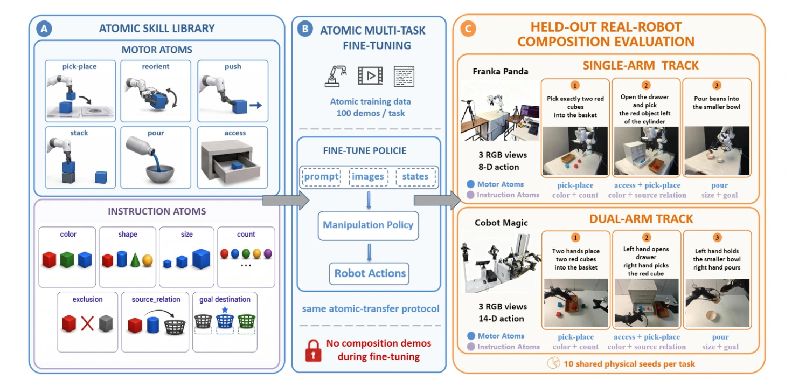
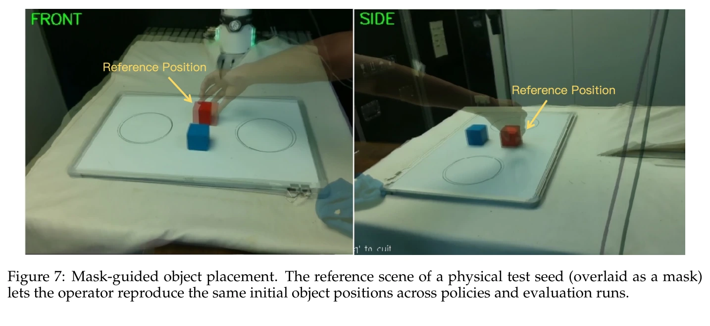
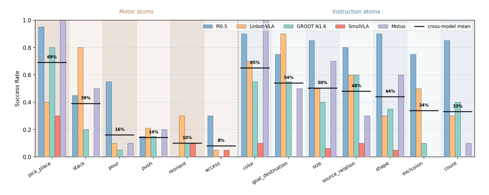
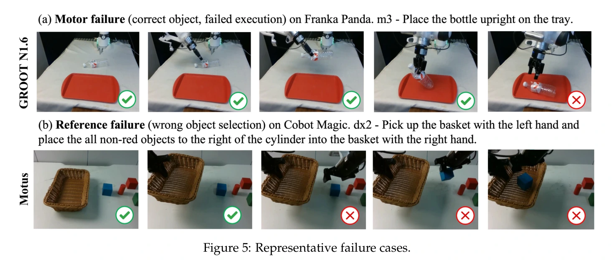
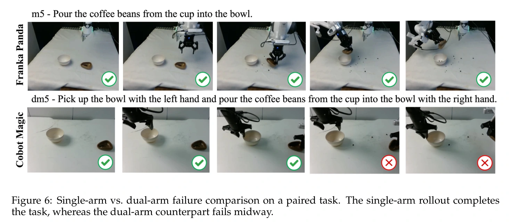
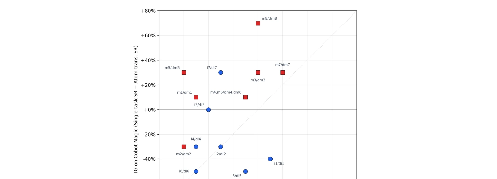

# ATOM-Bench：原子技能与组合泛化的真机基准

## 一屏概览

**研究问题。** 通用操作策略被当作机器人控制的基础模型，但真机泛化难以诊断：一个策略可能在已示范任务上成功，却仍然不会执行细粒度原子技能，或无法把已学技能重组进新任务结构。ATOM-Bench 把桌面操作分解为 **motor atoms**（物理动作原子）与 **instruction atoms**（语言／逻辑原子），只在 15 个原子任务上微调，再在 **24 个从未示范过的留出组合任务**上评测，目的是把失败定位到「动作执行弱」「指令 grounding 差」还是「组合复用受限」。

原文图 1；PDF 第 2 页。[查看原始来源](https://arxiv.org/pdf/2606.16826#page=2)

**基本规模。** 两个平台各 30 个任务（8 个 Motor + 7 个 Instruction + 12 个留出 Composition）；单臂 Franka Panda 与双臂 Agilex Cobot Magic 一一配对；3,000 条人类遥操作示范（每原子任务 100 条）；五个策略共 2,700 次真机 rollout。

**机构与出处。** 北京智源人工智能研究院（BAAI）与北京大学；arXiv v1，2026-06-15 提交，CC BY 4.0；项目主页给出示范数据与评测 rollout 数据的发布入口。

**主要结论。** 当前策略能获得简单的指令 grounding 能力，但细粒度 motor atom（尤其 `pour`、`reorient`、`access`）以及需要集合级判断的 `count`、`exclusion` 仍困难；**原子表现强并不能可靠迁移到留出组合任务**。

## 问题与设计动机

论文指出评测上的两难（§1）。仿真基准提供规模、可控性和快速迭代，但程序化生成的大规模任务分布容易被高容量策略快速吸收，且物理难度低于真机的接触、感知与执行，因此仿真高分越来越难作为真机泛化的证据。真机评测证据更强，但昂贵、难自动化、难扩展。已有的真机工作各有重点：RoboArena 做分布式两两比较排序，AutoEval 用学习到的成功分类器与复位策略减少人工，RoboChallenge 提供大规模在线评测系统，GM-100 扩展到 100 个细节导向任务；SceneReplica 与 FurnitureBench 强调可复现场景与长程装配。

**这些基准主要评估任务套件或排序协议，对策略在适配阶段见过哪些技能控制有限**，因此难以判断模型是否学到了可复用、可迁移到未见组合任务的原子技能。ATOM-Bench 针对这一诊断缺口：控制原子训练分布，同时评测量子技能获得与留出组合泛化。

论文自述的三个贡献：真机基准与 3,000 条跨两台平台的人类示范；配对双轨任务套件（30 原子 + 24 组合）；AS 与 CFS 两个区分「原子技能不足」与「组合失败」的指标；五个代表性策略、2,700 次真机 rollout 的结果。

## 原子分类法

原子不是按论文临时划分，而是从已有操作基准与动作分类学（Meta-World、RoboCasa、FMB 等）以及指称表达 grounding 数据集（ReferItGame、RefCOCO 系列）中总结出的**反复出现的任务因素**，选择标准是：在操作任务中常见、能暴露不同的物理或语义失败模式、能在真机上可靠实例化、可重组为留出组合任务（§3.1、附录 E）。

| 类型 | 原子 | 定义 | 设计理由（附录 E） |
| --- | --- | --- | --- |
| Motor | `pick_place` | 抓取物体并放入目标容器或区域 | 桌面操作基础，也是许多指令原子的默认载体动作 |
| Motor | `reorient` | 完成放置前改变物体位姿或朝向，如把瓶子立起来 | 测试基础搬运之外的物体位姿控制 |
| Motor | `push` | 沿支撑面把物体推到目标区域，不一定抓取 | 覆盖典型的非抓取桌面操作 |
| Motor | `stack` | 把一个物体放到另一个物体上 | 测试相对位姿精度与接触稳定性 |
| Motor | `pour` | 把颗粒或类液体内容物从一个容器转移到另一个 | 测试容器功能使用与物料转移 |
| Motor | `access` | 打开、维持或关闭铰接容器，如抽屉、盒子、盖子 | 测试铰接物交互与相位切换 |
| Instruction | `color` / `shape` | 按颜色／几何形状选择目标物体 | 物体级指称表达的基础属性 |
| Instruction | `size` | 按相对大小选择，如最大或最小 | 测试比较性属性 grounding |
| Instruction | `count` | 操作恰好指定数量的物体 | 测试集合级推理与多物体选择 |
| Instruction | `exclusion` | 排除指定属性或类别来选择物体 | 测试候选物体上的逻辑过滤 |
| Instruction | `source_relation` | 按与参考物体的空间关系选择目标 | 测试基于关系的物体指称 |
| Instruction | `goal_destination` | 把动作端点绑定到多个候选目标区域之一 | 测试指令与动作端点之间的绑定 |

两个分类决定值得单独记住。**`stack` 不并入 `pick_place`**，因为它要求稳定接触与准确的相对位姿控制；**`access` 是功能操作族**，覆盖打开、使用与关闭铰接容器。指令原子覆盖三种角色：`color`/`shape`/`size`/`source_relation`/`exclusion` 指定操作哪个物体，`count` 指定操作多少个，`goal_destination` 是绑定动作端点的 goal-binding 原子。

**指令原子始终通过可执行任务评测**，通常以 `pick_place` 或其双臂对应版本为载体。因此「指令原子比 motor atom 容易」这一结果部分来自载体动作本身简单，不能直接读成「语言理解比物理执行容易」。这是本文数据与结论之间需要读者自行接上的一环，论文在 §4.2 也把载体动作简单作为解释给出。

## 任务套件与配对双轨设计

每个平台三组任务（附录 A）。Motor Set（m1–m8 / dm1–dm8）在最小、无歧义指令下隔离单个 motor atom；Instruction Set（i1–i7 / di1–di7）在简单 `pick_place` 载体下隔离单个 instruction atom；Composition Set（x1–x12 / dx1–dx12）是留出任务，每个组合一个或多个 motor atom 与两个以上 instruction atom。

| 组 | 数量 | 单臂前缀 | 双臂前缀 | 作用 |
| --- | --- | --- | --- | --- |
| Motor Set | 8 | m | dm | 一次只测一个物理技能，语义歧义最小 |
| Instruction Set | 7 | i | di | 一次只测一个语言约束，载体动作简单 |
| Composition Set | 12 | x | dx | 留出组合；训练时未见其示范 |

双臂任务被设计为单臂任务的**双机械臂对应版本**，不是另一套技能集：差别在于额外的双手角色分配、臂间协作与更长的有序动作序列。例如单臂 m8 是「打开盖子再关」，双臂 dm8 是「左手开盒盖、右手把方块放进盒子、左手再关上」；单臂 x10 是「把最小的红立方叠在绿立方上」，双臂 dx10 是「左手把绿立方放到最大的蓝立方上，右手把最小的红立方放到绿立方上」。这个配对让「单臂会、双臂不会」成为可归因的对照，而不是跨任务比较。

## 数据采集

| 项目 | Franka Panda（单臂） | Agilex Cobot Magic（双臂） |
| --- | --- | --- |
| 本体 | 7-DoF Franka Panda + Robotiq 2F-85 夹爪 | 基于 Mobile ALOHA 的开源双臂系统 |
| 相机 | 左／前／腕三个 Intel RealSense；腕部为 3D 打印支架 | 左臂／右臂／前三个 Intel RealSense |
| 遥操作 | 3D SpaceMouse | 主臂遥操作 |
| 示范时长 | 约 9 小时 | 约 12.5 小时 |

每原子任务收集 100 条专家示范，观测与动作以 30 Hz 同步记录，每平台 1,500 条、合计 3,000 条。

## 训练与推理接口

**两个适配协议**（§4.1、附录 D）。*Atomic-transfer fine-tuning* 是主协议：单个策略在全部 15 个原子任务上**联合**微调（每任务 100 条示范，合计 1,500 条），再在原子任务与留出 Composition Set 上评测。*Single-task atomic fine-tuning* 为每个原子任务用其 100 条示范训练一个独立检查点，只在该任务上评测，作为专精基线；因为每个原子任务需要一次训练，只对 Pi0.5 报告。

评测策略为 Pi0.5、LingBot-VLA（4B）、GROOT N1.6、SmolVLA、Motus 五个。全部在 NVIDIA H100 上微调，使用各自官方代码库与公开配方：Pi0.5（`pi05_base`）、LingBot-VLA（`lingbot-vla-4b`）、GROOT N1.6、Motus 用 AdamW 全量微调；SmolVLA（`smolvla_base`）因模型较小用 LoRA。学习率、batch（128–256）与训练轮数（Franka 3–9 epochs，Cobot Magic 3–6 epochs）逐模型不同，具体配置见附录 D 表 10。

**真机初始条件复现**（附录 B）。每个任务在 10 个固定物理种子下评测，同一批初始摆放要在不同策略间复现。做法是把该种子的参考场景作为**半透明蒙版叠加在操作员相机视图上**（图 7），每次 rollout 前由操作员摆放物体直到与蒙版对齐。这是无需精密测量即可近似对齐初始条件的低成本流程，也让各策略的比较条件尽量一致。

原文图 7；PDF 第 18 页。[查看原始来源](https://arxiv.org/pdf/2606.16826#page=18)

## 指标：AS 与 CFS 如何分离两类失败

五个指标（§3.3）：SR、PSR、AS、CFS、TG。所有结果在任务上做宏观平均（macro-average），即先算每任务指标再平均。

**Success Rate（SR）** 是主指标，只有满足任务完成谓词的 rollout 才计成功。**Process Success Rate（PSR）** 捕捉部分完成：每个任务预标注一小组得分点（如选对物体、到达目标），PSR 是单回合达成得分点比例的平均——真机失败常是部分的，PSR 与 SR 的差距本身携带信息。

设组合任务 $X$ 参与的 motor 与 instruction 原子集合为 $A(X)$，则

$$
\mathrm{AS}(X)=\frac{1}{|A(X)|}\sum_{a\in A(X)}\mathrm{PSR}(a),
$$

其中某原子有多个代表性原子任务时，$\mathrm{PSR}(a)$ 取这些任务的平均。AS 是**该组合任务所需原子在隔离条件下的平均表现**，也就是「原子能力上限」。

$$
\mathrm{CFS}(X)=\frac{\max\bigl(0,\ \mathrm{AS}(X)-\mathrm{PSR}(X)\bigr)}{1-\mathrm{PSR}(X)}.
$$

CFS 度量组合失败中**无法由弱原子解释**的份额：低 CFS 意味着失败大体可由原子技能不足解释，高 CFS 意味着所需原子在隔离条件下已学会、组合之后才失效。**Transfer Gap（TG）** 是单任务微调与多任务原子微调之间的 SR 差；正值偏向任务专精，负值偏向联合原子训练。

**指标的假设要单独看。** CFS 的构造把「原子隔离表现」当作组合表现的参照上限，再用 $1-\mathrm{PSR}(X)$ 归一化。这等价于假设原子能力可以无损地作为组合的参照，而顺序依赖、状态遗忘和恢复失败恰恰会让这个上限本身不成立——组合链越长，这一假设越弱。因此 CFS 是**诊断性启发式**而非组合能力的无偏估计。论文自己的结果也能看出这点：Pi0.5 的 CFS 最高，同时它的 PSR 也最高，即「原子侧已无可指责，剩余失败才归给组合」。机制层面的说明见 [[CompositionalGeneralizationInRobotics|组合泛化]] 的概率链式分解。

## 实验：原子技能获得

原子迁移协议下 Motor／Instruction Set 的平均 SR 与 PSR（表 1，%）。

| 策略 | Franka Motor SR | Franka Motor PSR | Franka Instr SR | Franka Instr PSR | Cobot Motor SR | Cobot Motor PSR | Cobot Instr SR | Cobot Instr PSR |
| --- | --- | --- | --- | --- | --- | --- | --- | --- |
| Pi0.5 | 46.2 | 56.2 | 94.3 | 95.7 | 45.0 | 72.0 | 71.4 | 83.2 |
| Motus | 36.2 | 46.2 | 67.1 | 78.7 | 35.0 | 59.3 | 50.0 | 67.5 |
| LingBot-VLA | 37.5 | 46.5 | 54.3 | 60.5 | 26.2 | 42.8 | 21.4 | 47.1 |
| GROOT N1.6 | 28.8 | 47.1 | 57.1 | 69.5 | 23.8 | 41.0 | 27.1 | 52.1 |
| SmolVLA | 17.5 | 29.8 | 11.4 | 31.2 | 10.0 | 32.2 | 5.7 | 29.3 |

**指令原子整体比 motor atom 容易**：Pi0.5 在 Franka 指令原子上 SR 94.3%，motor 只有 46.2%；Cobot Magic 上分别是 71.4% 与 45.0%。论文的解释是多数指令原子经由简单载体动作评测，而 motor atom 要求策略自己执行物理技能。

按原子聚合的成功率（图 3）显示了更细的难度分层：motor 侧 `pick_place` 最易，`stack` 次之，`pour`、`push`、`reorient`、`access` 依次更难；instruction 侧 `color`、`goal_destination`、`size`、`source_relation`、`shape` 都在中等以上，而 `exclusion`、`count` 明显偏低。论文据此判断：当前策略常能用基础视觉属性选物体，但对**集合级约束与逻辑过滤**仍困难。PSR 系统性高于 SR，尤其在 motor 任务上，说明许多失败是「做到一半」。

原文图 3；PDF 第 6 页。[查看原始来源](https://arxiv.org/pdf/2606.16826#page=6)

**跨模型平均值的正文与图 3 不一致（本页记录的分歧）。** §4.2 正文写 motor 原子的跨模型平均 SR 为 pick-and-place 74%、access 9%、reorientation 11%、pushing 16%、pouring 20%；而图 3 图例中标为 cross-model mean 的水平线读数为 pick-and-place 69%、stack 39%、pour 16%、push 14%、reorient 10%、access 8%。两处都是「跨模型平均」，但数值不同（例如 pouring 20% 对 16%），论文没有说明二者的口径差异。可能的一种读法是把 74% 理解为指令集侧最高的 color 65% 之外的某处口径，但那与原文「Among motor atoms」的措辞不符。**本页不替论文选定解释，只保留两种读数**；引用具体百分比时应对照图 3 的原图读数。上表中按 Motor／Instruction Set 聚合的 SR 不受此分歧影响。

## 实验：原子 → 组合的迁移

Composition Set 上的平均 SR、PSR、AS、CFS（表 2，%）。AS 是原子基线天花板，CFS 是归因于组合而非弱原子的失败份额。

| 策略 | Franka SR | Franka PSR | Franka AS | Franka CFS | Cobot SR | Cobot PSR | Cobot AS | Cobot CFS |
| --- | --- | --- | --- | --- | --- | --- | --- | --- |
| Pi0.5 | 15.8 | 30.4 | 83.3 | 73.7 | 16.7 | 42.6 | 79.5 | 56.8 |
| Motus | 10.8 | 26.5 | 69.3 | 49.4 | 7.5 | 31.5 | 68.5 | 48.3 |
| LingBot-VLA | 3.3 | 12.1 | 60.3 | 54.5 | 0.0 | 24.4 | 47.2 | 29.3 |
| GROOT N1.6 | 3.3 | 11.6 | 66.3 | 61.2 | 1.7 | 13.7 | 48.2 | 38.8 |
| SmolVLA | 0.0 | 6.6 | 33.3 | 28.3 | 0.0 | 6.3 | 32.5 | 27.3 |

**AS 与组合 SR 之间的落差在所有模型上一致存在。** Pi0.5 在 Franka 与 Cobot Magic 上的 AS 分别是 83.3% 与 79.5%，组合 SR 只有 15.8% 与 16.7%；Motus 同样如此；LingBot-VLA 与 GROOT N1.6 在 Franka 上有中等 AS（60.3%、66.3%），组合 SR 都只有 3.3%。论文的结论是：学会原子技能不会自动带来把它们重组成未见任务的能力。

**CFS 进一步说明落差不能全归因于弱原子。** Pi0.5 在两条轨道上 PSR 与 CFS 都最高，说明它剩余失败的大部分来自组合本身而非未学会的原子；Motus 的 CFS 在两条轨道上约 48–49%，尽管其原子上限更低；SmolVLA 的 AS 与 CFS 都低，说明它的失败仍主要由原子能力限制——**低 CFS 不代表组合得好**，这是读 CFS 时最容易误读的一点。

## 实验：失败归因

每个失败 rollout 被标注为五类之一（§4.4）：*motor failure*（物体选对但执行失败）、*reference failure*（选错物体）、*constraint failure*（违反 count、exclusion 等逻辑约束）、*safety abort*（因不安全行为被人工干预）、*timeout*（超时未完成）。

**motor failure、reference failure 与 timeout 合计占全部失败的 90% 以上**，即三个瓶颈是物理执行、目标 grounding 与任务推进。motor failure 集中在需要精细控制的任务，如 pouring、reorientation 与铰接物 access；reference failure 更常出现在涉及空间关系、排除或多候选目的地的指令中。

原文图 5；PDF 第 7 页。[查看原始来源](https://arxiv.org/pdf/2606.16826#page=7)

图 5 给出两类代表案例：(a) GROOT N1.6 在 m3「把瓶子立到托盘上」上的 motor failure——物体选对、过程中一度把瓶子立起，但最终接触不稳定倒下；(b) Motus 在 dx2「左手拿筐、右手把圆柱右侧所有非红物体放进筐」上的 reference failure——早期步骤正确，随后抓错物体，说明失败发生在目标指称而非执行。

配对双臂对照（图 6）：单臂 m5「把咖啡豆从杯子倒进碗里」的 rollout 完成，双臂 dm5「左手拿起碗、右手把咖啡豆从杯子倒进碗里」在左手未能稳住碗之后失败，导致「倒＋接」序列整体不可执行。论文据此说明双臂版本增加的手角色分配、臂间协调与更长有序序列确实提高了难度。

原文图 6；PDF 第 8 页。[查看原始来源](https://arxiv.org/pdf/2606.16826#page=8)

## 实验：联合原子微调与单任务微调

在 Pi0.5 上比较 atomic-transfer 与 single-task 检查点，逐原子任务计算 TG（图 4）。论文声明该比较应读作「对 100 条示范的单任务基线的比较」，而不是对单任务训练的一般判决，因为 atomic-transfer 检查点训练在全部 15 个原子任务上。

效果同时依赖平台与原子类型。**Franka 上多数原子的 TG 为负**，即联合原子训练改善了许多单臂技能，可能原因是这些任务共享物体定位、抓取、移动与放置等低层行为，多任务训练提供了比单任务更多的数据与场景变化。**Cobot Magic 上模式更混合**：指令原子大多仍受益于联合训练（共享视觉—语言 grounding 与目标选择），但若干双臂 motor atom 的 TG 为正——手角色分配、臂间协调与精确有序动作更吃任务专精，单任务微调能更好地特化到所需动作模式。论文的总结是：原子迁移微调在共享指令 grounding 与单臂操作上是可靠默认，复杂双臂 motor 技能对任务专属练习更敏感。

原文图 4；PDF 第 7 页。[查看原始来源](https://arxiv.org/pdf/2606.16826#page=7)

图 4 中每个点把一个 Franka 原子与其双臂对应物配对，横轴为 Franka 上的 TG、纵轴为 Cobot Magic 上的 TG。红色方块是 motor atom，蓝色圆点是 instruction atom；`m8/dm8`（铰接容器 access）在两个平台上都最偏好单任务微调，`i1/di1` 与 `i5/di5` 则明显偏向联合训练。

## 附录 C：语言与视觉扰动下的鲁棒性

实验复用各策略的 atomic-transfer 检查点、不再微调，挑选它已经高成功率完成的任务，在两种扰动下重测：把桌面背景从默认白布换成棕布（保持物体、布局与光照不变），以及保留含义改写指令。指令改写刻意**保留**定义原子的词（颜色、形状、`exactly two` 等计数词）、左右手角色分配与多阶段动作的时序，只变化三个轴：同一动作族内的动词同义（pick up → grasp/lift/hold、place → drop/put、open/close → pull open/push shut、pour → tip）、角色分配措辞（with the left hand → using your left hand）、从句结构（合并或拆分句子、替换代词、显式连接词）。评分细则与物理种子不变。

在 Cobot Magic 上对六任务重测 Pi0.5：四个它已稳定解决的原子任务（di1、di2、dm2、dm6）与两个组合任务（dx1、dx12）。四个原子任务在两种扰动下 SR 都维持 90–100%，说明 Pi0.5 学到的是底层原子技能，而非对训练背景或措辞的过拟合。两个组合任务则明显下降：dx1 从 60% 降到两种扰动下的 40%，dx12 从 50% 降到 40%（视觉扰动）与 20%（语言扰动）。六任务平均 SR 从基线 78.3% 降到视觉扰动 76.7%、语言扰动 71.7%。论文的解读是：组合技能对表层形式变化比原子技能脆弱得多，**语言改写比背景扰动是更强的压力测试**。

## 局限与我们的解释

**作者明确的局限（§6）。** 受真机评测与模型微调成本限制，只评测五个代表性策略，未覆盖全部可用的 VLA 与 WAM 模型；任务套件聚焦能在真机可靠实例化的常见桌面因素，因此不覆盖可形变物体操作、工具使用、移动操作或高度长程任务；评测仍需人工摆场景、安全监控与手工标注得分点，未来工作将扩展任务覆盖并探索更自动化的复位、成功检测与标注工具。

**我们的解释（非来源主张）。**

第一，ATOM-Bench 是**诊断工具而非排行榜**。跨策略比较的有效性依赖「各模型都按官方配方尽力调过」，而附录 D 显示各模型的 batch、学习率与训练轮数并不相同（epochs 从 3 到 9 不等），论文也把这些当作复现细节而非受控变量。因此「Pi0.5 最强」这类排序读作「在该协议与该预算下」更稳妥，这与 [[topics/policy-evaluation|策略评测]] 中「不同训练方式的结果不能直接排列成通用能力榜」一致。

第二，**「原子能力不可组合」这一结论的强度取决于 CFS 的参照假设**。ATOM-Bench 已把这条链做得比多数基准干净：控制原子训练分布、留出组合、双臂配对对照、固定物理种子。但组合失败仍混有长序列条件成功率自然衰减的成分；把 AS 当作组合上限，会让 CFS 偏保守或偏激进取决于原子任务与组合任务在状态分布上的重叠程度。论文没有报告这一重叠，也没有给出组合链长度与 CFS 的关系。

第三，**最可搬运的资产是三个与平台解耦的东西**：原子分类法（可作为任务设计清单）、AS／CFS 这对分解指标、蒙版引导的固定物理种子流程。前两者可以直接移植到自建评测，第三者是把真机初始条件对齐到「近似一致」的低成本手段，代价是依赖操作员的人工对齐，论文没有报告对齐误差或其对各策略比较的影响。

第四，扰动实验的样本很小——六任务、单一策略（Pi0.5）、单一平台，且是在「该策略本已成功」的任务子集上做的。它支持「组合技能比原子技能更依赖表层形式」这一方向性判断，但不足以给出跨策略或跨平台的稳健性排序。

## 关联与材料

本文是 [[TaskGeneralistPolicyEvaluation|通用任务策略评估]] 中「任务组合泛化」协议在真机上的完整实例，此前该协议只有 [[robolab-a-high-fidelity-simulation-benchmark-for-analysis-of-task-generalist-policies|RoboLab]]（仿真、不重训）与 [[robocasa365-a-large-scale-simulation-framework-for-training-and-benchmarking-generalist-robots|RoboCasa365]]（仿真预训练 + 目标微调）作为证据。组合泛化的机制解释见 [[CompositionalGeneralizationInRobotics|组合泛化]]，指标设计与比较条件见 [[AtomicSkillAndCompositionalEvaluation|原子技能与组合泛化评测]]，研究归属见 [[topics/policy-evaluation|策略评测]] 与 [[topics/evaluation-and-transfer|评测与 Sim-to-Real]]。

被评测的策略中，[[pi07-steerable-generalist-robotic-foundation-model|π0.7]] 属同一 π 系列谱系（本文评测的是 Pi0.5，不是 π0.7，两者不可混用结果）；Motus 是统一的 latent action world model，与 [[LatentDynamicsActionModels|Latent Dynamics Action Models]] 一类工作相关。示范数据与评测 rollout 数据由项目主页发布，本次未检查其发布状态与实际内容，相关结论仅以归档论文为证据。

## 研究归属

[[topics/policy-evaluation|策略评测]] · [[topics/evaluation-and-transfer|评测与 Sim-to-Real]] · [[topics/robot-policy-learning|机器人策略学习]]。
