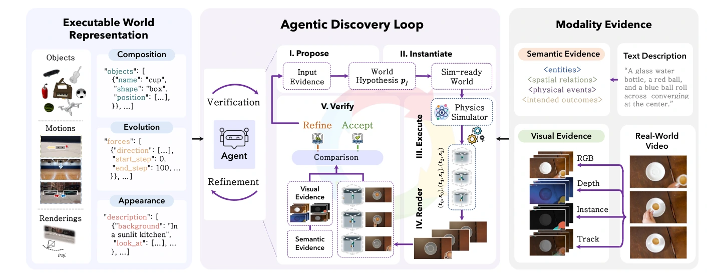

# Code-as-World：用可执行代码表示物理世界

## 一屏概览

**研究问题。** 视觉语言模型能描述“发生了什么”，却常常说不出“世界为什么这样演化”：物体状态、物理参数、接触与守恒关系都留在像素里，没有显式表示。Code-as-World 的命题是：**像素是物理世界的证据，不是它的本体**；要让模型可靠地推理干预与反事实，需要把世界写成可执行的代码表示，并从观察中把它“发现”出来。

**表示。** 一个 executable world representation（EWR）是三元组 $p=(C,E,A)$：物理构成 $C$（对象、几何、质量、摩擦、重力）、动态演化 $E$（初态、事件、时长、轨迹）、视觉外观 $A$（相机、材质、光照、帧率）。$C,E$ 决定物理等价，$A$ 只决定“看起来怎样”。实现为 `scene.json` 加 `simulation_sdk.py`，后端是 MuJoCo，可在运动学引擎与物理引擎之间切换；尺度标记为 `metric` 或 `scene_unit`，因为单目视频并不总能恢复绝对尺度。

**发现过程。** 给定文本或视频，智能体不是直接回归参数，而是走 propose → instantiate → execute → render → verify 循环：提出/修改 EWR，编译成模拟器参数 $\theta$，执行得到轨迹 $\tau$，渲染并投影回输入视角，在关键帧上比较 RGB、深度、掩码与轨迹，得到结构化诊断 $\Delta$，再修改假设。预算 $K=5$；接受条件是“能解释证据且足够简约”。这个循环没有损失函数，$\Delta$ 是语言模型写的文本反馈。

**结果。** 用发现的 EWR 生成物理监督，训练 Code-as-World-VL。QuantiPhy 验证集（外部基准，159 题）上，9B 直答模型平均 **55.4**，略高于 Gemini-3.1 Flash 的 **54.8**，并高于全部开源基线（最高 Qwen3-VL-32B 40.2）；27B 推理模型 **58.6** 为表中最高，但其 2S 子项 48.7 低于 9B 的 55.0。世界空间监督还反哺图像空间测量（9B 的 RefCLEF 从 47.2 升到 61.9）。

**版本。** MirroS、清华大学、北京大学、南洋理工大学，17 位作者（Hanyang Wang、Yimo Cai、Weiliang Chen、Jiawei Chi、Haowen Sun 等，Jialong Wu、Jiangran Lyu、Fangfu Liu 为项目负责人）；arXiv `2608.27549v1`，2026-08-31，31 页；代码 Apache-2.0。4B/9B 的基座模型论文未写明，不能假定为 Qwen。

## 为什么是代码，而不是像素、3D 或纯语言

论文的比较很直接：像素保留丰富外观，但同一个观测可以由许多不同的物理机制产生；3D 表示恢复几何，却不说明“什么推动什么”；语言提供紧凑的语义抽象，却缺少连续物理量的精度。代码同时具备三件事：

1. **语义抽象**：对象、状态、事件、关系是显式变量；
2. **结构组合**：世界可以由部件拼起来、拆开、局部替换；
3. **机制可执行**：规则可以跑出轨迹，从而被检验、被干预、被反事实重放。

这与 [[schema-discovering-unknown-environments-via-agentic-program-induction|Schema]] 在 ARC-AGI-3 中的“理解即程序”同源，但对象从离散游戏规则换成了连续物理：Schema 的程序预测下一帧网格，Code-as-World 的程序要经过物理引擎与渲染器，才能和视频证据对齐。也因此，它比纯程序归纳多了一个**渲染—投影**环节：模拟器的状态必须回到观察者的视角，才能比较。

## 表示：把“世界”与“外观”拆开

$C$ 描述存在什么：对象网格、尺寸、质量、摩擦、重力，地板/桌子/墙等静态环境也是物理实体，能参与支撑、接触和碰撞。$E$ 描述如何演化：初始状态、随时间变化、关键事件、模拟时长；给定 $E$，$C$ 可以展开成完整状态轨迹 $\tau$，其中记录接触、碰撞、速度变化与终止条件。$A$ 描述如何被观察：相机内外参、背景、材质、光照、分辨率、帧率；它不改变物理过程。

这个拆分带来一个实际好处：**改一个成分，其他成分保持**。可以只改初速度看重放，只改相机看另一个视角，只改材质看外观；物理轨迹与渲染外观解耦，反事实视频不需要重新拟合整个世界。

原文图 3：文本或视频先被适配成语义/视觉证据，再进入共享的 propose–instantiate–execute–render–verify 循环，在构成、演化、外观三个成分上迭代。左侧是 EWR 的三个成分，中间是智能体循环，右侧是文本与视频两种证据。来源：论文 PDF 第 7 页。[查看原始来源](https://arxiv.org/pdf/2608.27549v1#page=7)

## 发现：验证信号是语言诊断，不是梯度

证据适配分两路。文本输入抽取实体、空间关系、物理事件与预期结果，形成语义证据；视频输入用 SAM3 取实例掩码与图像平面轨迹，用 VGGT-Omega 估计深度与相机，用 SAM3D 为每个物体建网格，再结合深度与轨迹恢复物体的位置、尺度与动态状态。

循环的每一步：

1. **Propose / Modify**：智能体根据证据、当前假设与上轮诊断 $\Delta$，提出或局部修改 $p=(C,E,A)$；
2. **Instantiate**：把 $p$ 编译成模拟器可执行的 $\theta$；
3. **Execute**：跑出轨迹 $\tau$，记录对象状态、接触、碰撞与事件；
4. **Render & Project**：渲染 RGB；对视频输入，还把仿真状态投影成深度、掩码与图像平面轨迹；
5. **Verify**：在选定的关键帧上比较预测与输入；文本输入主要检查语义与物理约束，视频输入联合比较 RGB、深度、掩码与轨迹；
6. **Diagnose**：把帧级差异汇总成 $\Delta$，指导下轮只改相关成分；满足解释力与简约性则接受，否则到预算 $K=5$ 后拒绝。

这里最值得记住的是：**验证器不是可微损失，而是“比较—诊断—改写”的语言回路**。好处是能处理异构证据与结构修改；代价是收敛依赖诊断质量，且只检查关键帧，长时程漂移可能漏检。论文也明确说，循环可能收敛到一个“局部可信但机制错误”的 EWR。

## 从世界到监督：两阶段训练

第一阶段是图像空间测量：从 RefCOCO/RefCOCO+/RefCOCOg/RefCLEF 与 GOT-10K 构造像素级问答，共 **73,335** 条，问对象的宽、高、对角线、位置、位移、速度、加速度；用监督微调教模型定位、测量、跟踪。

第二阶段是世界空间物理校准：每个被接受的 EWR 同时给出视频与状态轨迹，因此可以直接从轨迹读出精确标签——尺寸来自场景几何，位移/速度/加速度由状态序列计算：

$$
v_t=\frac{c_{t+1}-c_{t-1}}{2\Delta t},\qquad
a_t=\frac{c_{t+1}-2c_t+c_{t-1}}{\Delta t^2},
$$

其中 $c_t$ 是物体在第 $t$ 帧的位置。数据包含 **1,585** 条文本驱动与 **988** 条视频驱动的世界空间 VQA。训练用 GRPO，奖励是尺度归一化的数值精度加单位与格式辅助项：

$$
r_{\text{num}}=\exp\!\left(-\frac{|\hat y-y|}{|y|+\epsilon}\right),\qquad
r=r_{\text{num}}+\lambda_u r_{\text{unit}}+\lambda_f r_{\text{fmt}}.
$$

文本世界提供完全可观测、数值精确的监督；视频世界更接近真实观测的外观与运动分布。两者联合，既有精确标签，又有视觉泛化。训练用 8 张 H100；所有变体统一采样 16 帧。27B 推理变体在回答前生成测量—校准的思维链，每 prompt 16 个 rollout，温度 1.0、top-p 0.95、最多 6,144 token。

## 实验：哪些结论站得住

QuantiPhy 验证集按 2S/2D/3S/3D 四个子集报告平均相对精度（MRA），下表只摘主表与关键基线：

| 模型 | 2S | 2D | 3S | 3D | 平均 |
| --- | ---: | ---: | ---: | ---: | ---: |
| Gemini-3.1 Flash | 49.4 | 47.5 | 61.4 | 61.1 | **54.8** |
| ChatGPT-5.1 | 56.9 | 34.6 | 45.6 | 56.4 | 48.4 |
| Gemini-2.5 Pro | 45.9 | 38.6 | 40.7 | 60.2 | 46.4 |
| Qwen3-VL-32B-Instruct | 38.1 | 39.7 | 39.8 | 43.0 | 40.2 |
| Code-as-World-VL-4B | 45.4 | 55.4 | 45.8 | 56.0 | 50.6 |
| Code-as-World-VL-9B | 55.0 | 52.9 | 55.6 | 58.1 | **55.4** |
| Code-as-World-VL-27B（Reasoning） | 48.7 | 62.4 | 60.5 | 62.8 | **58.6** |

表：论文 Table 1（第 13 页）。27B 同时改变规模与回答协议，作者自己把它当作“框架可扩展到推理模型”的证据，而不是“推理本身带来多少增益”的受控估计。

几个容易被忽略的细节：

- **不是所有子项都赢。** 27B 的 2S 只有 48.7，低于 9B 的 55.0；4B 的 2S 也低于 9B。平均分高不等于每个物理量都更准。
- **监督来源有互补性。** 4B 从 44.2 起，只用文本世界到 48.5，只用视频世界到 47.8，两者合用 50.6；9B 从 50.9 到 52.5 / 53.1 / 55.4（Table 4）。
- **世界空间训练反哺图像空间。** 9B 的 RefCLEF 从 47.2 升到 61.9，4B 的 RefCOCO 从 56.1 升到 62.9（Table 3）；说明学“世界尺度校准”没有牺牲像素测量。
- **sim-to-real 视频改善的是外观分布，不是运动精度。** 用视频生成模型把仿真渲染得更真实后，JEDi 从 3.000 降到 1.484、TRAJAN 从 406.872 降到 185.321，但 Traj-ADE 1.682→1.677 基本不变，Acc@2%D 78.81→77.49 反而略降（Table 2）。外观更真，不等于物理轨迹更准。

发现循环本身也有对照：在匹配的五次评估预算下，迭代式 agentic discovery 在 Visual Alignment、Object IoU、Traj-ADE、Accuracy@2%D 上优于独立采样五次（Best-of-5）；物理引擎版本五轮后五项全胜。这说明“有反馈地改假设”比“多采样几次”更有效地使用计算。

## 局限与未回答的问题

作者承认的：仿真器覆盖有限；刚体对接触几何与材料参数敏感；循环可能收敛到局部可信但机制错误的表示；QuantiPhy 只覆盖单目尺度校准下的尺寸/位移/速度/加速度，不含相机运动、形变、流体、long-horizon 多物体动力学；模型只学“验证过的世界”的结果，没有内化“发现过程”本身；27B 的规模与协议同时变化。

阅读后还应补上：

- **没有 C/E/A 成分消融，也没有验证器开/关消融**，因此无法从论文分离“代码表示”“迭代搜索”“验证信号”各自贡献多少；
- 没有物理参数估计误差表，EWR 的“物理正确”主要由视频对齐与语义检查间接支持；
- QuantiPhy 只有 159 题，MRA 是分档阈值，子项差异的方差未报告；27B 为单次采样；
- 视频来源经过“适合可执行重建”的筛选，world-space 训练集与 QuantiPhy 的去污染未在正文说明；
- `scale_status` 的两态本身说明：不少视频的绝对尺度不可恢复，这时“世界空间标签”其实是场景单位。

## 在知识库里的位置

Code-as-World 是“世界模型作为**可执行表示**”这一路线的物理版本：与 [[schema-discovering-unknown-environments-via-agentic-program-induction|Schema]] 共享程序归纳，与 [[tycho-active-abstraction-with-programmatic-world-models|Tycho]] 共享“模型要被验证、可被绕过”，与 [[agentgarten-code-worlds-evolving-agents|AgentGarten]] 共享“代码管状态与规则、渲染管外观”的分工。差别在于：Code-as-World 的产物是**知识与监督**（EWR 数据集、VLM 训练），AgentGarten 的产物是**练习环境**（实时交互、playbook 演化）。

它也给 [[topics/world-model-evaluation|World Model 评测]] 提了一个新问题：如果世界表示是代码，评测就不应只比视频保真，而要比“反事实干预后轨迹是否仍正确”。这个问题在 [[harnesseval-w-agentifying-evaluation-of-visual-worlds|HarnessEval-W]] 中被操作化为 transition correctness，但两者尚未使用同一套 case 与真值。

共享机制见 [[ExecutableWorldRepresentation|可执行世界表示]]；研究定位见 [[topics/executable-world-representations|可执行世界表示与智能体化评测]]。

## 证据定位

- 摘要与贡献：第 1–3 页；相关工作与表示比较：第 3–5 页。
- EWR 定义 $p=(C,E,A)$：第 5 页，Eq. 1；实现与引擎接口：附录 C.1。
- 发现循环：第 6–7 页，Algorithm 1；证据适配与工具：第 6 页。
- 训练目标：第 10–11 页，Eq. 2–4；数据统计：附录 A（73,335 / 1,585 / 988）。
- 主结果：第 13 页 Table 1；图像空间迁移：附录 Table 3；消融：附录 Table 4；sim-to-real：附录 Table 2。
- 局限：第 14 页 §5.5；发现循环失败模式：第 7 页 §4.4。
