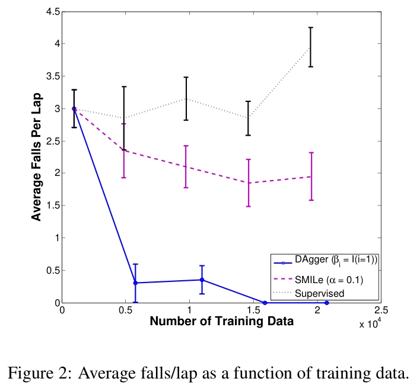

## 概览与版本

Ross、Gordon 与 Bagnell 的 DAgger（Dataset Aggregation）解决一个闭环问题：策略动作会改变以后看到的状态，因而只在专家轨迹上拟合动作，不能保证在自己的执行轨迹上表现良好。本文将模仿学习归约到无遗憾在线学习，逐轮在当前执行策略访问的状态上查询专家、聚合标签并重新监督训练，最终返回验证最好的一个固定策略。（§1–4）

`source_date: 2011-06-14` 采用 [PMLR 官方论文页](https://proceedings.mlr.press/v15/ross11a.html) RIS 导出的 `DA 2011/06/14`；这是出版记录日期，不是会议日期。该页 BibTeX 的会议日期为 2011 年 4 月 11–13 日。

本次完整阅读 [AISTATS 2011 正式版](https://proceedings.mlr.press/v15/ross11a.html)，PDF 共 9 页、印刷页 627–635，含全部证明、实验和参考文献；该文件没有另附附录。标准提取缓存的双栏与公式较破碎，另以原 PDF 的布局文本逐页阅读，并视觉核对算法 3.1 与定理页。这里的证据是论文；没有运行实现。

## 为什么补充更多专家示范仍可能无效

令 $T$ 为任务时域，$d_\pi^t$ 为从初始状态执行策略 $\pi$ 后第 $t$ 步的状态分布，$d_\pi=\frac1T\sum_t d_\pi^t$，$\pi^*$ 为专家，$\ell(s,\pi)$ 为相对于专家动作的监督损失。行为克隆最小化 $\mathbb E_{s\sim d_{\pi^*}}\ell(s,\pi)$，真正关心的却是 $\mathbb E_{s\sim d_\pi}\ell(s,\pi)$。后者的输入分布依赖正在优化的策略，不能靠把专家数据划分成独立训练集和测试集消除。（§2，式 1–2）

当单步任务代价在 $[0,1]$，且监督损失上界专家动作的 0–1 不一致率时，专家分布上的误差 $\epsilon$ 最坏可带来 $J(\pi)\le J(\pi^*)+T^2\epsilon$。直觉是一处偏差把策略带离示范覆盖范围，后续多步继续出错。这是最坏情形界，不能把任意连续动作 MSE 直接代入，声称实际成功率必然按平方恶化。（§2.1）

## 聚合机制及训练／执行接口

第 $i$ 轮持有学习策略 $\hat\pi_i$，用混合策略 $\pi_i=\beta_i\pi^*+(1-\beta_i)\hat\pi_i$ 执行轨迹。这里混合指逐步随机选择控制者，不是对两个连续动作做线性插值。对访问的每个状态查询专家动作，构造 $D_i=\{(s,\pi^*(s))\}$，再令 $D\leftarrow D\cup D_i$，在全部历史标签上训练 $\hat\pi_{i+1}$。（§3，算法 3.1）

必须区分“谁执行动作”和“谁给监督”：即使该步由学习策略执行，标签仍来自专家；算法并非将学习策略的动作直接当正确答案。第一次可用 $\beta_1=1$ 获得初始化，此后可立即令 $\beta_i=0$，或让专家比例指数衰减。一般分析要求平均专家比例随迭代趋零，避免始终由专家遮掩学习策略的状态分布。（§3）

训练接口需要环境重置／执行、对学习策略所到状态提供专家标签、历史数据聚合、一个监督学习器，以及独立验证策略。执行阶段可以只保留选中的固定策略，不需要保留历代策略混合物，也不要求任务奖励。这使它适合用脚本／规划器作专家的仿真，但论文没有提供通用仿真状态保存、分支回退或自动失败诊断系统。（§3、§5）

## 无遗憾保证究竟保证什么

把第 $i$ 轮在线损失定义为 $\ell_i(\pi)=\mathbb E_{s\sim d_{\pi_i}}\ell(s,\pi)$。若学习器对这一串变化的损失满足平均遗憾 $\gamma_N\to0$，且混合带来的分布偏差消失，就能保证历代策略中存在一个在自身分布上损失接近事后最优的策略。直觉是：每轮策略可以改变下一批题目，但累积训练使它不能一直在自己制造的题目上比同一策略类里的最佳固定答案更差。（§4.1–4.2）

本文定理 3.1 在有界、强凸监督损失及指数衰减专家混合等条件下，给出无限样本时 $N=\widetilde O(T)$ 轮存在 $\hat\pi$ 满足 $\mathbb E_{d_{\hat\pi}}\ell(s,\hat\pi)\le\epsilon_N+O(1/T)$；$\epsilon_N$ 是该策略类在各轮分布上事后最佳的平均损失。有限样本的基本分析多出 $O(\sqrt{\log(1/\delta)/(mN)})$ 项，其中每轮采样 $m$ 条轨迹、置信度为 $1-\delta$；论文讨论利用强凸性可进一步收紧。（定理 3.3、4.2）

将动作误差变成任意任务代价还需要额外结构：若一次错误动作之后交给专家恢复的额外代价至多 $u$，则 $J(\hat\pi)\le J(\pi^*)+uT\epsilon_N+O(1)$。$u$ 最坏可随 $T$ 增长，因此不能无条件声称 DAgger 把所有任务代价都从二次降为一次；也不能把存在一个好迭代策略等同于最后一次更新必定最好。大规模神经网络训练以及选择性接管没有自动满足这些理论条件。（§2.2、定理 3.2）

## 实验与证据定位

| 任务 | 采集与模型 | 指标和论文结果 |
| --- | --- | --- |
| Super Tux Kart | 固定速度，图像特征输入，5 Hz 线性转向器；人类提供 $[-1,1]$ 转向标签；每轮 1 圈约 1,000 点，共 20 轮 | Star Track 每圈掉落次数；DAgger 在 15 轮后不再掉落，SMILe 约 2 次／圈，单纯增加专家轨迹没有相同收益；误差条为 95% 置信区间（§5.1） |
| Super Mario Bros. | 难度 1 的随机关卡、60 秒限制；特权近最优规划器读内部状态并模拟未来；四个线性 SVM 输出四个按键；每轮 5,000 点，共 20 轮 | 每关移动距离；DAgger $\beta_i=0.5^{i-1}$ 为 3,030、只首轮用专家为 2,980，典型关卡总长约 4,200–4,300；缓慢衰减收敛较慢（§5.2） |
| 手写 OCR | 约 6,600 单词、52,000 字符，10 折验证；按字符顺序贪心解码，将前一预测作为输入 | 独立字符模型 82%，训练时总给正确前字的模型 83.6%，DAgger 85.5%；这是序列预测迁移例，不是机器人实验（§5.3） |

原文图 2，完整图注译文：平均每圈掉落次数随训练数据量的变化。原文图注：“Average falls/lap as a function of training data.” 误差条的 95% 置信区间含义由 §5.1 正文说明。来源：上述正式版 PDF 第 6 页／印刷页 632；保留所有坐标、图例与误差条。

## 与接管式学习及自改进系统的关系

DAgger 给出的是 [[InteractiveImitationLearning|交互式模仿学习]] 的分布纠正与聚合原理。[[hg-dagger-human-experts|HG-DAgger]] 将全程影子标注改成由人连续接管恢复，改变了监督采样机制；[[thriftydagger-budget-aware-interventions|ThriftyDAgger]] 再把请求接管变成有预算意识的决策。它们沿用迭代聚合思想，但不能直接继承本文全状态专家标注条件下的保证。

**我们的解释：** 放入 [[topics/interactive-policy-improvement|交互式策略改进专题]] 的仿真闭环时，这篇支撑“为什么让当前策略先执行再补专家标签”。它没有解决自动造专家、失败归因、选场景和候选模型验收；这些应由外层编排提供，不能由“使用 DAgger”四字推定已经具备。
