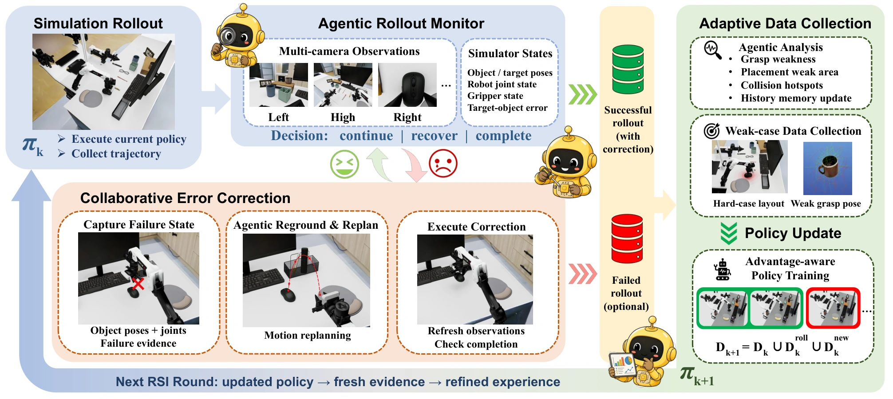

图 2（完整图注译文）：EmbodiRSI 的递归自改进循环。执行监测器结合多相机观测和模拟器状态，从当前状态触发恢复而不重置。失败分析指导定向数据收集。成功轨迹，包括经纠正后完成的轨迹，与新生成的示范共同累计，用来更新下一轮策略。外部恢复仅用于训练；评测时自主执行。来源：论文 HTML §3，图 2；HTML 无固定页码。

## 概览

EmbodiRSI 从目标工作台观测建立可执行仿真，再让当前策略的失败决定下一轮补什么数据。回合内的智能体恢复提供偏离正常示范状态后的纠正轨迹，回合间的失败归因调整采集分布；累积数据继续训练场景特定的 π0.5，最后用少量真机纠正数据适应。（§1、§3）

完整阅读 v3 HTML 正文、参考文献与附录 A–F；没有运行代码。论文附录 F.1 明确：其递归通过固定学习方法下的经验采集实现，不修改学习算法本身。因此本文使用作者的“递归策略自改进”名称，但不把它当成已验证的元学习算法自改写。

## 仿真与示范如何支撑闭环

场景智能体使用 SAM 3 分割、SAM 3D 网格重建，按支撑和容纳关系修正穿插，再构造目标布局。轨迹智能体提出物体空间路径，用 GraspGen 候选抓取映射为末端路径，经过携带物体的扫掠碰撞、多视角检查、cuRobo 顺序可达性和执行后的任务检查。机器人每段规划从上一段结束关节状态出发，不能把各段单独可达当成整个任务可执行。（§3.1–3.2、附录 B）

重置后，路点按对应物体或目标锚点的当前位姿重新定位。例如原始物体与抓取位姿分别为 $T_o^0,T_g^0$，当前物体为 $T_o^{cur}$，则

$$T_g^{cur}=T_o^{cur}(T_o^0)^{-1}T_g^0.$$

该式保持物体到夹爪的相对关系；还需从机器人当前关节状态重新规划。几何关系正确不保证碰撞、抓取和完整执行都可行，所以不通过检查的候选要修复或拒绝。（§3.3.2）

## 两种反馈，改变两种数据

回合内监控器融合时序图像、动作历史与仿真物体／机器人状态，输出继续、恢复或完成。恢复受到置信度、冷却时间、次数预算和持物检查限制；诊断和规划期间暂停仿真。恢复从策略实际到达的错误状态出发，不重置后重放一条干净示范。必须分开记录恢复请求、实际执行纠正和最终成功，不能把请求数等同成功纠正数。（§3.3.1–3.3.2、附录 A.1）

回合间把最终失败归因到源物体位置、目标位置或其他原因。每个位置范围归一化后划成网格，网格 $b$ 的统计量为 $\widehat r_{k,b}=U_{k,b}/N_{k,b}$，其中分母为有效完成的采集回合，分子只含有足够证据支持归因的最终失败。恢复后成功不计入失败，所以这是辅助采集过程的统计，不是自主策略测试失败率。（§3.3.3）

采集分布更新为

$$p_{k+1}(c)=(1-\alpha)p_0(c)+\alpha p_{hard,k}(c),\quad 0\leq\alpha\leq1.$$

$c$ 包含源物体、目标锚点、指令、抓取路点和重置范围；$p_0$ 保留原始覆盖，$p_{hard,k}$ 强调已归因的薄弱区域。网格入选还要求样本量、失败数与高于整体的失败比例。这个比例是采集启发式，不是该位置的预期学习收益；实际保留数据比例还受执行验收影响。（§3.3.3、附录 A.2、F.2）

## 策略学习与权限分离

数据更新把旧数据、策略执行／恢复轨迹和新生成示范相加，每个回合只计一次。实际实验仅保留最终成功的轨迹；失败回合用于诊断，不直接加入训练集。中间犯错但被纠正后完成的回合可以保留。（§3.3.4、附录 D.1）

策略使用三相机 RGB、14维关节与夹爪状态及指令，不输入仿真物体真值。价值模型给出 $\widehat A_t=R_t^{(n)}+V(o_{t+n},l)-V(o_t,l)$，实际设 $R_t^{(n)}=0,n=50$；阈值化的优势标签作为文本条件，动作仍用记录的动作做行为克隆监督。它不是在线优化动作的规划器。最终仿真与真机测试禁用外部智能体、规划器和人工接管，测试时的重试来自策略自身。（§3.3.4）

OpenClaw/MCP 监督层组织场景、抓取、运动、训练和评估作业，检查前置产物与资源，长作业返回持久标识。完成需要进程正常退出且产物有效；常驻服务则检查就绪。它解释了 [[RobotHarness|实验编排]] 层怎样参与系统，不能据接口名推断完整故障恢复已经实测。（附录 A.3；末句为解释）

## 实验与数据预算

三套工作台共有14个子任务，分别为6、4、4项，每个场景训练一个策略；各子任务单独评估，不是整套整理任务连续成功率。R0/R1/R2每子任务保留50/200/400条仿真轨迹，两次更新同时增加数据量。（§4、附录 D）

| 比较 | 结果 | 证据范围 |
| --- | --- | --- |
| 三场景仿真 R0→R2 | 场景等权50.4%→70.7%→83.5% | 仅两次更新；没有长期持续增长或留出工作台验证 |
| 较困难的 S1/S3，同为400条 | 自适应79.9%，静态59.3% | 支持反馈采集相对静态采集的收益；只匹配保留轨迹，不匹配所有尝试与算力 |
| 三场景真机，每任务400仿真＋10真实纠正 | 场景等权83.1%，合计116/140 | 140是测试回合；每子任务10条真实训练纠正，合计140条，不能说全系统只用10条 |
| 每子任务200条纯真实示范 | 场景等权75.0% | 示范与纠正不是同分布数据；未证明总人时或总成本减少20倍 |

“零样本真机”仅指没有任务特定真实微调，仿真已经使用目标工作台观测。R2未真实微调为62.8%，再加纠正为83.1%。每任务／设置10次真机测试；误差条多为同场景子任务间标准差，不是独立训练重复的置信区间。自适应也不是每项都胜出，例如铅笔盒仿真中静态采集略高；论文没有单独消融恢复、再采集与智能体推理的贡献。（§4–5、附录 D–E）

## 与相邻路线的区别

[[simex-simulation-integrated-robotics-autoresearch|SimEX]] 用仿真筛选代码修复，EmbodiRSI 用仿真生产训练数据并更新神经策略；[[physevo-physical-recursive-self-improvement|PhysEvo]] 修改工具及诊断资源，EmbodiRSI 的学习公式与预设轮数不变。这些都可能形成持续改进，但对 [[PhysicalRecursiveSelfImprovement|改进机制自身变强]] 的证据要求不同。主题比较见 [[topics/robot-harness-and-physical-rsi]]。
