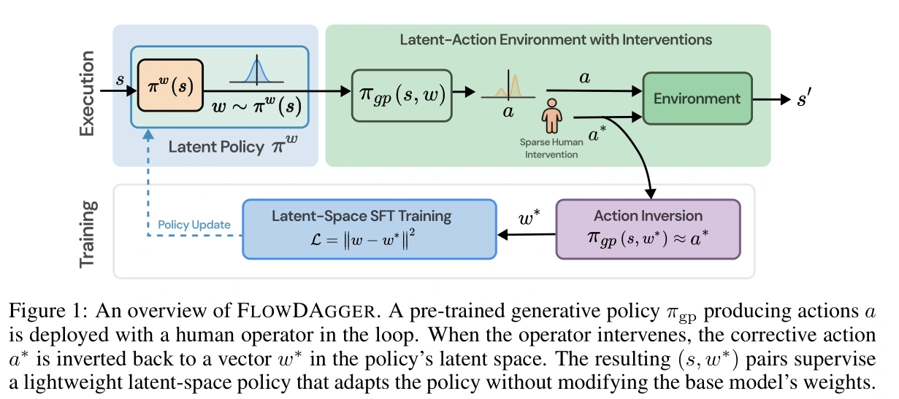

## 概览与阅读范围

FlowDAgger 将 [[InteractiveImitationLearning|交互式模仿学习]] 的纠正动作转成冻结生成式策略的初始噪声监督，只训练一个小型潜在策略。它解决的是“当前策略运行到错误状态后，怎样低成本吸收专家纠正”，并不自行生成任务、判断所有失败原因或修改训练程序。与 [[rho-efficiently-adaptable-vla-models|Rho]] 的关系是方法被后者采用，而非两套独立发明。（§1、§4）

本页完整阅读 v1 共 14 页，包括正文、参考文献和附录 A–B；核对了动作反演、两个缓存、MetaWorld 主表及遗忘结果。补充完整阅读[官方项目页](https://microsoft.github.io/FlowDAgger/)的当日归档 `raw/flowdagger-project-2026-10-18-11518b1b114b.html`，缓存为 `graph/extracts/flowdagger-project-2026-10-18-11518b1b114b.md`。项目页标注 CoRL 2026，但本页实际读取的论文仍是 7 月 9 日 arXiv v1，不能据项目页标签改称已读会议定稿。所有成绩均为作者报告；未运行训练或硬件。

## 为什么纠正发生在噪声空间

设 $s$ 为包含必要历史的观测，$a$ 为长度 $H$ 的动作块，冻结策略通过速度场 $v_\theta$ 把噪声 $w$ 变成动作：$\dot{x}=v_\theta(x,t,s)$，$x(0)=w$，$a=x(1)=\pi_{gp}(s,w)$。普通 SFT 更新大模型；动作残差直接加在输出上，可能离开原模型稳定生成的行为范围。作者因此改为学习 $w=\pi_w(s;\phi)$，执行 $a=\pi_{gp}(s,\pi_w(s;\phi))$，只更新 $\phi$。（§3–4）

这保留了原来的解码器，却不意味着行为分布自动保持不变：新噪声策略仍可能在未训练状态输出不合适的噪声。原文的旧任务评测也确实有退化，见下文。

原文图 1，PDF 第 2 页，完整图注译文：FlowDAgger 概览。预训练生成式策略 $\pi_{gp}$ 产生动作 $a$，部署时有人类操作员参与。当操作员接管时，纠正动作 $a^*$ 被反演为策略潜在空间的向量 $w^*$。所得 $(s,w^*)$ 对监督一个轻量潜在策略，在不修改基础模型权重的条件下适配策略。[原始来源](https://arxiv.org/pdf/2607.08877v1#page=2)

## 动作反演：逆的是离散采样步骤

专家给出的是动作 $a^*$，而不是噪声标签。目标是寻找 $w^*$，使 $\pi_{gp}(s,w^*)\approx a^*$。若采样器用 $K$ 步 Euler 积分，$x_{k+1}=x_k+\Delta t\,v_\theta(x_k,t_k,s)$、$\Delta t=1/K$，就从 $x_K=a^*$ 逐步解隐式方程：

$$x_k^{(m+1)}=x_{k+1}-\Delta t\,v_\theta(x_k^{(m)},t_k,s),\qquad x_k^{(0)}=x_{k+1}.$$

每一步不动点求解完成后继续向前一时间步反演，最终 $w^*=x_0$。当速度场对 $x$ 的 Lipschitz 常数 $L$ 满足 $\Delta tL<1$ 时，此映射是压缩映射，迭代才有相应收敛保证；这不是对任意预训练模型已验证的普遍条件。作者默认 $K=10$、每步 $M=5$，用于避免一次显式反向 Euler 在少步采样中积累较大误差。（§4.1、附录 B.1–B.2）

附录表 5 在同一批 29 个 Assembly 脚本专家动作块上，逐步不动点反演的动作 MSE 为 0.00168，显式 Euler 反向为 0.0329；RTX 5090 预热后中位每块耗时分别为 456 ms、315 ms。逐步方法更准确，但并不比显式 Euler 更快。表 6 默认配置列出 60 次模型求值，而正文粗略写 $KM=50$；实现还需初始化／重构等求值，工程预算应据实际调用测量，不能只用该简写。（附录 B）

### World-action model 的额外处理

Cosmos-Policy 联合生成动作、未来状态与价值，联合张量为 $16\times9\times28\times28$。作者以基础策略自己的干净预测为起点，只把动作帧加上“专家动作减原动作”的差量，保留状态和价值帧，再反演完整联合过程。噪声维度约 $10^5$，默认噪声策略预测 64 个 PCA 系数，基来自预热期间的反演噪声；反演本身仍作用于完整联合张量。（§4.2、附录 A）

这里需纠正正文的简化表述：正文称只需前向计算、不对基础模型反传；附录 A.1 明确指出 EDM 调度从 $\sigma_{max}=80$ 到非零 $\sigma_{min}=4$，末端去噪必须通过一次去噪器调用做短程 Adam 求解，因而需要对输入求梯度。基础模型权重依然冻结，但“全程无反向传播”只适用于相应的动作头反演路径，不能覆盖全部 Cosmos 实现。

## 聚合、训练与代码核查

每轮部署当前组合策略；专家接管产生 $(s,a^*)$，反演后加入纠正缓存。成功自主执行中实际使用的噪声进入另一缓存。每批各抽一半，回归目标为 $\mathcal L(\phi)=\mathbb E\|\pi_w(s;\phi)-w^*\|_2^2$。第二缓存避免少量纠正把噪声策略拉向狭窄状态集合；固定一半纠正则避免自主数据淹没纠正信号。这里的 on-policy 指采集状态来自当前部署策略，接管后又成为混合控制分布；参数更新仍是监督学习。（§4.3）

为区分“人类接管”与仿真实验，局部静态核查了官方仓库提交 `3426f246510fd67a9e39c3c08bd5b02d586ad688`，归档 `raw/flowdagger-repository-2026-10-18-12646ac81a9d.tgz`。`flowdagger_pi05/dagger_loop.py:1–5` 明确 MetaWorld 接管者为脚本专家；`:230–240` 默认可按整回合成功过滤数据，并指出真人接管与脚本的“未干预”含义不同；`:264–275` 双缓存采样默认自主比例 0.5。`flowdagger_pi05/flow_matching_inverter.py` 的 `_build_perstep_fp_reverse_fn` 实现逐步反演，代码时间约定为噪声 $t=1$ 到动作 $t=0$，与论文符号方向相反但机制相同。此次只核查这些路径及 README，未完整审计 Cosmos、控制器或实际执行，也未把可配置默认值等同于主表每项实验的完整配置。

## 实验、预算与结果边界

| 设置 | 预算与协议 | 作者报告 |
| --- | --- | --- |
| π0.5，12 个 MetaWorld 任务 | 每方法额外 50 回合；纠正方法为可接管执行，SFT 为离线示范，DSRL 为自主奖励学习；3 个种子，每点 25 次评测 | 表 1 平均成功率：基础 53%、SFT 71%、LoRA-DAgger 68%、残差 64%、DSRL 55%、FlowDAgger 78% |
| 两种模型，共用 7 个 MetaWorld 任务 | 动作头 π0.5 与联合 Cosmos；主文默认同上 | 表 2：π0.5 53%→79%，Cosmos 53%→74%；不能混成 12 任务均值 |
| 旧任务保留 | 只在 Hammer 适配 50 回合，随后评测 5 个近饱和旧任务；SFT 用 50 示范、匹配梯度步数 | 表 3：FlowDAgger 旧任务均值 96%→88%，其中 Push 96%→56%；较少遗忘，不是零遗忘 |
| FR3 Duo／Dual UR5e，8 个真机任务 | 5–20 个额外接管回合，表 4 各 30 次评测 | Toolbox Packing 13%→80%，Glassware 26%→76%；Jenga 的 SFT 90% 高于本方法 86%，Button 两者同为 73% |
| 额外骨干 | Gr00t N1.7 的 LIBERO-90 task 57；低维状态 Diffusion Policy 的 robomimic LIFT，各 50 回合 | 附录 B.3–B.4 各只有单种子、每点 15 次评测，证据强度低于主表 |

同为 50 回合不等于同等人力、专家动作数、环境步数或奖励信息。正文“12 任务中赢 8 个”的叙述与表 1 一致；“真实任务除 Jenga 都优于 SFT”的文字却忽略 Button 平局，应按表中数值解释。约 8 GB 显存来自 π0.5 适配设置，不能直接外推到联合世界模型。（§5、附录 B）

## 与仿真自改进和 Harness 的关系

FlowDAgger 提供了 [[RobotHarness|机器人 Harness]] 可以调用的“纠正动作→可训练潜变量”接口，以及数据聚合与回归更新模块。它没有自动决定失败属于感知、接口还是策略，也没有演化纠正器。相比 [[hi-wm-human-in-world-model|Hi-WM]] 改变采集介质，本工作主要改变模型适配接口；二者组合的收益仍需独立实验，见 [[topics/interactive-policy-improvement|交互式策略改进专题]]。

作者明确限制了冻结模型的可表达范围、纠正质量与覆盖、反演条件数和多模态性。我们的进一步解释是：冻结权重只能避免权重覆盖，不能免除新噪声策略的回归测试；把反演误差和旧任务自主成功率同时纳入验收，比只看接管后的完成率更有意义。
