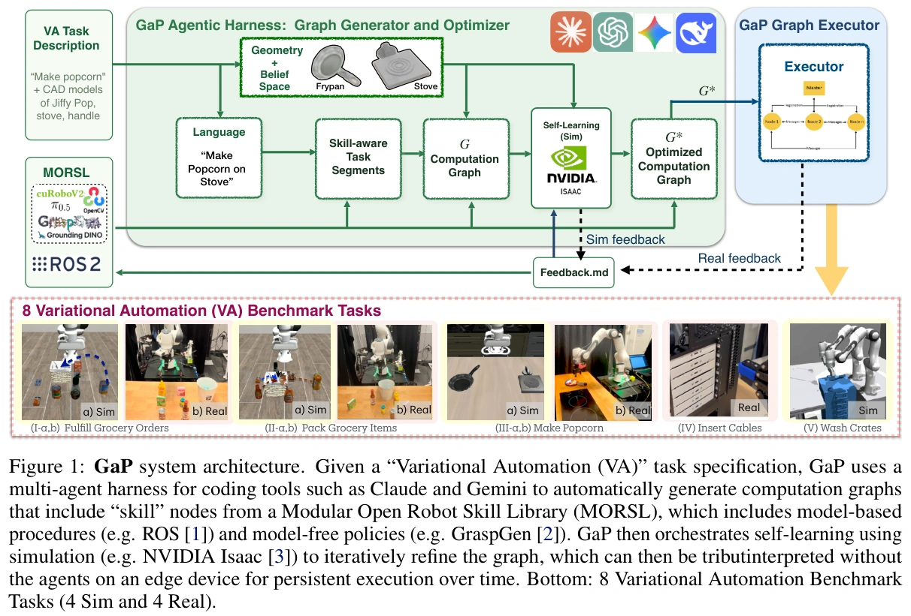

# Graph as Policy：用可执行技能图承载机器人策略

## 概览与适用问题

GaP 面向 Variational Automation（VA）：同一工作站长期重复同类任务，但对象种类、几何和初始位姿在已知范围内变化。机器人、传感器、工作区固定，可使用对象模型与标定；它不以任意新家庭的通用机器人为实验前提。核心是让编码智能体生成、检查和优化技能图，然后让图解释器重复执行。模型可以作为感知或动作节点被调用，但生成图的智能体不必在每步动作中重新规划。[论文 §3–4](https://arxiv.org/html/2607.05369v1)

本页完整阅读 v1 正文、参考文献、技能目录和提示／输出附录；代码另见 [[gap-runtime-repository|固定版本实现核查]]，论文研究代码中的 gRPC／protobuf 描述不能直接照搬到当前公开实现。

图 1：GaP 系统架构。给定 VA 任务，Harness 组织编码工具，从 MORSL 中组合基于模型的方法与学习式策略节点生成计算图，再用仿真迭代改进；优化图可脱离生成智能体，在边缘设备持续解释执行。下方列出四项仿真与四项真实任务。来源：论文 PDF，第 1 页；图与完整英文图注一并保留。

## 为什么图能够成为策略

令 $\mathcal G=(V,E)$，节点 $V$ 是带类型输入输出的感知、规划、控制或代码操作；数据边传递结果并确定依赖，控制边根据输出选择分支。一个技能可由多个原子节点构成子图。图不是场景中对象关系的知识图谱，也不是必须训练一个图神经网络；它本身是可执行程序的组织方式。

例如“把汤罐放进篮子”：相机观测 → 定位汤罐和篮子 → 掩码与深度转成三维点云／包围盒 → 生成并筛选抓取 → 规划接近、夹紧和抬升 → 根据当前持物关系计算放置位姿 → 释放与验收。失败出口可转向恢复或终止，下一次任务重新读取实际观测，因此图固定不意味着动作轨迹固定。闭环策略可以写成 $a_t=\pi_{\mathcal G}(o_t,z_t)$，其中 $o_t$ 是当前观测，$z_t$ 是图的执行状态；这是对论文接口的教学表达。

图约束了组合空间，也把错误定位到节点、边、参数和后置条件。它能减少不存在接口、悬空引用等生成错误，但类型正确只证明某一类结构约束，不证明机械抓持或物理安全。

## 生成、排练与更新

§4 的 MORSL 初始目录有 51 项技能，覆盖感知、抓取、规划、几何处理、控制与验证；附录 D 列出复合技能、原子类和服务方法的接口。协调者划分任务及子图契约，技能智能体在局部工具目录内填写节点，独立检查点生成步骤描述后置条件，随后验证并修复图。角色分工降低每个上下文的范围，但独立提示角色不等于独立物理真值。

给定实例分布 $\mathcal B$ 和目标 $\mathcal J=w_s\mathbf1[\text{success}]+w_t\Phi$，其中 $\Phi$ 为吞吐率，优化目标为 $\mathcal G^*=\arg\max_{\mathcal G}\mathbb E_{x\sim\mathcal B}\mathcal J(\pi_{\mathcal G};x)$。论文用语言模型根据仿真失败更新图，并未对图做可微梯度下降。一次迭代采样多种对象位姿、并行执行、读取状态与接触变化，再改节点替代方案、连接或参数，直到平台期或失败终止。

爆米花任务展示了具体更新链：初始抓锅不稳 → 混合学习式抓取与几何候选 → 把感知目标改为锅柄 → 重调持物后的放置偏移。仿真成功率由 33% 提至 94%，真实测试 18/20。**购物抓放两项首次生成已表现较好，没有执行自学习；不能把这两项成绩归因于迭代优化。** 见 §5.2、§5.5。

检查点使用模拟器的对象位姿、接触和区域关系，避免直接拿感知模块自己的置信度证明自己正确。附录 E 给出节点级失败信号，附录 F 展示提示和契约；其中“由独立检查点智能体编写”与后段“技能智能体必须声明检查点”的提示存在不一致，表明附录示例不能当作单一无冲突的最终接口规范。当前行为以 [[gap-runtime-repository|固定代码核查]] 为准。

## 实验读法

| 原文位置／任务 | 报告结果 | 证据限制 |
| --- | --- | --- |
| §5.3、表 1：购物目标与篮子混合位置扰动 | GaP 97%，两个 VLA 基线均 20%；每格 100 个实例 | 已知工作站／对象范围；不能推广到任意开放环境 |
| §5.3、表 2：真实购物目标抓放 | 25/25，TiPToP 8/25 | 样本有限，不能据满分声称生产可靠性 |
| §5.3、表 2：真实多物品装篮 | 28/30，TiPToP 10/30 | 计量单位是有限抓取次数内放入的物品，不是 30 次完整六物品任务 |
| §5.5、表 2：真实爆米花 | 18/20 | 两次失败分别涉及 IK 与累积运动学误差导致的误抓 |
| §5.6、表 3：真实 USB-C 插拔 | 单次插入合计 121/130 | 长序列整项成功率另列；视觉误差超出局部接触搜索范围仍会失败 |
| §5.7、表 4：双臂洗箱仿真 | 143/150，人工编写策略 148/150；三小时吞吐 18.33 对 19.33 次／小时 | 接近人工基线，未超过；吞吐不是由 150 次试验简单换算 |

§5.2 明确指出 CaP-X 只获初始图像和指令，GaP 获已知环境几何，比较不完全公平；生成结构和单智能体消融反映该实现与提示下的错误，不能推出自由代码或单智能体一般不可能胜任。GaP 也可以把腕部相机移到目标上方后交给 VLA，说明 [[VisionLanguageActionModels|VLA]] 可作为图中执行组件，而不是两类方案必须互斥。

论文内部位置描述有冲突：§5.1 写六个插口，§5.6 与附录按七插口设置报告；引言一处将洗箱并列在真实任务叙述中，但 §5.1、§5.7 明确洗箱为仿真。这里采用实验章节的四仿真、四真实设置，并保留插口数差异。

## 局限与相关研究

§6 承认可靠性与吞吐尚未达到工业目标，任务主要是准静态操作，只有插线依赖力觉；动态目标、柔性物体与更复杂接触尚待验证。图结构不能代替标定、技能质量、仿真保真度与实际成功判定。

从 [[RobotHarness|机器人 Harness]] 看，GaP 给出一种易组合、可检查的执行产物；[[racap-evolvable-robot-learning|RACaP]] 进一步演化 API、提示与经验，[[robofoundry-system-as-policy|RoboFoundry]] 将上下文管理也作为更新对象。从 [[PhysicalRecursiveSelfImprovement|Physical RSI]] 看，GaP 展示的是反复改进任务图，尚未以对照实验说明生成／诊断／选择更新的程序自身获得了可继承的增益。
