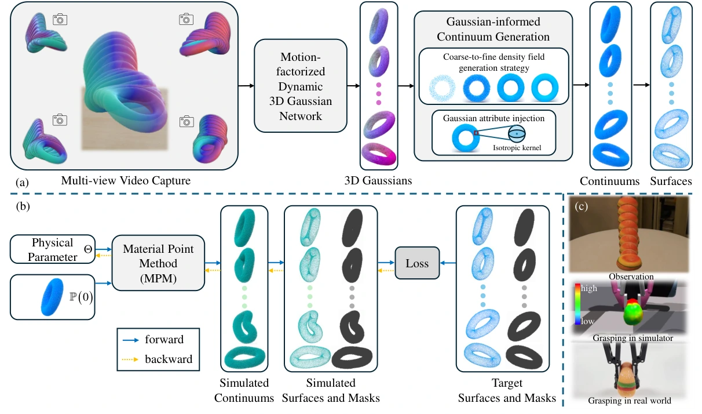
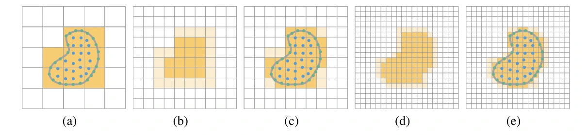

# GIC：面向物理属性辨识与仿真的高斯引导连续介质框架

## 一屏概览

**研究问题。** 从多视角视觉观测反演连续介质物理参数（系统辨识）时，现有路线存在两难：[[spring-gaus-reconstruction-and-simulation-of-elastic-objects|Spring-Gaus]] 虽用 3DGS 提升了弹性体的几何精度，但其弹簧质点假设无法处理流体、沙土与塑性橡皮泥；而支持五类连续介质的 [[pac-nerf-physics-augmented-continuum-neural-radiance-fields|PAC-NeRF]] 则受困于两个致命缺陷——一是隐式 NeRF 重建的初始体素几何往往偏肿（over-large shapes），二是用首帧静态辐射场渲染大变形后的物体会产生严重的 RGB 纹理扭曲（texture distortion），导致像素级颜色损失误导物理参数梯度。**GIC（Gaussian-Informed Continuum）** 提出在三维与二维形状空间（而非失真的大变形 RGB 颜色空间）建立双重几何监督：先通过**运动分解动态 3DGS（Motion-Factorized Dynamic 3DGS）**加**由粗到细密度场填充（Coarse-to-Fine Filling）**恢复每一帧的精确连续介质粒子集 $\tilde{P}(t)$ 与三维外表面 $\tilde{S}(t)$；再直接为模拟中的连续介质粒子赋予从密度场导出的各向同性高斯尺度与不透明度，使其能在 MPM 仿真过程中**直接光栅化渲染二维物体掩码（2D Object Masks）作为形状代理**，与三维表面 Chamfer 损失联合反演物理参数。[论文 §1–4](https://arxiv.org/abs/2406.14927)

原文图 1：GIC 整体框架。（a）连续介质生成：给定捕获运动物体的多视角视频，先训练运动分解动态 3D 高斯网络恢复各时刻的高斯点集；随后采用由粗到细（coarse-to-fine）密度场生成策略提取各时刻的连续介质粒子与物体表面（蓝色），并为连续介质粒子注入各向同性高斯属性（尺度与不透明度）以支持掩码渲染。（b）物理参数辨识：可微 MPM 从初始连续介质 $\mathbb{P}(0)$ 与候选参数 $\Theta$ 出发仿真轨迹，将仿真出的三维表面与二维渲染掩码分别与阶段（a）提取的目标表面及真实图像掩码对比，反传梯度更新 $\Theta$。（c）仿真与真机抓取对比：将辨识出的物理参数用于数字孪生仿真，在相同夹爪宽度下的应力与形变响应与真实 UR10 机械臂抓取高度一致。来源：论文 PDF，第 4 页。[查看原始来源](https://arxiv.org/pdf/2406.14927v3#page=4)

**机构与版本。** 香港科技大学（HKUST）、中山大学与阿里巴巴集团联合发布；作者为 Junhao Cai、Yuji Yang（共同一作）、Weihao Yuan（通讯）、Yisheng He、Zilong Dong、Liefeng Bo、Hui Cheng、Qifeng Chen；录用于 NeurIPS 2024（本页对应 `arXiv:2406.14927v3`，2024-10-31）。

## 三大核心机制与数学推导

### 1. 运动分解动态 3D 高斯网络与尺度正则化（§4.2，附录 A.1）

为了在不依赖物理先验的第一阶段先从多视角视频中恢复各帧高精度的显式三维形状，GIC 维护一组规范空间（canonical space）各向同性 3D 高斯核 $(\mu_0, s_0, \sigma, c)$，并将整个物体的非刚性运动分解为 $N_m = 8$ 个运动基（motion bases）：

- **共享主干的运动基网络：** 不同于为每个基训练独立网络，GIC 观察到同一连续体上各点的运动趋势高度相关，因此用 8 层 256 维全连接共享主干加 $N_m$ 个输出头预测时刻 $t$ 的各基位移残差 $d\mu_i(t) \in \mathbb{R}^3$ 与尺度残差 $ds_i(t) \in \mathbb{R}$；
- **时变运动系数网络：** 用 4 层 MLP 将位置与时间的正余弦编码 $(\gamma(\mu_0), \gamma(t))$（$L=10$）映射为时变权重 $w(\mu_0, t) \in \mathbb{R}^{N_m}$，线性组合得到时刻 $t$ 的核位置与尺度（式 3）：
  $$\mu(t) = \mu_0 + \sum_{i=1}^{N_m} w_i(\mu_0, t)\,d\mu_i(t), \qquad s(t) = s_0 + \sum_{i=1}^{N_m} w_i(\mu_0, t)\,ds_i(t).$$
- **防止大变形“巨型高斯膨胀”的 $\mathcal{L}_1$ 尺度正则化（式 4，附录 A.1.2）：** 在流体飞溅或沙土坍塌等拓扑剧变场景中，变形网络难以精确拟合大位移，往往会投机取巧地把高斯核半径 $s(t)$ 放大数倍来糊弄 RGB 渲染损失，导致重建出的几何轮廓严重膨胀。GIC 在训练损失中显式加入尺度惩罚项（$\lambda_1 = \lambda_2 = 1$）：
  $$\mathcal{L}_{\text{gs}} = \mathcal{L}_1(I, \tilde{I}) + \lambda_1 \mathcal{L}_{\text{ssim}}(I, \tilde{I}) + \lambda_2 \mathcal{L}_1\bigl(s(t)\bigr),$$
  迫使每个高斯核保持微小紧致尺度，从而紧贴真实物体表面。

### 2. 由粗到细（Coarse-to-Fine）连续介质密度场填充与表面提取（§4.3，图 3，算法 1）

动态 3DGS 的高斯核主要分布在表面且疏密不均，不能直接作为 MPM 物质点（[[physgaussian-physics-integrated-3d-gaussians-for-generative-dynamics|PhysGaussian]] 的单次射线奇偶计数在复杂或噪声分布下容易漏填或外溢）。GIC 提出了结合多视角渲染深度过滤与迭代上采样的 **Coarse-to-Fine 填充算法（算法 1）**：

原文图 3：由粗到细密度场填充策略示意（绿色为表面高斯核，蓝色为深度过滤后的内部候选点）。（a）在粗网格上将含粒子的体素密度置为 1，确保物体内部无空洞；（b）经 2 倍三线性上采样与均值滤波平滑后，边界处密度变模糊（浅黄色）；（c）再次利用绿色/蓝色粒子将包含粒子的体素密度强制重置为 1，防止平滑造成边界过度侵蚀；（d）–（e）重复上采样—滤波—重置循环（共 $n_u = 4$ 次），获得内部充实且表面紧致的密度场。来源：论文 PDF，第 6 页。[查看原始来源](https://arxiv.org/pdf/2406.14927v3#page=6)

具体步骤（算法 1，附录 A.2）：

1. **多视角渲染深度过滤（第 1–6 行）：** 在高斯点云包围盒内均匀随机采样初始候选点集 $P_{\text{in}}$；对每个相机视角 $i \in \{1, \dots, n\}$，利用式 2 的高斯 $\alpha$-blending 渲染深度图 $\tilde{D}_i(u) = \sum_{k \in N} T_k \alpha_k d_k$，仅保留在**所有视角**下投影深度 $d_{\text{in}}$ 均大于等于渲染表面深度 $\tilde{D}_i(u_{\text{in}}, v_{\text{in}})$ 的内部点：$P_{\text{in}} \leftarrow P_{\text{in}}[\tilde{D}_i(u_{\text{in}}, v_{\text{in}}) \le d_{\text{in}}]$。
2. **四轮“上采样 $\to$ 均值滤波 $\to$ 粒子占据重置”迭代（第 7–15 行）：** 在初始粗体素网格（步长 $\Delta x$）上初始化零密度场 $F(t)$，循环 $n_u = 4$ 轮：每轮先执行 2 倍三线性插值上采样（第 1 轮除外），再执行均值滤波平滑内部空隙，紧接着将 $P_{\text{in}} \cup \{\mu(t)\}$ 落入的体素值**重新硬置为 $1$**（既填平了内部孔洞，又用原始表面高斯核锁死了精确外边界）。
3. **连续介质与表面双阈值提取（第 16–17 行）：** 设 $\text{th}_{\min} = 0.5, \text{th}_{\max} = 0.8$，直接提取连续介质物质点集 $\tilde{P}(t) = \operatorname{GetPosition}(\text{th}_{\min} \le F(t))$（约 $5\text{万}\sim 10\text{万}$ 个均匀粒子）以及外表面点集 $\tilde{S}(t) = \operatorname{GetPosition}(\text{th}_{\min} \le F(t) \le \text{th}_{\max})$。

### 3. 高斯引导连续介质（Gaussian-Informed Continuum）与 2D+3D 形状联合监督（§4.3–4.4）

为什么不直接比较 MPM 渲染的 RGB 图像？论文 §5.1 直观对比了 [[pac-nerf-physics-augmented-continuum-neural-radiance-fields|PAC-NeRF]] 在大变形下渲染出的 RGB 图像会出现严重的色彩撕裂与模糊，这种外观失真与物理参数好坏无关，却会污染像素颜色损失的梯度。

GIC 干脆抛弃在辨识阶段渲染 RGB 颜色，而是将每个连续介质粒子 $\tilde{p} \in \tilde{P}$ 包装为无色各向同性高斯三元组（式 5）：

$$P_{\tilde{P}} = \bigl\{(\tilde{p},\, s_{\Delta x},\, \sigma_F)\bigr\}, \qquad s_{\Delta x} = \frac{\Delta x}{2^{n_u}}, \quad \sigma_F = F[\operatorname{Discretize}(\tilde{p})].$$

这样，在可微 MPM 推进连续介质轨迹 $P(t)$ 的每一步 $t_i$，既可以从当前粒子提取仿真三维表面 $S(t_i)$，又可以直接用 3DGS 光栅化器以极低开销渲染出各视角下的**二维不透明度掩码 $A_j(t_i) = \sum_k T_k \alpha_k$**，构建 3D 表面 Chamfer Distance + 2D 掩码 $\mathcal{L}_1$ 的双重几何辨识损失（式 6）：

$$\mathcal{L}_{\text{ppe}} = \frac{1}{m}\sum_{i=1}^m \left[\mathcal{L}_{\text{CD}}\bigl(S(t_i), \tilde{S}(t_i)\bigr) + \frac{1}{n}\sum_{j=1}^n \mathcal{L}_1\bigl(A_j(t_i), \tilde{A}_j(t_i)\bigr)\right].$$

## 实验结果：跨五类材质辨识、未来预测与 UR10 真机抓取

### 1. PAC-NeRF 五材质基准上的系统辨识与动态重建对比（§5.1，表 1–3、表 9）

在 PAC-NeRF 的 45 个跨材质实例基准上，GIC 在动态几何重建（平均 $\text{CD}$ 从 PAC-NeRF 的 $0.278$、DefGS 的 $0.234$ 降至 **$0.212$**，表 1）和系统辨识精度上均取得显著提升（论文表 2 与附录表 9 消融汇总，误差按 $\times 100$ 报告）：

| 材质与待辨识物理参数（论文表 2、表 9） | [[pac-nerf-physics-augmented-continuum-neural-radiance-fields|PAC-NeRF]] | GIC（仅 2D 掩码 `Ours*`） | GIC（仅 3D 表面 `w/o masks`） | **GIC（完整 2D 掩码 + 3D 表面）** |
| --- | --- | --- | --- | --- |
| **牛顿流体**：黏度 $\log_{10}(\mu)$ ↓ / 体积模量 $\log_{10}(\kappa)$ ↓ | $11.6 \pm 6.60$ / $16.7 \pm 5.37$ | $1.53 \pm 1.45$ / $16.0 \pm 22.4$ | $2.19 \pm 2.90$ / $24.2 \pm 22.2$ | **$1.53 \pm 1.31$ / $14.8 \pm 19.2$** |
| **非牛顿流体**：剪切模量 $\log_{10}(\mu)$ ↓ / 体积模量 $\log_{10}(\kappa)$ ↓ | $24.1 \pm 21.9$ / $44.0 \pm 26.3$ | $32.9 \pm 44.6$ / $17.7 \pm 20.2$ | $19.4 \pm 27.7$ / $24.0 \pm 24.8$ | **$13.5 \pm 18.2$ / $12.9 \pm 16.8$** |
| **非牛顿流体**：屈服应力 $\log_{10}(\tau_Y)$ ↓ / 塑性黏度 $\log_{10}(\eta)$ ↓ | $5.09 \pm 7.41$ / **$28.7 \pm 23.3$** | **$3.74 \pm 3.72$** / $34.9 \pm 24.1$ | $4.58 \pm 9.11$ / $49.1 \pm 40.5$ | $4.80 \pm 3.92$ / $40.7 \pm 24.6$ |
| **超弹性体**：杨氏模量 $\log_{10}(E)$ ↓ / 泊松比 $\nu$ ↓ | $3.02 \pm 3.72$ / $4.35 \pm 5.08$ | $3.27 \pm 4.13$ / $3.10 \pm 2.00$ | $2.85 \pm 1.94$ / $3.97 \pm 2.64$ | **$2.43 \pm 3.29$ / $2.52 \pm 2.03$** |
| **塑性橡皮泥**：杨氏模量 $\log_{10}(E)$ ↓ / 屈服应力 $\log_{10}(\tau_Y)$ ↓ / $\nu$ ↓ | $83.8 \pm 68.4$ / $11.2 \pm 14.5$ / $18.9 \pm 15.7$ | $28.1 \pm 24.4$ / **$1.24 \pm 0.90$** / $10.2 \pm 5.34$ | $25.6 \pm 27.4$ / $9.04 \pm 2.37$ / — | **$25.6 \pm 29.4$** / $1.67 \pm 1.21$ / **$9.59 \pm 5.00$** |
| **颗粒沙土**：内摩擦角 $\theta_{\text{fric}}$ ↓ | $4.89 \pm 1.10$ | $4.21 \pm 0.08$ | **$2.55 \pm 2.03$** | $4.18 \pm 0.52$ |

特别是在 PAC-NeRF 失效最严重的 `Cat`（橡皮泥猫，真值 $E = 10^6, \nu = 0.3, \tau_Y = 3.85 \times 10^3$）上，PAC-NeRF 估计为 $E = 1.61 \times 10^5$（偏差超 6 倍），而 GIC 精确恢复到 $E = 0.98 \times 10^6, \nu = 0.296, \tau_Y = 3.76 \times 10^3$（表 3）。

### 2. Spring-Gaus 基准上的未来预测与 UR10 真机软体抓取（§5.2–5.3，表 4、附录 A.5）

在 [[spring-gaus-reconstruction-and-simulation-of-elastic-objects|Spring-Gaus]] 的 7 物体未来状态预测基准（前 20 帧辨识、后 10 帧预测，表 4）上，GIC 将平均预测 Chamfer Distance 从 PAC-NeRF 的 $17.94$、Spring-Gaus 的 $5.16$ 大幅压缩至 **$0.95$**（降低 **81.6%**），同时将未来帧渲染 PSNR 从 Spring-Gaus 的 $17.06\text{ dB}$ 提升至 **$22.98\text{ dB}$**（SSIM 从 $0.897$ 提升至 **$0.930$**）。

在真实世界软体抓取实验（§5.3，附录 A.5）中，由于真实动态视频仅有 3 个视角（不足以直接训练多视角动态 3DGS），作者先从 50–70 张静态照片重建静态 3DGS 并配准到动态首帧，随后仅启用 2D 掩码分支（`Ours*`）辨识出真实玩具（汉堡、小猪、小狗）的杨氏模量与泊松比；接着对生成的连续介质密度场执行 Marching Cubes + fTetWild 四面体化，导入基于有限元（FEM）的 Isaac Gym / DefGraspSim 仿真器中，用配备 Robotiq140 夹爪的 UR10 机械臂在 $6\text{ cm}$、$4.5\text{ cm}$、$3.5\text{ cm}$ 三档闭合宽度下对比真机与仿真的挤压形变，验证了辨识参数向机器人有限元抓取仿真的可迁移性。

## 局限性

论文 §6 指出：（1）仍假设已知物体的本构模型类别（弹性、塑性、沙土或流体）与标定好的多视角相机位姿；（2）需要物体实际发生碰撞或挤压变形才能激励出可观测的物理响应，对易碎物品存在损坏风险；（3）单物体完整恢复几何与物理参数仍需在单张 NVIDIA A10 GPU 上训练约 **1.5 小时**。
