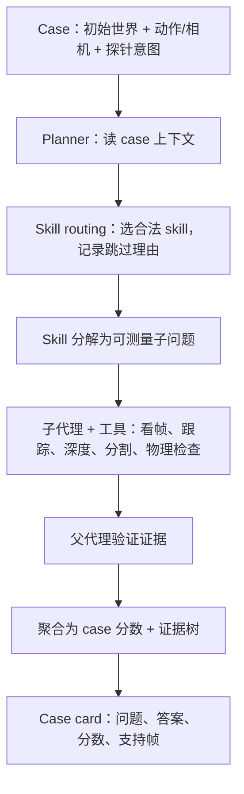
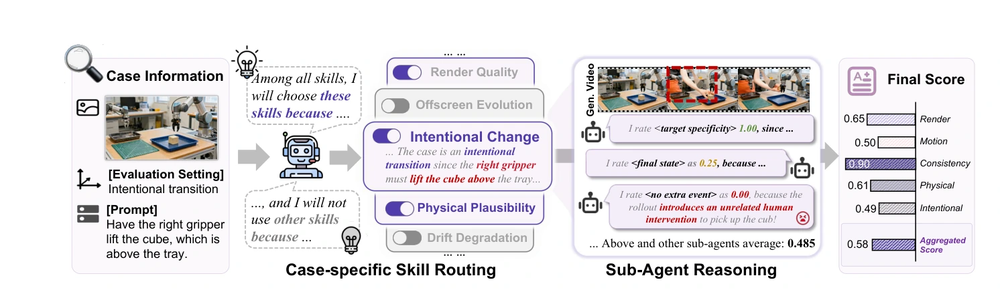

# HarnessEval-W：把世界模型评测变成可审计的证据树

## 一屏概览

**研究问题。** 世界模型的分数通常是一个黑箱标量：FVD、VBench 或某个固定量规算出数值，却不说明“哪一帧、哪个物理关系、哪条证据”导致扣分。HarnessEval-W 的主张是：**可信的评测不只给分数，还要给支持分数的推理链**；而人类评估视频时本来就在做一套工作流——定位对象、跟踪持续性、检查因果与几何——这套工作流可以被组织成智能体流程。

**系统。** 给定一个 case（初始世界、动作/相机轨迹、探针意图），planner 先根据 case 上下文路由到能合法评估它的 skill，并为跳过的 skill 记录理由；每个 skill 把问题分解成可测量的子问题，交给带专用上下文与诊断工具的子代理；父代理验证证据并聚合成分数；完整轨迹保存为可审计的 case card。这里没有固定量规，评分路径随 case 变化，但**路由只看 case 上下文，不看被评模型**，因此同一 case 对所有模型问同样的问题。

**基准。** 330 个 case、18 个世界模型、9 个 skill、3 条轴（Observation Quality、Transition Correctness、World Persistence）展开成 8 个指标。case 由 scene taxonomy 采样、文生图生成初始帧、图像 grounding 的规划器生成动作，再由验证代理过滤；公开集为 100 例并带 leaderboard。

**结果。** 与人类偏好高度一致：在 5,000 次 A/B 判断、9 个模型上，Intentional Transition 的 Spearman $\rho=0.93$（Kendall $\tau=0.82$），Physical Transition 为 $\rho=0.87$（$\tau=0.74$）。与最接近的 WBench 协议在同一批视频、同一 GPT-5.5 后端上比较：Physical 的 pairwise accuracy 从 31.9% 提到 **71.7%**，draw rate 从 52.2% 降到 **1.8%**，Brier 从 0.235 降到 0.185；Intentional 从 60.2% 到 **77.8%**，draws 从 36.1% 到 11.1%，Brier 从 0.119 到 0.108。

**版本。** MirroS 技术报告，43 位作者；Weiliang Chen、Haowen Sun、Jun Gao 为共同第一作者，Jialong Wu、Jiangran Lyu、Fangfu Liu 为共同项目负责人。首页只标 MirroS，未列院系单位。arXiv `2608.16859v1`，正文标注 2026-08-18（arXiv 页脚为 08-17），17 页（正文 13 页）；代码与数据开源。

## 形式化：把“未来观测”拆成三件事

论文把交互式世界模型写成对隐藏状态边缘化后的未来观测分布：

$$
P(o_1,\dots,o_t\mid o_{-T},\dots,o_0;a_0,\dots,a_{t-1})
\propto P(s_0\mid o_{-T},\dots,o_0)\prod_{i=1}^{t} S(o_i\mid s_i)\,T(s_i\mid s_{i-1},a_{i-1}),
$$

其中 $S$ 是给定状态渲染观测的似然，$T$ 是给定动作的状态转移，$P(s_0\mid\cdot)$ 是从历史推断的初始状态。这个分解直接对应三条评测轴：

| 轴 | 问什么 | 8 个指标 |
| --- | --- | --- |
| Observation Quality | 当前状态的渲染是否可信 | Render Quality（Obs-R）、Physical Observation（Obs-P） |
| Transition Correctness | 状态转移是否忠实执行动作 | Exploratory（Trans-E）、Intentional（Trans-I）、Physical（Trans-P） |
| World Persistence | 状态序列是否长期一致 | Drift Resistance（Pers-D）、Revisit Consistency（Pers-R）、Offscreen Evolution（Pers-O） |

表：依据论文 Table 1 与 §5.1 整理。Observation 两项在每个 case 都评，其余只在对应 probe family 的子集上平均；case 分数取平均，总分再对 330 个 case 取算术平均。

三类动作值得区分：**exploratory** 改变观察者的位置/视角；**intentional** 改变指定实体、关系或事件；**physical** 施加物理干预并检查动力学响应。它们不是同一种“动作遵循”，这也是 HarnessEval-W 比单一 action-following 指标更细的地方。

## 评测流水线：路由、分解、验证、聚合

9 个 skill 覆盖渲染质量、物理合理性、视角轨迹、意图改变、物理响应、物理动力学、漂移退化、返回一致性、离屏演化。每个 skill 不是一段固定打分代码，而是一个可展开的评估问题，例如 Intentional Change Verifier 会分解成八个子问题：目标可见、转移可见、意图改变、目标特异性、最终状态、锚点保持、无额外事件、可判断性；每个子问题由独立子代理看 rollout 证据后给出离散分与理由。

原文图 2：case 先经过 skill routing，再由子代理分别推理，最后聚合成带分项与总分的评分。来源：论文 PDF 第 4 页。[查看原始来源](https://arxiv.org/pdf/2608.16859v1#page=4)

上面的流程图是依据论文 §3–§4 重画的，不是原文插图。关键设计是**证据先于分数**：每个子分数都能追溯到具体帧与工具输出；父代理还要检查子代理的证据是否真的回答了问题，而不是把子代理的分数直接平均。

这套结构与 [[AgentHarness|Agent Harness]] 的思路同源：把“评测”当成一个可编排的智能体系统，而不是一段固定脚本。区别在于 HarnessEval-W 的产物是**评测结论**，不是任务执行；它借用了 harness 的“上下文、工具、子代理、验证”接口，但把动作空间换成了“检查与判断”。

## 基准构造：330 个 case 从哪来

case 不是从真实数据集切出来的，而是按 scene taxonomy 生成的。taxonomy 有六个轴：环境、前景、中景、场景密度、外观、视角。采样器选一组兼容值，分配 probe family（探索/意图/物理/漂移/返回/离屏），然后：

1. 文生图代理生成初始帧；
2. 图像 grounding 的 LLM 规划器根据帧生成动作或相机轨迹；
3. 验证代理检查环境、前中景与动作是否语境一致；
4. 不合格的候选回到采样器重采。

这样做的优点是覆盖可控、每个 case 都有明确的“该问什么”；代价是 case 分布被 taxonomy 和生成模型限制，真实机器人视频里的长尾故障不一定出现。论文没有报告 case 与真实视频分布的覆盖对比，也没有报告单 case 的生成成本。

## 结果怎样读

**榜单本身。** 18 个模型、330 个 case 的总分从 **75.5**（Seedance 2.0，Prompt I2V）到 **61.4**（InSpatio-World），极差 14.1；前四名都是 Prompt I2V 模型。分项冠军很分散：Obs-Q 是 Grok Imagine 1.5（85.1），Obs-P 是 HY-WorldPlay 1.5（64.6），Trans-E 是 ABot-World（83.5），Trans-I/Trans-P 是 Wan 2.7（83.6/71.1），Pers-R 是 HY-WorldPlay 1.5（81.9），Pers-O 是 SANA-WM（72.3）。这说明总分接近的模型可能在完全不同的能力上强。论文没有给每个模型总分的置信区间，第 1/2（75.5 vs 75.0）与第 3/4（74.4 vs 74.3）的差距不能当作确定排序。

**与人类的一致性。** 人类研究让标注者看同一 case 下两个模型的 rollout，选更好的一个，收集 5,000 次判断，覆盖 9 个模型；用 Bradley–Terry 聚合出模型强度。HarnessEval-W 的模型级分数与这个强度排序高度相关（Intentional $\rho=0.93$，Physical $\rho=0.87$）。这支持“分解成子问题”的设计，但要注意：**一致性是模型级排序，不是逐 case 正确率**；它不能证明每一个 case 的分数都对。

**与 WBench 的对照。** 同一批视频、同一后端、同一温度与帧采样，只换评测协议。Physical 的 pairwise accuracy 31.9%→71.7%，draws 52.2%→1.8%；Intentional 60.2%→77.8%，draws 36.1%→11.1%；Brier score 也更低。这个对照比“和人类相关性高”更有说服力，因为它控制了模型与输入，只留协议差异。

**稳定性。** 同一后端重复三次，HarnessEval-W 的拟合斜率 9.6–10.8、与人类强度相关 0.928–0.964、三次包络仅 0.33 个 Bradley–Terry 单位；WBench 的斜率从 11.2 到 21.0，相关 0.646–0.780，包络 1.61，宽 4.9 倍。说明分解式评测不仅更准，也更可重复。

**能力之间的相关。** Render Quality 与 Physical Observation 几乎不相关（$r=-0.04$）；Intentional 与 Physical Transition 高度耦合（$r=0.98$）；Exploratory 与两者都接近无关（$-0.15$、$-0.18$）。这意味着“画面好”“会跟随视角”“会执行指定干预”是不同能力，不能用一个总分替代。

**微调会重分配能力，而不是全面提升。** 按 Figure 10 的配对差值（95% CI、10,000 次配对 bootstrap、统一 2 秒/动作）：Wan 2.2 → DreamX-World 总分 $-0.8\,[-2.1,+0.4]$，Exploratory $+4.6$、Revisit $+6.5$、Offscreen $+2.0$、Physical Observation $+2.1$，但 Intentional $-12.1$、Physical Transition $-7.7$；HunyuanVideo 1.5 → HY-WorldPlay 1.5 总分 $-3.2\,[-4.7,-1.7]$，Revisit $+12.5$、Exploratory $+4.4$、Physical Observation $+5.6$，但 Intentional $-23.3$、Physical Transition $-11.7$。作者推测微调数据偏探索轨迹，导致“会逛不会按要求改世界”。这是描述性比较，不是受控消融，但方向值得记住。**原文内部有冲突**：§5.4.2 正文给的是另一组数（$+4.8/+7.8/+3.5/-11.9/-7.2$ 与 $+8.4/-24.2/-11.2$）；本页采用带区间与匹配协议的图值。

## 局限与未回答的问题

论文没有单独的 Limitations 小节，以下区分作者明说的与阅读后补充的。

作者明说的：评测是 context-dependent 的，所以路由与 skill 选择本身会影响结论；未来要扩展到 test-time scaling、skill library 扩展与“评测器自我改进”。他们把这些写成 future work，而不是已解决的鲁棒性。

阅读后应补上：

- **评测器仍是一个 VLM。** 子代理共享同一后端、温度与帧采样；分解降低了单次判断的负担，但没有消除视觉模型的系统性偏差（例如对某些材质、光照、机器人形态的偏好）。论文的 human alignment 是模型级，不足以发现逐 case 的偏差。
- **路由可能漏掉该问的问题。** planner 为跳过的 skill 记录理由，但理由本身由 LLM 生成；如果 case 的上下文描述不全，正确 skill 可能被跳过。论文没有报告路由的召回率或人工审计结果。
- **case 是生成的，不是采样的真实故障。** 330 个 case 覆盖 taxonomy，但不等于真实部署中的长尾；生成初始帧与动作规划都可能带有生成模型的先验。
- **分数聚合仍是算术平均。** 8 个指标等权、330 个 case 等权；不同能力的重要性随应用变化，等权平均会掩盖“某类失败被其他类抵消”。论文没有报告加权敏感性。
- **成本。** 每个 case 要跑 planner、多个 skill、多个子代理与工具；比 FVD 贵得多。论文没有给单 case 的 token/时间成本，也没有给“用更强评测器换更准分数”的性价比曲线。
- **人类效度只覆盖两条轴。** 5,000 次 A/B 只用于 Intentional 与 Physical Transition；其余六个指标没有人类参照，它们“看起来合理”但未必与人的判断一致。人评也只覆盖 18 个模型中的 9 个，榜单另一半没有人类锚点。
- **子代理带着预期去打分。** Intentional Change Verifier 会先让一个子代理从 case 上下文预测期望结果，再让后续子代理对照期望评分；这能提高一致性，也可能产生锚定/确认偏倚。论文没有“无先验”对照。
- **case 把评测轴直接告诉 planner。** 每个 case 自带 probe family 与 evaluation setting，planner 知道该看哪一轴；这降低了路由难度，但也意味着评测不是“从零判断该问什么”。
- **跳过的测量没有单独计量。** 论文说证据不足的测量会被排除、真实失败保留为负证据，但没有报告 skip rate；如果某些 skill 经常被跳过，分数可能把“没测”洗成“没失败”。
- **没有与传统指标的同表基线。** 论文没有报告 FVD、VBench 等数值基线，无法回答“这套贵得多的评测比一个便宜指标多带来多少信息”。
- **“可审计”不等于“可复现”。** 证据树记录了帧与理由，但子代理的自然语言判断仍受提示与采样影响；三次重复的稳定性是模型级拟合，不是逐 case 一致率。

## 在知识库里的位置

HarnessEval-W 把 [[WorldModelEvaluation|World Model 评测]] 的四层证据（外观、状态、动作遵循、闭环决策）中的前三层做成了可解释流程，但没有进入闭环决策：它评的是 rollout，不是策略在环里的收益。与 [[worldecho-worldsync-action-following|WorldEcho／WorldSync]] 相比，它不构造配对反事实，而是让子代理去“找证据”；与 [[v-jepa-2-understanding-prediction-planning|V-JEPA 2-AC]] 相比，它不接机器人，只评生成世界。

它也是 [[topics/executable-world-representations|可执行世界表示]] 这条线的“验收层”：如果世界表示是代码，最自然的评测是“改一个变量，轨迹是否按物理预期变”；HarnessEval-W 目前用自然语言动作与视觉证据做近似，还没有直接查询代码世界的状态。这个缺口与 [[code-as-world-executable-world-representations|Code-as-World]] 的 EWR 正好互补。

共享机制见 [[AgentifiedEvaluation|智能体化评测]]；研究定位见 [[topics/executable-world-representations|可执行世界表示与智能体化评测]]。

## 证据定位

- 形式化与三条轴：第 4–5 页，Eq. 1、Table 1。
- 流水线与 skill 分解：第 6–8 页；Intentional Change Verifier 的八子问题：第 8 页。
- case 构造：第 9–10 页，Figure 4–5。
- 主表与 18 个模型：第 10–11 页，Table 2。
- 人类对齐与 WBench 对照：第 11–12 页，Figure 6；稳定性：Figure 8。
- 轴间相关与微调重分配：第 12 页，Figure 9–10。
- 未来工作：第 13–14 页。
