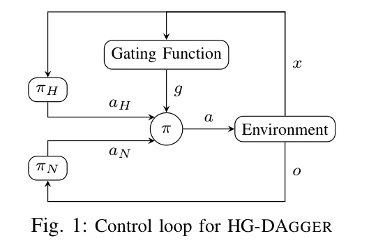

## 概览与阅读版本

HG-DAgger 把 [[dagger-no-regret-imitation-learning|DAgger]] 的专家标注改成**由人决定何时接管、连续控制恢复、再主动交还策略**。新增训练标签只来自人实际控制的恢复片段，目的是使纠正动作获得真实闭环反馈，减少随机切换或影子标注对人类动作质量的影响。论文还用接管时刻的策略集成不确定性学习风险阈值，但训练中的控制权由人决定，阈值自动接管属于作者提出的后续方向。（§I–II）

本次完整阅读 [arXiv:1810.02890v2](https://arxiv.org/abs/1810.02890v2)，2019-03-11 修订，PDF 7 页，含 §I–V、算法、全部实验和参考文献，无额外附录。它是 ICRA 2019 工作的作者预印本；首次预印本是 2018 年，不能将两个版本日期混写。提取缓存中的双栏、上下标和表格另以原 PDF 布局文本及方法页图像核对；没有运行代码或车辆。

## 动机：专家标签质量也取决于控制权

传统 DAgger 允许策略先走到自己的状态，再查询人类动作；然而人在没有控制反馈时很难持续给出自然动作。如果人动作只以概率 $\beta$ 被执行，操作者可能感到执行器延迟，继而过度修正；两个各自稳定的控制者也不保证任意切换后仍稳定。论文将此作为方法动机；后续实验中 DAgger 后期不稳定由作者解释为可能与感知延迟和标签变差有关，实验没有单独操纵延迟证明这一因果链。（§I、§IV-A）

提高专家控制比例可以减轻问题，却让采集分布更接近专家示范，削弱纠错覆盖。HG-DAgger 的选择是保留学习策略暴露错误的机会，让人获得足够长且不被打断的恢复控制段。（§I–II）

## 控制门控、数据集与更新接口

令 $x_t$ 为环境状态，$o_t=O(x_t)$ 为策略观测，$\pi_H(x_t)$ 是人类专家动作，$\pi_{N_i}(o_t)$ 是第 $i$ 轮学习策略动作。作者显式允许专家拥有比学习策略更多的信息。人判断的许可安全集合记作 $P$，门控抽象为 $g(x_t)=\mathbf1[x_t\notin P]$，执行策略为：

$$
\pi_i(x_t)=g(x_t)\pi_H(x_t)+(1-g(x_t))\pi_{N_i}(O(x_t)).
$$

这里 $g$ 由人实际决定；公式是描述，不意味着系统已计算出真实安全集合。学习策略运行到人认为需要恢复时，人持续独占控制，直到主动交还。在第 $i$ 轮执行轨迹集合 $\xi_i$ 上只收集

$$
D_i=\{(O(x_t),\pi_H(x_t)):x_t\in\xi_i,\ g(x_t)=1\}.
$$

初始数据集 $D_{BC}$ 是完整人类示范；每轮将恢复标签加到 $D$ 后重新训练学习策略。自主段用于到达需纠正的状态，**没有把自主动作作为专家监督**；而恢复后续状态受到人动作影响，所以整个训练轨迹属于混合控制分布，不是纯学习策略分布。（§II，式 1–2、算法 1）

原文图 1；完整图注译文：HG-DAgger 的控制环。原文：“Control loop for HG-DAgger”。来源：上述 v2 PDF 第 1 页；图中 $x$ 提供给人及门控，观测 $o$ 提供给学习策略，门控决定哪一个动作进入环境。

这要求执行系统提供可随时中断的动作控制、明确接管与释放事件、同步的人类动作与策略观测，以及按控制者筛选的数据记录。车辆实验中，转动辅助方向盘即接管，按按钮交还策略；实际控制方式是论文实验接口，不应推定所有 HG-DAgger 系统都必须采用相同设备。（§III-A.2）

## 不确定性阈值：诊断功能与自动接管要分清

学习策略由神经网络集成表示。给定观测 $o_t$，各网络动作输出的协方差为 $C_t$，作者定义疑虑度 $d_N(o_t)=\|\operatorname{diag}(C_t)\|_2$。它以模型间不一致近似覆盖不足与风险，不是直接估计物理碰撞概率。（§II，式 3）

每次人**开始接管**时，将当时疑虑度加入按时间排列的列表 $I$；最终阈值 $\tau$ 取最后约 25% 记录的平均，强调后期较成熟策略对应的接管判断。式 4 的上下取整与分母写法是近似“四分之一”的统计描述；具体实现应明确索引规则。测试时用 $\hat P=\{x:d_N(O(x))\le\tau\}$ 估计许可集合，并检查集合内外的执行差别。（§II、§IV-B）

论文没有用这个阈值替人决定训练接管，更没有证明集成高置信一定安全。作者将自动门控列为未来工作；把这篇写成“已根据风险分数自动请求人类”的方法会混淆它与 [[thriftydagger-budget-aware-interventions|ThriftyDAgger]]。

## 实验协议与主要证据

实验是两车道、单向道路上的静态障碍避让；障碍车辆每约 30 米出现，位置加 $\pm5$ 米扰动、车道随机。策略观测包括距道路中线、航向、速度、车道边界距离及两车道最近前方障碍距离，输出转向和速度指令。仿真用按实车参数设定的自行车模型。实体 MG-GS 车实验配有定位、LiDAR、安全驾驶员；道路和障碍车辆为模拟显示给遥控专家，并非实车驶入真实障碍车阵。（§III）

三种方法均从 10,000 个人类动作标签的行为克隆初始化，再进行 5 轮，每轮约 2,000 新标签；HG-DAgger 最后一轮因策略较少进入不安全区而收集更少。DAgger 初始 $\beta=0.85$，每轮乘 0.85。仿真各策略在同样 8 种障碍与初始条件上评测，实体车在固定 5 种配置上评测；这是特定调度下的比较，不是所有 DAgger 变体的普遍排序。（§III-A、§IV）

| 检验 | 原文结果 | 适用边界 |
| --- | --- | --- |
| 学习进度 | 按每米道路驶离与碰撞率，HG-DAgger 比行为克隆及所选 DAgger 调度收敛更稳定、标签效率更好（§IV-A） | 误差条为标准差；没有把人监控时间计为采集成本 |
| 风险集合有效性 | 在受约束初始集合中，$\hat P$ 内／外碰撞率为 $0.607\times10^{-3}$／$7.533\times10^{-3}$ 每米，道路驶离率为 $0.607\times10^{-3}$／$12.092\times10^{-3}$ 每米；驶离时长 1.630／3.740 秒（表 I） | 是不同初始化集合的关联比较，不是阈值带来安全保证 |
| 实体车测试 | 前 5,000 个样本中 BC 碰撞 1、驶离 6 次；DAgger 为 1、1 次；HG-DAgger 为 0、0 次；转向分布 Bhattacharyya 距离为 0.1173、0.1057、0.0834（表 II） | 作者明确指出数据少，统计显著性有限；零次不能外推零风险 |
| 阈值可解释性 | 对 40 个随机障碍配置，将风险地图与可行驶／占用区域作像素分类，学习阈值在所测指标下接近最佳（§IV-D） | 自由空间不等于安全状态，有些自由位置仍不可避免碰撞 |

## 局限与我们如何使用这条证据

方法依赖人持续观察并及时识别、响应危险；不适合专家也来不及接管的任务。只标注恢复片段降低了全程影子标注需求，却改变了 DAgger 的标签覆盖；本文没有给出原 DAgger 无遗憾保证直接适用于选择性接管的证明。专家看得更多时，还要防止恢复动作依赖学习策略观测中没有的信息。（§II 的假设及本文分析）

**我们的解释：** 在 [[InteractiveImitationLearning|交互式模仿学习]] 和 [[topics/interactive-policy-improvement|仿真策略改进]] 系统里，HG-DAgger 是“可靠交接控制权及筛选纠正监督”的基础。系统若要进一步自动进化，还需要接管请求、状态重放、训练调度和自主验收；本文的人工风险判断本身并不会自动演化这些模块。
