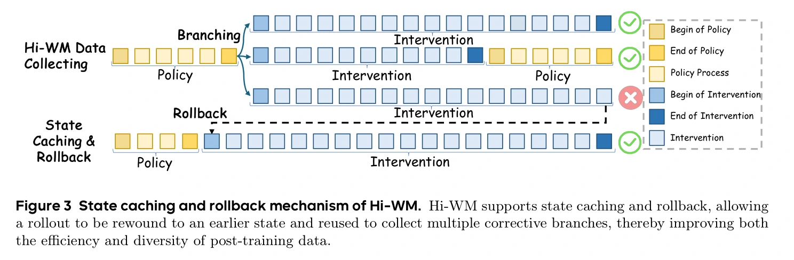
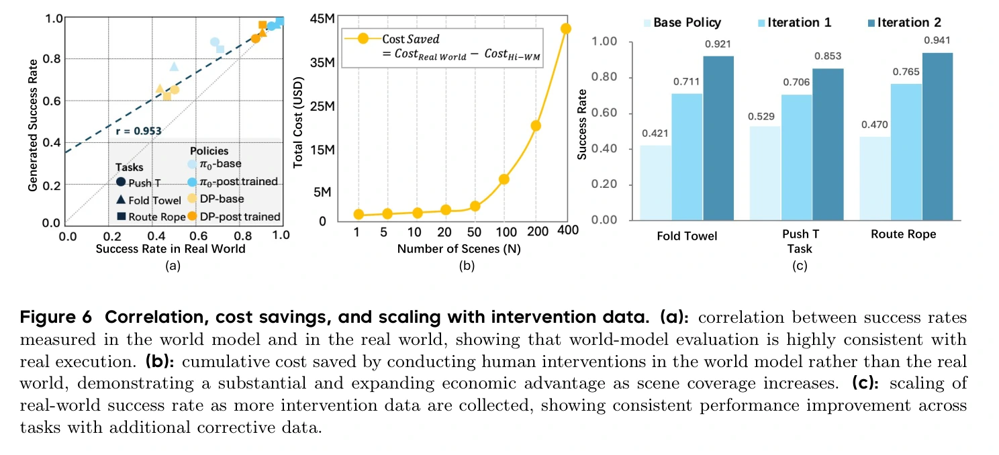

## 概览与版本

Hi-WM 把人类接管从真实机器人移到动作条件世界模型：当前策略在模型中闭环执行，人类在将要失败时纠正，系统缓存中间状态、回退并尝试不同恢复分支，把纠正片段与真实示范合并，再微调策略。其核心是复用失败状态来收集 [[InteractiveImitationLearning|交互式模仿学习]] 数据，而非仅生成更多原策略已经会做的成功轨迹。（§1、§3）

本页完整阅读当前 v2 共 15 页（正文至第 11 页、参考文献至第 15 页，无附录），并对 v1 与 v2 全文差异进行复核。v1 原始快照 `raw/hi-wm-2026-10-18-691d8a2ed9a1.pdf` 和缓存 `graph/extracts/hi-wm-2026-10-18-691d8a2ed9a1.md` 保留；当前 v2 的日期依据 arXiv 版本记录为 2026-05-05，PDF 封面则写 May 6，v1 类似为 arXiv 4 月 23 日、封面 April 24。补充完整阅读[官方项目页](https://hi-wm.github.io/)归档 `raw/hi-wm-project-2026-10-18-5683507fed9b.html`，缓存为 `graph/extracts/hi-wm-project-2026-10-18-5683507fed9b.md`。未实际连接在线演示、运行模型或核查训练源码；后文区分论文设计和可复现实现证据。

## 系统如何完成一次纠正

初始输入是真实任务起始顶视图像及双臂初始末端位姿。策略以当前图像、位姿等观测生成动作，动作转换成末端位姿输入世界模型，生成下一观测，再反馈给策略。真实实验使用双臂 YAM-Ultra、顶视相机，采集和执行频率 15 Hz。世界模型处理 14 维连续动作：每臂 6 维末端位姿与 1 维夹爪状态。（§3.2–3.3、§4.1）

操作员看到不正确、不确定或容易失败的执行后接管，键盘、校准后的机器人主臂或 VR 控制器通过统一映射输出同一连续动作表示。恢复到有希望成功的状态后，控制权可以交还策略。纠正数据因此包含当前策略诱导出的状态，并不是从任务起点重新录一条标准示范。（§3.4–3.5）

原文图 3，PDF 第 6 页，完整图注译文：Hi-WM 的状态缓存与回退机制。Hi-WM 支持状态缓存和回退，使一次执行能够回到较早状态，并复用该状态采集多条纠正分支，从而提升后训练数据的采集效率和多样性。[原始来源](https://arxiv.org/pdf/2604.21741v2#page=6)

图中的分支可以让一个失败前状态产生不同动作续接，避免每次从头重置场景。但论文只说明缓存“中间状态”，没有规定序列化字段、策略历史、世界模型隐状态、动作块位置或随机数发生器的保存与恢复。因此它支持回退分支的系统设计主张，却不提供“逐位相同的确定性重放”保证。对 [[RobotHarness|机器人 Harness]] 而言，这些是需要单独建立的接口契约，不能当作论文已实现并验证的全部细节。

## 为什么模型必须学会失败

世界模型包含视觉编码器、动作条件潜在动力学模型和视觉解码器，作者称从头训练。若只用成功演示训练，它可能看到“手接近物体”就预测成功，而忽略夹爪姿态或接触差异。论文因此强调三类条件：直接使用完整连续动作；混入未完成任务、抓取失败、意外接触和位姿错位；增加工作空间边缘、夹爪精确对齐等罕见状态。这些数据约束模型区分相近动作的不同后果，使纠正本身具有可信物理意义。（§3.3）

作者称边缘数据约为常规场景数据量的 30% 已带来改善；表 1 的 20%、50%、100% 却是相对“完整边缘数据集”的比例，两个分母不同。表中视觉指标从无边缘增强的 PSNR 18.50、SSIM 0.815、LPIPS 0.152 变为完整增强的 22.53、0.942、0.055。这不是毫米级末端误差；相关定位实验主要为定性展示。Push-T 连续十分钟交互也是定性演示，不能外推到任意分布外接触。（§4.2）

论文没有给出世界模型的完整网络配置、损失函数、绝对训练数据规模或超参数，也没有明确纠正采集和各轮策略更新期间世界模型是否冻结。已明确的是策略会通过新旧数据混合微调，不能把整套方法描述为“冻结策略、只改提示或工具”。（§3、§4.4）

## 真机收益与实验协议

基线 Base 只用原离线数据；WM-CL 在世界模型中自主运行，只取成功轨迹回训，不需人类；Hi-WM 在失败附近加入人类纠正。表 2 称后训练预算匹配，但没有给出绝对轨迹数、每任务评测次数、训练步数或随机种子／误差条，无法核查严格的人力与计算等预算。（§4.1、§4.3）

| 策略与方法 | Fold Towel | Push-T | Route Rope |
| --- | --- | --- | --- |
| DP，Base | 42.1% | 52.9% | 47.0% |
| DP，WM-CL | 76.3% | 64.7% | 70.6% |
| DP，Hi-WM | 92.1% | 85.3% | 94.1% |
| π0，Base | 55.3% | 76.5% | 64.7% |
| π0，WM-CL | 78.9% | 79.4% | 82.4% |
| π0，Hi-WM | 97.4% | 97.1% | 100.0% |

上表为原文表 2 的六种“策略×任务”条件，均为下游真机成功率。作者报告平均较 Base 提升 37.9 个百分点、较 WM-CL 提升 19.0 个百分点；这些是六个条件等权的平均改善，不是任意机器人任务的增益保证。

原文图 6，PDF 第 10 页，完整图注译文：（a）世界模型与真实世界测得成功率的相关性，显示模型评测与实际执行高度一致；（b）相较真实世界，在世界模型中进行人类干预所累计节省的成本，随场景覆盖扩大而增加；（c）随干预数据增加的真实世界成功率，三个任务均随新增纠正数据提升。成本曲线属于作者成本分析，缺少完整系数，不能当作经独立验证的实际节省。[原始来源](https://arxiv.org/pdf/2604.21741v2#page=10)

图中相关系数 $r=0.953$ 是所测策略／任务点的 Pearson 相关，不代表逐状态动力学误差很小，更不证明偏离训练覆盖后的纠正仍可信。数据扩展实验的累计新增纠正预算分别约为原离线数据量的 20%、35%；图中 DP 的三任务成功率为 42.1%→71.1%→92.1%、52.9%→70.6%→85.3%、47.0%→76.5%→94.1%。论文没有说明比例按轨迹、帧或动作数精确计量，也未单独消融回退、分支和人工纠正各自的贡献。（§4.2.3–4.4）

Push-T 泛化评测覆盖外观、背景和干扰物变化；作者在这些变化条件下先采集世界模型纠正，再测试真实执行。因此证据支持“借助变化条件中的虚拟纠正提高真机表现”，不能概括为对这些变化完全零样本泛化。（§4.5）

## 版本冲突与可复现边界

v1 成本段称最大评估规模节省近 100,000 美元；v2 改为近 45,000,000 美元，成本曲线纵轴也采用百万美元级刻度。两版的策略成功率、20%／35% 数据预算和主要方法未见对应实质更改。原文仅列设备部署、人力、场地与推理计算等成本项，没有给出足以重建如此大金额的系数或完整计算式。本页保留两版说法，不将任何金额作为已核实经济收益。（两版 §4.4）

此外，正文残留 `[refs]` 和未解析章节引用；缺少完整训练配方、重复试验统计及状态恢复实现。这些不足不否定作者在三个任务上的真机报告，但限制了复现、成本推断和场景外推广。

## 与自改进系统的关系

Hi-WM 为 [[topics/interactive-policy-improvement|交互式策略改进]] 提供可复用的失败采集介质；[[flowdagger-latent-space-corrections|FlowDAgger]] 则提供纠正数据如何进入冻结模型潜在接口的另一种选择。论文自身更新的是策略数据与参数，没有展示纠正程序、诊断工具或世界模型训练规则递归演化。与 [[topics/robot-harness-and-physical-rsi|机器人 Harness 与 Physical RSI]] 的连接是状态缓存、控制权交接、数据来源记录和更新验收，而不是已经证明了递归自改进。

我们的设计解释是：适合保留的状态应包括世界模型和策略执行所需的全部上下文；同一失败状态分出的轨迹在统计上相关，数据划分和评测应防止把共享前缀当作独立覆盖。以上是从方法推导出的工程要求，原文未实验证明其最优实现。
