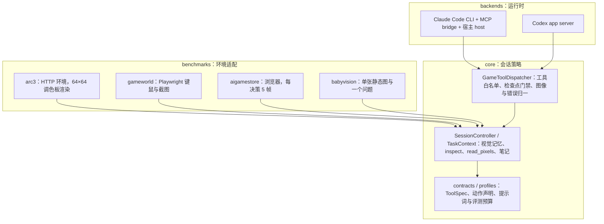

# joshhhhhan/VISTA 工程实现：视觉记忆、工具桥与上下文交接

## 1. 核查范围与运行入口

本页静态核查官方仓库 [`joshhhhhan/VISTA` 固定提交 `c97c354`](https://github.com/joshhhhhan/VISTA/tree/c97c354f0a8948256545a3e8850a1848f8e5b8c1)（`main`，提交时间 2026-10-04，MIT 许可），本地归档 `raw/joshhhhhan-vista-repository-2026-10-20-5b1b16a31113.tgz`，读取缓存保存 104 个文本文件（含全部源码、脚本、Dockerfile 与提示词）。仓库约 1.87 万行 Python，另有 `assets/` 中的演示动图未进入文本缓存。[[vista-a-visual-harness-for-reasoning-in-an-interactive-world|VISTA 论文]] 给出方法与实验，本页只讨论实现：视觉记忆怎样落盘、工具调用怎样过桥、上下文满时怎样交接。**本轮为源码静态阅读与构建配置核查，没有运行游戏、没有调用模型、没有复现 RHAE。**

运行形态是一个 Python 包加两个容器化运行时：

```bash
python3.12 -m venv .venv && .venv/bin/python -m pip install -e .
.venv/bin/vista --profile arc3 --backend claude --game-id s5i5 \
  --operation-mode online --model opus --effort xhigh
```

`--profile` 取 `arc3 | gameworld | aigamestore | babyvision`，`--backend` 取 `claude | codex`；除 ARC-AGI-3 外，其余 profile 在此提交里只接受 Codex 后端（`src/vista/cli.py:20-30`）。ARC-AGI-3 需要 ARC Prize 平台 API key；两种后端都通过订阅制 CLI 登录（Claude Code 2.1.220、Codex 0.145.0），不使用直接 API 调用。依赖锁定较紧（`arc-agi==0.9.9`、`pillow==12.2.0`、`numpy==2.5.1`），浏览器类基准另装 `playwright==1.45.0`。

## 2. 分层架构



分层的判据是“谁拥有状态”：benchmark 只提供环境与评分；`core` 拥有游戏状态、视觉记忆、笔记与恢复语义；`backends` 只负责把模型接到这些工具上。因此同一套 `inspect`/`read_pixels` 能被四个基准复用，而动作空间、观测形态与评分留在各自目录（`src/vista/benchmarks/*`）。

`core/contracts.py` 用 `ToolSpec`/`Capability`/`Effect` 声明每个工具能做什么：`play` 是 `Effect.ENVIRONMENT`，笔记工具是 `Effect.NOTES`，检查工具只读。`core/profiles.py` 把“用哪个模型、多少步、什么压缩模式、哪套提示词”收进 `Experiment`/`SessionPolicy`，CLI 只做选择，不改评测语义。

## 3. 一次 `play` 的完整数据流

以 ARC-AGI-3 + Claude 为例（`benchmarks/arc3/claude/`）：

1. 模型在 Claude Code 里发结构化 MCP 工具调用。内置工具被禁用（`--tools ""`），只允许 `mcp__game__*`（`backends/claude/runner.py:1195-1225`）。
2. 容器内的 `mcp_bridge.py` 把请求经 Unix socket 发给宿主机，带一次性 token；桥本身不持有游戏逻辑（`mcp_bridge.py:26-46`）。
3. 宿主机 `mcp_host.py` 先做图像预算检查：已交付图像块数加本次预计数若触顶，则不执行工具，改为请求检查点（`mcp_host.py:235-259`）。
4. 再检查动作闸门：上一个 `play` 的结果尚未交付给模型时，新的 `play` 被拒绝，返回 “Observe the previous play result before another action.”（`mcp_host.py:266-272`）。这保证环境一次只前进一步。
5. `GameToolDispatcher` 检查恢复/检查点标记；检查点未完成时只放行笔记工具（`core/dispatcher.py:52-77`）。
6. `GameController` 校验动作名是否在当前可用集合、坐标是否在显示坐标系内，并把 512 显示坐标映射到 64×64 环境格：`environment_x = x * 64 // 512`（`controller.py:137-160`）。
7. 调用 `env.step(...)` 或 `env.reset()`；若环境不返回观测，标记 `environment_response_missing` 并终止，避免在未知远端状态上继续（`controller.py:386-390`）。
8. `_store_observation()` 把本次返回的**全部**帧写成 `turn_003_frame_00.png` 这样的文件（`controller.py:701-710`、`controller.py:801`），同时把完整观测序列化到 `private/responses/step_0003.json`，保留原始 64×64 网格。
9. 回给模型的只有最后一帧（`_selected_images()` 返回 `[-1:]`，`controller.py:711-712`）和一段 metadata：`turn`、`state`、`progress`、`available_actions`、`frame_count`、`final_frame`。模型由此知道当前能寻址到哪里。
10. 结果交付后宿主机才在下一个 `play` 上放行动作闸门。

Codex 后端的差别在投递方式：工具结果只有文本，图像作为同一轮的 turn input 附带，并带 `<visual kind="current" event="…" moment="…" view="…">` 标签（`backends/codex/runner.py:1250-1310`）。语义一致，传输不同。

## 4. 视觉记忆与检查的实现

### 4.1 存储与寻址

- 目录：`runs/<run>/player/screenshots/`，文件名 `turn_{turn:03d}_frame_{frame:02d}.png`。
- 渲染：64×64 的调色板索引先查 16 色 RGB 表，再用最近邻放大 8 倍到 512×512（`benchmarks/arc3/render.py:27-47`、`harness.py:58-61`）。可选画网格线，默认关闭。
- 归档范围：一次动作返回的所有帧都存，包括动画中间帧；模型默认只看最后一帧。
- 私有副本：`private/responses/step_*.json` 保存原始网格与状态，供事后核查，模型不可见。

这样“记忆”就是文件系统加一个 `(turn, frame)` 索引，容量不占上下文；上下文里只有当前帧和模型主动取回的那些图。

### 4.2 `inspect`

实现在 `core/session.py:554-639`，四步：

1. 校验 `label`、`turn`、可选 `frame`、可选 `region`（`x/y/width/height`，显示坐标系）。
2. 用 `_turn_frame_paths(turn)` 找到该回合的全部帧；省略 `frame` 时取最后一帧，否则按帧号匹配。
3. 从归档 PNG 上裁出矩形，再用最近邻把最长边缩放到显示尺寸（512），保持纵横比；不引入平滑。
4. 返回 base64 PNG（`detail: "original"`）与该视图的 metadata：`available_frames`、`available_frame_range`、裁剪区域、输出尺寸。

一次调用最多 16 个视图（`core/tools.py:16`），可以同时取多个回合、多个区域。metadata 里的 `available_frames` 很关键：它把“地址空间”告诉模型，模型不必猜某回合存了几帧。

### 4.3 `read_pixels`

实现在 `core/session.py:645-806`。把选定区域等分成 `rows × columns` 个格子，取每个格子的中心像素（`session.py:770-776`），再把 RGB 映射成符号，返回每个视图一段紧凑行字符串和一个调色板表。

两套策略刻意分开：

| 场景 | 颜色处理 | 调色板作用域 | 代码 |
| --- | --- | --- | --- |
| ARC-AGI-3（16 色调色板） | 精确 RGB | 整个会话一致，便于跨调用比较 | `session.py:675-696` |
| 通用截图/照片 | 每通道量化到 4 bit | 每次调用重建 | `support.py:43-58`、`support.py:69-70` |

原因是压缩或反锯齿的截图里几乎每个像素都是新颜色，64 个符号的表一次就会耗尽；4 bit 量化把相近颜色折叠，既不丢可分性，也不爆表。ARC 的离散调色板则值得保留精确值。

限制：`read_pixels` 最多 64 个视图、4096 个采样点（`core/tools.py:25-28`），避免一次调用把上下文塞满。

### 4.4 笔记的边界

`GUIDE.md` 上限 64 KB、`WORKING.md` 上限 16 KB（`core/tools.py:7-10`）。写入是整文件替换而非追加，且 `WORKING.md` 在关卡推进时被归档并清空（`controller.py:457-507`）。上限不是随手设的：它迫使模型压缩，避免“笔记变成第二个上下文”。

## 5. 上下文交接协议

这是整个仓库最值得读的工程，论文只用一段话描述。

### 5.1 两个触发条件

- **图像预算。** Claude 单次请求最多约 600 个图像块，宿主机把阈值设为 599；已交付图像数达到阈值就请求检查点（`runner.py:55-56`、`mcp_host.py:302-320`）。由于每轮至少一张图，这个上限实际决定了“多少轮之内必须换一次上下文”。
- **provider 自动压缩。** CLI 配置了 1M 窗口、90% 触发（`runner.py:57-58`）。但 VISTA 不希望让 provider 做隐式摘要，于是用 `PreCompact` hook 拦截。

### 5.2 交接流程

1. 宿主机创建 `compact_checkpoint.requested` 标记。
2. dispatcher 只允许 `read_working` / `write_working`（Claude）或 `save_compact_checkpoint`（Codex），其余工具一律返回“先保存检查点”（`core/dispatcher.py:52-77`；`checkpoint_via_working` 由 `backends/binding.py:29` 按后端设置）。
3. Claude 的 `PreCompact` hook 返回 `{"decision": "block"}`，并提示模型“审阅并更新 WORKING.md，使其包含压缩后继续所需的完整状态”（`compact_hook.py`）。原生压缩被挡下，模型必须自己写交接。
4. 模型调用 `write_working`；写入成功后 dispatcher 触发 `complete_compact_checkpoint_from_working()`，并让本次工具结果带 `interrupt_after=True`（`dispatcher.py:152-195`），当前回合立即结束。
5. 生命周期层看到 `compact_checkpoint_saved`，结束旧会话，用恢复提示开一个**全新** session（`backends/claude/lifecycle.py:176-215`）。
6. 恢复提示不是聊天摘要，而是结构化交接：当前观测、上一次动作结果、本关动作历史、`GUIDE.md`、`WORKING.md`、当前帧（`benchmarks/arc3/claude/recovery.py:85-115`）。
7. `compact_restore.pending` 标记在新会话拿到首帧前阻止任何工具调用；若同一游戏状态连续 3 次只检查点不行动，直接报错（`lifecycle.py:16`、`lifecycle.py:180-190`）。

### 5.3 为什么不让 provider 自己压缩

provider 的原生压缩是对聊天记录做有损摘要，模型无法指定“哪些证据必须保留”。VISTA 把压缩变成一个**有接口的交接**：交接内容由模型写、长度有上限、格式固定，并且视觉记忆不在其中——历史帧本来就不在上下文里，换上下文不会丢。这也解释了论文里 (iii) 与 (v) 的差别：原生压缩只值 65.82，把记忆移出上下文后到 94.10。

## 6. 多基准适配

| profile | 观测 | 动作 | 工具差异 | 评分 |
| --- | --- | --- | --- | --- |
| `arc3` | 512×512 渲染图 + 元数据 | `play`（`ACTION1`–`7`，`ACTION6` 带坐标） | 全套 + `history` | ARC Prize 平台 scorecard（远程） |
| `gameworld` | 浏览器截图（可多视图） | `act`：`press_key`/`press_keys`/`click`/`drag`/`type`/`wait` | 无 `play`；保留检查与笔记 | 官方 evaluator 读游戏状态字段 |
| `aigamestore` | 每决策 5 帧 | `act` | 同上 | 官方协议归一化后取几何平均 |
| `babyvision` | 单张静态图 | 无环境动作，最终回答即提交 | 只有 `inspect`/`read_pixels` | 官方答案抽取 + 评分 |

`gameworld` 与 `aigamestore` 走 `core/support.py` 的 `TaskContext`：它把“回合/帧”泛化为“事件/时刻”，一个事件可以有多个视图，图像带 `<visual>` 标签写进文本，检查工具按事件号寻址。这条路径还处理了多角色（同一游戏多个控制方）与 `submit` 提交，是 ARC 控制器之外更通用的一层。

值得注意的是适配成本并没有消失：每个基准仍要写观测打包、动作 schema、评分与预算；`--profile` 只是把这些装进同一套工具契约。

## 7. 隔离与运行时

Claude 容器（`backends/claude/runner.py:1113-1195`）的启动参数值得单独记一笔：

- `--read-only`、`--cap-drop ALL`、`no-new-privileges`、`--pids-limit 256`、`--memory 16g`、`--cpus 4`、非 root 用户、`/tmp` 与工作区为 tmpfs。
- CLI 二进制、MCP bridge、压缩 hook 以只读方式挂载；只有配置目录、I/O 目录和 socket 目录可写。
- `CLAUDE_CODE_SUBPROCESS_ENV_SCRUB=1`、禁用自动记忆、后台任务、cron、IDE 连接；hook 子进程用 `env -u` 清掉 `CLAUDE_CODE_OAUTH_TOKEN`、`ANTHROPIC_API_KEY`、`ARC_API_KEY`。
- `--strict-mcp-config` 加 `--setting-sources ""`，只加载本次生成的配置，不读用户设置。

也就是说，模型进程确实持有调用模型所需的 token，但它能用的工具只有那 8 个 MCP 工具，没有 shell、没有文件系统、没有凭据读取路径。论文说“沙盒容器不接触环境凭据”，准确含义是**工具面**不接触，而不是容器里不存在 token。

## 8. 证据边界与缺口

- **已核查（静态）**：模块分层、工具 schema、帧归档与裁剪、像素采样、图像预算、检查点门禁、恢复提示、容器参数、各基准适配入口。
- **未核查**：实际运行行为、模型侧 token 统计是否与论文一致、ARC 平台 scorecard 的最终分数、浏览器基准在真实环境中的稳定性。
- **仓库没有测试目录**，也没有本地 RHAE 计算；分数完全依赖远程 scorecard，复现需要平台密钥与对应游戏权限。
- **版本脆弱**：Claude Code 与 Codex 都是订阅制 CLI，压缩 hook 的事件名、`--tools ""`、stream-json 字段都可能随版本变化；论文数字绑定 2.1.220 / 0.145.0。
- **两套控制器并存**：ARC 用 `benchmarks/arc3/claude|codex/controller.py`，通用基准用 `core/support.py`。前者代码更老、恢复逻辑更厚，后者抽象更通用；阅读时不要把两者混为一条路径。

## 9. 可复用的工程要点

1. **把重观测放外部存储，用 `(turn, frame, region)` 做地址。** 上下文只放当前帧与按需取回的裁剪，历史永远可寻址。
2. **在传输层计量稀缺资源。** 这里稀缺的是图像块数而非轮数；预算做在 host 上，才能在越界前阻断而不是事后截断。
3. **压缩要有协议。** 拦截原生压缩，要求模型写有长度上限的交接文档，再由 harness 换上下文；比让 provider 摘要可控。
4. **用工具结果本身结束回合。** `interrupt_after` 让“保存完检查点就停”成为工具语义的一部分，不依赖模型自觉停止。
5. **给精确性单独的工具。** `read_pixels` 不做解释、只做测量，把“看清颜色”从感知问题降级为读数问题。
6. **动作串行是正确性条件。** 一次只允许一个 `play`，否则并发工具调用会让环境状态与模型观察错位。
