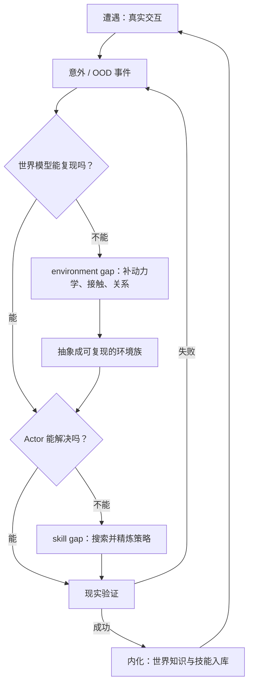

# MirroS：Physical RSI 需要同时改进 Actor 与世界模型

## 一屏概览

**这是什么。** MirroS（北京无限镜元）2026-08-06 的研究提纲，不是论文，也没有实验。它给出公司此后四项技术报告共同服务的框架：**Physical RSI 的瓶颈不在 Actor，而在环境**；要让智能体在开放物理世界里递归自我改进，必须把现实“镜像”成一个可执行、可验证、可修订的 **agentic world model**，并让 Actor 与世界模型共同进化。

**核心区分。** Karpathy 的 AutoResearch 之所以能闭环，是因为软件沙盒的世界规则已经写好：状态有限、目标明确、实验可重放。物理世界没有这份规则文件——规则写不全、条件在变、状态只能通过多模态部分观察、交互无法枚举。于是失败可能来自两个不同位置：

- **environment gap**：世界模型解释不了发生的事（例如电缆的路径、接触与张力如何共同导致机器狗被缠住）；
- **skill gap**：世界模型已经能复现，但 Actor 不知道该怎么做。

前者要求扩展世界模型，后者要求改进策略；把两者混为一谈，就会用“多训练策略”去补“世界模型缺了一块现实”的洞。

**八步循环。** 遭遇 → 意外 → 诊断 → 抽象 → 模拟 → 求解 → 验证 → 内化。OOD 事件（文中称 surprise）不是错误，而是路由信号：先判断缺口在哪一层，再把这次意外转成可复现的环境族与可验证的策略，最后把通过现实验证的部分固化为知识。

**路线图。** 四项能力分别对应循环的不同阶段：环境理解与抽象（diagnose → abstract）、agentic physical reasoning（simulate → solve → verify）、从经验持续学习（internalize）、主动发现未知（encounter → surprise）；另加两项横向要求——**下一代评测**（不看固定基准分数，而看系统把未知转成可验证能力的可靠性与效率）与**机制可解释性**（把内部世界表示当作监测与引导自我改进的仪器）。

**证据边界。** 本页只记录这份提纲的主张。它是立场文，不是对照实验；“environment gap / skill gap”目前是分析框架，不是已被独立测量的分类器。与库内 [[PhysicalRecursiveSelfImprovement|Physical RSI]] 的形式化相比，它多了“世界模型也要被改进”的对象扩展，但没有给出改进效率的定量判据。

## 为什么软件沙盒的经验不能直接搬

提纲用一个极简对照说明问题。AutoResearch 的循环是“改训练代码 → 跑固定实验 → 看验证集 → 保留有效改动”，每轮改进都发生在同一个已写好的世界里。物理场景里，连“验证集”本身都不稳定：

- 家庭机器人不可能拿到每件物体、每个人、每次接触的完整规则；
- 工厂控制器不能假设数字孪生永远准确，部件磨损和工况变化会让模型过期；
- 自主实验室会遇到现有假设解释不了的结果。

因此，物理世界的 RSI 必须把“世界模型是否够用”作为一等公民。文中给出的定义是：**agentic world model 不是像素级复制，而是把多模态经验翻译成关于实体、状态、关系与因果动力学的语言层抽象**；语言提供可迁移的先验，代码把先验变成显式状态变量与可执行动力学。这样得到的模型可能错，但错误可以被显式验证、定位和修订。

这与“生成更逼真的视频”是两条目标函数：视频世界模型可以画面合理而状态不守恒；可执行表示优先保证物理等价（组成、约束、演化一致），外观可以交给渲染器。后一项分工在 [[agentgarten-code-worlds-evolving-agents|AgentGarten]] 中被工程化：代码世界保留状态与规则，神经渲染器只负责“看起来怎样”。

## 从意外到知识：两个缺口与一条验证链

图为依据原文八步循环重画的流程，不是论文实验图。关键设计是**诊断先于求解**：只有先确认世界模型能复现失败，才能在同一个环境里比较策略；否则策略搜索会被错误的模拟器带偏。这与 [[topics/robot-harness-and-physical-rsi|机器人 Harness 与 Physical RSI]] 中“执行反馈、改进程序、独立验收要分开”的判断一致，但本提纲把“环境模型”单列为可改进对象。

## 路线图怎样对应到后续四项工作

| 提纲中的能力 | 对应循环阶段 | MirroS 后续公开工作 | 本文没有回答的问题 |
| --- | --- | --- | --- |
| 环境理解与抽象 | diagnose → abstract | [[code-as-world-executable-world-representations|Code-as-World]] 用代码表示组成、演化与外观，并从视频/文本反推 | 抽象何时算“够用”，由谁验收 |
| Agentic physical reasoning | simulate → solve → verify | Code-as-World 的 propose–execute–render–verify；[[agentgarten-code-worlds-evolving-agents|AgentGarten]] 的可交互代码世界 | 推理链的错误如何与表示错误分离 |
| 从经验持续学习 | internalize | AgentGarten 的 playbook 继承；S-Space 的测试时表示细化 | 继承的是知识、技能还是过拟合的提示 |
| 主动发现未知 | encounter → surprise | 尚未见到专门的主动探索报告 | 如何选择“最有信息量的意外” |
| 下一代评测 | 横向 | [[harnesseval-w-agentifying-evaluation-of-visual-worlds|HarnessEval-W]] 把评分变成可审计的证据树 | 评测器自身的能力边界与递归改进 |
| 机制可解释性 | 横向 | [[s-space-spatial-workspace-mllm|S-Space]] 读取并干预模型内部的空间表示 | 解释结果如何反馈到训练与评测 |

这张表是阅读后的对照，不是 MirroS 官方路线图；四项工作也不是按提纲顺序发布的。

## 该怎样读这份提纲

**可以支持的判断。** 物理世界的自我改进需要同时维护“关于世界的表示”和“在世界中行动的策略”；把二者混成一个 end-to-end 模型，会让失败诊断失去对象。用语言与代码承载世界表示，至少提供了可检查、可编辑、可执行的接口。

**不能直接推出的结论。** 代码表示一定优于视频世界模型；environment gap / skill gap 可以被自动、可靠地分类；或者“八步循环”已经在真实机器人上闭环。提纲没有给出任何成功率、样本效率或迁移数字。这些问题要回到具体论文与独立复现。

**与相邻工作的差别。** [[schema-discovering-unknown-environments-via-agentic-program-induction|Schema]] 在 ARC-AGI-3 里把环境规则写成可执行程序，[[tycho-active-abstraction-with-programmatic-world-models|Tycho]] 研究“何时值得建/修/绕过世界模型”，[[vista-a-visual-harness-for-reasoning-in-an-interactive-world|VISTA]] 把交互证据改成像素与视觉记忆。MirroS 的提纲把这条“程序化世界模型”路线从游戏环境推到物理世界，并加上“现实验证”这一环；但目前最硬的证据仍来自其代码世界与评测基准，而不是真实机器人上的长期 RSI。

## 证据定位

- 原文：MirroS Research，《Building Physical RSI Beyond the Known World》，2026-08-06，约 2,000 词，含 1 张故事板与 5 段视频（本地快照为 HTML，不含视频字节）。
- 关键段落：AutoResearch 的封闭沙盒；“environment gap / skill gap”；八步循环；四项能力路线图；评测与可解释性要求。
- 引用来源：Karpathy AutoResearch（2026）、A-Lab（Nature 2023）、Ha & Schmidhuber World Models（2018）、LeCun 自主智能路线图（2022）、World Labs Real2Sim2Real（2026）、Silver & Sutton《Era of Experience》（2025）。本页未独立核验这些被引工作。
