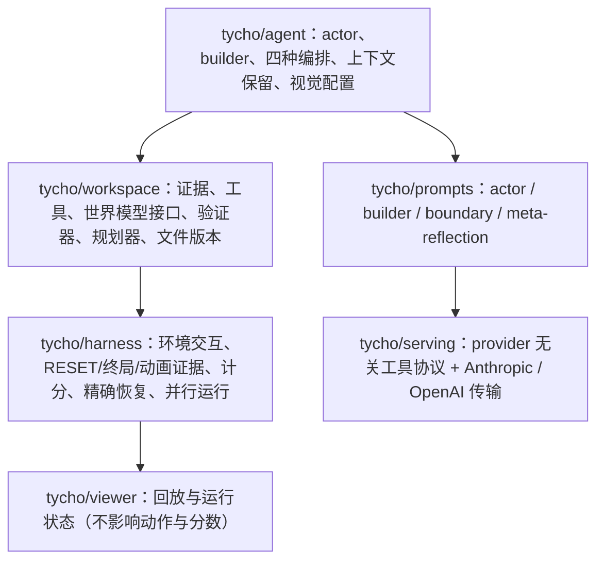

# NIMI-research/Tycho：证据工作区、可执行模型接口与可复算的跑分

## 1. 范围与可核查性

固定提交 `f68912a`（2026-07-29，Apache-2.0），`tycho/` 约 1.79 万行 Python，另有 51 个测试文件、6 份论文配置、6 张官方 scorecard 的 JSON。本页是静态核查，没有运行游戏或模型。

这个仓库在“可核查”上做得比多数同类项目彻底：

- `artifacts/evaluation_integrity.json` 把每个策略绑定到它的 canonical trace、SHA-256、官方 scorecard ID 与 RHAE；
- `artifacts/scorecards/` 直接提交六张卡（四种 Opus 4.8 策略 + GPT-5.6 Sol / Opus 5 的 orchestrator）；
- `PUBLIC_RELEASE_MANIFEST.json` 为 151 个跟踪文件记录摘要；
- `make validate` 检查摘要、扫描疑似凭据、解析全部论文配置、跑测试、构建 wheel，且不调用任何模型。

[[tycho-active-abstraction-with-programmatic-world-models|Tycho 论文]] 的 52 页与六个配置一一对应，读分数时可以顺着 `configs/paper/*.yaml` 与 `docs/PAPER_RESULTS.md` 复算。

## 2. 分层



判据仍是“谁拥有状态”：agent 决定策略，workspace 拥有证据与模型，harness 拥有环境与计分，viewer 只读。`tycho/agent/agent.py`（约 2,500 行）是最大的单文件，四种策略的差异集中在那里；`tycho/workspace/workspace.py` 定义磁盘布局。

## 3. 证据工作区：为 LLM 的可寻址性设计

每个游戏的目录长这样：

```
<root>/<game>/
  level_0/turn_000.txt     网格，空格分隔的十六进制字符（#16 色）
  level_0/turn_000.png     渲染图
  level_0/turn_000.json    {level, turn, action, x, y, state, available}
  level_0/diff_000_001.txt 关卡内精确格子差分（数量 + bbox + 列表）
  level_0/death_003.json   GAME_OVER 证据：动作前网格、终局网格、动作
  attempts/level_0_attempt_000/  不可变的先前尝试观测根
  notes/                   actor_beliefs.md、world_model.md、level_L_insights.md、scratch
```

两个细节体现“为模型设计”而非“为日志设计”：

- **网格格式是测过 token 成本的。** 代码注释记录了在真实 64×64 帧、Gemma tokenizer 下的相对开销：dense 0.51×（会合并格子，不可寻址）、spaced 1.0×、spaced_rownum 1.04×、spaced_grid8 1.09×、json 1.51×；默认选 `spaced_grid8`，因为行号与每 8 列的分隔符只多 9% token，却直接缓解了观察到的“网格迷失”。
- **尝试目录不可变。** 每关的 attempt 有独立观测根，失败后的重试不会覆盖旧证据；`WorkspaceVersionStore` 对 agent 自己维护的工作区做内容寻址快照。

## 4. 可执行模型接口

`world_model.py` 是一个自由形式的 Python 文件，约定五个入口：`State`、`init_state`、`transition`、`render`、`outcome`，可选 `actions`、`subgoals`、`heuristic`。`render` 允许用 `-1` 表示真正未知的格子——验证器会把“弃权”与“预测错”分开统计（精确预测、已知格准确率、覆盖率）。规划器只在模型表达的目标空间里搜索，模型可以随时被 actor 绕过。

这套接口与论文的形式化一一对应：`State`/`transition` 是 $\delta_\theta$，`render` 是 $\rho_\theta$，`outcome` 是 $\omega_\theta$，而 `-1` 是对“非单射观测”的显式承认。

## 5. 隔离与复现

- agent 写的 Python 与模型重放都在新起的 Docker/Finch 容器里跑：无网络、只读根文件系统、CPU/内存/进程数受限、只挂载当前游戏工作区。
- 四种策略共享同一套证据与动作协议，因此策略间的差异不是实现差异。
- 精确恢复（`--resume`）与并行运行在 `tycho/harness/run_parallel.py`，但论文的 25 局匹配实验是一局一次运行。

## 6. 证据边界

- **已核查（静态）**：目录结构、证据格式、模型接口、容器参数、六张 scorecard 与配置的对应、manifest 与测试的存在。
- **未核查**：实际运行行为、论文中 token 与成本数字的复算、四种策略的分数复现。
- **一个值得注意的缺口**：仓库提交了 scorecard 与 trace 摘要，但没有提交完整的 25 局原始对话；要复算 RHAE 需要 ARC Prize 的卡与 trace 包，而不是仓库本身。
- **开发史被压缩成一个提交**（152 个文件，2026-07-29），因此无法从 git 历史看出策略演化；作者用 `artifacts/` 与论文附录补偿。

## 7. 与另外两个实现的关系

与 [[ryanbbrown-retrodict-repository|Retrodict]] 相比，Tycho 的工程重心在“让模型可验证、可规划”，而不是“让日志可 grep”；与 [[joshhhhhan-vista-repository|VISTA]] 相比，Tycho 不保存原始图像历史，而把观测压成可寻址的文本网格与差分。三条路线共享的底层判断是一致的：**模型自己写的信念必须从属于可重放的记录**。横向对照见 [[topics/arc-agi-3-harness-design|ARC-AGI-3 Harness 设计]]。
