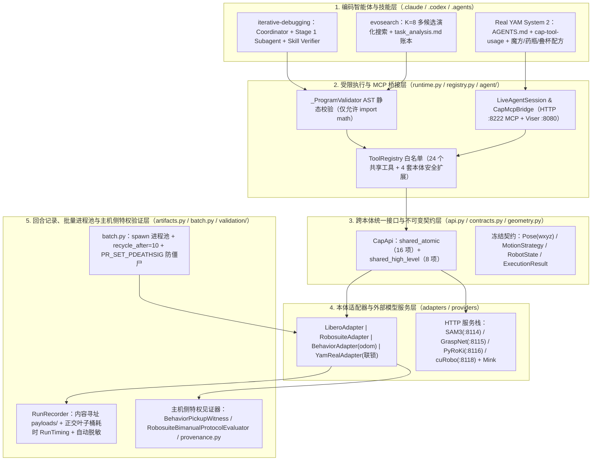

# NVlabs/ASPIRE 公开实现：工程架构与核心机制核查

## 1. 版本演进（`v0.1` $\to$ `v1.0`）、核查范围与五层架构

本页静态核查官方仓库 [`NVlabs/ASPIRE` 固定提交 `fa00f0ef`](https://github.com/NVlabs/ASPIRE/tree/fa00f0ef2bc1d91d594b9aa502c22133c9f538f7)（`main` 分支 `ASPIRE v1.0 release`，提交时间 2026-10-15，Apache-2.0 许可证），并交叉对照其同日保留的论文期分支 [`v0.1`（提交 `317a72e6`）](https://github.com/NVlabs/ASPIRE/tree/317a72e649d9c083298a1724d873491e499c0712)。本地归档 `raw/nvlabs-aspire-repository-2026-10-17-cdf064f957c9.tgz` 保存了 `v1.0` 的 61 个核心工程文件（完整清单见文末表格）；[[aspire-agentic-skills-discovery-for-robotics|ASPIRE 论文]] 阐述了算法动机与基准实验，本页聚焦从 `v0.1` 到 `v1.0` 的架构重构、受限代码沙盒、盲测技能验证器、跨本体物理语义修正与双臂 YAM 真机 System 2 MCP 闭环。本轮为静态源码与工程记录核查，未在本机启动 GPU 仿真或连接真实机械臂。

### 1.1 `v0.1`（论文期代码）与 `v1.0`（`cap-harness` 统一架构）的关键差异

仓库目前通过两个分支承载不同阶段的实验资产（`README.md:99–162`）：

| 维度 | `v0.1` 分支（提交 `317a72e6`，对应 2026-06 论文初版） | `main` / `v1.0` 分支（提交 `fa00f0ef`，2026-10 发布） |
| --- | --- | --- |
| **代码包结构** | 拆分为独立的 `aspire/sim/`（基于 CaP-X 的 LIBERO / Robosuite / BEHAVIOR 脚本）与 `aspire/real/`（双臂 YAM 桌面清理与跨本体迁移工程） | 统一打包为 `src/cap_harness/`（`pyproject.toml`），将 LIBERO-Pro、Robosuite、BEHAVIOR-1K 与真机 `yam_real` 收敛到同一套类型化契约与 `ToolRegistry` |
| **非特权隔离机制** | 依赖 `CLAUDE.md` 与提示词约定禁止访问 `env.handle.env.sim` 或 `sim.data.body_xpos`（论文附录 E.2） | 在 `runtime.py` 中用 **AST 语法树校验器 `_ProgramValidator`** 静态拦截模块导入与私有属性，配合白名单命名空间注入与主机侧特权见证器（Witness）实现硬隔离 |
| **技能入库门控** | 子智能体写 `findings.md`，由协调器按提示词做文本级可复用性审查（论文附录 E.1） | 新增**独立盲测验证器子智能体（`verifier-prompt.md`）**、技能使用评级回流（`skill_report.json`）、响亮/静默失配触发器修剪法则与 AST 静态检查器（`lint_skills.py`） |
| **仿真与模型规模结果** | Claude Opus 4.6；Robosuite `nut_assembly` 为 9%、`two_arm_lift` 为 71% | 扩展对比 12 个编码智能体模型（从 GPT-6 Luna 15% 到 Claude Opus 5.5 99% 成本—成功率前沿）；Robosuite `nut_assembly` 升至 **99%**、`two_arm_lift` 升至 **100%**（`robosuite/SUCCESS_RATES.md`） |
| **真机交互范式** | `aspire/real/` 下基于 Portal + BundleSDF + SAM3 的长时域桌面清理脚本与跨本体调试实验 | 新增 **Real YAM System 2 原生 MCP 服务（`cap_harness.agent`）** + Viser 实时 3D 工作台，支持 GPT-6 Astra 在线闭环复原三阶魔方、拧瓶盖倒药片、装药拧盖与倒扣叠杯 |
| **独有实验入口** | 仍承载论文中的零样本迁移（`zeroshot-transfer`）、技能库规模扩展律（`library-size-scaling`）、推理时扩展与调试 Token 消融（`training-law`）说明文档 | 承载双平台（`.claude/skills/` 与 `.codex/skills/`）的 `iterative-debugging`、`evosearch` 以及真机 `.agents/skills/` 操作规范 |

### 1.2 `cap-harness` 五层单向工程架构



上述架构图依据 `src/cap_harness/run.py:1–350`、`runtime.py:1–320`、`registry.py:1–200` 与 `docs/environments.md` 整理。模拟器环境（`.venv-libero`、`.venv-robosuite`、`.venv-behavior`）保持纯客户端轻量化安装，不携带 PyTorch 或分割/抓取模型依赖，而是通过 HTTP 调用由 `scripts/supervise_services.sh` 统一监管的共享模型服务栈（`docs/environments.md:1–55`）。唯一的例外是运行在 Isaac Sim 5.1 / OmniGibson 上的 `BEHAVIOR-1K`：由于外部 cuRobo HTTP 服务没有 R1 Pro 机器人模型且仅能看到点云，其运动规划通过 `src/cap_harness/behavior/planning.py:1–60` 在模拟器进程内直接调用 OmniGibson 的 `CuRoboMotionGenerator`（使用模拟器原生机器人模型与完整世界几何），同时显式设置 `DEFAULT_BATCH_SIZE = 1` 与 `DEFAULT_USE_CUDA_GRAPH = False` 以防在 24 GB 显存卡上与 Isaac 争抢显存导致 CUDA 图捕获失败污染后续分配。

## 2. 受限代码沙盒、特权状态剥离与密封溯源门控

在代码即策略基准中，最隐蔽的作弊或基准失真方式是生成的 Python 程序直接读取模拟器的 MuJoCo `sim.data.body_xpos`、隐藏奖励或 `.bddl` 场景文件。`v1.0` 用三道代码级硬防线替代了纯提示词约束：

### 2.1 AST 语法树校验与无特权白名单注入（`runtime.py`、`registry.py`）

当 `ProgramExecutor.execute_program(code)`（`src/cap_harness/runtime.py:243–296`）执行智能体生成的 `program.py` 时：

1. **编译前 AST 静态拦截（`_ProgramValidator`，`runtime.py:124–169`）：** 拒绝 `AsyncFunctionDef`、`Await`、`ClassDef`、`Delete`、`Global`、`ImportFrom`、`Nonlocal` 与 `With` 节点；拒绝任何以 `_` 开头的私有或双下划线属性/名称访问（`node.attr.startswith("_")`），从而封死通过 Python 反射或内部属性解包模拟器对象的路径；`Import` 节点**仅允许无别名的 `import math`**（`ALLOWED_IMPORTS = frozenset({"math"})`）。源码注释（第 135–139 行）专门解释了为何允许 `ast.Lambda`：既然允许 `def` 函数且名称/属性检查会递归进入函数体，禁止 `lambda` 只会让 `sorted(..., key=lambda ...)` 等正常排序代码变得笨拙，而不增加任何安全性。
2. **最小内置函数与只读命名空间（`runtime.py:49–91、224–241`）：** 执行环境的 `__builtins__` 被替换为 `MappingProxyType` 包装的 26 个纯计算内置函数（不含 `open`、`eval`、`exec`、`getattr`、`globals`），仅注入 6 个冻结契约构造器（`ArmCommand`、`MotionStrategy`、`Pose`、`RobotAction`、`SynchronizedTrajectory`、`Trajectory`）与 `ToolRegistry` 中的公开工具；命名空间由不可变的 `_ToolNamespace` 封装，任何修改命名空间属性的尝试直接抛出 `AttributeError("tool namespaces are immutable")`。
3. **返回值特权字段剥离与只读数组（`runtime.py:93–108`、`contracts.py:88–112`）：** 所有契约中的 NumPy 数组均以 `copy=True` 拷贝并设置 `result.setflags(write=False)`；公开工具返回前过滤 `_SENSITIVE_KEYS`（`ground_truth`、`mujoco`、`native_env`、`object_pose`、`privileged`、`qpos`、`qvel`、`reward`、`sim_state`、`success` 等 13 类敏感词），生成的程序在运行期既看不到奖励也看不到成功标志。

### 2.2 主机侧特权协议见证器（Protocol Witnesses，`validation/evaluators/`）

模拟器原生成功谓词有时过于宽松（例如只要物体最终高度达标即判成功，不检查是否真正完成了双臂交接），但若向策略暴露中间检查又会泄漏特权状态。`cap-harness` 在 `src/cap_harness/run.py:239–261` 中设计了**主机侧单向绑定的协议见证器（Protocol Evaluator）**：它在每步 `after_step(action, result)` 监听底层 `native_env`，结果只写入 `evaluation/protocol.json` 与 `outcome.json` 的 `protocol_success`，绝不进入公开 API 或调用追踪：

- **BEHAVIOR-1K 拾取见证器（`BehaviorPickupWitness`，`validation/evaluators/behavior_pickup.py:1–150`）：** 在任务实例加载并完成 25 步物理沉降后记录目标物体的初始高度 `_baseline_z`。每步同时检查两个条件：（1）机械臂的 `is_grasping` 为真；（2）物体当前高度相对 `_baseline_z` 抬升至少 `LIFT_THRESHOLD_M = 0.005`（$5\text{ mm}$）。首次同时满足时锁存 `protocol_success = True` 并记录 `first_held_step`、`first_lifted_step` 与 `max_clearance_m`，且以该见证器裁决作为 `outcome.json` 的 `task_success`（`docs/run-artifacts.md:166–170`）。
- **Robosuite 双臂协议状态机（`RobosuiteBimanualProtocolEvaluator`，`validation/evaluators/robosuite_bimanual.py:1–215`）：** 针对 `two_arm_lift` 与 `two_arm_handover` 维护纯状态机 `BimanualProtocolTracker`，逐步追踪主副臂抓持布尔值、物体离桌净空高度、锤柄三维位置、接收臂到锤柄距离以及副臂手指与锤柄/锤头的接触几何对数（`secondary_handle_full_finger_contacts`），要求 `program_ok`、`task_success` 与 `protocol_success` 三项同时为真才通过验收门控（`docs/robosuite.md:49–69`）。

### 2.3 种子划分审计与密封环境溯源（`audit_seeding.py`、`provenance.py`）

源码中的 `.claude/skills/iterative-debugging/scripts/audit_seeding.py:1–45` 记录了一次极具警示意义的真实基准事故：**早期实验曾因适配器重置路径缺陷，在 `--init-mode seeded` 下重置后又恢复了 `saved` 状态 0，导致所有种子实际上跑在完全相同的场景布局上，致使修复前的所有跑分作废**（亦见 `docs/libero-pro.md:72–86`）。为此，仓库不仅修复了 `LiberoAdapter` 的 `saved`（按 `(seed - 1) % N` 循环读取有限预设初始态，seeds 51+ 会与前 50 个状态重复）与 `seeded`（用种子初始化环境随机数生成器做程序化采样，不再覆盖保存态）两种模式，还专门编写了四项自动化种子审计：

1. **`vary`（跨种子变动性）：** 读取原生 MuJoCo 中所有自由关节（`jnt_type == 0`）的三维坐标，检验各可动物体在不同种子间是否真正发生位移（输出毫米级跨度 `spread (mm)`）；
2. **`repeat`（同进程与跨进程可复现性）：** 在同一进程内对同一组种子重置两次并比对自由关节签名哈希，再与新进程哈希对比，确保 `seed -> layout` 是确定性映射；
3. **`distinct`（留出集无碰撞且与开发集不相交）：** 検証留出集 seeds 1–50 具有 50 个互异签名，且与开发集 seeds 51–70 的交集为空；
4. **`modes`（模式区分度）：** 检验 `seeded` 与 `saved` 是否产生不同签名。

在正式验收评测时，`src/cap_harness/validation/provenance.py:80–145` 的 `seal_environment` 进一步强制要求 Git 工作树干净无未提交修改（`require_clean_worktree`），对仓库全部跟踪文件按路径排序计算整体 `source_tree_sha256`，连同 Python 版本、关键包版本、渲染环境变量（`CUDA_VISIBLE_DEVICES`、`MUJOCO_EGL_DEVICE_ID`）及 `configs/dependency-lock.json` 哈希一并封入 `environment.json`，并注入每次子运行中供事后校验。

## 3. 不可变回合记录、正交叶子桶耗时归因与批量进程池

### 3.1 不可变产物结构与记录性能优化（`artifacts.py`）

`RunRecorder`（`src/cap_harness/artifacts.py:1–250`）为每次 `cap-harness run` 创建带 UTC 时间戳与随机后缀的独立目录，绝不覆盖旧运行。每次运动原语调用（`move_to_pose`、`move_to_joints`、`close_gripper` 等 10 个动作工具，`runtime.py:309–325`）自动在执行前后保存无损 RGB 关键帧（`before-<name>` / `after-<name>`）并在首个关键帧附上深度 `.npy`。源码中有两项非常扎实的系统优化：

1. **关键帧 PNG 压缩级别调优（`PNG_COMPRESS_LEVEL = 1`，`artifacts.py:51–56`）：** 源码实测表明，在 $800 \times 512$ 分辨率下，zlib 默认压缩级别 6 每次写关键帧耗时 $136\text{ ms}$，而级别 1 仅耗时 $33\text{ ms}$（文件仅从 $435\text{ kB}$ 增至 $492\text{ kB}$）。由于每次运动调用写两张关键帧，默认级别 6 竟占用了整个录制回合墙钟时间的约 **16%**；改为级别 1 在保持无损画质的同时直接消除了这一 I/O 瓶颈。
2. **叶子桶正交耗时归因（`RunTiming`，`artifacts.py:66–106`）：** 為了精確回答“墙钟时间花在了哪里”，`RunTiming.measure(bucket)` 在上下文退出时计算 `elapsed = time.monotonic() - started`，并减去该区间内所有嵌套子桶已认领的耗时 `nested = self._attributed - attributed_at_start`，仅将净余量 `max(elapsed - nested, 0.0)` 计入当前桶。因此 `reset` 桶自动扣除其内部写关键帧的耗时，`record_step` 自动扣除编码 H.264 视频帧的耗时；所有叶子桶（`adapter_step`、`setup`、`reset`、`record_step`、`video_encode`、`keyframe`、`overlay`、`trace_write`、`provider.<name>`、`finalize`）之和严格等于 `attributed_s`，而未被任何桶认领的差值 `wall_s - attributed_s` 恰好就是生成的 Python 策略自身与胶水代码的耗时（`unattributed_s`）。每次测量的开销仅约 $4\ \mu\text{s}$（1000 步回合共 $4\text{ ms}$）。

### 3.2 Spawn 进程池、GL 驱动防泄漏与内核级防僵尸机制（`batch.py`）

在调试与验证循环中，對 15 个或 50 个种子逐一启动独立 Python 解释器会反复付出导入模拟器栈的高昂启动成本。`src/cap_harness/batch.py:1–355` 实现了 `cap-harness run-batch`，在**按 Worker 复用模块导入、但绝不跨种子复用环境实例**的前提下，通过四项硬措施保证跨种子独立性与系统稳定性：

1. **强制 `spawn` 上下文与全局随机流重播（`batch.py:175–183、301–303`）：** 使用 `multiprocessing.get_context("spawn")` 而非 `fork`，避免子进程继承父进程的 CUDA、EGL 或 MuJoCo 状态；每个种子开始前显式调用 `random.seed(seed)` 与 `np.random.seed(seed)`，确保随机抽样只取决于当前种子号而非 Worker 执行历史。
2. **双层文件描述符重定向捕获 C 层输出（`_captured_output`，`batch.py:217–238`）：** Python 的 `contextlib.redirect_stdout` 仅重绑定 `sys.stdout` 对象，无法拦截 MuJoCo、EGL 与 ffmpeg 直接向操作系统文件描述符 `fd 1` / `fd 2` 写入的 C 层日志；`_captured_output` 同时执行 `os.dup2(stream.fileno(), 1/2)` 与 Python 重定向，使批量运行的单种子日志与独立进程完全一致。
3. **定额退休重建防止 OpenGL/EGL 驱动泄漏（`DEFAULT_RECYCLE_AFTER = 10`，`batch.py:48、316–348`）：** 在同一进程内反复创建和销毁 OpenGL 上下文极易触发显卡驱动内存泄漏。`run_seeds` 为每个 Worker 分配最多 `recycle_after=10` 个种子的独立队列，跑满即销毁 `ProcessPoolExecutor` 并拉起新进程；同时放弃在子进程段错误或 OOM 被杀时会永久卡死 `imap_unordered` 的 `multiprocessing.Pool`，改用能立即抛出 `BrokenProcessPool` 并继续后续世代的 `ProcessPoolExecutor`。
4. **Linux `PR_SET_PDEATHSIG` 防止 GPU 僵尸进程（`_die_with_parent`，`batch.py:92–118`）：** 源码注释记录了一次真实故障：当父进程被 `SIGKILL` 或终端断开时，阻塞在 MuJoCo 或 EGL 驱动 `futex_wait_queue_me` 中的 Worker 永远无法走到下一次队列读取，曾导致 **4 个被 `init` 收养的僵尸 Worker 在后台驻留长达 30 小时，每个占用约 1.4 GB 内存、64 个原生线程和 1 个 GPU 上下文**。为此，Worker 启动时通过 `libc.prctl(PR_SET_PDEATHSIG, signal.SIGKILL, 0, 0, 0)` 请求 Linux 内核在生成它的父线程退出时立即向其发送 `SIGKILL`，并在设置后立刻检查 `if os.getppid() == 1: os._exit(1)` 以闭合父进程在 `spawn` 与 `prctl` 之间死亡的竞态窗口。

## 4. 技能生命周期的工程升级：独立验证器、反膨胀规则与静态 Linter

对比论文 v1 与 `v1.0` 仓库，ASPIRE 在 `.claude/skills/iterative-debugging/` 中对“技能如何入库、如何维护、如何防劣化”做了一套极其严密的工程升级，直接回应了论文 §5 提到的技能库污染问题。

### 4.1 独立盲测技能验证器（Skill Verifier，`verifier-prompt.md`）

在 `v1.0` 中，任何发现新修复的子智能体（Proposer）都**无权直接修改 `.claude/skills/iterative-debugging/skills/`**（`skills/README.md:19–40`）。一个候选技能要进入共享库，必须经过三步闭环：

$$\text{Subagent 提议（\texttt{skill\_report.json}）} \longrightarrow \text{Verifier 盲测复现（\texttt{verification\_report.json}）} \longrightarrow \text{Coordinator 晋升入库}$$

根据 `.claude/skills/iterative-debugging/verifier-prompt.md:1–185`，当某个任务提出新技能或修改建议时，协调器在隔离工作区 `$VERIFY_DIR`（位于 `<campaign root>/verification/<benchmark>__<suite>__task_<id>`，刻意設在所有任务目录之外）派发一个独立的 **Skill Verifier** 子智能体：

- **信息隔离铁律（Reading Rules，`verifier-prompt.md:45–84`）：** Verifier 只被允许读取现有共享技能库（`skills/`）、待测提案（`$VERIFY_DIR/proposed_skills.md`）和公开 API 文档；**严禁读取提议者的 `fix_code.py`、`findings.md`、`task_analysis.md`、任何其他任务目录，以及仓库自带的 `examples/`**（因为 `docs/libero-pro.md` 会指向 `examples/` 中的成型解法，偷看示例等同于抄答案）。一旦误打开上述文件，必须立即停止并将裁决设为 `verdict: void`。
- **刻意收紧的复现预算（Budget，`verifier-prompt.md:88–138`）：** Verifier 仅在 **5 个开发种子（seeds 51–55）**上测试，最多允许编写 **2 个程序版本**：第一版 `v01_from_skills.py` 必须**逐字照搬**提案中的代码片段（仅替换当前任务的物体名与提示词，严禁顺手修补提案中的缺陷，否则会掩盖坏技能）；若通过种子数 $< 4/5$，允许根据自身运行追踪再写一版 `v02_<slug>.py` 并记录“技能漏掉了什么关键信息（`gaps`）”。两版内达到 $\ge 4/5$ 成功才判为 `verified`，否则判为 `refuted`。
- **区分“可传递性（Transmits）”与“可泛化性（Generalizes）”：** `verifier-prompt.md:7–12` 与 `skills/README.md:31–46` 给出了非常清醒的认识论界定：**由于 Verifier 是在提取该技能的同一任务上进行盲测，通过验证仅证明该技能文本“写得足够清楚、足以向未见过答案的智能体传递修复方案（transmits）”，尚不证明它能跨任务泛化（generalizes）**；跨任务泛化证据必须在后续不同任务的实战中，由各任务子智能体在 `skill_report.json` 中对所读技能章节给出 `useful`、`misleading`、`wrong` 或 `not-applicable` 四级评分后逐步累积。

### 4.2 响亮失配 vs 静默失配的触发器修复法则与反膨胀治理（`main-agent-prompt.md`）

在 80 任务的 LIBERO-Pro 实战中，维护共享技能库暴露出了两个典型问题：一是不同任务对同一条技能分别打出 `useful` 和 `misleading`；二是不断追加注意事项导致技能文件失控膨胀。`main-agent-prompt.md:274–356` 对此制定了两条工程铁律：

1. **按失配是“响亮（Loud）”还是“静默（Silent）”决定修法（第 289–307 行）：**
   - **响亮失配（Loud misfit，如机械臂卡住、IK 拒绝、夹爪抓空）：** 保持**宽触发器（broad trigger）**，并在代码片段开头加上**零步耗时的可执行前置条件（precondition）**（例如先调 `solve_ik` 检查可达性，消耗 0 个仿真步）。源码统计显示，在 1,372 次技能查阅中有 394 次被标为 `not-applicable`，宽触发器多读一次几乎没有代价，而每次收窄文字范围都会引发繁琐的边界争论。
   - **静默失配（Silent misfit，配方在错误物体上“假装成功”）：** 必须**硬性收窄触发条件（narrow the trigger hard）**并注明验证范围。源码记录了一个真实反例：某任务在验证范围外使用水平腕部抓取，结果夹爪抓到了上一层抽屉的把手，闭合后夹爪宽度 `jaw_after_close = 0.0188 m` 恰好等于真实把手的直径，导致所有自检全部通过，最终在 50 个留出种子上得 **0/50**。
2. **条目只写当前真值，历史移入 Changelog（第 330–355 行）：** 源码披露，在前一轮未加控制的实验中，`transport.md` 曾膨胀到 **28,000 词（60% 是评注，31 个标题下堆了 191 个修正块）**，导致某个子智能体直接复制了位于上半部分的修正前代码片段（而真正的修正写在下一节的引用块里），在验证中拿到 **0/5**。因此 `v1.0` 规定：被证伪的论断直接替换、重测的数值直接覆盖、针对代码片段的修正必须写进代码注释内，旧表述一律移入 `<file>-changelog.md`，单条技能超过约 400 词即视为叙事冗余信号。

### 4.3 源自 80 任务真实事故的技能库静态检查器（`lint_skills.py`）

每次晋升技能后，协调器必须运行 `.claude/skills/iterative-debugging/scripts/lint_skills.py:1–250`。该脚本的文档字符串明确说明：**其中的每一条检查都不是凭空设想的，而是直接对应 80 任务战役中曾造成真实运行失败的事故**：

| 检查级别与名称（`lint_skills.py`） | 检查机制 | 源码记录的真实事故代价 |
| --- | --- | --- |
| **Error 1：沙盒拒绝（Sandbox rejection）** | 提取 Markdown 中所有 ` ```python ` 代码块，送入 `cap_harness.runtime._ProgramValidator` 做 AST 校验 | 技能库中被复制最多的一个辅助函数曾含有一处 `getattr()`，导致连续 3 个智能体粘贴后在所有种子上直接报 `program_error` |
| **Error 2：未定义辅助函数（Undefined helpers）** | 检查代码块中调用的所有函数是否属于公开 API（自动从 `docs/api-reference.md` 解析，含 6 个大写契约构造器）、Python 内置函数或库内已定义函数 | `quantile()` 曾在两个技能文件中被调用 89 次却从未定义，导致 3 个 Verifier 在第一次尝试时直接死于 `NameError` |
| **Error 3：无空分支的预置搜索（`seeded_search` / `unguarded_reduction`）** | AST 检测 `for/while` 含 `break` 的搜索循环前是否将结果变量预置为非 `None` 实值，或对未检查非空的列表直接调 `min/max(..., key=...)` | 搜索倾斜角前写 `quat = downward` 导致“没有任何倾斜角匹配”时静默沿用已知会碰撞的默认朝向，在 10 个航段中有 7 个半空掉物，得 0/5 |
| **Error 4：悬挂跨文件引用（`dangling_refs`）** | 归一化反引号与格式符后，校验跨文件 `other.md §Section` 引用是否仍能匹配目标标题 | 4 次并行重写曾留下 15 处失效章节指针，导致读者找不到修正说明而发运了旧版错误代码 |
| **Advisory 4 & 5：无步数预算的循环 / 未标明负载的伸展半径** | 正则扫描含 `repeat / strokes / increments` 却未注明 tick 成本的段落，以及给出米级 `reach / insertion / envelope` 却未说明夹爪是空载还是持物的描述 | 1000 步上限淘汰的验证尝试多于任何几何错误（曾有条目建议 4–5 次往复，而单次往复就耗费 550–630 步）；另有两项任务公布了空夹爪测得的伸展包络，持物时工具提前 7–9 cm 卡住被容器边缘刮落 |

此外，为了解决无人值守战役中“子智能体执行 `rm -rf` 等需人工审批的命令导致挂起等待”的问题（源码记录曾有一个 Worker 因 `rm -rf` 5 个探测目录等待审批而白白阻塞了 **14 小时 18 分钟**，整场战役累计损失 29.5 小时，`verifier-prompt.md:36–43`、`main-agent-prompt.md:196–210`），仓库不仅在所有提示词中严禁运行 `rm`（改用工作区内的 `mv ... archive/`），还配备了后台守护脚本 `watchdog.py`，一旦发现活跃智能体静默超过 `--idle-limit` 即打印其最后一条 Shell 命令告警。

### 4.4 Robosuite 困难任务在 `v1.0` 中的突破：以 `nut_assembly` 与双臂交接为例

在 [[aspire-agentic-skills-discovery-for-robotics|ASPIRE 论文]] 表 3 中，Robosuite 的精密装配任务 `nut_assembly` 成功率仅为 **0.09**，`two_arm_lift` 为 **0.71**。而在 `v1.0` 仓库的 `.claude/skills/iterative-debugging/robosuite/SUCCESS_RATES.md` 中，7 项任务的 100 种子留出评测通过率全面跃升：

| Robosuite 任务 | 论文 v1（Opus 4.6） | 仓库 v1.0（`SUCCESS_RATES.md`，100 留出种子） | 仓库检入的修复程序路径 |
| --- | --- | --- | --- |
| `cube_lifting` | 0.97 | **1.00（100/100）** | `robosuite/cube_lifting_fix_code.py` |
| `cube_stack` | 0.99 | **0.97（97/100）** | `robosuite/cube_stack_fix_code.py` |
| `cube_restack` | 1.00 | **1.00（100/100）** | `robosuite/cube_restack_fix_code.py` |
| `spill_wipe` | 0.99 | **0.95（95/100）** | `robosuite/spill_wipe_fix_code.py` |
| `two_arm_handover` | 0.92 | **0.90（90/100）** | `robosuite/two_arm_handover_fix_code.py` |
| `two_arm_lift` | 0.71 | **1.00（100/100）** | `robosuite/two_arm_lift_fix_code.py` |
| `nut_assembly` | 0.09 | **0.99（99/100）** | `robosuite/nut_assembly_fix_code.py` |
| **7 任务平均** | **0.81** | **0.973（681/700）** | — |

核查 `.claude/skills/iterative-debugging/robosuite/nut_assembly_fix_code.py:1–102`，可以看到生成的纯 Python 策略（无任何外部导入，完全在 AST 沙盒内运行）是如何攻克方螺母套方柱（`nut_assembly`）的：

1. **顶面点云切片与 401 角最小面积外接矩形拟合（第 5–24 行）：** 通用点云包围盒容易受侧面遮挡和孔洞干扰。`rectangle(points)` 先取点云 $Z$ 坐标的 $85\%$ 分位数 `top`，仅保留 `z > top - 0.002` 的顶面薄层点；随后在 $[-1, 1]$ 斜率范围内遍历 401 个方向角，投影计算二维外接矩形面积 `(higha - lowa) * (highb - lowb)`，精确锁定方螺母与方柱的主轴方向 `(ux, uy)`。
2. **基于截面宽度不对称性区分螺母“孔端（hole）”与“手柄端（handle）”（第 51–59 行）：** 方螺母一端带凸出手柄、另一端为方孔。程序分别截取主轴两端各 $18\%$ 区间内的顶面点（`low_end` 与 `high_end`），比较两端在次轴方向上的宽度跨度：较窄的一端必然是凸出手柄，较宽的一端则是围绕方孔的环体。由此无需任何模拟器真值，直接从点云几何算出方孔中心 `hole_a = amin + width * 0.5`、抓取点手柄中心 `handle_a = amax - (length - width) * 0.25` 以及两者偏心距 `offset = handle_a - hole_a`。
3. **利用方柱四重旋转对称性预检 PyRoKi IK（第 60–75 行）：** 螺母套入方柱有 4 个相差 $90^\circ$ 的等价朝向 `directions = ((pu, pv), (-pv, pu), (-pu, -pv), (pv, -pu))`。程序按与当前抓取轴内积从大到小（即所需腕部旋转角最小）排序，对每个候选朝向计算对应的手柄放置点 `candidate_handle = target + candidate_axis * offset`，并调用零步耗时的 `solve_ik(..., backend="pyroki")` 同时预检悬停位（`hover`）与释放位（`release_z`）的逆运动学可达性，选出第一个高低位均可达的对称方向；若旋转角较大（内积 $< 0.8$），则在悬停高度分 $0.25, 0.5, 0.75$ 三步插值过渡朝向后再垂直套入方柱。

而在 `BEHAVIOR-1K` 上，`.claude/skills/iterative-debugging/behavior/SKILL.md:1–95` 明确记录了一项相对原论文的**刻意协议改进**：原论文按任务分别维护技能库，而 `v1.0` 将技能库提升到 `$RUN_ROOT/behavior/skill-library/` 由两项任务（收音机与易拉罐）跨任务共享，且每个种子通过不断向 `policy.py` 追加 `# Code block N` 并从头重置运行来生长策略；Stage 1（seeds 26–35）结束后冻结技能库并生成 SHA-256 清单，Stage 2（seeds 1–25）对每个评测种子派发全新的智能体，仅凭冻结技能库从空白 `policy.py` 开始逐块编写策略。

## 5. 跨本体物理控制语义与双臂 YAM 真机 System 2 闭环

### 5.1 跨本体控制与规划语义的关键工程修正（`api.py`、`adapters/`）

在将同一套 `CapApi` 对接到 LIBERO-Pro、Robosuite、BEHAVIOR-1K 和真机双臂 YAM 时，源码修正了多处仅靠阅读论文无法发现的底层物理差异：

1. **模拟器速度型夹爪 vs 真机位置型夹爪（`docs/api-reference.md:45–56`、`robosuite/adapter.py:55–61`）：** 在 LIBERO、Robosuite 和 RoboCasa 中，底层 `simple_grip` 控制器实际上将动作解释为**指爪闭合速度（`goal_qvel`）**而非位置——正负号决定开合方向，数值大小仅决定移动快慢，夹爪物理上只能停在全开（`1.0`）或全闭（`0.0`）两个端点。源码实测指出，在 `libero_10_swap/task_7` 上调用 `set_gripper(0.669)` 和 `set_gripper(0.933)` 会因为永远无法收敛到中间宽度而各自白白耗尽 60 个控制步（占整个回合步数预算的 12%），且最终停在全开状态。因此 `v1.0` 在上述三个仿真器上直接拒绝 $(0.0, 1.0)$ 之间的中间值（返回 `unsupported`），仅在具有真实位置伺服的真机 `yam_real` 上允许比例宽度控制。
2. **锁存“下发夹爪目标”而非“到达宽度”以防半途掉物（`api.py:107–115`）：** 当机械臂成功抓住刚体时，指爪被物体挡住而无法闭合到 `0.0`，此时 `close_gripper()` 会因未达全闭目标返回 `ok=False`。早期实现仅在命令返回 `ok=True` 时更新缓存的夹爪目标，导致夹爪目标仍停留在抓取前的 `1.0`（全开）；结果下一步调用不带夹爪参数的 `move_to_pose()` 时，系统自动补入缓存的 `1.0`，瞬间把刚抓起的物体松手扔掉。`CapApi._commanded_gripper_positions` 改为记录**每一次被接受的下发目标**（无论是否因接触受阻而未收敛），彻底消除了这一静默掉物缺陷。
3. **释放后物理沉降必须显式推进仿真步（`skills/transport.md:54–80`）：** 当夹爪已经处于全开状态（`1.0`）时，再次调用 `set_gripper(1.0)` 会被适配器立即短路返回 `steps_executed = 0`（不推进任何物理时间）。若策略依赖 `for _ in range(3): set_gripper(1.0)` 等待物体落桌沉降，实际上获得了 **0 个物理步**。因此 `transport.md` 规定必须用 `step(RobotAction(...))` 保持当前测量关节角显式步进物理时钟。
4. **BEHAVIOR-1K 的固定 `odom` 坐标系与可通行栅格 1 m 跳点导航（`behavior/adapter.py:1–85`、`behavior/skills/navigation.md`）：** 移动机器人在房间内行驶后，若所有坐标定义在随车移动的 `base` 系下，此前定位的物体坐标就会全部失效。`BehaviorAdapter` 在实例加载时的底盘投影处建立固定 `odom` 坐标系，使行驶前定位的收音机坐标在行驶后依然有效。同时，由于 OmniGibson 的 cuRobo 底盘规划器仅做轨迹优化而不做全局图搜索，隔着茶几或跨房间的目标会耗时 20–27 s 后报 `TrajOpt Fail`；适配器先用按底盘半径膨胀的可通行图（`base_pose_is_free`）毫秒级过滤掉落在沙发/茶几内部的死目标（`route: goal_blocked`），在直连规划失败时自动沿可通行图最短路径切分为 `BASE_HOP_M = 1.0 m` 的跳点序列分段规划，并对直接伺服路径限制每步最大位移 `BASE_SERVO_STEP_M = 0.02 m`（防止位置控制器一步跨越 1 m 猛烈撞飞家具，源码实测未限步前曾在机械臂未动时就把目标物体撞偏 16–51 mm）。

### 5.2 双臂 YAM 真机安全联锁、单通道执行与录制保真（`yam_real/`）

针对双臂 6-DoF YAM 真机（左/右臂独立 CAN 电机服务 + RealSense D405 多相机 + 本地 Mink 逆运动学 + cuRobo 双臂避碰规划），`src/cap_harness/yam_real/adapter.py` 与 `env.py` 落实了三项硬件级工程契约：

- **客户端运动安全联锁（Motion Interlock，`yam_real/adapter.py:13–24、135–152`）：** 默认不传 `--allow-motion` 时，相机观测、状态读取与离线规划正常可用，但任何试图驱动电机的调用在构造 RPC 负载前即被 `_motion_denied()` 拦截并返回不可恢复的 `ErrorCode.SAFETY_INTERLOCK`，网络层不发出任何数据包，`command_rpc_count` 严格保持为 0。
- **单一动作咽喉要道（Single Action Chokepoint，`yam_real/env.py:1–18、233–260`）：** 无论是 `go_home`、`set_gripper` 还是轨迹跟踪，全部收敛到唯一入口 `RealYamEnv.execute_action_batch`，确保任何上层入口产生的数据流完全同构；相机所有权与机械臂连接解耦（`release_cameras` / `attach_cameras`），使 Viser 可视化器在让出 USB 相机句柄供任务独占时无需断开电机观察连接。
- **录制“下发动作”而非“滞后测量值”（`_commanded_action`，`yam_real/adapter.py:156–198`）：** 源码注释一针见血地指出：在存在厘米级跟随滞后的位置控制真机上，如果像旧版代码那样读取当前测量关节角作为 `episode/steps.jsonl` 的动作记录，那么记录下来的就是一个“永远只要求机械臂停在当前位置”的假策略——用这种数据做行为克隆，只会教会机械臂原地不动。因此 `_commanded_action` 严格写入本次向各臂实际下发的目标关节角与目标夹爪宽度（仅对未下发指令的静止臂回退到测量值）。

### 5.3 Real YAM System 2 原生 MCP 会话与精细操作技能（`agent/`、`.agents/skills/`）

在 `v1.0` 中，真机在线操作由 **System 2 架构**（`AGENTS.md`、`docs/system2.md`、`src/cap_harness/agent/mcp.py`、`session.py`）驱动：

1. **紧凑终端反馈与零等待连续调度（`session.py:114–153`、`mcp.py:210–375`）：** `CapMcpBridge` 通过 Streamable HTTP（`:8222/mcp/`）向编码智能体（如 GPT-6 Astra）暴露 `cap_localize_object`、`cap_move_to_pose`、`cap_move_synchronized`、`cap_move_to_joints`、`cap_set_gripper`、`cap_program_go_home` 与 `observe` 等原生 MCP 工具。每次动作执行完毕后，`_compact_execution_result` 将完整相机数组从 JSON 结构中剥离，直接返回已验证的终端关节/末端/夹爪数值状态（`terminal_state`）与后置条件满足标志，同时由 MCP 桥将动作完成后的最新多相机画面编码为独立 JPEG 图像块一并附回。这样智能体无需插入 `sleep` 或额外调用 `get_robot_state()` / `observe` 即可立即派发下一步动作（`AGENTS.md:50–79`）。
2. **真机三阶魔方复原闭环（`.agents/skills/manipulation-tasks/rubiks-cube.md`）：** 针对配备柔性 UMI 指垫的双臂 YAM，技能文档定义了完整的六步可复用求解循环：（1）整块抓起魔方，通过受支持的整块翻转（whole-cube reorientations）扫描全部 6 个面，以中心块颜色为基准建立 $3 \times 3$ 规范网格，验证色块计数、角/棱块合法性与奇偶性后在符号模型中求出 URFDLB 解序列，同时维护独立的“规范面 $\to$ 世界法向”映射表（使整块翻转不消耗求解步）；（2）采用**对向夹爪布置（opposing-gripper arrangement）**，支撑手跨越并锁死两个静止层（严禁跨过待转外层的接缝），转动手仅夹持待转外层；（3）在施加旋转力矩前强制检查四项**闭环转动门控（Required turn gate）**，首次接触配置先执行小角度试转，确认目标层独立转动而静止两层未发生滑移或倾斜后再完成 $90^\circ$ 旋转；（4）每次转完先张开转动手并沿逼近轴退离，再重置空载手腕，严禁在夹紧状态下倒转手腕；（5）复原后核验全部六个纯色面并平稳放回桌面。
3. **诚实完成谓词：区分“就位”与“拧紧”（`examples/yam_real/pill_in_bottle/TASK_CONTEXT.md`）：** 在“药片装瓶并拧紧瓶盖”任务中，规范明确要求智能体区分三个不同层次的物理谓词：**药片入瓶（pill contained）**、**瓶盖就位/入扣（cap seated/threaded）**与**瓶盖拧紧（cap snug）**。文档强调，由于当前夹爪位置（`0` 到 `1`）并非标定力矩传感器，释放后瓶盖水平留在瓶口只证明“就位/入扣”，不能伪造力矩读数或声称已验证最终拧紧度（`README.md:148–150`、`pill_in_bottle/TASK_CONTEXT.md:1–18、95–107`）。这种将“工具能验证的物理事实”与“传感器无法测量的物理属性”显式分开的契约设计，与 [[regenharness-evidence-gated-self-improvement|RegenHarness]] 和 [[RobotHarness|机器人 Harness]] 的证据边界高度一致。

## 6. 归档核查文件清单

本页结论基于 `raw/nvlabs-aspire-repository-2026-10-17-cdf064f957c9.tgz` 中归档的以下 61 个原始文件：

| 模块与路径 | 核心职责与核查要点 |
| --- | --- |
| `README.md`、`AGENTS.md`、`pyproject.toml` | `v1.0` 架构总览、12 模型成本—成功率前沿声明、Real YAM System 2 规则、`cap-harness` 依赖与 Ruff 契约 |
| `docs/api-reference.md`、`docs/run-artifacts.md`、`docs/environments.md` | 24 个公开工具签名、速度型/位置型夹爪差异、不可变产物布局、`RunTiming` 耗时桶、拓扑与硬件 Profile |
| `docs/libero-pro.md`、`docs/robosuite.md`、`docs/behavior.md`、`docs/yam-real.md`、`docs/system2.md`、`docs/system2-agent-guide.md` | 四大基准与真机工作站的语义、`saved`/`seeded` 初始态模式、双臂六例密封门控、System 2 五终端启动流 |
| `.claude/skills/iterative-debugging/{SKILL.md,main-agent-prompt.md,subagent-prompt.md,verifier-prompt.md}` | 协调器课程调度、GPU 独占账本、Stage 1/2 隔离、Skill Verifier 5 种子 2 次尝试盲测协议、响亮/静默失配法则 |
| `.claude/skills/iterative-debugging/skills/{README.md,grasp.md,localize.md,transport.md,manipulation.md}` | 共享桌面技能库模板、顶视/圆柱侧抓、SAM3 多提示回退与最小框消歧、IK 预探测（Pre-Probe）与释放后沉降步进 |
| `.claude/skills/iterative-debugging/robosuite/{SUCCESS_RATES.md,nut_assembly_fix_code.py,two_arm_handover_fix_code.py}` | Robosuite 7 任务 97.3% 平均通过率记录、方螺母 401 角顶面拟合与四对称 IK 预检、双臂锤柄曲率抓取与交接代码 |
| `.claude/skills/iterative-debugging/scripts/{audit_seeding.py,lint_skills.py,watchdog.py}` | 四项种子防泄漏审计、技能代码块 AST/未定义函数/预置初值搜索静态检查、挂起审批进程监控 |
| `.claude/skills/iterative-debugging/behavior/{SKILL.md,skills/README.md,skills/navigation.md}` | BEHAVIOR-1K 跨任务共享技能库、逐块生长策略协议、`odom` 固定坐标系与 cuRobo + 可通行图跳点导航 |
| `.claude/skills/evosearch/{SKILL.md,main-agent-prompt.md,subagent-prompt.md,scripts/evosearch_eval.py,scripts/analyze_evosearch_traces.py}` | $K=8$ 候选演化搜索运行手册、候选 $\times$ 种子矩阵并行评测器、成功/失败组 Span 与提示词对比分析器 |
| `.agents/skills/cap-tool-usage/SKILL.md`、`.agents/skills/manipulation-tasks/{SKILL.md,rubiks-cube.md}`、`examples/yam_real/*/TASK_CONTEXT.md` | 真机 MCP 低层动作契约、三阶魔方六面重建与双层支撑转动门控、药瓶拧盖倒药/装药拧盖/倒扣叠杯操作规范 |
| `src/cap_harness/{run.py,runtime.py,registry.py,contracts.py,api.py,artifacts.py,batch.py}` | 回合编排、AST 沙盒 `_ProgramValidator`、白名单 `ToolRegistry`、只读契约、`CapApi`、记录器与 `spawn` 进程池 |
| `src/cap_harness/{libero/adapter.py,robosuite/adapter.py,behavior/adapter.py,behavior/planning.py,yam_real/adapter.py,yam_real/env.py}` | 四个本体的归一化适配器、OmniGibson 进程内 cuRobo 规划器、YAM 硬件运动安全联锁与单通道动作执行 |
| `src/cap_harness/agent/{mcp.py,session.py}`、`providers/curobo/dual.py`、`validation/{provenance.py,evaluators/behavior_pickup.py,evaluators/robosuite_bimanual.py}` | System 2 MCP 桥与紧凑终端状态会话、14-DoF 双 Panda URDF/cuRobo 生成器、密封环境哈希与主机侧特权见证器 |
