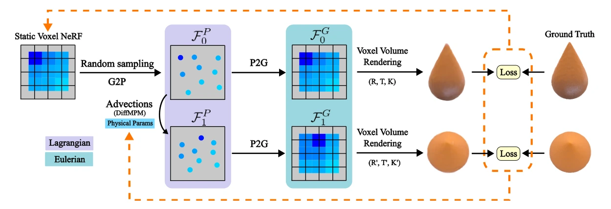
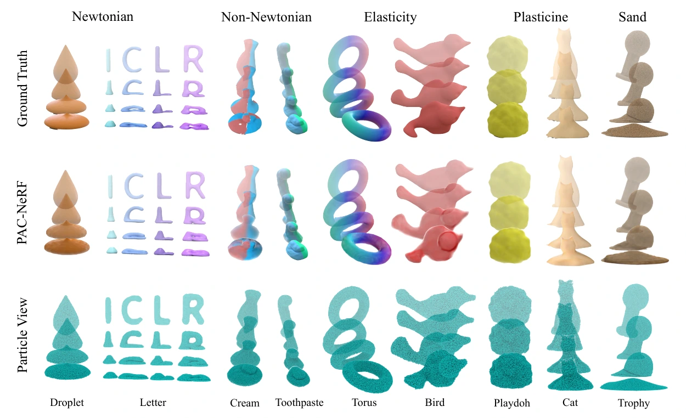

# PAC-NeRF：面向几何未知系统辨识的物理增强连续介质神经辐射场

## 一屏概览

**研究问题。** 早期基于可微物理的视频系统辨识方法（如 $\nabla\text{Sim}$、RISP）普遍假设物体的水密三维网格几何已知；而动态 NeRF（如 D-NeRF、Nerfies）虽能从视频重建动态外观，其学到的反向变形场却不遵守物理守恒律，既无法外推交互动力学，也无法反演物理参数。PAC-NeRF（Physics Augmented Continuum Neural Radiance Fields）是 [[physgaussian-physics-integrated-3d-gaussians-for-generative-dynamics|PhysGaussian]] 同团队（UCLA Chenfanfu Jiang 课题组与 MIT-IBM Watson AI Lab）提出的直接前驱工作：通过构造**欧拉—拉格朗日混合辐射场（Eulerian-Lagrangian Hybrid NeRF）**，在不假设任何几何或拓扑先验的前提下，直接从多视角 RGB 视频联合恢复动态物体的几何结构与五类连续介质物理参数。[论文 §1–3](https://arxiv.org/abs/2303.05512)

原文图 1：PAC-NeRF 的欧拉—拉格朗日混合表示。在初始帧世界空间中用欧拉体素网格（DirectVoxGO）表示体密度与颜色特征；通过网格到粒子（G2P）转换将辐射场属性绑定到拉格朗日物质点上，由可微物质点法（DiffMPM）按候选物理参数推进粒子状态，再经粒子到网格（P2G）映射回欧拉体素网格进行碰撞处理与体渲染。由于整条仿真—渲染管线端到端可微，像素重投影损失可直接回传梯度优化初始几何与材料参数。来源：论文 PDF，第 3 页。[查看原始来源](https://arxiv.org/pdf/2303.05512v1#page=3)

**机构与版本。** UCLA、马里兰大学、MIT CSAIL、哥伦比亚大学、UMass Amherst 与 MIT-IBM Watson AI Lab 联合发布；作者为 Xuan Li、Yi-Ling Qiao、Peter Yichen Chen、Krishna Murthy Jatavallabhula、Ming Lin、Chenfanfu Jiang、Chuang Gan；发表于 ICLR 2023 Spotlight（`arXiv:2303.05512v1`，2023-03-09）。

**核心贡献与承上启下意义。** （1）提出满足连续介质输运守恒律（$\frac{D\sigma}{Dt}=0, \frac{Dc}{Dt}=0$）的动态辐射场，将 DirectVoxGO 欧拉体素网格与 DiffTaichi 可微 MLS-MPM 的 P2G/G2P 转换无缝对齐；（2）设计“前景分割 $\to$ 几何播种（含表面紧凑正则化与 $\alpha_p^3$ 软粒子应力衰减） $\to$ 初速度与材料参数分阶段辨识”的三阶段反演流程；（3）构建涵盖牛顿流体、非牛顿流体、超弹性体、橡皮泥（塑性）与沙土（颗粒介质）的五材质多视角合成基准，该数据集随后成为 [[spring-gaus-reconstruction-and-simulation-of-elastic-objects|Spring-Gaus]] 与 [[gic-gaussian-informed-continuum-physical-property-identification|GIC]] 的标准评测基准。

## 核心机制与数学公式

### 1. 辐射场输运守恒律与 P2G/G2P 双向转换（§3.1–3.3）

动态 NeRF 在每个时刻 $t$ 维护体密度场 $\sigma(x, t)$ 与视角相关颜色场 $c(x, \omega, t)$。PAC-NeRF 强制要求这两个场随连续介质速度场 $v(x, t)$ 做物质平流（material advection），即物质导数为零（式 3–4）：

$$\frac{D\sigma}{Dt} = \frac{\partial \sigma}{\partial t} + v \cdot \nabla\sigma = 0, \qquad \frac{Dc}{Dt} = \frac{\partial c}{\partial t} + v \cdot \nabla c = 0, \qquad \rho\frac{Dv}{Dt} = \nabla \cdot T + \rho g,$$

其中 $\rho$ 为物理密度，$T$ 为 Cauchy 应力张量。为了避免每次查询光线都反向求解复杂的非线性微分方程，作者利用 DirectVoxGO 的欧拉体素网格存储标量密度场 $\hat{\sigma}$ 与 12 维颜色特征向量 $\hat{c}$（分辨率 $160^3$，配一个 2 层 128 维浅层 MLP 解码视角颜色，式 6）：

$$\sigma(x, t) = \operatorname{softplus}\bigl(\operatorname{Interp}(x, \hat{\sigma})\bigr), \qquad c(x, d, t) = \operatorname{MLP}\bigl(\operatorname{Interp}(x, \hat{c}), d\bigr).$$

在初始时刻 $t_0$，每个体素网格内随机采样 8 个拉格朗日粒子，通过三次线性插值权重 $w_{ip}$ 在欧拉网格场 $F^G(t) = \{\hat{\sigma}, \hat{c}\}$ 与拉格朗日粒子属性 $F^P(t)$ 之间做 G2P 与 P2G 转换（式 5）：

$$F_p^P \approx \sum_i w_{ip} F_i^G \quad (\text{G2P}), \qquad F_i^G(t) \approx \frac{\sum_p w_{ip} F_p^P(t)}{\sum_p w_{ip}} \quad (\text{P2G}).$$

**关键工程技巧：**

1. **初始帧也必须经过 $\text{G2P} \to \text{P2G}$ 重采样后再渲染（§3.4 Geometry Seeding）：** 作者发现，如果在 $t_0$ 直接渲染原始欧拉体素场，而在 $t > t_0$ 渲染经粒子平流再 P2G 投回网格的场，两者之间的插值核平滑差异会破坏跨帧一致性；因此连初始帧 $t_0$ 也强制执行一次 $\text{G2P} \to \text{P2G}$ 后再渲染，从而建立跨帧一致的粒子对应关系。
2. **基于不透明度 $\alpha_p^3$ 的虚空粒子软化与剪枝（§3.3）：** 每个粒子关联不透明度 $\alpha_p = 1 - \exp(-\operatorname{softplus}(\hat{\sigma}_p)) \in (0, 1)$。为了防止低不透明度的自由空间悬浮粒子在 MPM 中产生虚假碰撞力，将每个粒子的物理密度 $\rho_p$ 与物理应力张量 $T_p$ 乘以因子 $\alpha_p^3$ 进行软化，并直接剔除满足 $\alpha_p < 10^{-3} \max_q \alpha_q$ 的粒子。
3. **表面紧凑度正则化（式 7）：** 为使体素密度场紧贴前景分割掩码，最小化近似总表面积 $\mathcal{L}_{\text{surf}} = \sum_p \operatorname{clamp}(\alpha_p, 10^{-4}, 10^{-1})(\Delta x / 2)^2$。

### 2. 三阶段几何未知系统辨识流程（§3.4、§4、附录 A.1）

1. **阶段一（几何播种）：** 仅用第 1 帧多视角图像与前景掩码，通过 Adam 优化静态体素场 $\hat{\sigma}(t_0), \hat{c}(t_0)$，随后冻结初始几何与外观属性。
2. **阶段二（初速度估计）：** 利用碰撞发生前的最初 2–3 帧视频，使用 **L-BFGS 优化器**反演观测粒子的初始速度向量 $v_0$（实验表明在该子任务上 L-BFGS 显著优于 Adam）。
3. **阶段三（本构物理参数辨识）：** 在碰撞发生后的关键帧上用暖启动（warm start）与 Adam 优化器联合反演五类本构参数（附录式 8–17）：
   - **弹性体（Neo-Hookean）：** 杨氏模量 $E$ 与泊松比 $\nu$，$J T(F) = \mu(FF^T) + (\lambda \log J - \mu)I$；
   - **牛顿流体（J-based Fluid）：** 动力黏度 $\mu$ 与体积模量 $\kappa$，$J T(F) = \frac{1}{2}\mu(\nabla v + \nabla v^T) + \kappa(J - J^{-6})$；
   - **橡皮泥（StVK + von Mises 塑性）：** $E, \nu$ 与屈服应力 $\tau_Y$；
   - **非牛顿流体（Viscoplastic）：** 剪切模量 $\mu$、体积模量 $\kappa$、屈服应力 $\tau_Y$ 与塑性黏度 $\eta$；
   - **沙土（Drucker-Prager 颗粒介质）：** 内摩擦角 $\theta_{\text{fric}}$。

## 实验结果与为什么需要向 3DGS 演进

原文图 4：PAC-NeRF 在五类连续介质（牛顿流体、非牛顿流体、弹性体、橡皮泥、沙土）共 9 个合成场景上的动态重建与粒子视图。来源：论文 PDF，第 7 页。[查看原始来源](https://arxiv.org/pdf/2303.05512v1#page=7)

在 11 视角合成基准上（论文表 1、表 2），PAC-NeRF 在 17 项待估物理参数中的 14 项上超越了 Multi-view LSTM、D-NeRF+DiffSim 与 NeRF+$\nabla\text{Sim}$：

- 例如在弹性体 `Torus` 上，从初始猜测 $E = 10^5, \nu = 0.1$ 收敛至 $E = 1.04 \times 10^6, \nu = 0.322$（真值为 $E = 10^6, \nu = 0.3$）；在沙土 `Trophy` 上，摩擦角从 $10^\circ$ 收敛至 $36.1^\circ$（真值 $40^\circ$）；
- **令人意外的 2D 像素损失 vs 3D Oracle 对照（§5.3.2，表 2）：** 在牛顿流体黏度 $\log_{10}(\mu)$（误差 $11.6$ vs Oracle $19.4$）、体积模量 $\log_{10}(\kappa)$（$16.7$ vs $258.9$）和弹性体 $\log_{10}(E)$（$3.02$ vs $4.39$）上，基于可微渲染的 2D 像素颜色损失甚至优于直接给真值三维点云算 Chamfer Distance 的 Oracle 基线——因为 Chamfer Distance 丢失了点与点之间的局部纹理对应，而多视角像素光度梯度隐式约束了表面切向运动。

**PAC-NeRF 暴露的三大瓶颈（催生 PhysGaussian 与 GIC 的原因）：**

1. **渲染与训练速度慢：** 即使采用 DirectVoxGO 加速，单帧“MPM 仿真 + 体素光线步进渲染”仍需约 **$1\text{ s}$**，单个场景训练耗时约 **$1.5\text{ 小时}$**（RTX 3090，§4），无法用于实时交互。
2. **欧拉体素网格再插值导致大变形纹理模糊：** 每次渲染都要把粒子属性通过 P2G 抹回 $160^3$ 固定分辨率欧拉网格再做三次线性插值，高频纹理在大变形下严重退化（在 [[physgaussian-physics-integrated-3d-gaussians-for-generative-dynamics|PhysGaussian]] 表 1 的晶格变形基准上平均 PSNR 仅 21.93 dB，低于 PhysGaussian 的 26.73 dB）。
3. **几何体素偏肿且单帧静态外观在大变形下失真：** 如后续 [[gic-gaussian-informed-continuum-physical-property-identification|GIC]]（表 1、表 2）所示，在橡皮泥（Plasticine）等剧烈非刚性变形场景中，PAC-NeRF 渲染的扭曲 RGB 图像会误导梯度，导致橡皮泥 $\log_{10}(E)$ 平均绝对误差高达 $83.8\%$（GIC 通过动态 3DGS 与掩码代理将其降至 $25.6\%$）。
