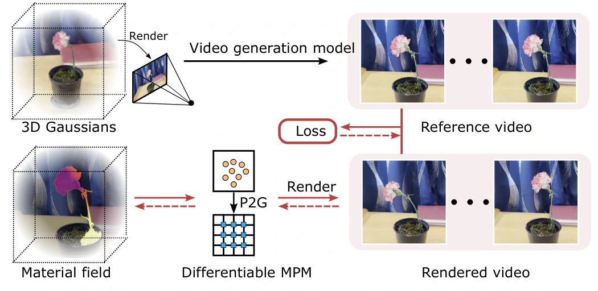
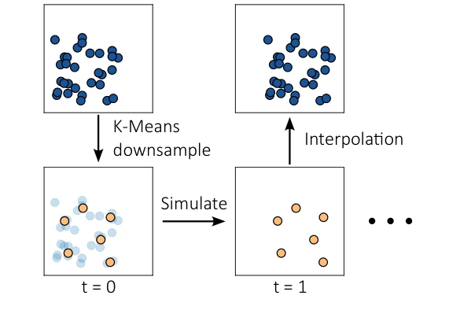

# PhysDreamer：利用视频生成先验蒸馏 3D 高斯空间材料场

## 一屏概览

**研究问题。** [[physgaussian-physics-integrated-3d-gaussians-for-generative-dynamics|PhysGaussian]] 能够用 MPM 驱动 3D 高斯合成交互运动，但其材料参数（如杨氏模量 $E$）需要人工凭经验设定；而 [[pac-nerf-physics-augmented-continuum-neural-radiance-fields|PAC-NeRF]] 与 [[spring-gaus-reconstruction-and-simulation-of-elastic-objects|Spring-Gaus]] 虽然能从真实动态视频反演参数，却要求对每个目标物体专门架设多相机同步录制受控交互视频——对于仅有静态 3D 扫描或生成的资产，根本没有真实交互视频可供反演。**PhysDreamer** 提出：**预训练视频生成模型（如 Stable Video Diffusion）在海量真实世界视频上训练后，已经隐式掌握了“物体外观（如花瓣、花茎、毛线帽、电话线）与其受扰动时振荡频率/幅度”之间的常识物理先验**。因此可以先用图生视频模型生成一段短参考视频，再通过**可微 MPM + 可微 3DGS 渲染**将这段参考视频中的动力学先验蒸馏为静态 3D 物体上的**空间连续变化杨氏模量场 $E(\mathbf{x})$**，从而赋予静态 3D 资产在任意新外力与新视角下的物理交互能力。[论文 §1–4](https://arxiv.org/abs/2404.13026)

原文图 3：PhysDreamer 系统总览。给定以 3D 高斯表示的静态物体，首先从某个选定视角渲染静态图 $I_0$，输入图像到视频生成模型（Stable Video Diffusion）生成一段 14 帧的参考运动视频 $\{I_0, \dots, I_T\}$；随后通过可微物质点法（Differentiable MPM）与可微高斯光栅化渲染出仿真视频，最小化渲染视频与参考视频之间的像素 $\mathcal{L}_1 + \mathcal{L}_{\text{D-SSIM}}$ 损失（红色虚线箭头表示梯度流），联合反演由三平面（Triplane）神经场参数化的空间变化杨氏模量场 $E(\mathbf{x})$ 与初始速度场 $\mathbf{v}_0(\mathbf{x})$。来源：论文 PDF，第 6 页。[查看原始来源](https://arxiv.org/pdf/2404.13026v2#page=6)

**机构与版本。** MIT、斯坦福大学、哥伦比亚大学与康奈尔大学联合发布；作者为 Tianyuan Zhang、Hong-Xing Yu、Rundi Wu、Brandon Y. Feng、Changxi Zheng、Noah Snavely、Jiajun Wu、William T. Freeman；录用于 ECCV 2024（本页对应 `arXiv:2404.13026v2`，2024-10-07）。

## 核心机制与关键工程设计

### 1. 为什么只辨识空间杨氏模量场 $E(\mathbf{x})$，以及如何稳定两阶段反传？（§3、§4.2）

在 Fixed Corotated 超弹性模型（式 1–2，$\psi(F) = \mu\sum_{i=1}^d(\sigma_i - 1)^2 + \frac{\lambda}{2}(\det(F)-1)^2$）中，物体的局部振荡频率与变形幅度主要由杨氏模量 $E$ 决定（论文 §3 展示了同一朵花在 $1\times, 10\times, 100\times$ 杨氏模量下，单次往复振荡周期从 $10.30\text{ s}$ 缩短至 $2.30\text{ s}$ 与 $0.87\text{ s}$）；而预实验表明泊松比 $\nu$ 对视觉运动轨迹的影响微乎其微，因此 PhysDreamer 固定常数密度 $\rho$ 与常数泊松比 $\nu$，专门估计空间连续变化的杨氏模量场 $E(\mathbf{x})$ 与激发该段参考视频运动的未知初始速度场 $\mathbf{v}_0(\mathbf{x})$。

为了避免高维场过拟合与梯度爆炸，作者引入了三项关键优化设计（§4.2、§5.2）：

1. **双尺度三平面（Triplane）+ 总变分（TV）平滑正则化（式 11）：** 使用两个三平面神经场（后接 3 层 MLP）分别参数化材料场 $E(\mathbf{x})$ 与初速度场 $\mathbf{v}_0(\mathbf{x})$。由于材料刚度在空间上比瞬时激励速度更平滑，将材料场三平面分辨率设为低频的 **$8^3$**、初速度场三平面设为 **$24^3$**，并对所有 2D 特征平面施加总变分正则化 $\mathcal{L}_{\text{tv}} = \sum_{i,j}(\|u_{i+1,j}-u_{i,j}\|_2^2 + \|u_{i,j+1}-u_{i,j}\|_2^2)$。
2. **解耦初速度与材料刚度的两阶段优化：** 若同时从随机初始化优化 $\mathbf{v}_0(\mathbf{x})$ 与 $E(\mathbf{x})$，两者会相互补偿导致发散。因此在**第一阶段**随机初始化并冻结 $E(\mathbf{x})$，仅用参考视频的**前 3 帧**优化初速度场 $\mathbf{v}_0(\mathbf{x})$；在**第二阶段**冻结 $\mathbf{v}_0(\mathbf{x})$，在全部 14 帧上专门优化 $E(\mathbf{x})$。
3. **跨帧截断梯度 + 768 子步激活检查点（Checkpointing）：** 相邻两帧视频之间包含 **768 个 MPM 子步**（每子步 $\Delta t = 4.34 \times 10^{-5}\text{ s}$）。在第二阶段优化 $E(\mathbf{x})$ 时，一方面采用**重计算检查点（simulation state checkpointing）**解决 768 步展开的显存爆炸，另一方面限制梯度只回传至**紧邻的上一视频帧**（截断长时域 BPTT），彻底消除了穿过数千个 MPM 子步时的梯度爆炸与消失。

### 2. 基于 K-Means 驱动粒子（Driving Particles）的 $10\text{--}50\times$ 加速（§4.3，图 4，算法 1）

高保真 3DGS 场景通常包含 $50\text{万}\sim 150\text{万}$ 个高斯核（分割出的前景物体也有 $5\text{万}\sim 30\text{万}$ 个核）。若直接在全部前景高斯核上跑 768 子步/帧的可微 MPM，计算与显存开销均难以承受。

原文图 4：基于 K-Means 降采样驱动粒子的加速 MPM。在 $t=0$ 时对稠密 3D 高斯核（蓝色）执行 K-Means 聚类，生成少量“驱动粒子（driving particles，黄色）”；仅在这些驱动粒子上运行可微 MPM 仿真（$t=0 \to t=1$），渲染时再通过每个高斯核周围最近邻驱动粒子的局部刚体变换插值恢复所有高斯核的位置与旋转。来源：论文 PDF，第 9 页。[查看原始来源](https://arxiv.org/pdf/2404.13026v2#page=9)

如上图 4 与论文附录 C 算法 1 所示，PhysDreamer 提出**驱动粒子子采样（Subsampling with Driving Particles）**：

1. 在 $t=0$ 时刻，对前景 3D 高斯中心 $\{x_p\}_{p=1}^P$ 执行 K-Means 聚类，生成 $Q \ll P$ 个驱动粒子 $\{Q_q^0\}_{q=1}^Q$（数量比原始高斯核少 **$10\text{--}50\text{ 倍}$**，按 $64^3$ 网格中每个非空体素平均至少保留 8 个驱动粒子确定 $Q$）。
2. 仅在 $Q$ 个驱动粒子上查询 $E_q = E(x_q^0), v_q^0 = \mathbf{v}_0(x_q^0)$ 并运行可微 MPM 仿真，得到第 $t$ 帧的驱动粒子位置 $\{x_q^t\}_{q=1}^Q$。
3. 对于每个原始 3D 高斯核 $p$，预先在 $t=0$ 找出其 $k=8$ 个最近邻驱动粒子索引 $\mathcal{N}_8(p)$；在渲染第 $t$ 帧时，通过可微刚体配准（`fitRigidTransform`，即局部 Procrustes / SVD 正交对齐）拟合这 8 个驱动粒子从 $t=0$ 到时刻 $t$ 的最佳局部刚体旋转 $R_{\text{sim},p} \in \mathrm{SO}(3)$ 与平移 $t_{\text{sim},p} \in \mathbb{R}^3$，从而更新每个高斯核：
   $$x_p^t = x_p^0 + t_{\text{sim},p}, \qquad R_p^t = R_{\text{sim},p} R_p^0, \qquad \Sigma_p^t = R_p^t \Sigma_p^0 (R_p^t)^T.$$

## 实验结果与一个极有启发性的“人类视觉偏见”发现

在 8 个真实静态捕获场景（红玫瑰、康乃馨、橙玫瑰、白玫瑰、郁金香、海芋盆栽 Alocasia、电话线 Cord、毛线帽 Hat）上，作者通过 100 名受试者、每基线 800 次双选强迫判断（2AFC，论文表 1）以及相对真实采集视频的 FVD / FID（附录表 2–3）对比了 PhysDreamer、手工设参数的 [[physgaussian-physics-integrated-3d-gaussians-for-generative-dynamics|PhysGaussian]] 与非物理场变形的 DreamGaussian4D：

| 对比维度与指标（论文表 1、附录表 2–3） | PhysDreamer vs PhysGaussian | PhysDreamer vs DreamGaussian4D | PhysDreamer vs 真实拍摄视频（Real Capture） |
| --- | --- | --- | --- |
| **2AFC 运动真实感偏好率（Motion Realism ↑）** | **80.8%** 偏好 PhysDreamer | **63.5%** 偏好 PhysDreamer | **53.7%** 偏好 PhysDreamer |
| **2AFC 整体视觉质量偏好率（Visual Quality ↑）** | **65.0%** 偏好 PhysDreamer | **70.0%** 偏好 PhysDreamer | 37.3% 偏好 PhysDreamer |
| **FVD ↓ / FID ↓（相对真实视频，越低越好）** | **270.3** vs 482.6 / **47.7** vs 63.2 | **270.3** vs 432.6 / **47.7** vs 52.8 | —（真值基准） |

**值得警惕的评测洞见（§5.3–5.4）：**

1. **为什么在 `Alocasia`（海芋叶片）上，86% 的人类受试者认为仿真比真实视频“更真实”？** 如果仿真完美复刻真实，2AFC 偏好率应接近 50%。作者结合 §5.3 的时空切片（space-time slices）给出了诚实的物理解释：对于海芋叶片这类薄壳几何，MPM 背景网格离散存在数值阻尼，产生的振荡频率比真实叶片更低、运动更平滑缓慢；而心理学研究表明人类在目测判断视频速度自然度时存在系统性偏见，往往偏爱更平滑、更慢的运动。这再次印证了[[overview|本库总览]]的判断：**人类主观偏好高或画面平滑，不等于物理参数与真实频率已准确恢复**。
2. **单视角自遮挡与双视角联合蒸馏（§5.4）：** 在存在叶片自遮挡的 `Alocasia` 场景中，仅靠单视角生成视频蒸馏会导致被遮挡后方叶片刚度估计失真；当从前后两个视角分别生成参考视频、共享同一个空间杨氏模量场 $E(\mathbf{x})$（但各自独立优化视角专属初速度 $\mathbf{v}_0^{(1)}, \mathbf{v}_0^{(2)}$）时，双视角蒸馏在 2AFC 中以 **86.0%（运动真实感）** 与 **81.0%（视觉质量）** 压倒性优于单视角。
