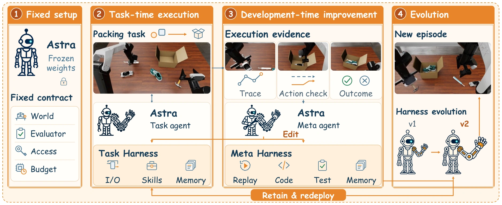

图 2（完整图注译文）：PhysEvo 中的 Physical RSI。冻结的 Astra 通过任务 Harness 行动，并根据执行反馈修订任务资源与元层资源。接受的修订支持后续执行回合和改进轮次。来源：论文 HTML §3，图 2；HTML 无固定页码。

## 概览

PhysEvo 用同一个冻结的 Astra 分别扮演任务执行者与元智能体。前者通过工具控制机器人，后者回看轨迹、修改动作／观测工具与技能说明，也能修改自己的诊断工具。被接受的修改由下一轮继承，作者据此称为 Physical RSI。（§1、§3）

此前已完整阅读 v1 HTML 正文、参考文献与附录 A–F；本次（2026-10-18）针对 §3.1–3.3 与 §5.5 复核双层 Harness 和诊断工具继承，没有重新通读全文、核查实现或运行机器人。本文最有价值的证据是诊断工具跨轮复用的具体案例；总体任务成绩与“改进过程本身持续变强”的证明需要分开。

## 双层 Harness 与继承

固定模型记为 $M_\theta$，第 $r$ 轮系统为 $H_r=(H_r^{task},H_r^{meta})$。任务层供给观测、动作工具、当前回合记忆、通用及任务特定技能；元层供给源码检查、轨迹回看、诊断实验和候选测试。两个角色上下文及工具权限分开，模型权重、机器人动力学和任务评价规则不可编辑。（§3.1）

附录 A 把循环写为

$$
\widetilde H_r\leftarrow\operatorname{Revise}_{M_\theta,H_r^{meta}}(H_r,E_r),\qquad
 y_r\leftarrow\operatorname{Test}(\widetilde H_r,H_r),\qquad
 H_{r+1}\leftarrow\operatorname{Select}_{M_\theta,H_r^{meta}}(H_r,\widetilde H_r,y_r).
$$

$E_r$ 是当前可用的执行证据，$\widetilde H_r$ 为候选，$y_r$ 为测试结果。由于元层工具也可被修改，后续修复使用的资源随之改变，这是比单纯修任务脚本更强的继承机制；公式并没有证明收益必然单调或无限增长。

行为修改在同任务、同初态比较：分数提升，或越过失败且分数不降，支持采纳；分数下降则拒绝。诊断工具按其声称要修的错误或测量进行检查。代码和配套说明一起装载，更新在回合之间生效；最终评分布局不用于候选选择。（§3.3、附录 A–B）

## 一次失败如何推动系统修改

**动作权限。** 单纯给末端 TCP 目标时，局部 IK 可能把手臂折进碍事姿态。演化后接口允许12个绝对臂关节目标和两个夹爪开度，模型可直接改变姿态，执行器仍检查驱动限位和实际跟踪。两布局、六回合的聚焦比较保持模型、技能、初态和预算相同，TCP、Joint、Both 的均分分别40、100、55；样本很小，不能推广为关节控制总优于末端控制。（§4.1、§5.5、附录 C.1）

**观测策略。** 倒水时持瓶手遮挡视野，修改技能让空闲手保持侧视，持续检查瓶口、杯沿、落点与回正过程。几何工具依赖模型选点、相机标定和机器人状态；时序三角化要求目标静止、有平移基线，不能把所有视图都直接用于静态重建。（§4.2、附录 C.2–C.3）

**诊断工具继承。** 后续装箱失败中，元智能体复用此前生成的回看工具，把图像、状态和决策对齐，发现箱子移位源于手腕碰到翘起箱盖，再修改转动前的净空要求。这个案例支持“诊断工具能被保存并用于另一轮修复”，尚不等于在新任务集上定量证明新改进器优于旧改进器。（§5.5；后句为本页解释）

## 运行接口细节

附录 F 明确区分请求与实际执行：`control_arms` 接收绝对关节角，单位弧度；位置为米，四元数为标量在前。`steps` 请求若干原生物理步，执行器可以提前终止，返回 `executed_steps`、原因与跟踪记录。`review_frames` 和几何查询不推进物理；夹爪命令回显与实测指位分开，闭合命令不能证明已抓住物体。任务执行者没有 shell 或隐藏状态查询权限。

这使 [[PolicyDeploymentContract|部署约定]] 成为反馈依据：模型要知道自己请求了什么、底层真正执行多少、机器人实际处于什么状态，才能把失败定位到决策、接口或执行。

## 实验口径与限制

| 设置 | 结果 | 不能省略的条件 |
| --- | --- | --- |
| RoboDojo 42任务，各5个留出布局 | 五维等权均分68.14，成功率62.00%；按42任务等权则65.00、58.57% | 每任务保留自己的部署版本，评分时冻结；不能称为一套完全通用版本跨42任务 |
| 八项直接 Astra 较困难的任务 | 55.00%对外部报告的1.25% | 子集由外部标准定义；对照来自既有公开结果，不是所有方法重新同预算训练 |
| PiPER 五任务各五次 | 21/25成功，即84%；平均分90.60 | 从仿真演化系统开始，部署后继续逐次修订技能；与仿真的冻结留出评测不同 |
| 真机分项 | 堆方块、叠碗、放笔各5/5；倒水和书写各3/5 | 小样本、任务特定评分，未证明长期无人维护性能 |

真机改进包括补偿水流前冲，以及先靠视觉接近、再在近距离调用几何定位。论文给出有效病例，但没有完整分解开发交互、人工重置、候选数量及各任务总预算；不能从结果推算固定成本下的递归增益。（§5.6、附录 B.3；预算判断为本页审阅）

## 我们如何理解其 RSI 主张

作者采用“任务与诊断资源经过测试后持续继承”的 RSI 用法。我们的证据判读是：任务系统改进和元工具复用有支持；若要证明改进能力本身增强，还需冻结初始能力、数据和资源，比较新旧元层在未用于开发的任务上的修复收益，排除仅因工具库更大或试验更多带来的提升。这是 [[PhysicalRecursiveSelfImprovement|Physical RSI]] 中需单独评估的量。

与 [[racap-evolvable-robot-learning|RACaP]] 的部署冻结策略、[[regenharness-evidence-gated-self-improvement|RegenHarness]] 的证据与版本治理互补；与 [[embodirsi-data-efficient-robot-adaptation|EmbodiRSI]] 修改训练经验分布的含义不同。专题见 [[topics/robot-harness-and-physical-rsi]]。

## 与接管数据闭环的关系

与 [[InteractiveImitationLearning|交互式模仿学习]] 共享的是“执行暴露问题，纠正经验证后进入下一轮”的反馈结构，保留对象却不同：[[embodirsi-data-efficient-robot-adaptation|EmbodiRSI]] 保留训练经验并更新策略；PhysEvo 保留动作接口、技能说明和诊断工具，模型权重冻结，也没有训练独立动作策略。因此不能把轨迹回看或同回合闭环纠错直接称为 DAgger 的专家动作标注。（§3、§5.3；与 DAgger 的分类比较为本页解释）

对于 [[topics/interactive-policy-improvement|交互式策略改进]]，可借鉴的部分是把请求动作、实际下发命令和物理结果对齐，先判定错误来自能力不足、接口受限还是观察缺失，再选择修复对象；“同一个系统可在数据更新与 Harness 修改之间自动选择”是进一步的设计设想，本文没有验证这种联合选择器。
