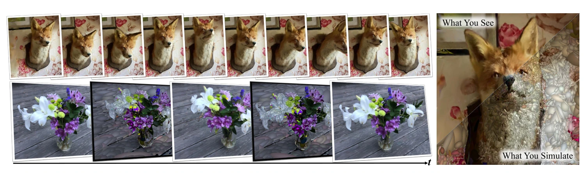
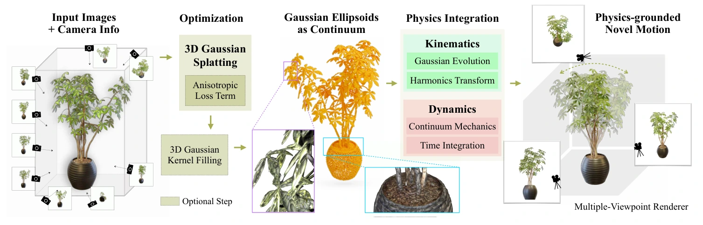
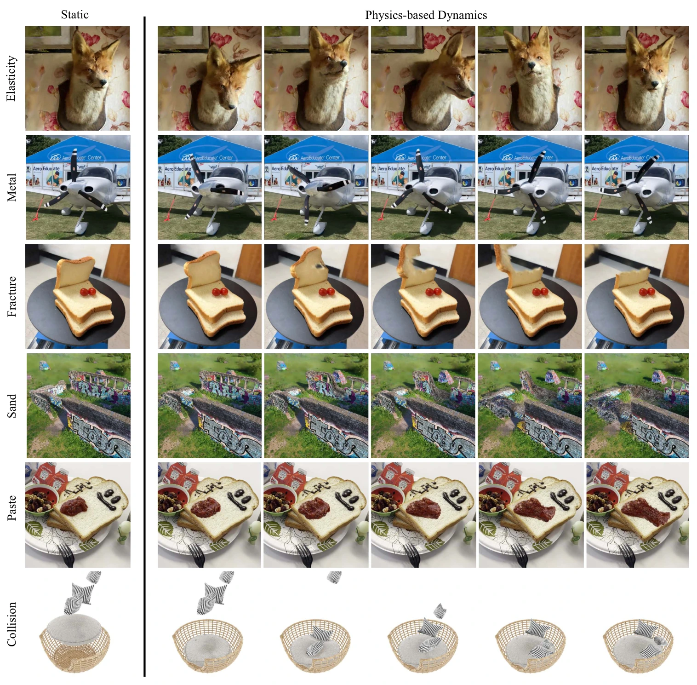
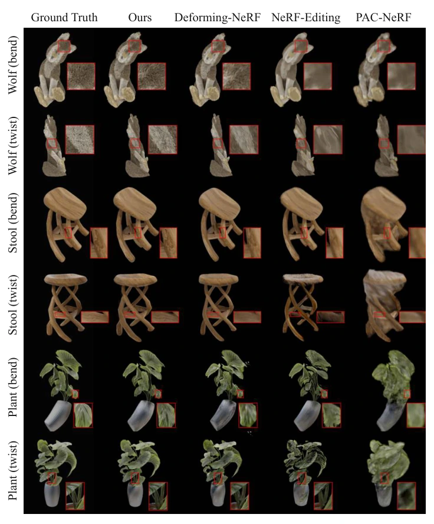
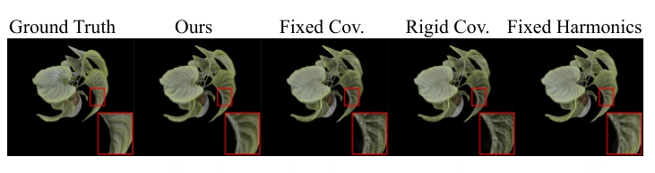
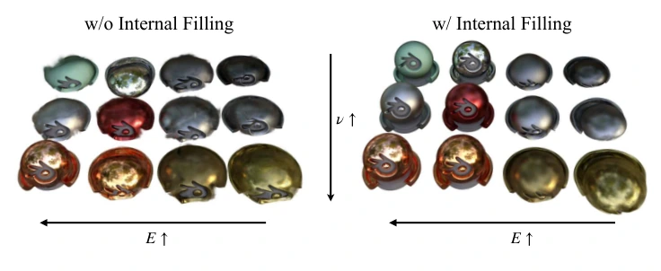
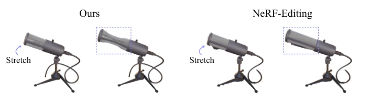
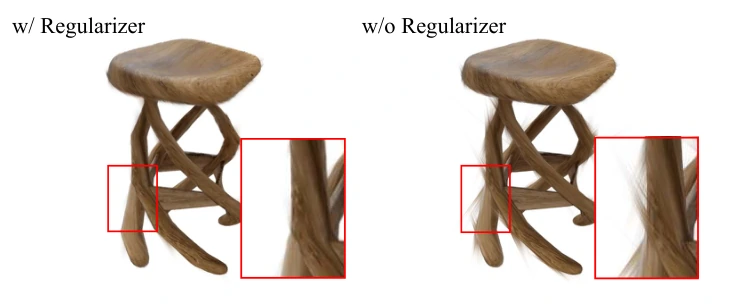

# PhysGaussian：面向生成式动力学的物理集成 3D 高斯

## 一屏概览

**研究问题。** 传统基于物理的视觉内容生成与神经辐射场（NeRF）动态编辑遵循“重建几何 $\to$ 提取三角形/四面体网格或笼网格（cage mesh） $\to$ 物理仿真 $\to$ 重新绑定渲染”的多阶段管线；网格转换与代理嵌入不仅繁琐，还会在仿真几何与渲染几何之间引入分辨率失配与视觉伪影。PhysGaussian 提出**“所见即所仿（What You See Is What You Simulate，$\text{WS}^2$）”**原则：直接将三维高斯溅射（3D Gaussian Splatting，3DGS）的离散高斯核本身作为连续介质力学中的拉格朗日物质点，用定制的物质点法（Material Point Method，MPM）直接驱动同一组 3D 高斯核完成物理变形与光栅化渲染，彻底省去网格提取、Marching Cubes 或笼网格嵌入。[论文 §1–3](https://arxiv.org/abs/2311.12198)

原文图 1：PhysGaussian 是基于 3D 高斯与连续介质力学的统一仿真—渲染管线，直接对视觉重建的 3D 高斯椭球施加物理动力学，实现“所见即所仿（What You See Is What You Simulate）”。来源：论文 PDF，第 1 页。[查看原始来源](https://arxiv.org/pdf/2311.12198v3#page=1)

**机构与版本。** 加州大学洛杉矶分校（UCLA）、浙江大学与犹他大学（University of Utah）联合发布；作者为 Tianyi Xie、Zeshun Zong、Yuxing Qiu、Xuan Li（共同一作）、Yutao Feng、Yin Yang、Chenfanfu Jiang；录用于 CVPR 2024，本页对应最终修订版 `arXiv:2311.12198v3`（2024-04-15，初版提交于 2023-11-20）。官方开源代码的底层实现与论文—源码差异核查见 [[physgaussian-repository|XPandora/PhysGaussian 代码核查]]；共享连续介质与物理 3DGS 基础见 [[PhysicsIntegrated3DGaussians|物理集成 3D 高斯与连续介质仿真]]。

**核心贡献与实验范围。** （1）推导了在连续介质偏微分方程（PDE）位移场下演化 3D 高斯核协方差（$a_p(t) = F_p(t) A_p F_p(t)^T$）与球谐函数（SH）朝向的局部仿射运动学，并提供无需显式跟踪总变形梯度 $F_p$ 的速度梯度增量更新形式；（2）针对 3DGS 仅聚焦物体表面导致的“空心壳坍塌”与细长核大变形毛刺，提出基于不透明度场射线求交的**内部粒子填充（Internal Filling）**与训练期**各向异性正则化（Anisotropy Regularizer）**；（3）支持超弹性体、金属塑性（von Mises）、非牛顿黏塑性流体（Herschel-Bulkley）、颗粒介质（Drucker-Prager 沙土）与断裂/碰撞等多材质动力学生成，在合成晶格变形基准（Wolf / Stool / Plant 的弯曲与扭转）上全面超越 NeRF-Editing、Deforming-NeRF 与 [[pac-nerf-physics-augmented-continuum-neural-radiance-fields|PAC-NeRF]]（表 1）。

## 问题与设计动机：为什么 $\text{WS}^2$ 需要绕开代理网格

在 [[pac-nerf-physics-augmented-continuum-neural-radiance-fields|PAC-NeRF]]、NeRF-Editing 与 Deforming-NeRF 等先前工作中，把物理引入三维辐射场面临两类结构性摩擦（§1–2）：

1. **代理网格嵌入导致的“所见非所仿”。** 基于网格的方法（如 NeRF-Editing 使用 NeuS 提取表面再膨胀为四面体笼，Deforming-NeRF 使用粗粒度笼网格插值）需要把连续神经场绑定到外部代理几何上：笼太紧会漏掉外围辐射场，笼太松会造成边界空洞（void border），而笼顶点平滑插值又会滤除精细局部形变。
2. **动态 3DGS 只平移或刚性旋转核，忽略局部拉伸与剪切。** 早期动态 3DGS（如 Dynamic 3D Gaussians）在变形时假设高斯核保持刚性或固定协方差。然而当物体发生大拉伸、弯曲或扭转时，若椭球核不能随局部应变一起延展，核与核之间就会裂开缝隙或暴露出尖刺状伪影（§2、§4.2）。

原文图 2：PhysGaussian 方法总览。输入多视角图像与相机参数后，首先在各向异性正则化损失约束下重建静态 3D 高斯场景，可选地对空心内部区域执行 3D 高斯核填充；随后将高斯椭球直接视为连续介质的离散粒子，在 MPM 时间积分中同步演化连续介质力学状态（应力、塑性返回映射）与 3D 高斯运动学（核协方差变形与球谐系数旋转），直接送入多视角光栅化器生成逼真动态画面。来源：论文 PDF，第 3 页。[查看原始来源](https://arxiv.org/pdf/2311.12198v3#page=3)

## 核心机制与数学推导

### 1. 连续介质力学与显式 APIC-MPM 离散（§3.2–3.3，附录 A）

连续介质力学用时间相关的变形映射 $x = \phi(X, t)$ 描述未变形物质空间 $\Omega^0$（坐标 $X$）到变形后世界空间 $\Omega^t$（坐标 $x$）的运动。局部拉伸、旋转与剪切由变形梯度（Jacobian）编码：

$$F(X, t) = \nabla_X \phi(X, t).$$

为支持金属、沙土或膏体的永久塑性形变，总变形梯度按乘法分解为弹性部分与塑性部分 $F = F^E F^P$。质量守恒与动量守恒方程分别为：

$$\int_{B_\epsilon^t} \rho(x, t)\,dx \equiv \int_{B_\epsilon^0} \rho(\phi^{-1}(x, t), 0)\,dX, \qquad \rho(x, t)\dot{v}(x, t) = \nabla \cdot \sigma(x, t) + f^{\text{ext}},$$

其中 $\sigma = \frac{1}{\det(F)}\frac{\partial \Psi(F^E)}{\partial F^E}(F^E)^T$ 为 Cauchy 应力张量（对应 Kirchhoff 应力 $\tau = \det(F)\sigma = \frac{\partial \Psi(F^E)}{\partial F^E}(F^E)^T$），$\Psi(F^E)$ 为超弹性应变能密度函数。

PhysGaussian 采用仿射粒子网格法（APIC-MPM，使用 $C^1$ 连续二次/三次 B 样条核函数 $w_{ip}^n$）在拉格朗日粒子 $p$ 与欧拉背景网格节点 $i$ 之间双向传递信息。在第 $n$ 个时间步（步长 $\Delta t$）：

1. **粒子到网格（P2G，式 13）：** 粒子质量 $m_p = \rho_p V_p^0$ 随时间守恒（初始代表体积 $V_p^0$ 取所在背景网格单元体积除以该单元内粒子数），将质量与仿射动量传至网格：
   $$m_i^n = \sum_p w_{ip}^n m_p, \qquad m_i^n v_i^n = \sum_p w_{ip}^n m_p \bigl(v_p^n + C_p^n(x_i - x_p^n)\bigr).$$
2. **网格动量更新（Grid Update，式 4、式 14）：** 在欧拉网格上由弹性内力与重力更新速度：
   $$v_i^{n+1} = v_i^n - \frac{\Delta t}{m_i^n}\sum_p \tau_p^n \nabla w_{ip}^n V_p^0 + \Delta t\,g.$$
3. **网格到粒子与本构返回映射（G2P，式 15）：** 插值回粒子速度 $v_p^{n+1} = \sum_i v_i^{n+1} w_{ip}^n$，推进粒子位置 $x_p^{n+1} = x_p^n + \Delta t\,v_p^{n+1}$，更新 APIC 仿射矩阵 $C_p^{n+1}$ 与速度空间梯度 $\nabla v_p^{n+1} = \sum_i v_i^{n+1}(\nabla w_{ip}^n)^T$，进而计算试探弹性变形梯度并施加塑性返回映射 $Z(\cdot)$：
   $$F_p^{E,\text{tr}} = \bigl(I + \Delta t\,\nabla v_p^{n+1}\bigr)F_p^{E,n}, \qquad F_p^{E,n+1} = Z\bigl(F_p^{E,\text{tr}}\bigr), \qquad \tau_p^{n+1} = \tau\bigl(F_p^{E,n+1}\bigr).$$
   （注：论文附录式 15 第 5 行印刷漏写了 $\Delta t$，写为 $(I + \nabla v_p^{n+1})F_p^{E,n}$，正文 §3.3 与开源代码 `mpm_utils.py:449` 均正确乘以了 $\Delta t$。）

### 2. 物理集成 3D 高斯的局部仿射运动学（§3.4–3.6）

静态 3DGS 用一组三维高斯核 $\{X_p, A_p, \sigma_p, C_p\}_{p \in \mathcal{P}}$ 表示场景，其中物质空间中心为 $X_p$，初始协方差矩阵为 $A_p$，不透明度为 $\sigma_p$，球谐（SH）系数为 $C_p$：

$$G_p(X) = \exp\Bigl(-\frac{1}{2}(X - X_p)^T A_p^{-1}(X - X_p)\Bigr).$$

当物体经历连续介质非线性变形映射 $x = \phi(X, t)$ 时，精确推前后的核函数 $G_p(x, t) = \exp\bigl(-\frac{1}{2}(\phi^{-1}(x,t)-X_p)^T A_p^{-1}(\phi^{-1}(x,t)-X_p)\bigr)$ 在世界空间不再是严格的高斯分布，无法直接被 3DGS 光栅化器渲染。

**一阶泰勒局部仿射近似（式 6–8）：** 假设每个高斯核支撑域足够局部，在核中心 $X_p$ 附近对 $\phi(X, t)$ 做一阶线性展开：

$$\tilde{\phi}_p(X, t) = x_p(t) + F_p(t)(X - X_p),$$

代入后，世界空间中的变形核恰好保持为三维高斯分布：

$$G_p(x, t) = \exp\Bigl(-\frac{1}{2}(x - x_p)^T \bigl(F_p A_p F_p^T\bigr)^{-1}(x - x_p)\Bigr),$$

从而得到直接驱动 3DGS 渲染器的大变形核中心与时变协方差公式（式 8）：

$$x_p(t) = \phi(X_p, t), \qquad a_p(t) = F_p(t) A_p F_p(t)^T.$$

**球谐函数（SH）朝向随局部旋转演化（§3.5，式 9）：** 当物体发生刚体或局部旋转时，由于 SH 基函数 $f_0(d)$ 定义在初始物质空间，若不旋转 SH，固定相对物体视角下的高光与外观就会随旋转发生失真。利用变形梯度的极分解（Polar Decomposition）$F_p = R_p S_p$（其中 $R_p \in \mathrm{SO}(3)$ 为局部纯旋转，$S_p$ 为对称拉伸），无需改动 3DGS 内部硬编码的 SH 基函数，只需将相机指向粒子的视线方向单位向量 $d$ 左乘逆旋转 $R_p^T$ 即可等价旋转球谐场：

$$f_t(d) = f_0(R_p^T d).$$

**不依赖总变形梯度 $F_p$ 的率形式增量演化（§3.6，式 10）：** 在更新拉格朗日（Updated Lagrangian）框架或经历严重塑性流动的流体/沙土模型中，模拟器往往只跟踪弹性变形梯度 $F_p^E$ 而不保存总变形梯度 $F_p$。借鉴计算流体力学中椭球演化的率形式 $\dot{a} = (\nabla v)a + a(\nabla v)^T$，可直接用网格传递来的速度空间梯度 $\nabla v_p$ 对世界空间协方差与旋转矩阵做增量更新：

$$a_p^{n+1} = a_p^n + \Delta t\bigl(\nabla v_p a_p^n + a_p^n (\nabla v_p)^T\bigr), \qquad R_p^{n+1} = \operatorname{PolarRot}\bigl((I + \Delta t\,\nabla v_p)R_p^n\bigr).$$

### 3. 内部粒子填充与各向异性正则化（§3.7–3.8）

1. **内部区域填充（Internal Filling，§3.7，式 11）：** 多视角重建的 3DGS 高斯核高度聚集在物体可见外表面，内部为空腔；直接对其进行体积力学仿真会导致物体在重力或碰撞下像薄皮气球一样坍塌（见下文图 6）。PhysGaussian 利用 3DGS 连续不透明度场
   $$d(x) = \sum_{p} \sigma_p \exp\Bigl(-\frac{1}{2}(x - x_p)^T A_p^{-1}(x - x_p)\Bigr)$$
   离散到三维背景网格，定义射线从低不透明度网格（$\sigma_i < \sigma_{\text{th}}$）跨入高不透明度网格（$\sigma_j > \sigma_{\text{th}}$）为一次“表面相交”：
   - **条件 1（六向包围检测）：** 从候选空网格沿 $\pm x, \pm y, \pm z$ 六个轴向发射射线，内部网格必须在各个方向上都能击中表面；
   - **条件 2（奇偶交点计数）：** 沿指定单一方向统计射线穿过表面的次数，交点数为奇数的网格才判定为真正位于封闭表面内部。
   被判定为内部的网格填入新粒子，并从最近邻表面高斯核继承不透明度 $\sigma_p$ 与球谐系数 $C_p$（注：论文式 11 下方写协方差按体积初始化为各向同性球 $\operatorname{diag}(r_p^2, r_p^2, r_p^2)$，而公开仓库实现实际一并从最近邻表面核继承了初始协方差，详见 [[physgaussian-repository#21-差异一内部填充粒子的协方差初始化与默认不渲染策略fillingpy-vs-论文-37|代码核查 §2.1]]）。
2. **各向异性正则化（Anisotropy Regularizer，§3.8，式 12）：** 原始 3DGS 训练常产生长短轴比极大的针状/扁平高斯核；当局部变形梯度 $F_p$ 发生剪切或旋转时，细长核会向外刺出物体表面形成毛刺伪影（plush/burr-like artifacts，见图 8）。为此在静态 3DGS 训练阶段加入轴比铰链损失：
   $$\mathcal{L}_{\text{aniso}} = \frac{1}{|\mathcal{P}|}\sum_{p \in \mathcal{P}} \bigl(\max\{\max(S_p)/\min(S_p),\, r\} - r\bigr),$$
   强制每个高斯核的最大缩放轴与最小缩放轴之比不超过阈值 $r$。

### 4. 五类本构模型与塑性返回映射（附录 B，表 2–3）

论文附录 B 汇总了支撑不同材质物理行为的本构方程（其中拉梅参数 $\mu = \frac{E}{2(1+\nu)}, \lambda = \frac{E\nu}{(1+\nu)(1-2\nu)}$，体积模量 $\kappa = \frac{E}{3(1-2\nu)}$，$F^E = U \Sigma V^T$ 为奇异值分解，$J = \det(F^E)$，$\epsilon = \log(\Sigma)$ 为对数 Hencky 应变，$\hat{\epsilon} = \operatorname{dev}(\epsilon)$ 为偏应变）：

| 材质类型与代表场景（表 2） | 本构与屈服模型 | Kirchhoff 应力 $\tau$ 与塑性返回映射 $Z(\cdot)$ |
| --- | --- | --- |
| **弹性体（Elasticity）**：Ficus、Fox、Toast、SofaSuite | Fixed Corotated（式 16）或 Neo-Hookean（式 18，Microphone） | Fixed Corotated：$\tau = 2\mu(F^E - R)(F^E)^T + \lambda(J - 1)J I$（其中 $R = UV^T$）；纯弹性无塑性屈服（$F^E = F$），当拉伸过大时粒子群自然分离呈现撕裂/断裂（Toast、Bread） |
| **金属塑性（Metal）**：Plane、Can | StVK 弹性 + von Mises 屈服（式 17、21） | $\tau = U(2\mu\epsilon + \lambda\operatorname{sum}(\epsilon)\mathbf{1})V^T$；当 $\delta\gamma = \|\hat{\epsilon}\|_F - \frac{\tau_Y}{2\mu} > 0$（超出屈服应力 $\tau_Y$）时，沿偏应变方向径向返回屈服面：$Z(\Sigma) = \exp\bigl(\epsilon - \delta\gamma \frac{\hat{\epsilon}}{\|\hat{\epsilon}\|_F}\bigr)$ |
| **颗粒介质（Sand）**：Ruins、Wolf | StVK 弹性 + Drucker-Prager 摩擦锥（式 19–20） | 屈服判据含静水压力项 $\delta\gamma = \|\hat{\epsilon}\|_F + \alpha\frac{(d\lambda+2\mu)\operatorname{sum}(\epsilon)}{2\mu} > 0$，其中 $\alpha = \sqrt{\frac{2}{3}}\frac{2\sin\phi_f}{3-\sin\phi_f}$，$\phi_f$ 为内摩擦角；受拉（$\operatorname{sum}(\epsilon) > 0$）时无抗拉强度直接投影至 $Z(\Sigma) = I$（即 $F^E = UV^T$），受压屈服时拉回摩擦锥面 |
| **非牛顿黏塑性膏体（Paste）**：Jam、Cake | Herschel-Bulkley 黏塑性（式 B.6） | 屈服条件 $\Phi(s) = \|s^{\text{trial}}\| - \sqrt{\frac{2}{3}}\sigma_Y \le 0$；超出屈服后受塑性黏度 $\eta$ 阻尼松弛而非瞬时投影：$s = s^{\text{trial}} - \bigl(\|s^{\text{trial}}\| - \sqrt{\frac{2}{3}}\sigma_Y\bigr)/\bigl(1 + \frac{\eta}{2\mu\Delta t}\bigr)$ |

## 实验结果与基准对比

### 1. 多材质生成式动力学展示（§4.1，图 3）

原文图 3：PhysGaussian 的跨材质通用性展示。从上至下依次为：Fox（弹性体晃动）、Plane（金属螺旋桨塑性弯折）、Toast（吐司撕裂断裂）、Ruins（沙土颗粒坍塌）、Jam（果酱非牛顿黏塑性涂抹）以及 SofaSuite（抱枕与沙发碰撞弹跳）。来源：论文 PDF，第 6 页。[查看原始来源](https://arxiv.org/pdf/2311.12198v3#page=6)

在单张 NVIDIA RTX 3090 GPU 与 24 核 Intel i9-10920X CPU 上，简单动力学场景按 $1/24\text{ s}$ 帧间隔衡量可达到准实时速率：Plane 为 **30 FPS**、Toast 为 **25 FPS**、Jam 为 **36 FPS**（§4.1）。

### 2. 晶格变形定量基准与运动学消融（§4.2，图 4、图 5，表 1）

由于真实动态场景缺少变形后的多视角真值图像，作者使用 BlenderNeRF 合成了 Wolf、Stool、Plant 三个场景在晶格弯曲（Bend）与扭转（Twist）下的 100 视角真值渲染，将相同的晶格变形场输入给 NeRF-Editing（基于 NeuS 表面网格 ARAP 变形）、Deforming-NeRF（基于笼网格插值）、[[pac-nerf-physics-augmented-continuum-neural-radiance-fields|PAC-NeRF]]（操纵离散粒子并在体素 NeRF 上渲染）以及 PhysGaussian 的三项运动学消融变体：

| 方法 / 消融变体（论文表 1，指标：PSNR ↑） | Wolf (Bend) | Wolf (Twist) | Stool (Bend) | Stool (Twist) | Plant (Bend) | Plant (Twist) | 6 项平均 PSNR |
| --- | --- | --- | --- | --- | --- | --- | --- |
| NeRF-Editing | 26.74 | 24.37 | 25.00 | 21.10 | 19.85 | 19.08 | 22.69 |
| Deforming-NeRF | 21.65 | 21.72 | 22.32 | 21.16 | 17.90 | 18.63 | 20.56 |
| [[pac-nerf-physics-augmented-continuum-neural-radiance-fields|PAC-NeRF]] | 26.91 | 25.27 | 21.83 | 21.26 | 18.50 | 17.78 | 21.93 |
| PhysGaussian：Fixed Covariance（仅平移核中心） | 26.77 | 26.02 | 29.94 | 25.31 | 23.95 | 23.09 | 25.85 |
| PhysGaussian：Rigid Covariance（仅刚性旋转核，如 Dynamic 3DGS） | 26.84 | 26.16 | 30.28 | 25.70 | 24.09 | 23.53 | 26.10 |
| PhysGaussian：Fixed Harmonics（协方差随 $F_p$ 变形但不旋转 SH） | 26.83 | 26.02 | 30.87 | 25.75 | 25.09 | 23.69 | 26.38 |
| **PhysGaussian（Ours，完整运动学）** | **26.96** | **26.46** | **31.15** | **26.15** | **25.81** | **23.87** | **26.73** |

原文图 4：晶格变形基准定性对比。NeRF-Editing 受限于 NeuS 表面网格与膨胀笼的精度（在扭转凳子和植物时出现空洞边缘），Deforming-NeRF 的笼顶点平滑插值丢失了高频细节，PAC-NeRF 的体素粒子渲染在复杂几何与纹理上模糊严重；PhysGaussian 同时利用零阶变形映射 $x_p$ 与一阶变形梯度 $F_p$，在大变形后依然保持锐利纹理。来源：论文 PDF，第 7 页。[查看原始来源](https://arxiv.org/pdf/2311.12198v3#page=7)

原文图 5：高斯运动学消融实验。若高斯核在变形过程中不可拉伸（Fixed Cov. 或 Rigid Cov.），叶片拉伸处会出现明显的条纹裂隙伪影；在此基础上引入球谐函数随局部极分解旋转（Ours vs Fixed Harmonics），可进一步提升大变形视角下的高光与颜色一致性。来源：论文 PDF，第 7 页。[查看原始来源](https://arxiv.org/pdf/2311.12198v3#page=7)

### 3. 内部填充、体积守恒与各向异性正则化定性分析（§4.3，图 6–8）

原文图 6：内部粒子填充与材料参数控制。左：无内部填充（w/o Internal Filling）时，仅靠表面高斯核建模的球体内部为空壳，无论如何调节杨氏模量 $E$ 与泊松比 $\nu$，在重力下落碰撞时都会瘪塌。右：启用内部填充（w/ Internal Filling）后，球体呈现真实的体积力学响应——增大杨氏模量 $E$ 提升整体刚度，增大泊松比 $\nu$ 增强体积保持能力。来源：论文 PDF，第 8 页。[查看原始来源](https://arxiv.org/pdf/2311.12198v3#page=8)

原文图 7：体积守恒对比。与仅做表面几何 ARAP 形变的 NeRF-Editing 相比，PhysGaussian 基于连续介质力学本构，在拉伸麦克风时能真实呈现横向收缩的体积守恒效应（泊松效应）。来源：论文 PDF，第 8 页。[查看原始来源](https://arxiv.org/pdf/2311.12198v3#page=8)

原文图 8：各向异性正则化效果对比。未加正则化（w/o Regularizer）时，静态重建中过度细长的高斯核在大扭转形变下向外支棱，在凳子腿边缘产生毛刺伪影；加入式 12 的 $\mathcal{L}_{\text{aniso}}$（w/ Regularizer）后彻底消除了毛刺。来源：论文 PDF，第 8 页。[查看原始来源](https://arxiv.org/pdf/2311.12198v3#page=8)

## 局限性与后续演进脉络

论文 §5 指出了两项核心局限：（1）**光影静态烘焙**：球谐系数烘焙了静态环境光照，物体运动或变形时地面与自身的动态阴影不会随之更新；（2）**手工设定材料参数与仿真区域**：杨氏模量 $E$、泊松比 $\nu$、屈服应力等均需人工在 JSON 中指定，且直接在数十万个高斯核上跑显式 MPM 在复杂场景中难以满足高频实时交互（如 VR 双手抓取要求 $>60\text{ FPS}$）。

这两项局限直接催生了后续四条紧密相连的研究分支（详见 [[PhysicsIntegrated3DGaussians|物理集成 3D 高斯与连续介质仿真]]）：

1. **走向实时 VR 交互与动态阴影：** 同一作者团队在 [[vr-gs-physical-dynamics-aware-interactive-gaussian-splatting|VR-GS]]（SIGGRAPH 2024）中将单核 MPM 替换为“内部填充 + VDB 笼网格 + 双层四面体嵌入（Two-Level Embedding）+ XPBD”并引入实时阴影贴图（Shadow Map），将单帧仿真耗时从 PhysGaussian 的 $112\text{--}390\text{ ms}$ 压缩至 $17\text{--}22\text{ ms}$。
2. **走向无需本构先验的弹性体视频反演：** [[spring-gaus-reconstruction-and-simulation-of-elastic-objects|Spring-Gaus]]（ECCV 2024）将三维弹簧质点系统（Spring-Mass）锚点与外观高斯解耦，从多视角真实视频中直接反演异质弹性体的逐锚点刚度。
3. **走向零交互视频样本下的材料场蒸馏：** [[physdreamer-physics-based-interaction-with-3d-objects|PhysDreamer]]（ECCV 2024）以 PhysGaussian 的可微 MPM 为后端，结合 K-Means 驱动粒子降采样，从视频生成模型（Stable Video Diffusion）蒸馏空间变化的杨氏模量场 $E(\mathbf{x})$。
4. **走向多材质几何感知系统辨识与机器人操作：** [[gic-gaussian-informed-continuum-physical-property-identification|GIC]]（NeurIPS 2024）用运动分解动态 3DGS、由粗到细密度场填充与二维连续体掩码代理解决了大变形纹理失真对参数反演的干扰；[[phystwin-physics-informed-reconstruction-and-simulation-of-deformable-objects|PhysTwin]]（2025）则进一步从稀疏 RGB-D 交互视频构建可实时遥操作与模型预测规划（MPC）的柔性物体数字孪生。
