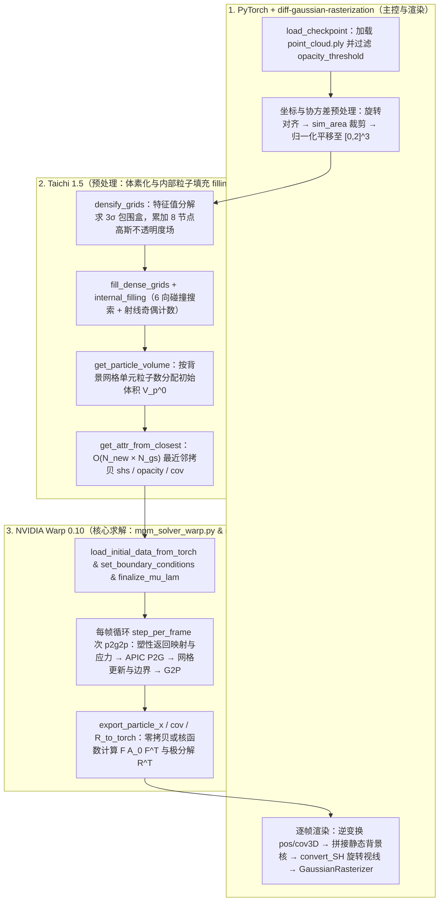

# XPandora/PhysGaussian 公开实现：工程架构与核心源码核查

## 1. 版本、范围与单次仿真执行流

本页静态核查官方仓库 [`XPandora/PhysGaussian` 固定提交 `8339ed6a`](https://github.com/XPandora/PhysGaussian/tree/8339ed6aa2cd5d50e1001a254a3d95aea678a956)（`main` 分支最新提交，日期 2025-04-06）。本地归档 `raw/physgaussian-repository-2026-10-19-d9fc70e92aff.tgz` 完整保存了除外部 `gaussian-splatting` 子模块与二进制 `.h5` 资产外的全部 21 个源码与配置文件；[[physgaussian-physics-integrated-3d-gaussians-for-generative-dynamics|PhysGaussian 论文]] 说明连续介质力学与高斯运动学推导，本页聚焦 PyTorch + Taichi + NVIDIA Warp 三框架协同的数据流、核函数实现以及四处重要的**论文—源码实现差异**。本轮为静态源码核查，未在本机编译 CUDA 光栅化扩展或运行仿真。

### 1.1 PyTorch + Taichi + Warp 三框架协同架构

仓库将不同计算阶段分配给三个 GPU 框架（`gs_simulation.py:1–41`）：



如上述流程示意（对应 `gs_simulation.py:66–340`），一次完整仿真（如 `python gs_simulation.py --model_path ... --config config/ficus_config.json --render_img`）严格按五个阶段推进：

1. **高斯加载与低不透明度滤除（`gs_simulation.py:100–125`）：** 调用 `load_params_from_gs` 提取三维均值 `init_pos`、预计算的 6 维上三角协方差 `init_cov`（开启 `pipeline.compute_cov3D_python = True`）、不透明度 `init_opacity` 与球谐系数 `init_shs`，首先用 `init_opacity[:, 0] > preprocessing_params["opacity_threshold"]`（默认 `0.02`）剔除悬浮噪声核。
2. **仿真域裁剪与 $[0, 2]^3$ 归一化变换（`gs_simulation.py:134–180`、`transformation_utils.py:6–115`）：** 先按配置的 `rotation_degree` 与 `rotation_axis` 旋转点云使其底面平行于 $xy$ 平面；若配置了 `sim_area = [xmin, xmax, ymin, ymax, zmin, zmax]`，则将框外的高斯核分离保存在 `unselected_pos / cov / opacity / shs` 中（作为不参与 MPM 计算但每帧参与拼接渲染的静态背景！）。框内受仿粒子通过 `transform2origin` 按最大跨度缩放 `scale_origin` 并居中，再经 `shift2center111` 平移 $+[1, 1, 1]$ 进入 MPM 求解域 $[0, 2]^3$（默认 `grid_lim = 2.0`）。同时，初始协方差矩阵必须同步左乘/右乘预处理旋转矩阵并乘上缩放因子的平方：`init_cov = scale_origin * scale_origin * apply_cov_rotations(init_cov, rotation_matrices)`。
3. **Taichi 内部粒子填充与体积计算（`gs_simulation.py:182–230`）：** 调用 `fill_particles` 与 `get_particle_volume`（详见 §2）。
4. **Warp MPM 初始化与不可调换的设置顺序（`gs_simulation.py:235–250`）：** 源码第 247 行特别注释警告：`load_initial_data_from_torch` $\to$ `set_parameters_dict`（由 `density * particle_vol` 计算 `particle_mass`）$\to$ `set_boundary_conditions` $\to$ `finalize_mu_lam`（由 $E, \nu$ 计算拉梅参数 $\mu, \lambda$）的顺序绝不可调换，因为冲量边界条件依赖已算出的粒子质量。
5. **多子步 MPM 循环与逆变换渲染（`gs_simulation.py:271–338`）：** 每帧执行 `step_per_frame = int(frame_dt / substep_dt)` 次（例如 `ficus_config.json` 中 `frame_dt = 4e-2, substep_dt = 1e-4`，即每渲染一帧执行 **400 个 MPM 子步**）`mpm_solver.p2g2p(frame, substep_dt)`。随后导出前 `gs_num` 个粒子的位置 `pos`、变形后协方差 `cov3D` 与极分解逆旋转矩阵 `rot`，执行与阶段 2 严格相反的逆平移、逆缩放（`cov3D / scale_origin**2`）与逆旋转，拼回静态背景核 `unselected_*`，调用 `convert_SH` 旋转视线方向预计算 RGB 颜色后送入 `GaussianRasterizer`。

## 2. 关键模块源码剖析与四处“论文—源码”差异

### 2.1 差异一：内部填充粒子的协方差初始化与默认不渲染策略（`filling.py` vs 论文 §3.7）

在 `particle_filling/filling.py:12–288` 中，内部填充通过四个步骤实现：

1. **`densify_grids`（第 24–78 行）：** 对每个原始高斯核协方差矩阵做对称特征值分解 `sig, Q = ti.sym_eig(cov)`，取最大半轴长度 $r = \lceil \max_d \sqrt{\sigma_d} / \Delta x \rceil$，在 $[-r, r]^3$ 邻域网格内计算网格八个顶点处的高斯权重均值乘以 $\sigma_p$，原子累加到 `grid_density[i, j, k]`。
2. **`fill_dense_grids`（第 81–103 行）：** 对 `grid_density > density_thres` 但粒子数不足 `max_particles_per_cell` 的高密度表面网格补齐随机抖动粒子。
3. **可选受约束平滑（第 259–265 行）：** 当 `smooth=True`（如 `tear_bread` 与 `wolf`）时，调用 `mcubes.smooth(df, method="constrained", max_iters=500)` 平滑密度场。
4. **`internal_filling`（第 171–216 行）：** 对空网格（`grid[i, j, k] == 0`），先沿除 `exclude_dir` 外的 5 个（或全部 6 个，当 `exclude_dir = -1` 时）轴向调用 `collision_search` 确认均能碰到 `grid_density > search_thres` 的表面（条件 1）；再沿 `ray_cast_dir` 调用 `collision_times` 统计从非表面进入表面的状态跳变次数 `hit_times`，当 `hit_times % 2 == 1`（奇数次穿过表面，条件 2）时向该内部网格填入 `max_particles_per_cell` 个粒子。

**核查发现的两处论文—源码差异：**

- **填充粒子的初始协方差并非由体积算出的各向同性球：** 论文 §3.7 写到“每个填充粒子的协方差矩阵初始化为 $\operatorname{diag}(r_p^2, r_p^2, r_p^2)$，其中 $r_p = (3V_p^0 / 4\pi)^{1/3}$”。然而核查 `filling.py:293–363` 的 `init_filled_particles` 与 `get_attr_from_closest` 可见，源码对每个新填充粒子遍历所有原始高斯核寻找欧氏距离最近邻 `min_idx`，并直接执行：
  ```python
  ti_new_shs[pi] = ti_shs[min_idx]
  ti_new_opacity[pi] = ti_opacity[min_idx]
  ti_new_cov[pi] = ti_cov[min_idx]
  ```
  即**连同 6 维协方差矩阵也直接复制自最近邻表面高斯核**，代码中并未实现 $(3V_p^0 / 4\pi)^{1/3}$ 的球形初始化。
- **填充粒子默认只参与物理支撑而不参与渲染（`visualize` 开关）：** 在 `utils/decode_param.py:165` 中，`filling_params["visualize"]` 默认设为 `False`（在 `pillow2sofa_config.json` 与 `plane_config.json` 中均为默认 `False`，仅在会发生内部暴露的 `tear_bread_config.json` 与 `wolf_config.json` 中显式设为 `True`）。当 `visualize == False` 时，`gs_simulation.py:224–228` 将填充粒子的初始协方差设为 0 且**不更新 `gs_num`**；因此在第 294 行导出渲染张量 `pos = mpm_solver.export_particle_x_to_torch()[:gs_num]` 时，内部填充粒子被直接切片丢弃——它们在 MPM 网格中提供内部体积应力以防止空壳坍塌，但完全不进入光栅化器。

### 2.2 差异二：协方差更新标志位 `update_cov_with_F` 的命名反转（`mpm_solver_warp.py` & `mpm_utils.py`）

论文提出了两种演化世界空间高斯协方差 $a_p(t)$ 的方法：一是 §3.4 式 8 的总变形梯度公式 $a_p(t) = F_p(t) A_p F_p(t)^T$；二是 §3.6 式 10 的速度梯度增量率形式 $a_p^{n+1} = a_p^n + \Delta t(\nabla v_p a_p^n + a_p^n \nabla v_p^T)$。

核查 `mpm_solver_warp/mpm_solver_warp.py:45、551–564` 与 `mpm_utils.py:290–308、451–480` 可以发现，控制这两种模式的布尔变量 `self.mpm_model.update_cov_with_F`（默认值为 `False`）在代码逻辑中的字面含义**完全相反**：

- 当 `update_cov_with_F == False`（默认路径）时，G2P 阶段不更新协方差，而是在每帧渲染导出调用 `export_particle_cov_to_torch()`（`mpm_solver_warp.py:552`）时启动 `compute_cov_from_F` 核函数（`mpm_utils.py:456–480`）：
  ```python
  F = state.particle_F_trial[p]
  cov = F * init_cov * wp.transpose(F)
  ```
  注意这里使用的是**尚未经过塑性返回映射截断的试探变形梯度 `particle_F_trial[p]`**（而非塑性截断后的弹性变形梯度 `particle_F[p]`）来变形初始协方差 `init_cov`！为什么在塑性和沙土下还能用 `particle_F_trial`？因为在 `g2p`（`mpm_utils.py:449`）中，`particle_F_trial` 是由 `state.particle_F[p]` 左乘 $(I + \Delta t\,\nabla v_p)$ 得到的，而在下一个子步开头 `compute_stress_from_F_trial` 才会将 `particle_F_trial` 投影回 `particle_F`；因此对于经历塑性屈服的材料，`compute_cov_from_F` 实际上测量的是**弹性变形梯度叠加最近一个子步的增量变形**，而非从 $t=0$ 累积的总变形梯度。
- 当手动将 `update_cov_with_F` 设为 `True` 时，代码反而跳过 `compute_cov_from_F`，改为在每个子步的 `g2p` 末尾（`mpm_utils.py:452`）调用 `update_cov(state, p, new_F, dt)`（其中局部变量 `new_F` 实际存储的是速度空间梯度 $\nabla v_p = \sum_i v_i \nabla w_{ip}^T$），执行 §3.6 式 10 的率形式增量更新 `cov_np1 = cov_n + dt * (grad_v * cov_n + cov_n * wp.transpose(grad_v))`。阅读源码时切勿被 `update_cov_with_F` 的变量名误导。

### 2.3 差异三：平面碰撞器 `add_surface_collider` 中的滑移/摩擦速度覆盖缺陷（`mpm_solver_warp.py:610–652`）

在 `mpm_solver_warp/mpm_solver_warp.py:570–652` 中，`add_surface_collider` 支持三类表面边界条件：`sticky`（`surface_type == 0`，粘滞）、`slip`（`surface_type == 1`，无摩擦自由滑移）、`cut`（`surface_type == 11`）以及默认的摩擦滑移面（`surface_type == 2`）。然而核查第 632–650 行的 Warp 核函数 `collide`：

```python
else:
    v = state.grid_v_out[grid_x, grid_y, grid_z]
    normal_component = wp.dot(v, n)
    if param.surface_type == 1:
        v = v - normal_component * n  # Project out all normal component
    else:
        v = v - wp.min(normal_component, 0.0) * n  # Project out only inward normal component
    if normal_component < 0.0 and wp.length(v) > 1e-20:
        v = wp.max(0.0, wp.length(v) + normal_component * param.friction) * wp.normalize(v)
    state.grid_v_out[grid_x, grid_y, grid_z] = wp.vec3(0.0, 0.0, 0.0)
```

可以看到，代码在 `else` 分支中完整计算了投影掉法向分量并施加库仑摩擦衰减后的切向速度 `v`，但在最后一行（第 648 行）却误写成了 `state.grid_v_out[grid_x, grid_y, grid_z] = wp.vec3(0.0, 0.0, 0.0)`（而非 `= v`）！这导致在当前公开代码中，无论是配置 `slip` 还是带摩擦系数 `friction` 的平面碰撞器，在网格速度后处理时实际上都会像 `sticky` 一样将穿透侧网格节点速度强制清零。

### 2.4 差异四：论文未展开的第六种材质——带软化损伤的 `plasticine`（`mpm_utils.py:121–169`）

论文正文与附录 B 共介绍了弹性体、金属（von Mises）、沙土（Drucker-Prager）与非牛顿流体（Herschel-Bulkley）四类本构。而在源码 `mpm_solver_warp.py:258–272` 与 `mpm_utils.py:121–169、400–435` 中，求解器实际定义了 6 个材质编号（`0: jelly`, `1: metal`, `2: sand`, `3: foam`, `4: snow`, `5: plasticine`），其中编号 `5`（`plasticine`）专门实现了**带应变软化与刚度归零损伤的 von Mises 返回映射（`von_mises_return_mapping_with_damage`）**：

- 每当粒子偏应力超出当前屈服应力 `model.yield_stress[p]` 时，屈服应力按塑性应变增量线性衰减：
  $$\tau_{Y,p} \leftarrow \tau_{Y,p} - \text{softening} \cdot \|\Delta \epsilon^p\|;$$
- 一旦某个粒子的屈服应力衰减至 $\tau_{Y,p} \le 0$，核函数立即将该粒子的剪切模量与拉梅参数清零（`model.mu[p] = 0.0; model.lam[p] = 0.0`），使其彻底丧失弹性恢复力，从而在连续介质框架内模拟材料的永久韧性撕裂。

## 3. 球谐视线旋转与六个官方场景配置对照

### 3.1 极分解逆旋转在 `convert_SH` 中的实现（`mpm_utils.py:483–511`、`render_utils.py:114–129`）

在每个渲染帧导出时，`compute_R_from_F`（`mpm_utils.py:483–511`）对 `particle_F_trial[p]` 执行 $3 \times 3$ 奇异值分解 `wp.svd3(F, U, sig, V)`，通过修正行列式符号确保 $\det(U) > 0, \det(V) > 0$（防止反射矩阵混入旋转），计算局部旋转矩阵 $R = U V^T$，并将**转置矩阵 $R^T$** 存入 `state.particle_R[p] = wp.transpose(R)`。随后在 `utils/render_utils.py:121–125` 的 `convert_SH` 中：

```python
dir_pp = position - viewpoint_camera.camera_center.repeat(shs_view.shape[0], 1)
if rotation is not None:
    n = rotation.shape[0]
    dir_pp[:n] = torch.matmul(rotation, dir_pp[:n].unsqueeze(2)).squeeze(2)
```

直接用导出的 $R_p^T$ 左乘前 `n` 个受仿高斯核的相机视线向量 `dir_pp`，完全对应论文 §3.5 的式 9 $f_t(d) = f_0(R_p^T d)$。

### 3.2 官方六大示例场景配置参数总表（`config/*.json`）

核查 `config/` 目录下的 6 个官方 JSON 配置文件，可以清楚看到不同物理现象在网格分辨率、时间步长、内部填充与边界激励上的工程取值范围：

| 场景配置 | 材质类型（`material`） | 物理参数（$E, \nu, \rho$ 等） | 网格 `n_grid` / 子步 `substep_dt` / 帧长 `frame_dt` | 内部填充（`particle_filling`） | 边界条件（`boundary_conditions`） |
| --- | --- | --- | --- | --- | --- |
| `ficus_config.json`（榕树盆栽晃动） | `jelly`（Fixed Corotated） | 下部 $E=2\times 10^6, \nu=0.4, \rho=200$；上部树冠通过 `additional_material_params` 设 $\rho=70$；$g=[0,0,0]$ | `n_grid=50`（默认） / $10^{-4}\text{ s}$ / $4\times 10^{-2}\text{ s}$（每帧 400 子步，共 125 帧） | 无（叶片薄无需填充） | 底部花盆 `cuboid` 固定速度为 0 + 初始 1 子步水平粒子冲量 `force=[-0.18, 0, 0]` |
| `pillow2sofa_config.json`（抱枕落向沙发） | `jelly` | $E=10^4, \nu=0.3, \rho=2000, g=[0,0,-5]$ | `n_grid=100` / $10^{-4}\text{ s}$ / $2\times 10^{-2}\text{ s}$（每帧 200 子步，共 300 帧） | `n_grid=128`，每格 4 粒子，`visualize=False`（默认） | `bounding_box` + 沙发底座固定 + 两个分时释放的 `cuboid`（0.5 s 与 1.0 s 释放上下抱枕） |
| `plane_config.json`（飞机螺旋桨弯折） | `metal`（StVK + von Mises） | $E=10^5, \nu=0.3, \tau_Y=10^2, \rho=1000, g=[0,0,0]$ | `n_grid=120` / $10^{-4}\text{ s}$ / $10^{-2}\text{ s}$（每帧 100 子步，共 400 帧） | `n_grid=50`，每格 1 粒子，`visualize=False` | 机身两处 `enforce_particle_translation` 锁死 + 桨叶圆柱区 `enforce_particle_velocity_rotation` 正反转 |
| `tear_bread_config.json`（撕裂面包） | `jelly`（配合 `rpic_damping=0.5`） | $E=2\times 10^3, \nu=0.3, \rho=200, g=[0,0,0]$ | `n_grid=150` / $10^{-4}\text{ s}$ / $10^{-2}\text{ s}$（每帧 100 子步，共 300 帧） | `n_grid=100`，`smooth=True`，`visualize=True`（渲染撕裂暴露的内部核） | 左右两侧薄片区域施加反向平移速度 $v_y = \pm 0.2$ 强行拉开 |
| `vasedeck_config.json`（花瓶扭转回弹） | `jelly` | $E=10^4, \nu=0.3, \rho=40, g=[0,0,0]$ | `n_grid=120` / $10^{-4}\text{ s}$ / $4\times 10^{-2}\text{ s}$（每帧 400 子步，共 75 帧） | 无 | 底部锁死 + 顶部圆柱区在 $0\text{--}0.3\text{ s}$ 正转、$0.3\text{--}0.6\text{ s}$ 保持、$0.6\text{--}0.9\text{ s}$ 反转、$0.9\text{ s}$ 后释放自由振荡 |
| `wolf_config.json`（狼雕像逐层沙化坍塌） | `sand`（Drucker-Prager） | $E=5\times 10^7, \nu=0.3, \phi_f=30^\circ, \rho=2000, g=[0,0,-9.8]$ | `n_grid=200` / $2\times 10^{-5}\text{ s}$ / $4\times 10^{-2}\text{ s}$（每帧 **2000 子步**，共 50 帧） | `n_grid=100`，`smooth=True`，`visualize=True` | 底部 `surface_collider`（sticky）+ `release_particles_sequentially`（沿 $x$ 轴分 50 层在 1.5 s 内逐步解除粒子速度锁定） |

## 4. 归档文件清单

本页分析基于 `raw/physgaussian-repository-2026-10-19-d9fc70e92aff.tgz` 中归档的以下 21 个文件：

| 路径 | 核心内容 |
| --- | --- |
| `README.md`、`requirements.txt`、`download_sample_model.sh` | 环境依赖（PyTorch 2.0、Taichi 1.5.0、Warp 0.10.1）、自定义场景预处理五步法与 JSON 配置说明 |
| `gs_simulation.py` | 端到端主入口：加载 3DGS `.ply`、坐标旋转缩放归一化、调用内部填充、驱动 Warp MPM 循环与逆变换渲染导出 |
| `particle_filling/filling.py` | Taichi 实现的高斯密度场体素化、表面补齐、六向射线搜索与奇偶计数内部填充、粒子体积分配与最近邻属性继承 |
| `mpm_solver_warp/{README.md,mpm_solver_warp.py,mpm_utils.py,warp_utils.py,engine_utils.py,run_sand.py}` | NVIDIA Warp 实现的 APIC-MPM 求解器、五类本构/塑性返回映射核函数、高斯协方差与极分解旋转更新、PyTorch 零拷贝指针桥接（`torch2warp_*`）与边界条件 |
| `utils/{camera_view_utils.py,decode_param.py,render_utils.py,transformation_utils.py}` | 球面相机轨迹生成、JSON 参数解析与默认值、3DGS 光栅化包装与球谐视线旋转 `convert_SH`、坐标与 $3\times 3$ 上三角协方差正逆变换 |
| `config/{ficus,pillow2sofa,plane,tear_bread,vasedeck,wolf}_config.json` | 六个代表性实验场景的完整超参数、内部填充阈值与分时边界条件配置 |
