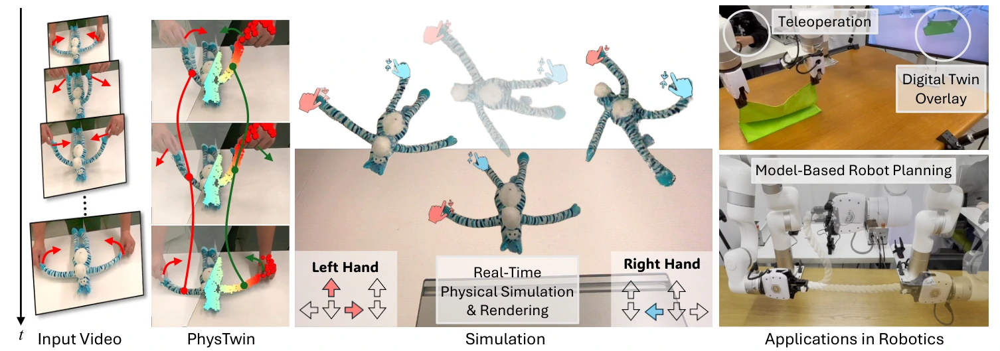
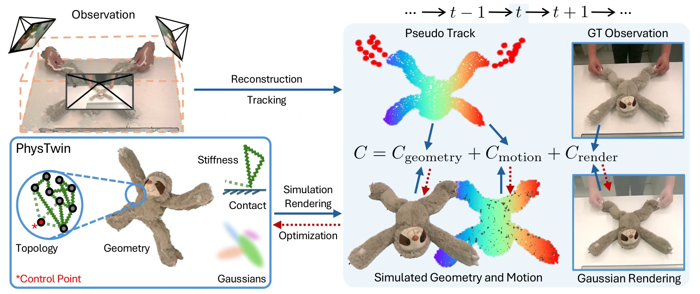

# PhysTwin：从稀疏交互视频构建面向机器人实时仿真与规划的柔性物体数字孪生

## 一屏概览

**研究问题。** 要把物理集成的 3D 高斯真正用于机器人操作（如双臂折叠绳索、拉扯毛绒玩具、搬运柔性包裹），必须跨越 [[physgaussian-physics-integrated-3d-gaussians-for-generative-dynamics|PhysGaussian]] 与 [[spring-gaus-reconstruction-and-simulation-of-elastic-objects|Spring-Gaus]] 尚未解决的三道现实鸿沟：（1）真实机器人工作台通常只有稀疏的 **3 个固定 RGB-D 视角**且伴随严重的人手/夹爪遮挡，无法像 Spring-Gaus 那样先环拍 70 张无遮挡静态图；（2）操作任务由外部手部/机械臂动作 $a_t$ 主动驱动，而非单纯的桌面自由落体；（3）弹簧连接半径与最大邻居数等**离散拓扑超参数不可微**，若固定死拓扑只做一阶梯度下降，模型无法适配绳索、布料、毛绒玩具与纸箱包裹等截然不同的结构。**PhysTwin** 结合**单图生成式 3D 形状先验（TRELLIS）**、**视觉基础模型 3D 密集跟踪（Grounded-SAM2 + CoTracker3）**、**零阶（CMA-ES）+ 一阶可微弹簧质点分层由疏到密优化**以及**线性混合蒙皮（LBS）3D 高斯渲染**，仅凭单个稀疏视角交互视频即可构建实时运行的水密物理数字孪生，并直接服务于机器人实时遥操作与基于模型的运动规划。[论文 §1–4](https://arxiv.org/abs/2503.17973)

原文图 1：PhysTwin 从稀疏视角（3 个 RGB-D 相机）采集的人手交互视频出发，重建具有完整三维几何、高保真 3DGS 外观与稠密弹簧质点物理参数的可交互数字孪生，支持键盘或双臂机械臂遥操作下的实时物理仿真与视觉叠加，以及面向特定目标构型（如绳索摆形）的基于模型机器人运动规划。来源：论文 PDF，第 1 页。[查看原始来源](https://arxiv.org/pdf/2503.17973v1#page=1)

**机构与版本。** 哥伦比亚大学与伊利诺伊大学厄巴纳-香槟分校（UIUC，Shenlong Wang 与 Yunzhu Li 课题组）联合发布；作者为 Hanxiao Jiang、Hao-Yu Hsu、Kaifeng Zhang、Hsin-Ni Yu、Shenlong Wang、Yunzhu Li；`arXiv:2503.17973v1`（2025-03-23）。

## 核心机制与算法设计

原文图 2：PhysTwin 框架总览。核心表示包含 canonical 几何与拓扑 $\mathcal{G}_0$、弹簧与接触物理参数 $\alpha$、主动控制点（红色星号 `*Control Point`）以及 3D 高斯核 $\theta$。第一阶段利用三维点云单向 Chamfer 几何损失 $\mathcal{C}_{\text{geometry}}$ 与 CoTracker3 伪真值三维轨迹损失 $\mathcal{C}_{\text{motion}}$（蓝色实线前向，红色虚线反向）分两步优化拓扑与稠密物理参数；第二阶段固定物理轨迹，最小化图像渲染损失 $\mathcal{C}_{\text{render}}$ 优化静态 3D 高斯并通过线性混合蒙皮（LBS）合成动态外观。来源：论文 PDF，第 3 页。[查看原始来源](https://arxiv.org/pdf/2503.17973v1#page=3)

### 1. 带主动控制点的三维弹簧质点动力学模型（§3）

将可变形物体表示为图 $\mathcal{G} = (\mathcal{V}, \mathcal{E})$，其中质点集 $\mathcal{V}$ 含位置 $x_i \in \mathbb{R}^3$ 与速度 $v_i \in \mathbb{R}^3$，边集 $\mathcal{E}$ 为连接相邻质点以及**连接外部控制点（人手/夹爪轨迹点 $a_t$）与物体质点**的弹簧。不同于 [[spring-gaus-reconstruction-and-simulation-of-elastic-objects|Spring-Gaus]] 非标准化的距离幂次力，PhysTwin 采用严格遵守牛顿第三定律与动量守恒的双向对称胡克弹簧力、粘壶（dashpot）阻尼力、冲量碰撞处理与空气阻力衰减 $\delta$（式 1）：

$$F_i = \sum_{(i,j)\in\mathcal{E}}\left[k_{ij}\bigl(\|x_j - x_i\| - l_{ij}\bigr)\frac{x_j - x_i}{\|x_j - x_i\|} - \gamma(v_i - v_j)\right] + F_i^{\text{ext}},$$

$$v_i^{t+1} = \delta\left(v_i^t + \Delta t\,\frac{F_i^t}{m_i}\right), \qquad x_i^{t+1} = x_i^t + \Delta t\,v_i^{t+1}.$$

### 2. 第一阶段：生成式完整形状配准与“零阶 $\to$ 一阶”分层物理优化（§4.2.1，附录 A）

面对仅 3 个 RGB-D 视角的严重遮挡，直接从首帧深度点云建网会丢失背面与被手遮挡部位。PhysTwin 设计了两步几何与物理反演：

1. **TRELLIS 生成式完整形状初始化与四步非刚性配准（§4.2.1 Generative Shape Prior，附录 A）：**
   - 用 Grounded-SAM2 分割首帧前景物体并经超分辨率增强后，输入单图转 3D 生成模型 **TRELLIS** 生成完整水密三维网格；
   - **粗到精刚性/尺度对齐：** 在球面上均匀布置虚拟相机渲染生成网格，用 SuperGlue 与真实首帧匹配 2D 特征点，选匹配数最多的视角后用 PnP 算法精化旋转矩阵；在相机坐标系下沿射线方向优化缩放因子与平移；
   - **ARAP 非刚性形变与射线无遮挡对齐：** 用尽可能刚性（ARAP）形变将生成网格对齐到实测深度点云，并从相机发射射线消除遮挡穿透。同时用 Grounded-SAM2 分割人手掩码，结合 **CoTracker3** 在 2D 视频上跟踪像素点并利用深度图反投影到 3D，经最远点采样（FPS）提取主动控制点序列 $a_t$，同时獲得物体表面点的三维伪真值跟踪轨迹 $x_i^t$。
2. **分层由疏到密（Hierarchical Sparse-to-Dense）物理参数优化（式 3）：**
   最小化仿真状态 $\hat{X}_t$ 对实测局部点云 $X_t$ 的单向 Chamfer 距离 $\mathcal{C}_{\text{geometry}}$ 与对 CoTracker3 三维伪轨迹的跟踪误差 $\mathcal{C}_{\text{motion}}$：
   $$\min_{\alpha, \mathcal{G}_0} \sum_t \Bigl(\mathcal{C}_{\text{geometry}}(\hat{X}_t, X_t) + \mathcal{C}_{\text{motion}}(\hat{X}_t, X_t)\Bigr) \quad \text{s.t. } \hat{X}_{t+1} = f_{\alpha, \mathcal{G}_0}(\hat{X}_t, a_t).$$
   - **零阶采样优化（Zero-Order Optimization via CMA-ES）：** 弹簧拓扑参数（质点间连接半径、最大邻居数、控制点连接半径与邻居数）、碰撞参数以及初始均质弹簧刚度是离散或高度非光滑的。第一子阶段假设所有弹簧共享单一均质刚度，用无梯度演化策略（CMA-ES）搜索最佳拓扑结构与全局物理初值；
   - **一阶可微精细优化（First-Order Gradient Optimization）：** 锁定零阶找到的最佳弹簧拓扑后，在基于 NVIDIA Warp 编写的自定义可微弹簧质点模拟器上，通过一阶梯度下降同时优化**数万根弹簧各自的稠密异质刚度 $k_{ij}$** 与精细碰撞参数。

### 3. 第二阶段：各向同性高斯与线性混合蒙皮（LBS）渲染更新（§4.2.2，附录 B）

在物理轨迹 $\hat{X}_t$ 优化收敛后，PhysTwin 在首帧初始化各向同性 3D 高斯核 $(\mu_j^0, q_j^0, s_j, \alpha_j, c_j)$。为了在后续帧 $t \to t+1$ 中既保持高斯的旋转朝向又不产生毛刺，摒弃了 [[spring-gaus-reconstruction-and-simulation-of-elastic-objects|Spring-Gaus]] 仅平移中心的做法，采用**两步线性混合蒙皮（Linear Blend Skinning，LBS，附录式 5–8）**：

1. **求解每个质点的局部刚体旋转 $R_i^t \in \mathrm{SO}(3)$：** 对每个质点 $\hat{\mu}_i^t \in \hat{X}_t$，利用其邻域质点 $\mathcal{N}(i)$ 从 $t$ 到 $t+1$ 的相对位移求解局部正交 Procrustes 问题（式 5）：
   $$R_i^t = \arg\min_{R \in \mathrm{SO}(3)} \sum_{j \in \mathcal{N}(i)} \bigl\|R(\hat{\mu}_j^t - \hat{\mu}_i^t) - (\hat{\mu}_j^{t+1} - \hat{\mu}_i^{t+1})\bigr\|_2^2.$$
2. **高斯中心与四元数的 LBS 插值（式 6–8）：** 对每个高斯核 $\mu_j^t$，根据其周围 $K$ 个最近邻质点 $\hat{\mu}_k^t$ 的距离反比权重 $w_{jk}^t = \frac{\|\mu_j^t - \hat{\mu}_k^t\|^{-1}}{\sum_{m \in \mathcal{N}(j)}\|\mu_j^t - \hat{\mu}_m^t\|^{-1}}$，插值更新高斯核中心与旋转四元数：
   $$\mu_j^{t+1} = \sum_{k \in \mathcal{N}(j)} w_{jk}^t \bigl(R_k^t(\mu_j^t - \hat{\mu}_k^t) + \hat{\mu}_k^t + T_k^t\bigr), \qquad q_j^{t+1} = \Bigl(\sum_{k \in \mathcal{N}(j)} w_{jk}^t r_k^t\Bigr) \otimes q_j^t.$$

## 实验结果与机器人下游应用

### 1. 22 个真实柔性交互场景定量对比與消融（§5.1–5.2，表 1–3）

作者使用 3 台 RealSense D455 相机采集了涵盖绳索、毛绒玩具、布料与快递包裹的 22 个单/双手真实交互序列（按 7:3 划分训练与未来预测测试帧，并人工标注每段视频 9 个三维真值跟踪点），与增强了控制点及 TRELLIS 形状先验的 [[spring-gaus-reconstruction-and-simulation-of-elastic-objects|Spring-Gaus]] 和增强了 CoTracker3 + LBS 的图神经网络动力学模型 GS-Dynamics 对比（表 1–3）：

| 评测任务与方法（论文表 1–3） | 3D $\text{CD} \downarrow$ | 3D $\text{Track Error} \downarrow$ | 2D $\text{IoU}\% \uparrow$ | $\text{PSNR} \uparrow$ | $\text{SSIM} \uparrow$ | $\text{LPIPS} \downarrow$ |
| --- | --- | --- | --- | --- | --- | --- |
| **重建与重仿真（前 70% 帧）**：[[spring-gaus-reconstruction-and-simulation-of-elastic-objects|Spring-Gaus]]（仅计未崩溃样本） | 0.041 | 0.050 | 57.6 | 23.445 | 0.928 | 0.102 |
| **重建与重仿真**：GS-Dynamics（GNN 学习动力学） | 0.014 | 0.022 | 72.1 | 26.260 | 0.940 | 0.052 |
| **重建与重仿真**：PhysTwin（仅零阶 CMA-ES，表 3） | 0.007 | 0.012 | 80.2 | 27.409 | 0.943 | 0.039 |
| **重建与重仿真**：PhysTwin（仅一阶梯度下降，表 3） | 0.008 | 0.012 | 82.7 | 27.913 | 0.944 | 0.037 |
| **重建与重仿真**：**PhysTwin（完整零阶 + 一阶）** | **0.005** | **0.009** | **84.4** | **28.214** | **0.945** | **0.034** |
| **未来预测（后 30% 未见帧）**：[[spring-gaus-reconstruction-and-simulation-of-elastic-objects|Spring-Gaus]] | 0.062 | 0.094 | 46.4 | 22.488 | 0.924 | 0.113 |
| **未来预测**：GS-Dynamics | 0.041 | 0.070 | 49.8 | 22.540 | 0.924 | 0.097 |
| **未来预测**：**PhysTwin（完整零阶 + 一阶）** | **0.012** | **0.022** | **72.5** | **25.617** | **0.941** | **0.055** |
| **泛化至未见交互方式（22 组跨动作迁移，表 2）**：GS-Dynamics | 0.029 | 0.038 | 63.4 | 25.053 | 0.934 | 0.067 |
| **泛化至未见交互方式**：**PhysTwin（本文）** | **0.013** | **0.018** | **72.18** | **26.199** | **0.938** | **0.047** |

**两个极具说服力的实验发现：**

1. **物理先验对数据效率的量级碾压（附录 C Data Efficiency）：** 在双手拉伸与折叠绳索任务上，哪怕给纯神经网络基线 GS-Dynamics 提供 **30 倍的数据量（30 条训练轨迹）**，其表现仍不及仅用 **1 条交互视频** 构建的 PhysTwin。
2. **物理约束反向净化视觉跟踪噪声（§5.2，附录 C）：** 用于监督训练的 CoTracker3 原始 3D 伪轨迹本身存在明显抖动与遮挡跳变，但经过全局弹簧质点动力学约束优化后，PhysTwin 输出的轨迹反而比输入给它的 CoTracker3 教师信号更平滑、更准确。

### 2. 机器人实时遥操作与基于模型的运动规划（§5.3，图 1）

依托 NVIDIA Warp 实现的高效弹簧质点求解器，构建好的 PhysTwin 可直接支持两类具身智能应用：

- **实时交互仿真与遥操作叠加：** 接收键盘或双臂机械臂遥操作设备的实时末端位移输入，在线预测并渲染柔性物体的未来形变状态；
- **基于模型的机器人运动规划（Model-Based Robotic Planning）：** 将重建的 PhysTwin 作为高保真正向动力学模型接入规划管线（如[[ModelPredictiveControl|模型预测控制 MPC]] / 采样规划），规划机械臂将柔性绳索提起并摆放到指定目标构型的动作序列并在真机上执行。
