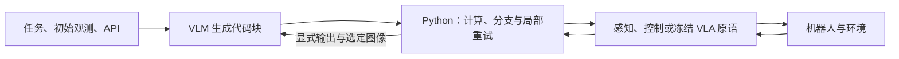
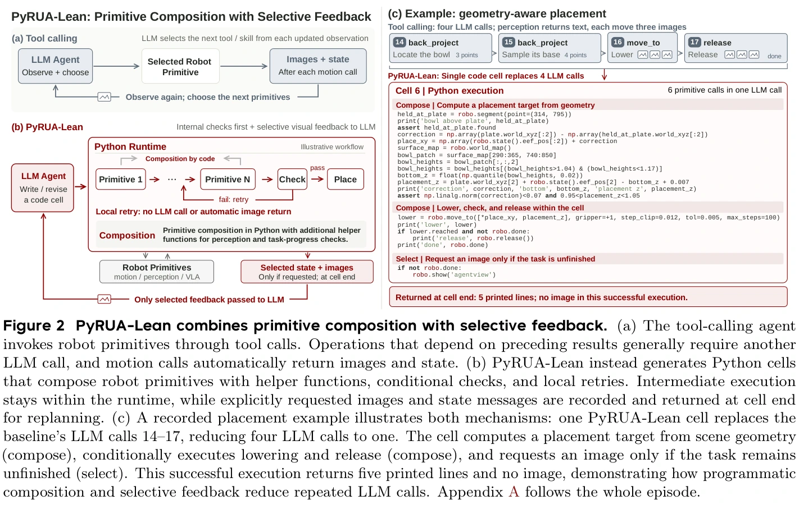
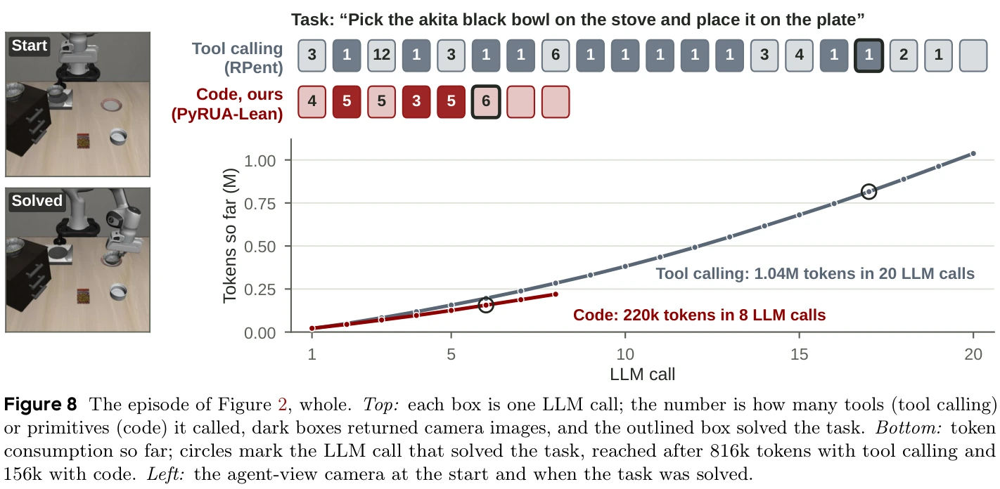
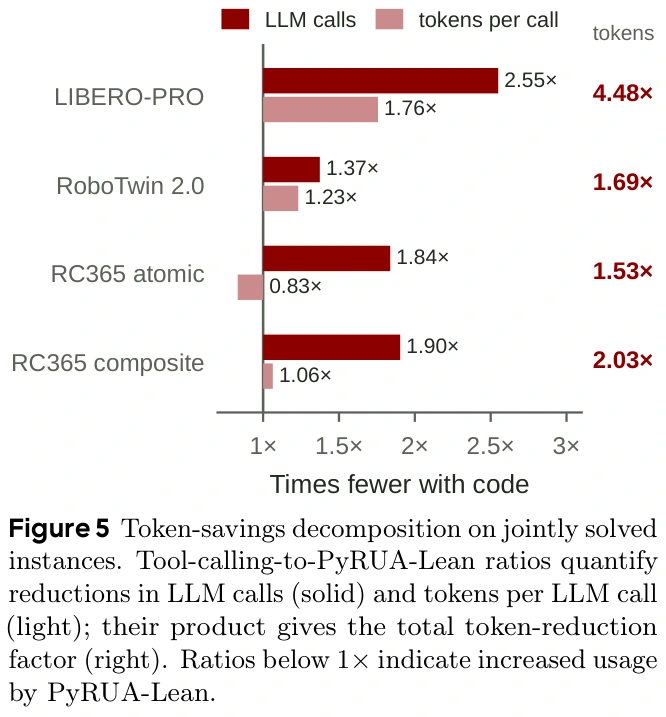
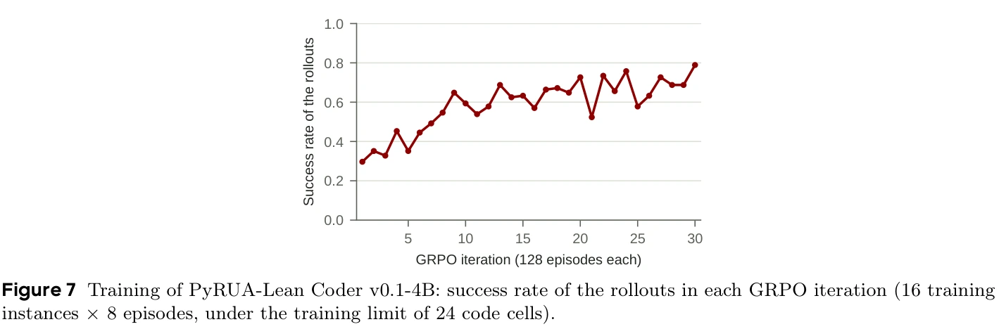

# PyRUA-Lean：通过交互代码组织机器人执行与反馈

## 先把论文的三个问题分开

**这篇论文研究的是机器人智能体的执行接口。** PyRUA-Lean 把机器人暴露为 Python 对象 `robo`，让视觉语言模型编写可执行代码块，在程序里组织动作原语、检查返回结果、计算几何量和重试，再选择哪些反馈交给下一次模型调用。它提出并分别验证三个问题：同一规划模型与原语下，代码接口是否优于逐步工具调用（§3）；冻结大模型加手写几何原语能在 RoboDojo 做到什么程度（§4）；小模型能否通过强化学习学会使用这个接口（§5）。三部分的控制变量不同，不能合并成一次“RSI 系统超过 VLA”的实验。[论文 v2](https://arxiv.org/abs/2610.01939v2)

**版本与阅读范围。** Ruiyang Si、Jianxin Bi 等 15 位作者，机构包括北京大学、新加坡国立大学、NVIDIA 与 Impossible Research；首版提交于 2026-10-01，本页完整阅读 2026-10-13 的 v2，共 29 页，含参考文献及附录 A–K。归档 PDF 为主证据；另存官方 HTML `raw/pyrua-lean-fewer-tokens-better-action-html-2026-10-28-91242e3d3568.html`，SHA-256 为 `91242e3d35686172c6db860b65a1eba449fd5c9c5175fad67dccd63991b42fd0`，用于核对提取损坏的代码与表格。HTML 把部分代码清单混入图序，附录中会出现与 PDF 不同的图号，本页统一采用 PDF 图号与物理页码。

**与后续项目的关系。** 截至本次核查，[[pyrua-lean-repository|官方仓库]]仍将 PyRUA-RSI 标为即将发布；本页只解读已公开的 Lean 与 Coder。跨回合积累和改进程序的验证口径见 [[PhysicalRecursiveSelfImprovement|Physical RSI]]，通用执行层概念见 [[RobotHarness|机器人 Harness]]。

## §1–2：瓶颈为什么出现在接口，而不只在模型能力

考虑“定位碗→接近→抓取→确认抓住→放到盘子上”。若下一步依赖前一步返回值，逐步工具调用通常需要重新调用模型。RPent 基线还会在运动后自动返回多相机图像；这些反馈进入对话历史，后续请求继续携带。即使每个原语本身可靠，长任务仍会花很多模型调用来协调它们。

Python 能把明确的局部条件留在程序里：只有接近成功才抓取；抓取未完成则重试；几何量由数组计算；需要语义判断时再交还模型。它也扩大了模型可表达的策略空间，例如构造已有工具没有直接返回的放置目标。但“用代码控制机器人”并非本文首创；§2 将本文与 Code as Policies、ProgPrompt、CodeAct、[[aspire-agentic-skills-discovery-for-robotics|ASPIRE]] 等区分，贡献重点是**相同规划器和底层原语下的接口比较、反馈成本核算，以及代码规划器训练**。[§1–3](https://arxiv.org/html/2610.01939v2#S3)

## §3.1–3.3：一次执行包含两层反馈

模型接收任务指令、初始图像和状态、机器人 API，以及可用的操作说明。随后调用 `python(code)`。代码中的 `robo` 方法把感知、运动、夹爪和冻结 VLA 变成结构化返回值；Python 可以继续检查这些值。代码块结束后，打印内容、异常和请求的图像返回模型，模型再决定下一段代码。以下为依据论文整理的教学结构，不是新增实验：

原文图 2：PyRUA-Lean 将原语组合与选择性反馈结合。（a）工具调用智能体逐步调用原语，依赖前序结果的操作通常需要另一次模型调用，运动调用自动返回图像与状态。（b）Python 代码块组合原语、辅助函数、条件检查和局部重试，中间执行留在程序环境中，显式请求的图像与状态消息在代码块结束后返回模型重规划。（c）一次记录中的放置操作用一个代码块替代基线第 14–17 次模型调用：从场景几何计算目标、按条件下放和松手，任务未完成才请求图像；这次成功执行返回五行文字而没有图像。来源：论文 PDF 第 4 页。[原始页面](https://arxiv.org/pdf/2610.01939v2#page=4)

### 程序状态、对话历史与物理状态不同

可以用下面的教学形式化表示第 $k$ 轮交互，原文没有给出这一组公式：

$$
c_k\sim\pi_\theta(\cdot\mid I,h_k),\qquad
(\sigma_{k+1},\tau_k)=\operatorname{Execute}(c_k,\sigma_k,\mathcal E),
$$

$$
y_k=\operatorname{Select}_{c_k}(\tau_k),\qquad
h_{k+1}=h_k\oplus(c_k,y_k).
$$

$I$ 是任务与接口说明，$\pi_\theta$ 是代码规划器，$h_k$ 是模型可见的交互历史；$\sigma_k$ 是 Python 变量和函数，$\tau_k$ 是本轮执行产生的中间结果，$y_k$ 是交给模型的反馈，$\mathcal E$ 是会被动作改变的物理环境。程序可以保存大数组而只打印几个数，因此保存信息和把信息加入模型上下文是两件事。

变量与辅助函数只在**同一回合**的代码块之间保留。主比较关闭跨回合记忆；这些变量没有形成跨任务技能库。未捕获异常结束当前代码块，并把回溯交给模型；异常发生前创建的变量仍在，但已执行的物理动作不会回滚。因此修复一段报错代码时仍要重新确认物体和夹爪状态。[§3.1–3.3](https://arxiv.org/html/2610.01939v2#S3.SS1)

论文描述 `robo.show` 在代码指定位置记录图像、在块末返回；本次固定版本的实际取图时机存在差异，详见 [[pyrua-lean-repository#roboshow-的时刻语义与论文表述有差异|代码核查与最小实验]]。这里不能把论文的接口意图当作当前实现保证。

### 一个代码块究竟多做了什么

它既能串联动作，也能构造计算。例如放置碗时，末端执行器位置与碗中心、碗底不是同一点。附录 A 的最后一个操作块先估计碗的当前位置，再根据点云中碗底的低分位高度推算末端目标。把该实例的计算改写成易读公式：

$$
p_{\mathrm{eef,target}}^{xy}=p_{\mathrm{eef,current}}^{xy}+
\left(p_{\mathrm{plate}}^{xy}-p_{\mathrm{bowl}}^{xy}\right),
$$

$$
z_{\mathrm{eef,target}}=z_{\mathrm{plate}}+
\left(z_{\mathrm{eef,current}}-z_{\mathrm{bowl,bottom}}\right)+0.007.
$$

$p^{xy}$ 是世界坐标的水平位置，$z$ 是高度，长度单位为米；`eef` 指末端执行器。括号内保留夹爪与被抓物之间的偏移，最后的 7 mm 是该次程序采用的余量，并非论文证明的通用参数。该计算假设测量有效、搬运时抓持关系近似不变；物体滑动或姿态改变后需更新测量。代码随后检查目标范围、下放结果和是否完成任务，再决定松手及取图。这个实例说明程序可以把**物体几何关系转换为控制目标**，并非简单把多个 API 名称拼接起来。[附录 A，PDF 第 19–20 页](https://arxiv.org/pdf/2610.01939v2#page=19)

## 附录 A：沿一个完整回合理解信息流

任务是将炉子上的黑色碗放到盘子上，实例为 LIBERO-PRO spatial swap、task 7、seed 2。它是双方都成功、成本接近该基准中位数的展示实例，不代表每个任务的固定流程。

| 代码块 | 实际作用 | 哪些信息留给下一步 |
| --- | --- | --- |
| 1 | 分割碗与盘子，读取状态并查询桌面点 | 碗和盘子的定位结果保存为变量 |
| 2 | 检查目标存在，接近成功后调用 VLA 抓取 | 接近／抓取返回值与请求图像 |
| 3 | 闭合夹爪、抬升、重新定位持有的碗 | 抓持后的几何与机器人状态 |
| 4 | 通过图像和定位检查抓持 | 为继续搬运提供依据 |
| 5 | 根据夹爪—碗偏移计算目标，经中间点搬运；动作失败则退出循环 | 新状态、搬运结果与请求图像 |
| 6 | 估计碗底、修正水平位置与放置高度；下放成功后松手 | 成功时只返回文字，不再请求图像 |

原文图 8：原文图 2 对应的完整回合。上部每格是一次模型调用，数字为调用的工具或原语数，深色格表示返回图像，描边格为任务成功的调用；下部为累计输入 token，圆点标记首次成功：工具调用在第 17 次、816k token 时成功，代码接口在第 6 次、156k token 时成功。左侧为开始和成功时的场景图像。全回合还包括成功后的结束操作，最终分别为 20 次／1.04M token 与 8 次／220k token。来源：论文 PDF 第 19 页。[原始页面](https://arxiv.org/pdf/2610.01939v2#page=19)

原文计入成功后的模型调用，因此“首次成功成本”和主表使用的“完整回合成本”不能混用。这个实例还显示，代码接口仍多次查看图像；减少的是不必要的协调往返，不是取消反馈。[附录 A、E](https://arxiv.org/pdf/2610.01939v2#page=19)

## §3.4–3.8：主比较证明了什么

### 固定条件与统计分母

两组均使用 GPT-6 Astra、高推理强度、相同任务种子、机器人栈、SAM 3 和冻结 VLA：LIBERO-PRO 使用 $\pi_{0.5}$，RoboTwin 2.0 使用 LingBot-VLA，RoboCasa365 使用 RLDX-1。LIBERO-PRO 有 40 任务 × 5 种子，RoboTwin 有 50 × 5，RoboCasa 有 18 个原子任务和 32 个复合任务，各 5 种子，总计 700 个配对实例、1,400 个回合。每实例每组只运行一次。[§3.4，附录 F](https://arxiv.org/html/2610.01939v2#S3.SS4)

单回合上限通常为 40 次模型调用，RoboCasa 复合任务为 100 次，另有两小时墙钟上限。**等模型调用预算不等于等动作次数、仿真步数或墙钟时间**；一次代码块可执行多个原语，正是待测接口的能力。实验支持相同模型调用预算下的收益，不是相同物理尝试次数下的纯规划能力比较。

| 基准 | 成功率：工具 → 代码 | 模型调用：工具 → 代码 | 输入 token：工具 → 代码 |
| --- | --- | --- | --- |
| LIBERO-PRO | 83.0% → 94.0% | 21.4 → 8.4 | 1.23M → 273k |
| RoboTwin 2.0 | 60.0% → 69.2% | 12.2 → 8.9 | 415k → 245k |
| RoboCasa 原子任务 | 78.9% → 86.7% | 10.4 → 5.6 | 261k → 171k |
| RoboCasa 复合任务 | 34.4% → 39.4% | 28.4 → 14.9 | 1.22M → 603k |
| 总计 | 63.1% → 71.7% | 17.0 → 8.7 | 788k → 276k |

来源为表 2（PDF 第 6 页）。成功率以全部实例为分母；调用与 token 只在**双方都成功的交集**上平均，包括缓存输入及成功后的调用。标题中的 14% 是相对提升，$(71.7-63.1)/63.1\approx13.6\%$；绝对提升是 8.6 个百分点。输入减少约 65%，不能读成机器人动作减少 65%，也不能直接读成费用或耗时减少 65%。

### 为什么 token 减少：记账分解与因果解释要分开

定义一组回合的总输入 token 为 $T$、模型调用总数为 $N$，每次调用平均输入为 $\bar C=T/N$。则同一实例集合上的比例恒等式为：

$$
\frac{T_{\mathrm{tool}}}{T_{\mathrm{code}}}
=\frac{N_{\mathrm{tool}}}{N_{\mathrm{code}}}
\frac{\bar C_{\mathrm{tool}}}{\bar C_{\mathrm{code}}}.
$$

这是对原文记账方式的数学展开，不是独立的因果模型。LIBERO-PRO 的 $2.55\times1.76\approx4.48$ 倍 token 比例同时来自少调用与较短的平均输入。RoboCasa 原子任务则是 $1.84\times0.83\approx1.53$：代码组每次调用反而更大，但总调用更少。不能概括成“每个提示都变短”。

原文图 5：在双方均成功的实例上，将工具调用相对代码接口的总 token 比例分解为模型调用次数比例（深色）和每次调用平均 token 比例（浅色），二者乘积为右侧总比例；小于 1 表示代码接口反而使用更多。来源：论文 PDF 第 7 页。[原始页面](https://arxiv.org/pdf/2610.01939v2#page=7)

把所有失败回合也计入后，RoboCasa 原子任务的输入比例只剩约 1.1，按论文当时价格估算每回合费用为工具 0.94 美元、代码 0.96 美元。主表双方成功交集的平均费用从 1.63 降至 0.74 美元，缓存折扣使费用降幅小于输入 token 降幅。这些是历史价格下的成本记录，不是当前服务报价。[附录 E]

### 消融如何约束解释

只把 LIBERO-PRO 工具基线改成按需返回图像，成功率从 83.0% 降到 68.5%；在三组均成功的 131 个实例上，原基线与该变体都约用 1.07M 输入 token，代码组为 222k。这个结果支持“单独关掉自动图像不够”，但没有独立测出代码接口中选择性反馈的净贡献。代码组合、持久变量和观测策略仍是一起变化的。[表 14，PDF 第 25 页]

去掉 VLA 后，RoboTwin 的工具／代码成功率为 42.8%／68.8%；但继续去掉操作说明，工具组反而升至 60.4%，代码组为 66.4%。说明说明文档的效果依赖接口与配置，不能假定越多越好。[表 3]

附录 C 的实际行为统计也避免把所有代码块想象成复杂长程序：45% 的块执行两个以上动作原语，19% 有依赖前序结果的条件动作，30% 使用 NumPy，7% 调用先前定义的函数，84% 请求过相机图像；35% 仍是单步动作后看图。数据支持多种策略混用，不支持“长代码块总是最佳”。

代码组独自成功的 96 个实例中，52 个对应基线用完模型调用预算，其余 44 个对应基线提前结束；后者还包括相同 VLA 在一次运行成功、另一次失败的情况。只有一次配对运行，不能把全部差值归因于程序恢复逻辑。[§3.8，附录 D]

## §4：RoboDojo 更换了哪些条件

这里使用双臂 ARX-X5 和作者自写原语，输入为头部及双腕三幅 RGB 图像、关节和末端状态。没有 VLA、没有深度图、没有物体真值位姿，也没有运行中可读的成功／进度信号；但程序事先知道固定工作站的相机标定、机械臂安装位置与桌面高度。`locate` 用 SAM 3 掩码和多视角几何估计物体，`move_to` 通过逆运动学和轨迹执行移动夹持点，夹爪原语报告开度及阻挡结果。**无特权场景真值不等于没有机器人标定或几何先验。** 这些接口的实现见 [[pyrua-lean-repository]]。

42 个任务分为泛化、精度、长时域、记忆和开放指令五类，每任务每评测种子 50 个回合，合计 2,100。泛化任务的一半为标准外观，一半随机化房间及桌面外观。论文主结果用 seed 0：先在类别内平均，再对五类无权平均，得到成功率 **51.62%**、过程分数 **58.20**。直接汇总所有回合则为 1,061/2,100，即 50.5%，两者分母权重不同。过程分数给部分完成的步骤计分，不能称为成功率。[§4.1–4.3，表 5]

同页列出的 GPT-6 Astra 直接输出末端目标结果为 22.48%，但两套系统还改变了几何感知、推理强度和提示内容；51.62% 对 22.48% 是系统比较，不能全部归因于代码接口。比较的其他方法取自 2026-10-09 榜单快照，不代表今天的排名。

作为后续证据，[[pyrua-lean-repository|仓库中的官方评测记录]]由 RoboDojo 团队在 seed 3 运行，五类平均成功率为 **50.35%**，过程分数为 **55.26**。这是另一轮评测，不是对论文 seed 0 数字的纠错。仓库另有两段 AF8 真机演示的说明；它们晚于所读 v2，不能补写成论文已有的大规模真机对照。

论文六个任务零成功，其中包括插钥匙、按指定次数按按钮等；作者把不足集中描述为反馈缺少接触结果、紧配合精度有限，未逐回合完整归因。增加深度的单种子成功率为 52.42%，三个种子平均为 52.91%（标准差 0.35 个百分点），与 RGB 组 51.62% 分开报告；深度不符合该榜单智能体输入条件，因此不能混入排行榜结果。[§4.3–4.4，表 6–7]

## §5：GRPO 到底训练了什么

### 训练对象、环境与样本量

训练对象是 **Qwen3.5-4B 代码规划器**：读任务、图像和 API，生成推理及代码，读取返回值后继续。冻结 VLA、SAM 3 与动作原语不更新。训练从原模型直接做全参数强化学习，无监督微调阶段或示范数据，成功奖励为 1，失败为 0，没有额外的 token、调用次数或仿真步数惩罚。[§5.1]

45 个训练实例来自 LIBERO-PRO 的 goal、spatial、object 三套件，每套 3 个任务 × 5 个种子，即 9 个任务各 5 种布局。它不是“只看过 45 条轨迹”：每轮采样 16 个实例，各运行 8 次，共 128 回合；30 轮产生 **3,840 个回合、60 次优化器更新**。训练用 8 GPU 节点，约 12 小时；论文未在该表给出 GPU 型号。训练回合上限为 24 个代码块、30 次模型调用、25 分钟，生成单次最多 4,096 token；评测限制更宽。[表 16，PDF 第 28 页]

### 从成败奖励到代码生成的梯度

以下为帮助理解 §5.1 的教学展开，论文描述了算法与超参数，没有给出这一整套推导。对同一训练实例采样 $G=8$ 个回合，回合 $i$ 的终局奖励为 $R_i\in\{0,1\}$，用组内相对成败形成优势：

$$
A_i=\frac{R_i-\bar R}{s_R+\epsilon},\qquad
\bar R=\frac{1}{G}\sum_{j=1}^{G}R_j.
$$

$s_R$ 是组内奖励标准差，$\epsilon$ 是此教学公式用于避免零除的小量；原文未明确数值实现细节。若八次全败或全成功，这种相对优势没有区分信号。若两次成功、六次失败，成功回合获得正优势、失败回合获得负优势，从而改变对应输出序列的概率。

设 $a_{i,t}$ 为模型生成的第 $t$ 个 token，$h_{i,t}$ 为生成前的上下文，概率比为

$$
\rho_{i,t}=\frac{\pi_\theta(a_{i,t}\mid h_{i,t})}{\pi_{\theta_{\mathrm{old}}}(a_{i,t}\mid h_{i,t})}.
$$

论文将裁剪策略梯度应用到该回合**模型生成的推理和代码 token**。单 token 的教学写法是最大化

$$
\min\left(\rho_{i,t}A_i,
\operatorname{clip}(\rho_{i,t},0.8,1.28)A_i\right).
$$

原文给出的下／上裁剪幅度为 0.2／0.28，无 KL 或熵项，Adam 学习率恒为 $10^{-6}$。终局奖励通过生成概率更新代码规划器，**不沿 Python、物理仿真或 VLA 动作反向传播**。这解释了为什么即使底层操控能力冻结，也能通过学习何时检查、如何组织调用而提升成功率。该解释不等于证明所有收益只来自这些习惯；原文行为统计提供的是一致证据。

原文图 7：PyRUA-Lean Coder v0.1-4B 每轮 GRPO 采样回合的成功率，每轮 16 个训练实例 × 8 回合，按训练时 24 个代码块上限运行。来源：论文 PDF 第 14 页。它是训练回合曲线，不能作为留出泛化成绩。[原始页面](https://arxiv.org/pdf/2610.01939v2#page=14)

### 泛化结果与行为变化

| 规划器 | 训练实例 45 | 未训练 LIBERO-PRO 155 | RoboTwin 250 | RoboCasa 原子 90 | RoboCasa 复合 160 | 全部未训练实例 655 |
| --- | --- | --- | --- | --- | --- | --- |
| Qwen3.5-4B | 37.8% | 13.5% | 14.0% | 52.2% | 12.5% | 18.8% |
| Qwen3.5-27B | 64.4% | 38.1% | 20.8% | 65.6% | 13.1% | 29.2% |
| 训练后的 4B Coder | 71.1% | 37.4% | 52.4% | 76.7% | 19.4% | 44.1% |

表 8（PDF 第 13 页）。三种开源规划器使用相同评测方式；训练仅包含 LIBERO-PRO，故 RoboTwin／RoboCasa 提供了跨仿真器、本体与冻结 VLA 的迁移证据。但“未训练实例”指本次强化学习未用，并不保证基础模型预训练没有相关资料。另列的 GPT-6 Astra 结果使用不同智能体循环和时限，应作为参考而非严格受控的小模型对大模型比较。

表 9 的关键变化是：原始 4B 每次模型调用生成代码块数的回合中位数为 9.0，提前批量提交后续动作；训练后为 1.0，先执行一个块再读取反馈。平均请求图像由每回合 19.3 降至 0.8，不含初始任务卡图片；因上下文溢出结束的比例由 19.2% 降至 3.4%，但主动放弃和墙钟耗尽比例升高。平均模型调用反而从 9.4 增至 21.1，说明它学会更多反馈往返，并非简单把所有调用压到最少。这也是不能把 GPT-6 接口实验的“少调用”机制照搬为 Coder 训练结论的原因。

## §6–7：结论应停在哪里

论文提供三类独立证据：代码接口在其固定模型与原语下提高完成率并减少输入开销；具备标定和感知原语的冻结大模型可执行 RoboDojo 的许多任务；小模型可以通过交互奖励学会更有效地使用接口。原文没有建立跨回合技能积累、改进算法自我修改，或大规模真机可靠性证据；Coder 只有一个模型尺寸和一次训练运行，也未在不含 VLA 的 RoboDojo 原语上验证。[§6–7]

对 [[PhysicalRecursiveSelfImprovement|Physical RSI]]，本文是很有用的**执行闭环与固定学习器参照**：回合内代码会变，训练后模型参数会变，但“生成未来改进的方法”是否越来越有效仍需独立测量。与 [[aspire-agentic-skills-discovery-for-robotics|ASPIRE]] 的跨任务技能库、[[physevo-physical-recursive-self-improvement|PhysEvo]] 的诊断工具继承比较，重点应放在更新对象、保留范围、测试期是否继续适配和总试验预算，而不是直接排列最终成功率。跨论文问题集中在 [[topics/robot-harness-and-physical-rsi|研究专题]]。

## 阅读后应能独立回答

- 为什么存进 Python 变量不等于存进模型上下文？为什么报错后物理状态不回滚？
- 一次模型调用可执行更多动作，会如何影响“等预算”比较？
- 65% 的统计分母是什么？RoboCasa 原子任务的全尝试费用为什么没有同样下降？
- Coder 的 45 个实例与 3,840 个回合分别是什么？梯度更新谁，冻结谁？
- 一个回合会恢复、下一版策略更强、改进方法会进化，分别需要什么证据？

这些问题对应本页的机制和统计口径。若需要核对具体实现，继续读 [[pyrua-lean-repository|固定版本代码与官方后续记录]]，不要从论文描述直接推定当前代码的全部语义。
