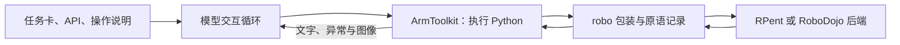

# PyRUA-Lean 公开实现

## 版本与核查范围

本页固定到官方仓库提交 [`fdf6e870654254e2c0c891ee407313fa48bdd0f9`](https://github.com/DAGroup-PKU/PyRUA-Lean/tree/fdf6e870654254e2c0c891ee407313fa48bdd0f9)，提交日期为 2026-10-24，消息为将预告中的名称改为 PyRUA-RSI。归档通过 `git archive` 保存该提交的完整受版本控制文件，不含 `.git` 历史和外部依赖。论文机制与训练实验另见 [[pyrua-lean-fewer-tokens-better-action|PyRUA-Lean v2 精读]]。

完整阅读 README、交互机制说明、Coder 说明、官方评测汇总与适配配置；定向静态核查代码块执行、机器人包装、模型反馈、RoboDojo 通信桥、RGB 几何和动作原语路径。缓存保留所读文档及代码片段的原文件名和行号。本次还用真实 `ArmToolkit`／`RobotBase` 加最小假后端验证了 `show` 的取图时机；**没有运行机器人、物理仿真、模型推理或 GRPO 训练，也没有完整审计仓库**。

## 一次代码块从模型到机器人，再返回模型

公开项目有两条后端路线：LIBERO-PRO、RoboTwin、RoboCasa 复用 RPent 的原语与服务；RoboDojo 通过 XPolicyLab 的评测客户端，由本库的运动、夹爪和感知原语操作。两者共用代码执行和反馈接口，不能因为都暴露 `robo` 就假定传感器和成功信号相同。[README](https://github.com/DAGroup-PKU/PyRUA-Lean/blob/fdf6e870654254e2c0c891ee407313fa48bdd0f9/README.md)

代码路径如下，均为本次固定提交中的行号：

| 阶段 | 实现位置 | 实际语义 |
| --- | --- | --- |
| 创建回合 | `src/pyrualean/play.py:580–643` | 启动后端、生成任务卡，创建机器人对象与 `ArmToolkit`，把接口及配置写入提示 |
| 初始化执行状态 | `src/pyrualean/arms.py:134–198` | 每个工具集保存自己的 `_globals`，其中有 `robo`、NumPy、数学工具及受限 builtins |
| 接收代码调用 | `arms.py:263–300` | 串行执行工具，记录耗时、原语数量变化、环境步数与审计标记 |
| 执行代码块 | `arms.py:391–441` | 先保存代码、检查预算与静态禁用名称，再解析 AST，使用同一个 `_globals` 执行；收集输出、末尾表达式和异常 |
| 调用机器人原语 | `src/pyrualean/_robot.py:289–340` | 记录输入、返回和耗时；运动前检查回合停止条件，结果更新已知状态和结束标记 |
| 组装模型反馈 | `arms.py:327–385` | `pure` 返回程序自身输出；`rich` 还附原语记录、状态及环境步数；图像由独立策略决定 |
| 继续模型交互 | `src/pyrualean/openai_runtime.py:470–590` | 读取模型工具调用，执行后把文字作为工具结果、图像作为随后的一条用户消息，再请求模型 |

`cells` 模式通过同一变量字典跨代码块保留状态；另一种 `program` 模式加载完整 `run(robo)` 程序，命名空间生命周期不同，不能套用论文代码块实验的语义。异常被返回后，已经赋值的变量与已执行动作仍然存在。`finish` 只记录模型给出的状态和摘要；它不能把评测客户端的失败改成成功。机器人 Harness 的共享语义见 [[RobotHarness]]。

## robo.show 的时刻语义与论文表述有差异

论文 §3.3 描述在代码指定点记录图像，等块末返回；但当前代码的 `RobotBase.show()`（`_robot.py:220–230`）只把相机名称加入去重列表，没有记录图像或步号。`ArmToolkit._attach_images()`（`arms.py:355–385`）在代码块结束后读取名单，并调用 `robo.artifact(name)`；默认 `step=-1`，因此得到读取时的最新画面。四种机器人包装的 `show` 只是调用基类，没有覆盖成即时保存图像的操作。[基类](https://github.com/DAGroup-PKU/PyRUA-Lean/blob/fdf6e870654254e2c0c891ee407313fa48bdd0f9/src/pyrualean/_robot.py#L220) · [组装反馈](https://github.com/DAGroup-PKU/PyRUA-Lean/blob/fdf6e870654254e2c0c891ee407313fa48bdd0f9/src/pyrualean/arms.py#L355)

本次运行最小假后端实验：以一个像素的红通道编码环境步号，初始为 0，执行 `show → 环境步号加一 → 再次 show 同一相机`。真实工具集返回 **一张**图，像素为 `(1, 0, 0)`，没有异常。这验证了本地固定代码的“按相机去重、块末取最新图”行为，实验不涉及仿真、视觉模型或任务成功率。

实践含义是：把 `show` 写在运动前，不能据此承诺模型收到运动前的图。同一块内若确实要保留不同阶段，可在各时刻主动读取 `robo.image()` 的数组，另行显示或保存；这些对象的生命周期和大小也需控制。该差异不推翻“按需反馈”的总体机制，却限制了论文关于反馈采样时刻的表述，不能假定历史评测的其他提交也具有同样行为。

## RoboDojo：交互程序怎样接上异步评测客户端

官方适配配置 `integrations/xpolicylab/PyRUA_Lean/deploy.yml` 明确使用 `robot: robodojo_xpl_rgb`、`primitives: no-vla`、`images: on-demand`、`feedback: pure`、100 个代码块上限、5,400 秒时限，以及高推理强度。机器人类虽有可选 VLA 的文档与结果类型，**此评测配置主动禁用它**；不能只看类说明判定论文 RoboDojo 实际用了 VLA。[固定配置](https://github.com/DAGroup-PKU/PyRUA-Lean/blob/fdf6e870654254e2c0c891ee407313fa48bdd0f9/integrations/xpolicylab/PyRUA_Lean/deploy.yml)

`hosts/xpolicylab_bridge.py:53–186` 用条件变量连接两种调用方向：评测客户端推送观测、索取下一动作；Python 原语主动发出一步动作并等执行后的观测。模型尚在思考时，`get_action()` 最多等 `poll_s=20` 秒，然后返回“等待”标记，由客户端继续轮询；有动作才真正推进。`step()` 保存请求并等待观测序号改变或回合终止，避免把一次模型推理阻塞成一条超长网络请求。

同文件还处理旧客户端“图像比状态晚一拍”的兼容情况，把图像与其对应的历史机械臂状态配对，用于腕部相机位姿。代码中存在这项修正，是时间对齐设计的证据；本次没有实际连接各版本客户端验证它。几何正确不仅依赖坐标公式，也依赖图像和机器人状态属于同一时刻。

RoboDojo 机器人继承的 API 隐藏了 `done`／世界坐标图等不具备的成员；RGB 主机入口把 `depth` 固定为 `False`。评测结束由外部客户端宣布，不能用其他基准的 `if robo.done` 示例直接替换。[RGB 主机](https://github.com/DAGroup-PKU/PyRUA-Lean/blob/fdf6e870654254e2c0c891ee407313fa48bdd0f9/src/pyrualean/hosts/xpolicylab_robodojo_rgb.py) · [机器人接口](https://github.com/DAGroup-PKU/PyRUA-Lean/blob/fdf6e870654254e2c0c891ee407313fa48bdd0f9/src/pyrualean/robodojo_xpl_rgb.py)

## RGB 定位不是直接获得物体真值

`robodojo_xpl_rgb.py:102–325` 暴露 `locate`、`back_project` 和相机标定查询。`hosts/robodojo_tools.py:1185–1249` 先用 SAM 3 分割对象，再在 `colour_only` 分支调用 `_measure_in_colour`；后者从其他相机中寻找同一对象候选掩码，交给 `hosts/robodojo_sight.py:818` 开始的 `measure`。

可以这样理解几何部分，这是对实现的教学解释：已标定相机的一个像素决定一条射线 $p=c+\lambda d$，$c$ 为相机位置，$d$ 为射线方向。若对应点在高度已知的平面 $z=z_0$，则 $\lambda=(z_0-c_z)/d_z$；但物体顶部高度未知，单个像素不能直接恢复它。实现以已知桌面为支撑平面，搜索物体高度和棱柱／上宽下窄等形状近似，把候选投影到其他视角，检查与掩码的一致性。第二视角提供的是几何约束，不是一个通用物体位姿真值接口。

`robodojo_sight.py:59–96` 保存固定头部相机、腕部安装变换与手指外形等常量，注释明确这些曾从模拟器标定获得。在线运行不用场景物体真值，并不意味着事前不知道机械臂、相机和桌面。`_measure_in_colour` 还按规范化后的对象提示缓存多视角可靠估计的高度；单视角复查可能复用先前高度，这与完全无状态的视觉检测不同。

接口通过 `views`、`note` 等字段报告不确定性：只有一个视角时高度可能只是形状假设；细长悬空部件、遮挡、掩码包含机械臂或对象不在桌面上都有局限。文档中毫米级精度描述不是本次独立测量结果。本次仅确认对应字段与计算分支存在，没有验证其数值精度。

## 从目标位姿到原生关节动作

RoboDojo 的 `move_to` 目标是指垫中间的夹持点，位置单位为米；其 `pitch/yaw/roll` 参数用度，状态中的姿态四元数按 `[w,x,y,z]` 排列。夹爪命令正值为闭合、负值为张开，而测量开度是 0 到 1，语义不同。[机器人接口说明](https://github.com/DAGroup-PKU/PyRUA-Lean/blob/fdf6e870654254e2c0c891ee407313fa48bdd0f9/src/pyrualean/robodojo_xpl_rgb.py#L102)

`hosts/robodojo_tools.py:377–508` 的 `move_pose` 接收目标和当前状态，调用 `_plan` 生成关节路径；直线路径逐路点求解，`auto` 在直线不可行时可退回关节空间运动，之后通过 `_act → Bridge.step` 发出关节动作。返回值根据实际末端位置／姿态误差设置 `reached`，并可报告运动受阻。只在空夹爪条件下考虑等效的半圈姿态，避免持物时翻转物体。

这条路径表明，模型不用逐步生成每个关节控制值，原语内部已承担 IK、路径组织和到达判定。但局部几何筛查、IK 可解、夹爪受到阻挡和物体稳定被抓住仍是不同命题；本次没有进行接触稳定性、碰撞覆盖或控制频率测试。底层原语的能力必须计入系统能力解释。

## 限制代码访问与记录执行，并不等于完整安全证明

`sandbox.py` 对导入模块和文件路径设限制，去掉部分动态执行入口，拒绝明确的 Python 内省名称，同时记录代码尝试访问私有接口、宿主对象等审计标记。`arms.py` 将每块原代码、输出和记录保存下来，使结果可追踪。文件本身也明确：进程内 Python 无法视为完全封闭的安全边界。本次未进行绕过测试；记录此处是为了理解评测如何限制直接读取模拟器内部信息，不把它升级为真实机器人安全认证。[沙盒实现](https://github.com/DAGroup-PKU/PyRUA-Lean/blob/fdf6e870654254e2c0c891ee407313fa48bdd0f9/src/pyrualean/sandbox.py)

## 论文之后的官方评测与真机说明

`integrations/xpolicylab/evaluation/robodojo_summary_official.md` 说明它复现 RoboDojo 团队发来的 seed 3 结果，覆盖全部 42 任务。这里是仓库归档的官方团队评测记录，本次没有独立重跑。

| 指标 | 泛化 | 精度 | 长时域 | 记忆 | 开放指令 | 五类平均 |
| --- | --- | --- | --- | --- | --- | --- |
| 成功率 | 43.17% | 38.25% | 43.75% | 68.33% | 58.25% | 50.35% |
| 过程分数 | 48.27 | 44.77 | 54.30 | 68.40 | 60.56 | 55.26 |

论文 seed 0 的 51.62%／58.20 与这里的 50.35%／55.26 来自不同评测种子，应并列保留；该文件中的跨种子标准差为 0 仅因只有一个种子，不能当成没有实验波动。[官方汇总快照](https://github.com/DAGroup-PKU/PyRUA-Lean/blob/fdf6e870654254e2c0c891ee407313fa48bdd0f9/integrations/xpolicylab/evaluation/robodojo_summary_official.md)

README 的 2026-10-21 更新还说明 AF8 双臂两段连续演示，每段把五个积木放入碗中，分别 41／42 个代码块、约 22 分钟；真机集成代码标为即将提供。本次只核查这段说明，未逐帧评审视频，也未将其当作真机对照实验。

Coder 模型已提供权重入口与运行说明，但本次未在此快照中找到、核查 GRPO 训练实现；训练算法、样本量与泛化结论追溯 [[pyrua-lean-fewer-tokens-better-action|论文 §5 与附录 J]]。PyRUA-RSI 仍是 README 中的预告，没有依据将 Lean 的回合内代码复用解释成已发布的跨回合递归改进机制。

## 对后续学习与复现的含义

要复现代码接口，先固定后端、原语集合、`cells/program` 模式、`pure/rich` 反馈、图像策略和预算单位；只记录模型名不够。要复现 RoboDojo，还需要对齐相机时序、标定先验、最终判定来源和评测种子。要研究 [[PhysicalRecursiveSelfImprovement|递归改进]]，则需另定义跨回合保留对象及独立验收；当前实现页只支持已核查的执行与反馈机制。比较入口见 [[topics/robot-harness-and-physical-rsi]]。
