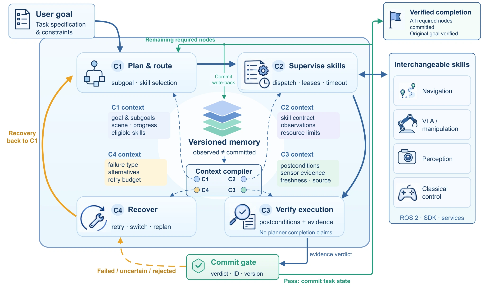

# RegenHarness：用证据决定物理进度何时生效

## 概览与动机

RegenHarness 区分模型提出计划、控制器终止、物理子任务完成、原始用户目标完成四件事。它把跨任务的配置改进称作 evidence-gated RSI，但本文提供的真实实验是四足机器人巡检与闭环路线案例，不能据此宣称已定量证明递归改进。本页完整阅读 v1 正文与参考文献；未运行或静态审查参考实现。证据为[论文全文](https://arxiv.org/html/2609.27612v1)。

对 [[RobotHarness|机器人 Harness]]，本工作最值得借鉴的是状态、证据和权限边界；对 [[PhysicalRecursiveSelfImprovement|Physical RSI]]，应把“提出发布协议”与“实证改进曲线”分开。

图 1（完整图注译文）：RegenHarness 的架构与执行权限。版本化记忆向计划 C1、监督 C2、验证 C3、恢复 C4 提供角色隔离的上下文。只有与身份及版本绑定的提交门接受任务进度。蓝色路径传递执行与上下文，绿色路径传递已接受进度，琥珀色路径表示有界恢复。可替换后端没有任务状态提交权限。来源：论文 HTML §4，图 1；HTML 无固定页码。

## 状态与提交机制

§2 将用户任务写成 $\mathcal T=(g,\mathcal G,\mathcal C_g,\mathcal S,\mathcal R)$：原目标 $g$、子目标依赖图 $\mathcal G$、原始完成条件 $\mathcal C_g$、安全／资源条件 $\mathcal S$ 和恢复预算 $\mathcal R$。节点表示期望效果，一次 invocation 是某个后端的一次尝试；重试可以换 invocation，却不能偷换节点目标。

逻辑版本 $k$ 下，$O_k$ 是带来源和时效的观测事实，$C_k$ 是通过检查而接受的任务事实。技能只能生成证据与建议更新，不能直接写 $C_k$。验证状态包括满足、违反、不确定、过期、不安全；只有“满足”且任务、节点、执行身份和版本全部匹配，提交门才能原子地改变可信进度。可信表示通过配置中的检查，不表示传感器无误。

例如，抓取函数正常返回只是控制器执行终止；`held(cup)` 需要抓持证据。又如沿环线巡检后返回起点，启动时恰好就在终点附近不能算完成，还需要离开、路线进度与返回历史。这解释了为什么验收条件不能只读取最终一帧。

## 四个上下文与执行生命周期

§4 的四个上下文是同一版本状态的权限视图，不是必需四个模型：C1 给计划器原目标、可执行前沿和已确认进度；C2 给技能当前子目标与局部观测；C3 给验证器后置条件和前后证据，排除计划器自己写的完成结论；C4 给恢复器失败类型、已有尝试和剩余预算。验证器也可以是确定性谓词，不一定是语言模型。

能力卡描述版本、本体、参数、前置条件、资源、延迟、取消语义和所需证据。确定性过滤后才按成功估计、风险、时延等排序；论文给出的打分式是可配置接口，没有由本次导航案例校准成通用最优路由器。

执行流为：编译任务 → 获取资源租约并记录调度意图 → 用幂等键发起技能 → 轮询异步状态 → 验证物理效果 → 检查证据身份与版本 → 提交节点 → 最后重查原始用户目标。失败后重观测、改视角、切换技能或重规划均消耗显式预算。租约只是资源协调，不替代急停。

§4.5 与 §5 给出重要实现前提：跨崩溃边界避免重复运动需要后端幂等；参考监督器把 `cancel()` 返回视作停止并释放资源，异步机器人必须另加停止确认。当前参考实现为单主机，跨机器人需要外部事务租约和时钟／事件顺序约定。事件记录能重建任务状态，不自动重现随机模型决策或物理过程。

## 跨任务改进协议与证据范围

配置 $H_j$ 根据执行记录产生候选 $\widetilde H_j$，通过固定回归集、目标指标、授权和不可放松的证据／安全约束后，才能在任务边界变成 $H_{j+1}$；活动任务保持原版本。可改对象是上下文选择、任务模板、路由偏好和有界恢复策略，不能削弱自己的验收门，不在线改模型权重。

§6.8 **定义**了冻结配置对照、保留任务、陈旧证据、重复请求、故障恢复及消融的评测协议；本文没有给出这些受控实验的定量结果或多轮 RSI 增益表。不能把设计中的评测方案当成已执行证据，也不能直接接受“首次”优先权宣称。

## 实验具体说明了什么

§6.2 的一次真实语音巡检包括导航、八张全景照片、视觉分析、消息投递、返回和语音报告。任务耗时 259.94 秒，完整语音轮次 271.22 秒；往返参考路径各 17.62 米，监督器宣布到达时距目标分别 0.11 米、0.17 米。通信回执支持系统侧投递，不证明人已阅读或分析结论一定正确。

§6.6 的另一次 18.83 米闭环路线启动时距终点约 0.23 米，已经落在 0.40 米到达阈值内；系统仍先记录离开，再等路线进度和返回。轨迹最远离公共端点 6.20 米。这支持历史依赖验收的必要性。表 2 的端点距离来自定位和监督器，不是外部真值精度，也不是轨迹跟踪误差；规划器内部避障迭代不能充当 Harness 恢复次数。

这些案例支持多阶段物理与通信记录可关联的工程可行性，没有样本量足够的整体可靠性估计，也未隔离各模块的因果增益。模型、传感器或定位共同出错时，角色隔离仍不能制造独立真值。

## 与相关工作的关系

[[gap-graph-as-policy|GaP]] 明确技能图的结构；RegenHarness 补充“哪条物理证据授权图进度前移”。[[physevo-physical-recursive-self-improvement|PhysEvo]] 展示诊断工具的继承与修订，RegenHarness 则更细地规定候选何时允许生效；两者是不同证据维度，不能把后者的发布机制等同前者的改进效果。
