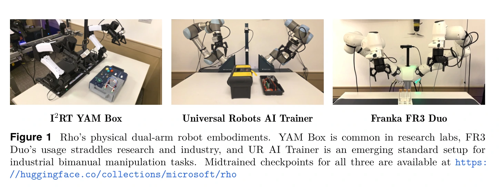
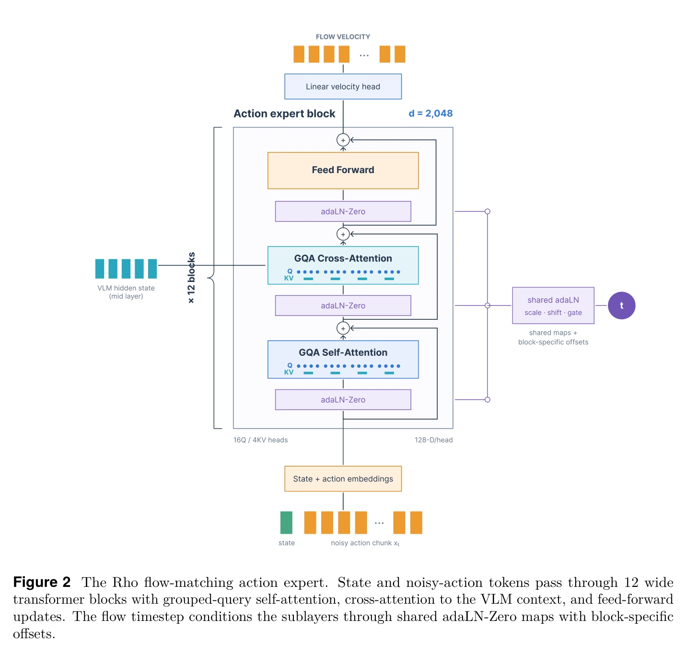
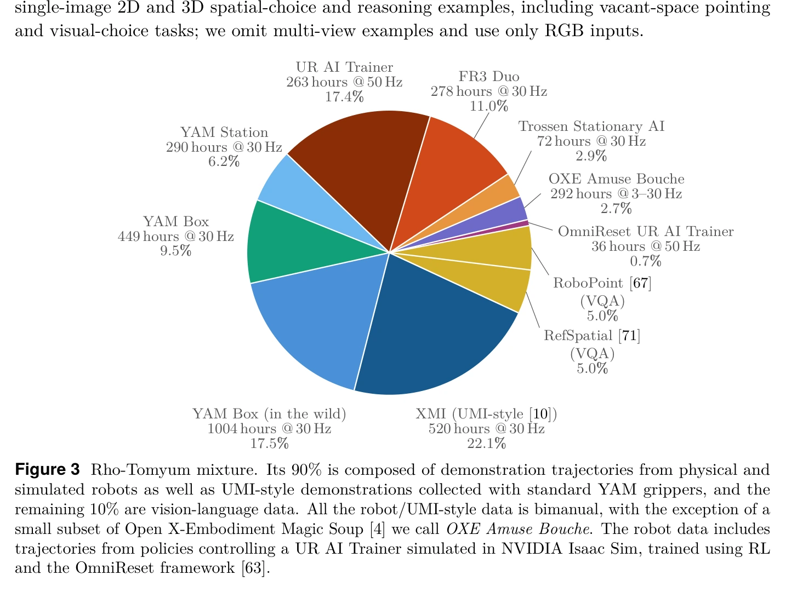
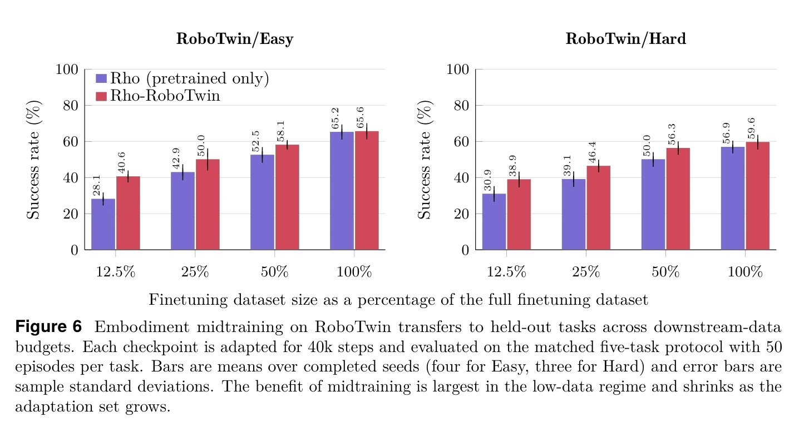
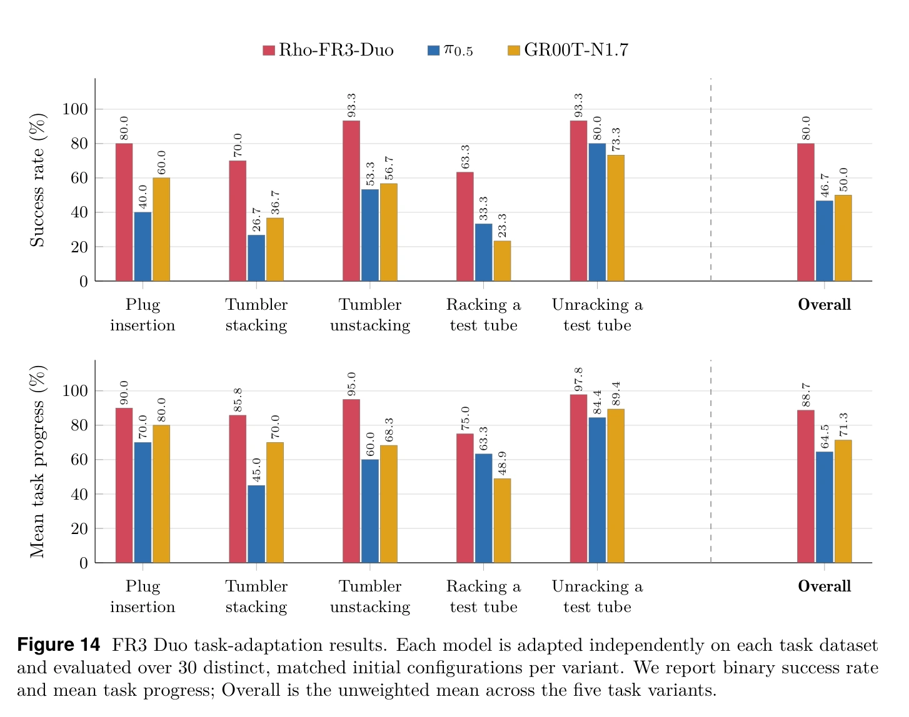
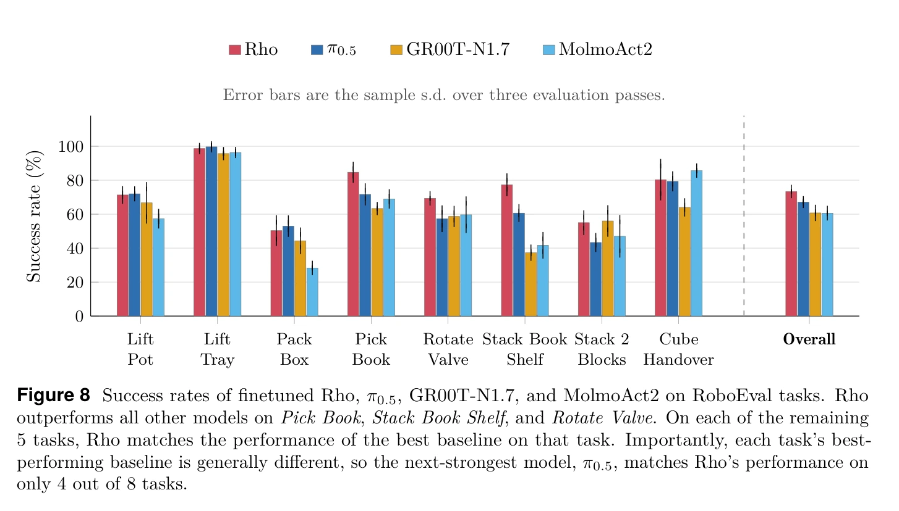

## 一屏概览

**问题：** 一个多机器人预训练模型，怎样较低成本地适配某种机器人、某个任务，以及部署时暴露的具体错误？Rho 将三种适配分开，而不是把所有变化都归为一次端到端微调。（§1、§5–6）

原文图 1（完整图注中译）：Rho 的真实双臂机器人平台。YAM Box 常见于研究实验室，FR3 Duo 的用途横跨研究与工业，UR AI Trainer 则是正在形成的工业双臂操作标准配置。三种平台的中间训练检查点均发布于 https://huggingface.co/collections/microsoft/rho 。 PDF 第 2 页。[查看原始来源](https://arxiv.org/pdf/2609.38164v1#page=2)

原文图 2（完整图注中译）：Rho 的流匹配动作专家。状态与含噪动作令牌经过12个宽 Transformer 块，各块包含分组查询自注意力、对视觉语言模型上下文的交叉注意力和前馈更新。流时间步通过共享的 adaLN-Zero 映射及块专属偏移调制各子层。 PDF 第 6 页。[查看原始来源](https://arxiv.org/pdf/2609.38164v1#page=6)

原文图 3（完整图注中译）：Rho-Tomyum 数据混合。90% 为真实和仿真机器人示范轨迹，以及使用标准 YAM 夹爪采集的 UMI 风格示范，余下10%为视觉语言数据。除称为 OXE Amuse Bouche 的 Open X-Embodiment Magic Soup 小子集外，所有机器人及 UMI 风格数据均为双臂数据。机器人数据还包含在 NVIDIA Isaac Sim 中控制 UR AI Trainer 的策略轨迹，这些策略使用强化学习和 OmniReset 框架训练。 PDF 第 8 页。[查看原始来源](https://arxiv.org/pdf/2609.38164v1#page=8)

**方法：** 约5.22B 参数的视觉—语言—动作模型，以物理理解增强的视觉语言骨干为条件，用流匹配生成动作块；先多机器人预训练，再做机器人专属中间训练与任务微调。在线阶段采用既有 FlowDAgger 思路，冻结动作生成器，通过少量纠正轨迹训练一个选择初始潜变量的小策略。（§2–6、附录 F）

**结果与边界：** 作者报告 RoboEval 73.4%、LIBERO 97.9%，但后者包含在线专家纠正，不能当成单纯离线微调成绩。FR3 的两项在线适配各用15条纠正轨迹，测试的是指定困难配置，不足以证明广泛的新任务泛化。（表8–10、附录 C–F）

**阅读建议：试。** 已有固定版本的发布文档可支撑40回合 LIBERO 冒烟评测计划，见 [[rho-release-documentation|发布文档与验证步骤]]。本页完整阅读 [v1 论文及附录](https://arxiv.org/pdf/2609.38164v1) 共52页，视觉核对在线适配与逐任务结果；未运行模型、训练或硬件实验。所有成绩为作者报告。

## 架构与实际动作接口

模型由4.68B 参数的 Phi-Phy 视觉语言模型和542M 参数动作专家组成。前者包含428M 参数的 SigLIP2 NaFlex 视觉编码器及32层、宽3072的语言骨干；后者为12层、宽2048的生成网络，16个查询头、4个键值头，每头128维。动作专家交叉注意力复用骨干第14个块的特征，经投影后缓存，减少生成多步动作时重复计算视觉语言条件的代价。（§2.1、§3.2–3.3、附录 A）

输入包含至多三路256×256图像和语言；本体状态单独投影为动作专家的状态令牌。状态与动作补齐到32维，并用掩码排除无效维度。这样的接口统一不意味着不同机器人控制器自动可互换，坐标、归一化和执行频率仍需逐项对齐。（§3.1、附录 A、C–E；基础见 [[VisionLanguageActionModels|Vision-Language-Action (VLA)]]）

预训练的末端动作相对**当前动作块起点**表达，而不是每一步相对前一步：每只手臂包含3维位置、6维旋转表示和1维绝对夹爪量，双臂共20维，再补齐到32维。一个动作块覆盖约一秒原生频率数据，最多50步。按数据源、动作维度与块内位置的1%／99%分位数映射到 $[-1,1]$，并裁剪到 $\pm1.5$；后续任务配置可能采用均值／标准差归一化，不能把预训练规则无条件套到所有检查点。（§4.2、附录 A–C）

流匹配以真实动作块 $a$ 和同维高斯噪声 $\epsilon$ 构造：

$$
x_t=(1-t)a+t\epsilon,\qquad
\mathcal L=\mathbb E\|v_\theta(x_t,t,o)-(\epsilon-a)\|^2.
$$

$o$ 表示观测和任务条件，生成时间 $t$ 与机器人控制时间不同。推理从 $t=1$ 向0执行10步显式欧拉积分得到动作块；不是让机器人只运动10个时刻。通用原理见 [[FlowMatching|流匹配]]，这里的特有设计在于条件缓存、动作参数化及后续潜在策略。（§3.2、附录 A）

## 三层适配分别改什么

| 阶段 | 数据与更新对象 | 作用与适用边界 |
| --- | --- | --- |
| 多机器人预训练 | 机器人动作与视觉语言任务混合，更新骨干和动作专家，词嵌入冻结 | 学到跨数据源的基础动作能力；数据并非全部公开 |
| 机器人专属中间训练 | 同一种平台的多任务数据，两轮训练，保留视觉语言混合 | 提供可重复使用的平台起点，不是直接获得每个下游任务能力 |
| 任务微调 | 目标任务示范，更新可训练的主模型参数，不再混合视觉语言任务 | 学习具体任务，需要任务数据和对应动作归一化 |
| 在线纠正 | 冻结主模型，只学习小型潜在策略 | 在现有生成器内选择更合适的动作，依赖纠正数据和可逆近似 |

多机器人预训练中90%的更新为机器人任务、10%为视觉语言任务，后者损失系数0.02。骨干与动作专家学习率分别为 $10^{-6}$ 和 $10^{-4}$；论文列出48张 B200 的预训练配置。不能把发布仓库的“四张 H100”任务训练说明解读成完整基础模型的训练成本。（§4.3–4.4、附录 B.1；发布说明见 [[rho-release-documentation]]）

中间训练平台数据包括 FR3 的278小时／19类任务、UR 的299小时（263小时真实、36小时仿真），以及 YAM 的289小时／65个任务家族。这里的“减少下游示范”以前置的大量平台经验为条件，而非从总数据预算里免费节省。（§5.1–5.4，PDF 第10–11页）

## 在线纠正为何能只训练小网络

令冻结的条件生成器为 $G_\theta(o,z)$，普通流匹配从高斯初值 $z$ 生成动作。在线适配改为：

$$
a=G_\theta(o,\pi_\phi(o)),
$$

其中 $\pi_\phi$ 是新训练的小策略。它接收池化后的视觉语言前缀特征与本体状态，使用三层1024宽 MLP、层归一化与末端双曲正切，输出 $16\times32$ 的潜变量并限制在 $[-3,3]$。这改变的是生成的起点，不是只微调最后一个动作头。（§6.2、附录 F）

人类或脚本专家介入后，收集实际执行的动作块 $a^*$，其中可以混合自主动作和纠正动作。通过近似逆变换得到 $z^*\approx G_\theta^{-1}(o,a^*)$，再最小化：

$$
\mathcal L_{\mathrm{latent}}(\phi)=\mathbb E\|\pi_\phi(o)-z^*\|^2.
$$

这是纠正轨迹上的监督学习，不是用在线奖励做强化学习；[[flowdagger-latent-space-corrections|FlowDAgger]] 是论文采用的既有方法，不能当作 Rho 首次提出的算法。其共享基础是 [[InteractiveImitationLearning|交互式模仿学习]]：监督来自当前策略实际访问的状态，接管后则进入混合控制分布；Rho 的特有接口是把纠正动作块反演为内部潜在策略的训练目标。（§6.2、§7.6、附录 F）

### 为什么“反向积分”还要迭代

一次正向生成的离散欧拉步为 $x_{j-1}=x_j-\Delta v_\theta(x_j,t_j,o)$。已知数据侧的 $x_{j-1}$，求噪声侧的 $x_j$ 要解隐式关系：

$$
x_j=x_{j-1}+\Delta v_\theta(x_j,t_j,o).
$$

右侧也依赖未知 $x_j$，所以作者采用不动点迭代，而不是简单对同一个速度取反。Meta-World 使用每步5次迭代，FR3 使用3次；再正向生成检查往返误差，均方误差超过 $10^{-3}$ 的样本丢弃。（附录 F）

连续流的可逆直觉不能保证有限步离散映射总能稳定求逆。上述筛选是在控制近似误差，不证明任意纠正动作都可表示。冻结主模型也不自动保证策略行为保持不变或安全：初始潜变量变化仍可能明显改变动作。这是由方法结构得到的解释，论文没有提供通用安全定理。

## 架构和中间训练证据怎样读

**动作专家缩小的局部证据。** 在部分预训练数据和固定 RoboEval 适配协议中，动作专家从1.649B 减至542M，得分从0.673变为0.671（后者报告误差量0.008），表明该配置下大幅缩小并未明显损失成绩。这组架构实验不是最终73.4%的完整训练结果，也不能推出任意任务上参数越少越好。（§7.1、表4–5）

**混合视觉语言训练。** 对应消融中，机器人＋视觉语言预训练的 LIBERO 得分为0.963，机器人预训练为0.943，无预训练为0.924；RoboEval 相应为0.673、0.652、0.610。这支持当前数据与训练设置下的混合收益，未直接建立语言指令鲁棒性或组合泛化能力。（§7.2）

**中间训练的数据效率。** RoboTwin 先用45个任务、约23000条示范做中间训练，再在五个留出任务上用12.5%、25%、50%、100%的嵌套示范子集，以相同40000步微调预算比较。部分曲线约用一半下游数据达到相近成绩，但效果随任务与饱和程度变化；各子集的归一化统计取自完整下游数据集，因此小数据条件并非连统计信息都只见过那个子集。（§7.3.1、附录 C）

统计口径也应保留原文差异：附录部分叙述泛称三个种子，而图6／表19及具体设置列出 Easy 四个种子、Hard 三个有效种子。本页按明确列出的设置理解，不将其统一改写为所有实验均三种子。FR3 插接中间训练0／1／2轮的独立比较为18／30、23／30、26／30，不应与主结果图14的插接80%混为同一试验。（§7.3.2、附录 C）

原文图 6（完整图注中译）：RoboTwin 上的平台中间训练能在不同下游数据预算下迁移到留出任务。每个检查点均适配40000步，并以匹配的五任务协议、每任务50回合评估。柱高为已完成种子的均值（Easy 四个、Hard 三个），误差线为样本标准差。中间训练的收益在低数据条件下最大，并随适配数据增加而缩小。 PDF 第 16 页。[查看原始来源](https://arxiv.org/pdf/2609.38164v1#page=16)

## 主实验：数字后面的协议

| 评测与定位 | 作者结果 | 必须一起保留的条件 |
| --- | --- | --- |
| RoboEval，§7.4、附录 C、G、表22 | Rho 73.4%，次高 π0.5 为67.1% | 八个任务，每任务100回合、三轮；所有模型40000步、批量128，但 Rho／Molmo 每样本8次流匹配训练采样，π／GR00T 为1次，计算预算并不完全相同 |
| LIBERO，§7.4、表8、附录 C、F | 总体97.9%；空间98.3%、物体99.6%、目标97.6%、长任务95.9% | 包含离线微调和有特权脚本专家的在线纠正；40任务×50回合×3种子，共6000回合，比较表还引入不同协议的既有文献结果 |
| YAM BusyBox，§7.5.1、附录 D–E | 六项任务共60次，Rho 90%，与 π0.5 持平 | 2000条示范、50000步任务训练；不是所有平台上都独占第一 |
| UR，§7.5.2、附录 D–E | 工具箱46.7%、小电子件60% | 各30次评测，分别150／160条示范；18 Hz 执行，任务时限60／90秒 |
| FR3，§7.5.3、图14、附录 D–E | 三类任务五种操作，150次平均80% | 每变体30次，30秒／30 Hz；任务专属微调50000步，示范量因任务而异 |

原文图 14（完整图注中译）：FR3 Duo 任务适配结果。每个模型分别在各任务数据集上独立适配，并针对每个变体使用30个不同且匹配的初始配置进行评估。报告二元成功率和平均任务进度；Overall 为五个任务变体的非加权平均。 PDF 第 25 页。[查看原始来源](https://arxiv.org/pdf/2609.38164v1#page=25)

RoboEval 用32步动作块、每次执行16步，最长250步。除总成功率，还评估行为指标；Rho 在九项中五项最好，不等于所有碰撞与动作质量指标都最佳。（§7.4、附录 C、G）

**原文内部的措辞边界。** 图8图注称其余任务“匹配最佳”，但表22点估计中，Cube Handover 为0.80 vs Molmo 0.86、Lift Pot 为0.71 vs π0.5 0.72。没有进一步统计检验时，应报告表内数值和总体优势，不能把图注强化成逐任务都持平或领先。（图8、表22）

原文图 8（完整图注中译）：微调后的 Rho、π0.5、GR00T-N1.7 和 MolmoAct2 在 RoboEval 各任务上的成功率。Rho 在 Pick Book、Stack Book Shelf 和 Rotate Valve 上超过其他所有模型；图注称其余五项任务与各自最优基线持平。各任务的最优基线通常不同，因此总体次优的 π0.5 仅在八项中的四项与 Rho 持平。 PDF 第 18 页。[查看原始来源](https://arxiv.org/pdf/2609.38164v1#page=18)

LIBERO 97.9%与架构章节出现的98.3%属于不同实验，不能挑较高数字作为统一总成绩。论文表15给出 LIBERO 预测16步、执行8步，固定版本发布文档则写预测16步、执行16步；本次只核查了文档，未追踪代码默认值，复现前必须对照实际配置。（附录 A 表15、[[rho-release-documentation|发布文档]]）

## “15条纠正轨迹”具体证明了什么

Meta-World 在六个任务各采集50条纠正轨迹，再每任务100回合评测，平均57.5%提升到73.3%。纠正者为具有特权状态的脚本专家，随机选择接管点并持续至结束；这不是等量人工纠正成本的测量。策略每八个环境步查询一次；16步的动作／潜变量预测范围与八步的实际查询间隔应分开配置。每次查询期间实际执行的自主动作和专家动作共同组成待反演动作块，不能只记录接管后的动作而丢掉块起点与对应观测。训练与评测分开，评测使用固定检查点。（§7.6、附录 F、表9）

FR3 两任务分别已有150条离线示范，再各用15条在线纠正轨迹。评测覆盖十个指定困难配置、每个重复三次：试管任务9／30提升到21／30，插接20／30提升到28／30。纠正与评测使用这些困难配置，结论是对已针对性收集反馈的问题有适配收益，不是未见布局的普遍泛化。（附录 F、表10）

在线机制也存在表示限制：若冻结生成器无法由可用潜变量产生所需动作，只学习潜在策略可能不足。论文没有系统给出这种支持范围的判别方法；这是一个适合进一步研究的边界，而非已测得的失败率。

## 我们的解释与复现优先级

最有价值的分解是把“平台经验”“任务经验”“现场纠错”当作不同层次。与 [[simex-simulation-integrated-robotics-autoresearch|SimEX]] 相比，Rho 在线修复的是潜变量选择器，SimEX 修复的是工具代码与仿真假设；因此两者的反馈条数、计算预算和可复用产物都不能直接横向排名。

优先执行 [[rho-release-documentation|40回合冒烟评测]]，确认检查点、归一化、执行块长和结果文件一致，再谈训练。冒烟运行只检验环境和推理链路；40回合不够复现6000回合及在线纠正后的97.9%。语言稳健性、跨平台泛化范围和未见配置下在线适配仍需补证，不能用“基础模型”名称代替实验。（§9）

## 与交互式策略改进的连接

[[topics/interactive-policy-improvement|交互式策略改进]] 将 Rho 作为“在仿真中获取专家纠正、更新模型内部适配器”的实例，与工具代码修复和环境课程更新比较。2026-10-18 完整复读归档 v1 的52页提取文本（正文、参考文献、附录 A–H），核对整页机制、主要数字和定位；修正此前章节／附录错引及 FR3 中间训练小时数。原始 PDF 与缓存保持不变，未运行模型或实验。
