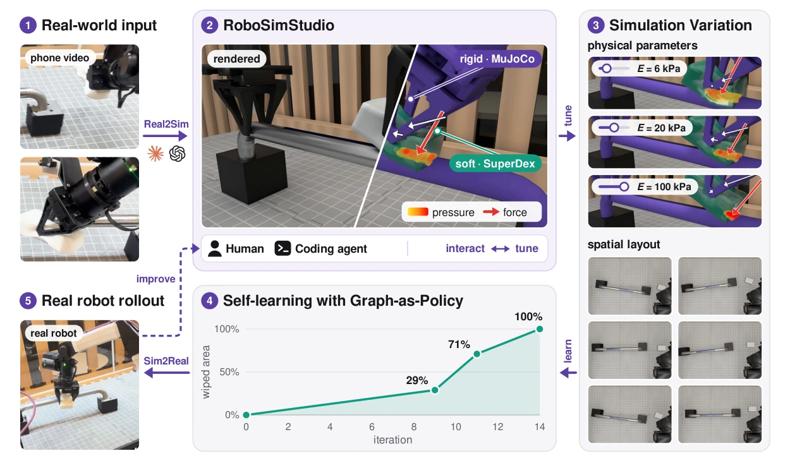
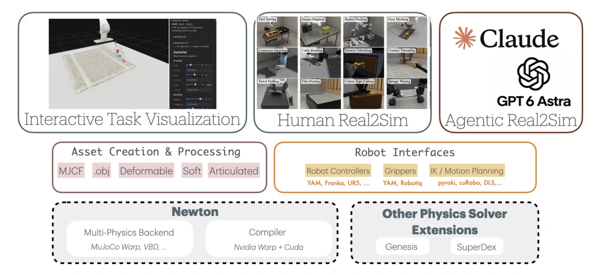
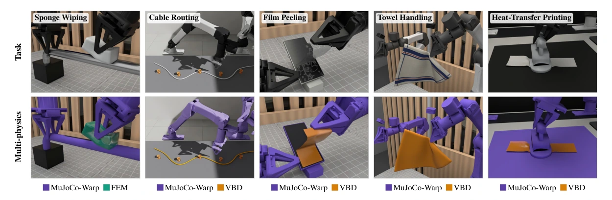
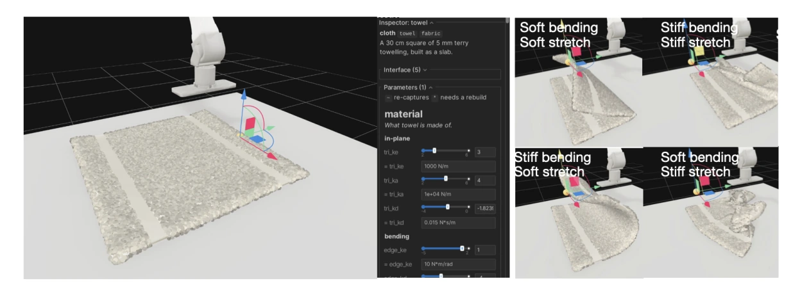
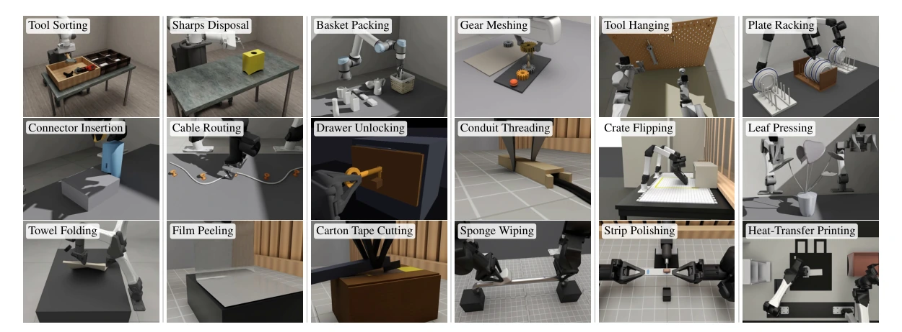
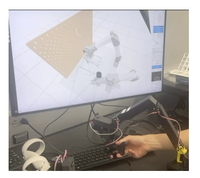
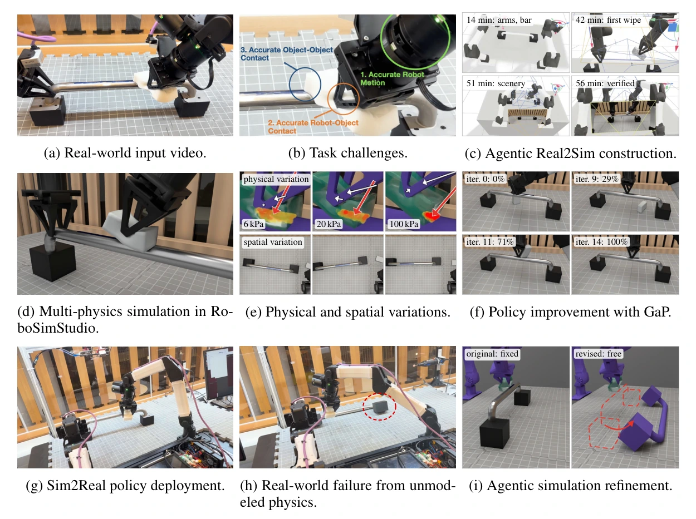

# RoboSimStudio：面向富接触机器人操作快速 Real2Sim 的交互式多物理场工具包

## 一屏概览

**研究问题。** 机器人操作的物理仿真不仅要生成场景几何，还要建模机械臂运动学、耦合接触动力学、刚柔变形、刚度与摩擦；要把仿真行为对齐真实世界（Real2Sim），必须针对观察到的物理现象反复选择求解器、接触模型并调整物理参数。RoboSimStudio（RSS）把求解器选择、接触模型与物理参数做成显式且可实时编辑的配置，让人类与编码智能体（Claude Code、Codex）在同一交互环境中闭环构建与修正多物理场仿真，并把训练或自学习得到的策略迁回真机（Real2Sim2Real）。[论文 §1](https://arxiv.org/abs/2610.18835)

原文图 1：RoboSimStudio 接收智能手机拍摄的机器人操作视频作为输入，输出可供人类与编码智能体检查和调优的多物理场仿真。以海绵擦杆任务为例，Claude 或 Codex 智能体根据视频构建仿真，通过 Newton 耦合刚体物理（MuJoCo）并用 SuperDex 仿真软体海绵；人类或智能体在闭环中调整求解器、接触模型与物理参数直至仿真行为匹配视频。随后对物理参数（海绵杨氏模量 $E \in \{6, 20, 100\}\text{ kPa}$）与空间布局做变体扩展，编码智能体利用仿真反馈将 [[gap-graph-as-policy|Graph-as-Policy（GaP）]] 的擦拭面积从 0% 迭代提升至 100%（14 轮）并部署到真机，真机执行暴露的异常还可继续回流修正仿真。来源：论文 PDF，第 1 页。[查看原始来源](https://arxiv.org/pdf/2610.18835v1#page=1)

**机构与版本。** 加州大学伯克利分校（UC Berkeley AUTOLab）与 NVIDIA 联合发布；arXiv `2610.18835v1`（2026-10-13）。配套开源代码的实现机制与固定提交静态核查见 [[robosimstudio-repository|RoboSimStudio 代码核查]]。

**核心贡献与实验范围。** （1）基于开源 Newton 构建支持跨求解器协同仿真的操作工具包，将求解器、接触模型与材料参数显式化；（2）提供基于 Viser 的浏览器端人机共享交互工作台，以及向编码智能体暴露仿真状态与时空反馈的迭代接口；（3）构建涵盖刚体、铰接机构、线缆、布料与体积软体的 18 项富接触操作任务，展示低成本主臂力反馈遥操作，并在双臂海绵擦杆任务上完成从单段手机视频到多物理场构建（约 1 小时，单智能体最快 56 分钟验证通过）、[[gap-graph-as-policy|GaP]] 策略自学习（14 轮擦除率 0% → 100%）、真机部署及真实失败驱动的约束修正先导实验（§1、§4）。

## 问题与设计动机：为什么 Real2Sim 需要人机共享的物理交互回路

现有机器人仿真框架（如 [[mujoco-overview|MuJoCo]]、[[isaac-lab-repository|Isaac Lab]]、[[maniskill-repository|ManiSkill3]]、Genesis、Newton）不断扩展刚体、铰接体与可变形体求解能力，但要把真实操作任务重建为可用仿真，仍面临三道工程瓶颈（§1–2，表 1）：

1. **单一物理模型难以覆盖混合接触场景。** 机器人操作常在同一工作台内同时包含铰接机械臂、刚体夹具、薄壳布料、柔索线缆与大变形多孔软体（如海绵），需要把不同求解器组合进同一场景并处理跨求解器力/位姿耦合。
2. **仅靠场景生成无法保证接触物理正确。** 先前数字孪生、数字表亲（digital cousins）或 LLM 场景生成工作多关注几何重建或一次性脚本生成；而富接触操作中的抓取滑移、插拔卡滞、薄壳折痕回弹对接触间隙、刚度、阻尼和摩擦参数高度敏感，必须“修改场景 → 执行交互 → 观察偏差 → 修正参数”。
3. **纯视觉图像难以支撑智能体诊断物理接触。** 人类可通过直接拖拽、视觉观察与力反馈感知接触异常；编码智能体若只看渲染帧，很难判断“为什么没抓住”或“是否真正发生接触”。因此需要从底层仿真状态提取时空结构化反馈（目标误差、物体位移、接触事件、抓持或滑移、目标进度），与视觉图像一起交给智能体归因。

| 能力维度（论文表 1） | MuJoCo | Isaac Lab | ManiSkill3 | Genesis | Newton | RoboSimStudio |
| --- | --- | --- | --- | --- | --- | --- |
| 刚体与铰接体仿真 | ✓ | ✓ | ✓ | ✓ | ✓ | ✓ |
| 可变形物体仿真 | ✓ | ✓ | ∼ | ✓ | ✓ | ✓ |
| 耦合多物理场求解器 | – | ∼ | – | ✓ | ✓ | ✓ |
| 交互式场景检查 | ✓ | ✓ | ✓ | ∼ | ∼ | ✓ |
| 物理参数在线调优 | ∼ | ✓ | ∼ | – | Custom | ✓ |
| 面向编码智能体的结构化反馈 | Custom | Custom | – | – | Custom | ✓ |
| 人与智能体共享修正回路 | Custom | Custom | – | – | Custom | ✓ |
| 视频驱动的智能体 Real2Sim | – | – | – | – | – | ✓ |
| 力反馈 Real2Sim | – | – | – | – | – | ✓ |
| 失败驱动的仿真修正 | – | – | – | – | – | ✓ |

表中符号按论文表 1 原意记录：✓ 表示内置支持，∼ 表示部分支持，Custom 表示需额外自行开发。需要注意，这是作者按自身系统定位给出的功能特性对照表，并非跨引擎数值精度或吞吐量的定量基准测试。

## 系统架构与核心机制

原文图 2：RoboSimStudio 系统架构。底层通过 Newton（MuJoCo-Warp、VBD 等加上 NVIDIA Warp + CUDA 编译器）与外部物理求解器扩展（Genesis、SuperDex）提供多物理场仿真，中层整合资产创建与处理（MJCF、`.obj`、可变形体、软体、铰接体）和统一机器人接口（控制器、夹爪、PyRoKi/cuRobo/DLS 逆运动学与运动规划），上层通过共享仿真框架同时支撑交互式任务可视化、人类引导 Real2Sim 与编码智能体 Real2Sim。来源：论文 PDF，第 4 页。[查看原始来源](https://arxiv.org/pdf/2610.18835v1#page=4)

### 1. 声明式机器人接口与特权状态隔离

RoboSimStudio 为 Franka Panda、UR5e 以及单臂/双臂 YAM 提供统一声明式接口（模型、关节、安装位姿与手部几何），并支持扩展新本体（§3）。逆运动学支持可替换求解器（如基于 URDF 的模块化优化库 PyRoKi 与阻尼最小二乘 DLS），运动层支持关节空间移动、笛卡尔移动、接触保护运动（guarded contact motions）以及基于 cuRobo 的无碰撞运动规划。策略可在关节空间或末端执行器空间下发指令，同时**将仿真器内部的被操作物体特权状态（privileged state）与机器人实际可获得的传感器观测严格分离**，保证策略在仿真排练后能切换至非特权观测部署到真机。

### 2. 多物理场仿真与跨求解器耦合

在 RoboSimStudio 中，**物体只声明自己是什么（领域与材料），而由场景配置显式指定哪类物理由哪个求解器负责**，因此切换求解器、耦合方式或接触参数无需重写任务逻辑（§3）：

- **铰接机器人与刚体：** 默认采用 Newton 内的 [[mujoco-warp-mjwarp-documentation|MuJoCo-Warp]]；
- **线缆与布料（cables and cloth）：** 默认采用 Newton 内的顶点块坐标下降法（Vertex Block Descent，VBD）；
- **体积软体（soft bodies）：** 可交由外部隐式有限元/接触引擎（如 SuperDex 或 Genesis）与 Newton 协同仿真。

在耦合机制上，Newton 内部各求解器通过交换接触力耦合，而与外部物理引擎则通过**交换刚体位姿与接触力旋量（poses and contact wrenches）**进行协同仿真。论文图 3 展示了在同一套机器人接口与场景描述下组合不同求解器的五项任务：

原文图 3：RoboSimStudio 中的多物理场耦合。上方为渲染的仿真画面，下方用颜色标出各物体所用的物理求解器：紫色为 MuJoCo-Warp，青色为有限元仿真（FEM，SuperDex），琥珀色为顶点块坐标下降（VBD）。五项任务依次为海绵擦杆（Sponge Wiping，MuJoCo-Warp + FEM）、线缆布线（Cable Routing，MuJoCo-Warp + VBD）、薄膜剥离（Film Peeling，MuJoCo-Warp + VBD）、毛巾操作（Towel Handling，MuJoCo-Warp + VBD）与热转印（Heat-Transfer Printing，MuJoCo-Warp + VBD）。来源：论文 PDF，第 5 页。[查看原始来源](https://arxiv.org/pdf/2610.18835v1#page=5)

关于求解器分岛（islands）、单向与双向耦合通道、CUDA 图捕获以及外部引擎力旋量非对称滤波与冲量限幅的底层代码实现，详见 [[robosimstudio-repository#2-场景编译十阶段与多物理场分岛耦合|RoboSimStudio 代码核查 §2–§4]]。

### 3. 面向人类的 Viser 浏览器交互工作台

人类通过基于 Viser 构建的浏览器工作台直接与运行中的仿真交互：可在编写策略前点选、拖拽刚体或布料节点，用末端交互手柄直接驱动机械臂测试抓取与接触反应（§3）。每个物体的检查器（Inspector）按物理单位和合理范围暴露参数，并明确区分**可在仿真运行中实时生效的参数**（如刚度与阻尼）与**需要重新构建场景的参数**（标有 `needs a rebuild` 或 `re-captures`）。

原文图 4：RoboSimStudio 交互界面。左：一块毛巾及其属性检查器（Inspector），其中 `tri_ke` 控制面内拉伸刚度（stretch stiffness），`edge_ke` 控制弯曲刚度（bending stiffness），并标明参数修改是触发重捕获还是重建。右：同一块毛巾在四种不同弯曲刚度与拉伸刚度组合下，被拖拽到同一时刻所呈现的折痕形态对比。来源：论文 PDF，第 5 页。[查看原始来源](https://arxiv.org/pdf/2610.18835v1#page=5)

### 4. 面向编码智能体的时空反馈与人机共驾（Human-in-the-Loop Agentic Real2Sim）

针对编码智能体，RoboSimStudio 将一次轨迹执行组织为机器人运动基元，并把底层仿真状态转化为**时空文本与视觉反馈**（spatial-temporal text and visual feedback），显式报告目标位姿误差、物体运动幅度、接触事件、抓持或滑移状态以及任务目标进度（§3）。由于这些读数直接计算自仿真器内部状态，它们能够暴露单靠 RGB 图像极难推断的物理事件（如指垫是否产生足够法向接触力、静置时物体是否穿模或漂移）。

同时，人类与编码智能体可以**并发操作同一个仿真实例**：当智能体构建场景并运行评估时，人类可在 Viser 浏览器中实时观察，用滑块探索线缆或布料的刚度、阻尼与接触参数，并异步向智能体发送自然语言指导，而不必打断智能体的执行循环。

## 三类 Real2Sim 实验与案例分析

### 4.1 视觉反馈下的人类引导 Real2Sim（18 项富接触操作任务）

作者首先使用交互式工作台构建了 18 项涵盖刚体接触、铰接机构、线缆、布料与软体变形的操作任务（§4.1，图 5），通过对比仿真运动/形变与真实行为来迭代调节接触与材料参数：

原文图 5：用 RoboSimStudio 构建的 18 项富接触与可变形物体操作仿真任务，包括 Tool Sorting、Sharps Disposal、Basket Packing、Gear Meshing、Tool Hanging、Plate Racking、Connector Insertion、Cable Routing、Drawer Unlocking、Conduit Threading、Crate Flipping、Leaf Pressing、Towel Folding、Film Peeling、Carton Tape Cutting、Sponge Wiping、Strip Polishing 与 Heat-Transfer Printing。来源：论文 PDF，第 6 页。[查看原始来源](https://arxiv.org/pdf/2610.18835v1#page=6)

论文重点剖析了三项代表性物理挑战（注意：原文 §4.1 有一处笔误写为“We highlight five examples”，实际正文分点列出了以下三项）：

- **精密装配接触（Connector insertion）：** 将 USB-C 插头插入亚毫米级间隙（sub-millimeter clearance）的插座，依赖网格级碰撞检测与可调碰撞分辨率来还原插拔几何约束。
- **薄壳弯曲与弹性恢复（Leaf pressing）：** 按压弯曲叶片并在松开后恢复原状，使用薄壳（shell-based）仿真并调节求解器与接触参数以匹配弯曲与回弹响应。
- **基于接触力的表面加工建模（Strip polishing）：** 将塑料条压向旋转滚筒打磨去除表面痕迹，直接从物理求解器暴露接触力，并用 Preston 方程（材料去除率正比于接触压强与相对滑移速度之积）计算表面磨损。

### 4.2 力反馈遥操作 Real2Sim

在第二类实验中，操作者使用低成本主臂（论文写为 GELLO 主臂，公开仓库实现为 Feetech STS3215 伺服驱动的 YAM 主臂）驱动仿真机械臂，并将仿真中的接触阻碍实时转化为伺服电机力矩反馈给操作者手部（§4.2，图 6）。

原文图 6：使用主臂对 RoboSimStudio 中的挂工具（Tool-hanging）任务进行带力反馈的遥操作。操作者通过力反馈感知薄工具与挂架之间的接触并调整插入动作。来源：论文 PDF，第 7 页。[查看原始来源](https://arxiv.org/pdf/2610.18835v1#page=7)

为了避免把正常的控制跟随滞后误渲染为碰撞阻力，系统设计了三项关键机制（数学公式与代码实现见 [[robosimstudio-repository#6-双时钟力反馈遥操作与安全门控|代码核查 §6]]）：

1. **指令与实测偏差驱动：** 以主臂发送的关节指令角与仿真从臂实际到达角之间的差距作为接触反馈信号；
2. **速度相关死区与超时卸载：** 采用随运动速度增大的动态死区过滤自由空间跟踪延迟，且只要仿真暂停或步进落后就立即释放力反馈；
3. **实测夹爪开度对比：** 夹爪通道对比的是仿真夹爪的**实测开度**而非指令开度，从而让操作者能明显区分“夹住实体物块被阻挡”与“在空气中完全闭合”。

### 4.3 智能体端到端 Real2Sim2Real 与真实失败回流修正

第三类实验在双臂海绵擦杆任务（bimanual sponge-wiping：左臂稳住横杆，右臂抓起海绵擦除横杆上的马克笔条纹）上检验端到端 Agentic Real2Sim2Real 闭环（§4.3，图 7）：

原文图 7：海绵擦杆任务的智能体 Real2Sim2Real 全流程。（a）真实世界双臂操作输入视频；（b）任务涉及机械臂运动、物—物接触与手—物接触三类物理挑战；（c）编码智能体通过交互工作台构建并迭代修正仿真，在 56 分钟内完成经过验证的仿真擦拭（14 分钟建好双臂与横杆，42 分钟完成首次擦拭，51 分钟补齐背景场景，56 分钟验证通过）；（d）Newton（MuJoCo-Warp）与 SuperDex 耦合的多物理场仿真及接触压强/力可视化；（e）海绵刚度变化（$6\text{ kPa}$、$20\text{ kPa}$、$100\text{ kPa}$）与 30 个横杆/海绵空间布局变体；（f）[[gap-graph-as-policy|GaP]] 利用时空仿真反馈在 14 轮迭代内将擦除面积从 0%（iter 0）提升至 29%（iter 9）、71%（iter 11）直至 100%（iter 14）；（g）改进后的策略部署至真实双臂机器人完成擦拭；（h）一次真机试验暴露未建模物理：擦拭力推动了原仿真中被固定死的横杆底座，导致海绵失去接触；（i）智能体根据失败视频与描述将横杆底座从固定约束（original: fixed）改为自由刚体（revised: free），成功在偏心擦拭下复现底座位移与倾覆。来源：论文 PDF，第 7 页。[查看原始来源](https://arxiv.org/pdf/2610.18835v1#page=7)

整个闭环分为四个阶段：

1. **从单段手机视频构建多物理场仿真（Real2Sim）：** 在没有 CAD 模型和相机标定的前提下，仅输入一段智能手机视频，两个通用编码智能体——Claude Code 中的 `Claude Fable 5.1` 与 Codex 中的 `GPT-6 Astra`——各自在约 1 小时内独立构建出可运行的耦合仿真（其中最快一次在 56 分钟内完成验证）。智能体利用视觉观测与时空仿真反馈定位运动学与接触错误，调通海绵与横杆的接触擦拭。
2. **参数与布局变体下的策略自学习：** 构建好的仿真将关节/刚体交由 Newton 内的 MuJoCo-Warp 求解，海绵变形交由 SuperDex 求解以输出接触力与压强分布。随后对海绵杨氏模量 $E \in \{6, 20, 100\}\text{ kPa}$ 和 30 种空间布局进行变体采样，由 [[gap-graph-as-policy|Graph-as-Policy（GaP）]] 根据仿真反馈迭代优化技能图，在 14 轮内将模拟擦除面积比例从 0% 提升至 100%。
3. **真机部署（Sim2Real）：** 优化后的 GaP 策略部署到真实双臂机器人上完成擦杆任务。
4. **真实失败回流修正仿真约束（Real-world Failure Refinement）：** 在一次真机执行中，擦拭动作推歪了横杆底座，导致海绵脱离接触（图 7h）。把失败视频与现象描述交回编码智能体后，智能体识别出原仿真把横杆底座错误地设为环境固定约束（fixed），于是将底座修改为受接触力作用的自由刚体（free rigid body），并在不同擦拭轨迹下验证：当擦拭力过大或偏离横杆中心时，修正后的仿真能够复现横杆位移与倾覆（图 7i）。

## 局限、原文与代码对照及我们的判断

**论文自述局限（§5）。** 本文报告的是发展中的系统与可行性先导研究（pilot study）：智能体建场景依赖工具包已有的材料模型、耦合器与机器人资产；外部引擎协同仿真会带来额外计算开销；Sim2Real 仅在单一双臂擦杆任务上验证，且仿真与真机行为的一致性主要基于定性观察，尚未在多样化任务上系统报告接触力误差、物体轨迹误差、智能体构建时间分布与真机策略成功率的定量指标。

**原文叙述与固定版本公开代码的四处关键对照。** 对照 `robosimstudio/robosimstudio` 固定提交 `73739abe212f963e8a9f5862b27bca370df091a7` 的源码与文档（详见 [[robosimstudio-repository|RoboSimStudio 代码核查]]），有四项工程事实需要在阅读论文时一并把握：

1. **海绵擦杆的接触门控插销（Latch）：** 论文 §4.3 仅叙述海绵由 SuperDex 仿真并与机械臂接触耦合；而公开仓库 `examples/08_demos/wipe_the_bar/README.md` 诚实记录了 33 次消融试验：由于 SuperDex 正则化摩擦在滑移速度低于 `friction_falloff` 时无严格静摩擦，单靠夹爪挤压与摩擦在多往复擦拭中会让海绵在指垫间滑移 69–226 mm 甚至脱手。因此公开演示代码在夹爪依靠真实物理接触闭合稳定后（开度在 12 步内变化 $\le 0.3\text{ mm}$、两侧指垫法向力均 $\ge 2\text{ N}$、开度比海绵宽小 $\ge 2\text{ mm}$），通过 `bar.Latch` 将指垫接触点 $6\text{ mm}$ 内的 106 个海绵节点以顺应弹簧（$4000\text{ N/m}$）锁定在手部直至松爪。这说明**软体抓取建接触与长程往复擦拭保持有别**，阅读论文时不能把擦杆成功简单外推为“纯摩擦软体夹持在长程往复载荷下已无滑移问题”。
2. **主臂硬件型号与力反馈实验状态：** 论文 §4.2 称使用 GELLO 主臂；公开仓库 `examples/09_teleop/README.md` 实现的是基于 Feetech STS3215 串联总线伺服的 YAM 主臂，且文档明确声明当前发布版本中的力反馈代码仅在仿真伺服总线上验证过（默认 `compare="applied"` 对比从臂当时追赶的目标，仅 `compare="live"` 曾在硬件上试感），标注为 experimental。
3. **智能体接口在工程上分化为“场景重建环”与“策略执行环”：** 论文 §3 统称为智能体迭代接口；代码中则拆成两套职责清晰的模块——`robosimstudio_real2sim_agent` 负责通过热重载 `scene.py`、实例分割对齐 `compare`、四联对照图 `look sheet`、六项物理门控 `check` 和时间轴对比 `compare --take` 完成视频到场景的 Real2Sim；`robosimstudio_policy_agent` 则负责将建好的场景通过 `ConnectorNewton` 与 `SimBus` 接入 [[gap-graph-as-policy|GaP]] 技能图执行器。
4. **18 项任务的公开形态：** 论文图 5 展示 18 项任务、仓库首页拼图展示 48 个场景片段；当前公开仓库随库提供了完整的五包内核、`00`–`09` 分步示例以及 3 个完整双臂演示（`wipe_the_bar`、`route_the_cable`、`fold_the_towel`），而 `examples/06_tasks/README.md` 说明 `robosimstudio_bench` 的完整基准任务套件尚未包含在该次发布中。
