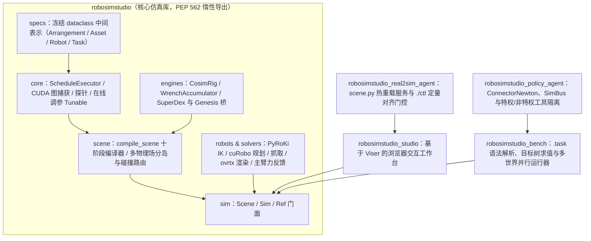

# RoboSimStudio 公开实现：工程架构与核心机制核查

## 1. 版本、范围与五包单向依赖架构

本页静态核查 [`robosimstudio/robosimstudio` 固定提交 `73739abe`](https://github.com/robosimstudio/robosimstudio/tree/73739abe212f963e8a9f5862b27bca370df091a7)（提交时间 2026-10-14，Apache-2.0 许可证）。本地归档 `raw/robosimstudio-repository-2026-10-16-5860aeb05800.tgz` 保存了 34 个核心工程文件的原始字节，完整列表见文末表格；[[robosimstudio-interactive-toolkit-rapid-real2sim|RoboSimStudio 论文]] 说明方法动机与案例实验，本页聚焦具体工程实现与代码契约。本轮为静态源码核查，未在本机安装或启动 GPU 仿真进程。

整个发行版由 `pyproject.toml` 打包为**五个顶层 Python 包**，依赖方向严格自底向上单向流动（底层核心库绝不导入上层交互界面、基准测试或智能体模块）：



上图根据 `robosimstudio/__init__.py:1–86` 与 `pyproject.toml:128–150` 绘制。两项工程约束贯穿全库：

1. **零开销顶层导入与禁止模块级可选依赖。** `robosimstudio/__init__.py` 仅导入 `_version`，其余符号全部通过 PEP 562 `__getattr__` 在首次属性访问时按需加载；同时 `pyproject.toml` 的 `[tool.ruff.lint.flake8-tidy-imports]`（第 229–252 行）将 `mujoco`、`mujoco_warp`、`superdex`、`genesis`、`ovrtx`、`pyroki`、`viser`、`coacd`、`torch`、`trimesh` 等 19 个模块列入 `banned-module-level-imports`，强制所有可选后端在函数内部按需导入。这样在不装 GPU 驱动或重型扩展的环境中，仍能直接运行 `scripts/testrun.py --tier fast` 检查接口与协议契约。
2. **工作台面坐标系（work-surface frame）与世界坐标系分离。** 所有场景构造器中的位置参数 `at=(x, y, z)` 均定义在当前工作台（`CellSpec`，如 `bench_075` 桌面中心在世界系 `(0.6, 0.0, 0.75)`）的台面坐标系下（原点位于台面正中央顶面，$+z$ 向上），而 `ref.position`、`sim.read()` 与相机参数 `eye`/`look_at` 则统一采用世界坐标系（`examples/live/REFERENCE.md`）。这一约定使同一套物体摆放代码可在不同尺寸工作台间无缝迁移。

## 2. 场景编译十阶段与多物理场分岛耦合

### 2.1 `compile_scene` 不可调换的十个阶段

`robosimstudio/scene/compiler.py:1–31` 明确指出，`compile_scene` 将场景规格（`SceneRequest`）与回合（`Episode`）编译为可执行 `CompiledScene` 的十个步骤顺序是承载正确性的硬约束，调换任何一步都会引发静默错误：

| 阶段 | 核心操作（`compiler.py`） | 若顺序颠倒会导致的静默错误（源码实测记录） |
| --- | --- | --- |
| 1. 设备与坐标布局 | 绑定设备，设置 `newton.use_coord_layout_targets = True` | 当场景含自由关节（free-joint）刚体时，`joint_target_q` 默认按自由度（DOF）计数而非 `joint_q` 坐标计数，导致后续所有关节目标写入错位 |
| 2. 注册后端自定义属性 | 在任何资产导入前，遍历 `ArrangementSpec` 调用各求解器类的 `register_custom_attributes(builder)` | MuJoCo 的 `gravcomp`（重力补偿）与 VBD 的关节标志由导入器在解析 MJCF 时写入；若后注册，导入器会静默丢弃 `gravcomp`，导致机械臂在仿真中下垂 |
| 3. 实体几何构建 | 各 `Entity.build(builder, episode)` 添加刚体、关节、粒子与碰撞形状，并记录各自索引区间 | — |
| 4. 驱动与对象索引 | 建立关节执行器与刚体对象索引 | 依赖阶段 3 已生成的关节表 |
| 5. 重映射自定义属性 | 固定关节折叠后调用 `rekey_custom_attributes` | 折叠固定关节会改变索引，不重映射会使属性指向旧索引 |
| 6. 定型与模型终结 | 写入颜色、生成地面、调用 `builder.finalize()` 生成未复制的 `template_model`（多世界时再复制生成 `model`） | 实体句柄与主机侧规划统一绑定在无歧义的 `template_model` 索引上，通过 `WorldMap` 步幅映射到多世界 |
| 7. 绑定与全局材质 | 调用 `entity.bind` 并写入模型级材质数组 | 这是各求解器在阶段 8 拷贝模型数据前的唯一窗口 |
| 8. 多物理场组合 | 调用 `physics.compose` 生成 `PhysicsProgram`（分岛、通道、碰撞路由、耦合求解器与子步日程） | 详见 §2.2 |
| 9. `on_scene_ready` 沉降 | 布料与软体在此步进若干帧完成重力沉降（settle），捕获沉降态作为 `reset` 起点，再将 `sim_time` 与 `step_count` 归零 | 把沉降视为建景阶段而非仿真时间；需要在平整布料上建粘接键的任务必须在调用父类前完成 |
| 10. 构建句柄 | 生成 `SceneHandles` 供 `Sim`、`Ref` 与交互界面查询 | — |

### 2.2 求解器分岛（Islands）、碰撞路由与三类内置耦合器

在阶段 8 中，`robosimstudio/scene/physics/compose.py` 与 `islands.py`、`routing.py`、`couplers.py` 执行多物理场拼装：

1. **按后端相等性自动分岛（`islands.py:1–19`）：** 每个非静态实体解析其目标 `BackendSpec`（实体自身覆盖优先，其次查 `ArrangementSpec` 中对应 `domain` 的配置，最后回退到 `"*"`）。**凡是解析出相同 `BackendSpec`（求解器类与参数完全一致）的实体自动合并进同一个求解器岛（`Island`）**，例如将 `cloth` 与 `rod` 都指向相同参数的 `backend("vbd", ...)` 时，毛巾与线缆就在同一个 VBD 实例内求解并天然发生互碰撞。静态实体（如桌面、固定支架）本身不拥有动力学，其碰撞形状（`shapes`）会分发给可变形体岛，从而让线缆和布料能停留在桌面上。
2. **从模型过滤表切分碰撞对并扩展多世界步幅（`routing.py:89–140`）：** 每对碰撞形状只在一个碰撞管线中检测。路由表直接从 `model.shape_contact_pairs` 切分（而非手写枚举），以保留实体构建时注册的所有自碰撞过滤对（如线缆布线工作台中机械臂手指与桌面的 392 个过滤对）。**多世界扩展的关键修复（`routing.py:109–123`）：** 交互图节点记录的是单世界 `template_model` 的形状索引，而 `model.shape_contact_pairs` 包含全部复制世界的形状对；切分前必须通过 `WorldMap` 将模板索引展开到所有世界。源码记录，未做该展开前，3 世界并行线缆场景中只有第 0 世界有接触，第 1、2 世界的线缆在第 120 步静默掉到桌面以下 19 米处。
3. **三类 Newton 内部耦合器与关键取舍（`couplers.py:157–336`）：**
   - **`SolverOneWay`（单向运动学镜像，默认 `GENERIC` 用于刚体臂 + VBD 布料）：** 为什么抓毛巾不用双向 `SolverCoupledProxy`？`couplers.py:245–250` 解释，Newton 的 proxy 接触收集只读取逐粒子（per-particle）接触记录，直接拒绝 `enable_rigid_soft_full_surface_contact=True`（边/三角形面全表面接触）；然而平行夹爪指垫往往比布料网格单元更窄，若不开启全表面接触（并配合 `force_sdf=True` 为刚体网格烘焙有符号距离场，`arrangement.py:147–155`），两指之间可能恰好没有网格顶点，导致夹爪完全抓不住布料。
   - **`SolverOneWay` 中的子步位移差摩擦技巧（`couplers.py:236–244、288–296`）：** 在每个物理子步中，VBD 从 `state_out.body_q` 读取刚体新位姿、从 `state_in.body_q` 读取旧位姿，并用两者之差计算粒子相对于指垫的滑移摩擦。而碰撞检测管线 `collision.collide(state_in, contacts)` 却是在 `state_in` 上运行。因此 `SolverOneWay.step` 必须执行四步序列：
     ```python
     wp.copy(self._body_q_prev, state_in.body_q)      # 1. 备份子步初刚体位姿
     self.rigid.step(state_in, state_out, control, None, dt)  # 2. 刚体求解器推进到 state_out
     wp.copy(state_in.body_q, state_out.body_q)       # 3. 临时将新位姿拷入 state_in 供碰撞检测
     self.collision.collide(state_in, self.contacts)
     wp.copy(state_in.body_q, self._body_q_prev)      # 4. 恢复旧位姿到 state_in，使 VBD 看到本子步位移差
     self.soft.step(state_in, state_out, control, self.contacts, dt)
     ```
     源码实测指出：若漏掉第 4 步恢复，VBD 看到的 `state_in` 与 `state_out` 刚体位姿相同，指垫在摩擦定律看来处于静止状态，闭合夹爪抬升毛巾边缘时会把已捏住的 15 个粒子全部拖落；恢复位移差后，100 mm 抬升全程完整保住 15 个粒子。
   - **同岛刚体抓取（`MUJOCO_500HZ`）与双向代理/ADMM（`proxy` / `admm`）：** 在默认 `GENERIC` 下，自由刚体在 VBD 上、机械臂在 MuJoCo 上且单向耦合，因此机械臂只能推动刚体而无法靠摩擦捏起刚体；当需要靠摩擦抓取刚体方块时，切换至 `rss.MUJOCO_500HZ`（50 Hz 控制、500 Hz 物理子步，将机械臂与自由刚体放入同一个 MuJoCo 岛），或显式配置 `coupler("proxy")` / `coupler("admm")` 进行跨岛双向耦合。

## 3. 子步调度器、CUDA 图捕获与三级在线调参

### 3.1 九阶段日程与 CUDA 图可捕获性铁律

`robosimstudio/core/schedule.py:1–47、72–106` 将一个控制步（control step，默认 $1/60\text{ s}$）拆解为 9 个阶段，其中中间 7 个子步阶段被循环录制进单个 **CUDA 图（CUDA Graph）** 中执行：

$$\underbrace{\texttt{before}}_{\text{主机/图外，每控制步 1 次}} \longrightarrow \left[\;\texttt{clear} \to \texttt{rigid\_force} \to \texttt{pre\_solve} \to \texttt{collide} \to \texttt{solve}\text{（含状态双缓冲交换）} \to \texttt{post\_solve} \to \texttt{mirror}\;\right]^{\times N_{\text{substeps}}} \longrightarrow \underbrace{\texttt{after}}_{\text{主机/图外，每控制步 1 次}}$$

- **为什么固定位置写入必须在 `post_solve` 而非 `pre_solve`：** `rigid_force` 与 `pre_solve` 在求解前向 `state.body_f` 和 `state.particle_f` 累加外力（如拖拽弹簧力、粘接键力与跨引擎反馈力旋量）；而粒子插销（pin）或手柄固定必须在 `solve` 刚产生新状态并完成双缓冲交换后的 `post_solve` 阶段直接覆写位置，否则求解器会覆盖求解前写入的位置。`mirror` 阶段则调用 `eval_ik` 将最大坐标（maximal-coordinate）岛的刚体结果镜像回广义坐标 `joint_q`。
- **CUDA 图可捕获性铁律（Capturability rule，`schedule.py:37–46`）：** 凡在子步图内运行的阶段，必须无条件启动设备端 Warp 核函数，并通过**设备端数组标志位（device-side flag）**控制是否生效；若在 Python 侧用主机 `if` 包裹核函数启动，首次 eager 运行有效，一旦捕获进 CUDA 图就会被永久跳过。当交互界面动态挂载拖拽器或策略挂载插销导致阶段列表变化时，`ScheduleExecutor.invalidate_graph()` 会丢弃当前 CUDA 图，在下一步先以 eager 模式运行一次（让新核函数完成 JIT 编译，避免在图捕获期间触发编译导致失败），再于下下一步重新捕获新图。

### 3.2 在线调参的三级生效机制（`LIVE` / `RECAPTURE` / `REBUILD`）

`robosimstudio/core/tuning.py:1–45` 与 `specs/params.py` 解释了为什么不同物理参数在浏览器滑块调节时具有不同的生效路径：

1. **`LIVE`（直接写设备数组，CUDA 图内下一子步生效）：** Newton 将布料本构参数保存为 Warp 数组（`tri_materials`、`edge_bending_properties`），VBD 求解器在每个子步、每个着色组迭代中都直接按设备指针重读这些数组。由于 CUDA 图固化的是**数组指针**而非数组内的数值，主机侧直接修改数组内容即可在下一子步立即改变布料软硬，甚至无需重捕 CUDA 图。
2. **`RECAPTURE`（写模型数组 + `notify_model_changed` + 重捕 CUDA 图）：** MuJoCo-Warp 在构造时会将 Newton 模型转换为内部 `mjm` 副本，运行时不再读取 Newton 的原始刚体质量或形状摩擦数组。若只改 Newton 数组而不通知求解器，就会出现“滑块动了、数值变了、仿真行为却完全不变”的静默失效。因此 `BodyWriter`、`ShapeWriter`、`JointWriter` 在写入模型后，会向所有岛的求解器广播 `notify_model_changed(flags)`（对应 `SHAPE_PROPERTIES`、`BODY_INERTIAL_PROPERTIES`、`JOINT_DOF_PROPERTIES`），并调用 `invalidate_graph()` 丢弃旧 CUDA 图以执行主机侧重同步。
3. **`REBUILD`（重建场景）：** 改变网格拓扑、碰撞体分解或外部引擎（如 SuperDex）在创建 actor 时一次性拷贝的材料常数（如海绵杨氏模量 `young`、泊松比 `poisson`、`contact_penalty`，见 `examples/02_soft/soft.py:69–72`），由 UI 明确标记 `* needs a rebuild`，触发重新编译场景。

## 4. 外部物理引擎协同仿真桥：SuperDex、Genesis 与力旋量整形

当场景包含运行在主机侧外部引擎（SuperDex 隐式有限元或 Genesis IPC）上的可变形体岛时，编译器自动用 `SolverCosim`（`couplers.py:339–415`）包装 Newton 求解器，并将该岛的粒子在构建时标记为对 Newton 求解器非激活（`~newton.ParticleFlags.ACTIVE`，`examples/02_soft/soft.py:435–438`），使其跳过 Newton 内部求解，改由 `after` 阶段的 `CosimBridge.tick` 驱动。

### 4.1 `CosimRig` 的五步标准协同循环与子步位姿插值

`robosimstudio/engines/cosim.py:1–31、116–267` 提取了与具体引擎无关的五步协同状态机：

1. **按需读取刚体位姿（`body_poses`）：** 默认 `pose_source="fresh"` 在 Newton 子步刚结束时从设备读取被镜像刚体的最新世界位姿（实现零控制步延迟耦合）；可选 `pose_source="snapshot"` 则读取无额外拷贝开销但滞后一个控制周期的批量主机快照。
2. **按刚体去重并线性插值驱动镜像碰撞体（`substeps_of`）：** 在 60 Hz 控制频率下，单个控制周期 $16.7\text{ ms}$ 内夹爪可能移动数毫米；若外部引擎的镜像碰撞体在控制步之间直接跳变（teleport），不仅会在步末碰撞检测中直接穿透薄片，还会丢失由连续位姿差分算出的表面摩擦速度。因此 `CosimRig` 在外部引擎的每个子步 $s \in \{0, \dots, N_{\text{sub}}-1\}$ 按比例 $t = (s+1)/N_{\text{sub}}$ 对刚体位姿做线性/球面插值（`lerp_poses`），仅在首次步进或 `reset` 后的第一帧置 `_teleport = True` 执行瞬移。此外，由于一个凸分解刚体链接可能挂有数十个碰撞形状（例如 12 世界表面处理场景共有 264 个刚体上的 2,748 个镜像形状），`_Drive` 计划按**刚体**而非按镜像形状计算插值再通过索引广播，将每控制步开销从 $4.1\text{ ms}$ 降至 $0.5\text{ ms}$（`cosim.py:59–113、201–237`）。
3. **推进外部引擎（`substep_dt`）：** 以 $\Delta t_{\text{engine}} = \Delta t_{\text{control}} / N_{\text{sub}}$ 步进 SuperDex 或 Genesis（多世界场景在 `SuperdexBridge` 中为每个世界维护独立 `scenes[w]` 实例，保证各世界物理结果与单世界串行完全一致，`superdex/bridge.py:26–30`）。
4. **收集接触反力并整形为刚体外力旋量（`WrenchAccumulator`）：** 详见 §4.2。
5. **有限差分速度与双缓冲粒子回写（`write_particles`）：** 由于外部引擎不暴露一致的节点速度，由前后两帧节点位置有限差分计算速度 $\mathbf{v} = (\mathbf{q}_{\text{new}} - \mathbf{q}_{\text{prev}}) / \Delta t$，并**同时写入 `pipeline.state_0` 与 `pipeline.state_1`** 的 `particle_q` / `particle_qd` 切片，防止下一控制步的内部双缓冲交换复活旧帧粒子状态（`cosim.py:148–159、244–267`）。

### 4.2 接触力旋量的非对称 EMA 滤波与冲量上限（`WrenchAccumulator`）

`robosimstudio/engines/feedback.py:1–167` 解决了跨引擎力耦合中最核心的数值稳定性问题。不同外部引擎回报的接触反力形式不同：SuperDex 回报作用点处的接触力 $\mathbf{f}_i$（需对刚体质心 $\mathbf{c}_b$ 计算力矩 $\boldsymbol{\tau}_i = (\mathbf{p}_i - \mathbf{c}_b) \times \mathbf{f}_i$），而 Genesis 的 IPC 耦合器同时回报约束反力与纯力偶 $\boldsymbol{\tau}_{\text{couple}}$。`WrenchAccumulator.add` 将它们统一累加为世界系质心六维力旋量 $\mathbf{w}_{\text{raw}, b} = (\mathbf{f}_{\text{raw}, b}, \boldsymbol{\tau}_{\text{raw}, b}) \in \mathbb{R}^6$。

源码注释（`feedback.py:23–30、118–136`）解释了为什么不能把 $\mathbf{w}_{\text{raw}}$ 直接加进 Newton 的 `body_f`：外部隐式引擎在初次接触瞬间产生的惩罚反力非常刚硬，而 Newton 在下一控制步的所有子步中将其作为**零阶保持（zero-order hold）**常值外力施加——这等价于对硬弹簧做显式欧拉积分，未加整形时曾将一块 $63\text{ g}$ 的方块以 $8\text{ m/s}$ 的速度直接弹飞。为此，`WrenchAccumulator.shape(dt)` 实施两级整形：

1. **非对称指数滑动平均（Asymmetric EMA）：** 当本步接触力幅值上升（$\|\mathbf{f}_{\text{raw}, b}\|_2 \ge \|\mathbf{f}_{\text{ema}, b}\|_2$）时，按系数 $\alpha$（默认 $0.35$）平缓渐入以抑制初接触尖峰；而当接触力下降（尤其是物体分离瞬间归零）时，**不经过滤波直接跃变到当前值**：
   $$\mathbf{w}_{\text{ema}, b}^{(k)} = \begin{cases} \mathbf{w}_{\text{ema}, b}^{(k-1)} + \alpha \bigl(\mathbf{w}_{\text{raw}, b}^{(k)} - \mathbf{w}_{\text{ema}, b}^{(k-1)}\bigr), & \text{若 } \|\mathbf{f}_{\text{raw}, b}^{(k)}\|_2 \ge \|\mathbf{f}_{\text{ema}, b}^{(k-1)}\|_2 \\[4pt] \mathbf{w}_{\text{raw}, b}^{(k)}, & \text{若 } \|\mathbf{f}_{\text{raw}, b}^{(k)}\|_2 < \|\mathbf{f}_{\text{ema}, b}^{(k-1)}\|_2 \end{cases}$$
   源码指出，若改用对称滤波，物体表面脱离接触后滤波器仍会持续推挤刚体 3 个控制步，曾导致原本静止的方块变成不断弹跳的方块。
2. **基于单步最大速度增量的冲量限幅（`dv_max`）：** 设刚体质量为 $m_b$，单控制步允许由跨引擎反力注入的最大速度变化为 $\Delta v_{\max}$（默认 $0.5\text{ m/s}$；在海绵擦杆中，因 YAM 指尖质量仅 $71\text{ g}$，默认 $0.5\text{ m/s}$ 下反力上限仅 $2.1\text{ N}$ 无法抗衡 $8\text{ N}$ 夹持力，故显式上调至 `feedback_dv_max=5.0`，对应 $21\text{ N}$ 上限，见 `bar.py:127–132`）：
   $$f_{\max, b} = m_b \frac{\Delta v_{\max}}{\Delta t}, \qquad s_b = \begin{cases} \dfrac{f_{\max, b}}{\|\mathbf{f}_{\text{ema}, b}\|_2}, & \text{若 } \|\mathbf{f}_{\text{ema}, b}\|_2 > f_{\max, b} \\[6pt] 1, & \text{其他} \end{cases}, \qquad \mathbf{w}_{\text{shaped}, b} = s_b \, \mathbf{w}_{\text{ema}, b}$$
   力与力矩乘上同一比例因子 $s_b$ 后拷入持久设备数组 `WrenchFeed.array`，由 CUDA 图内 `rigid_force` 阶段的 `_add_wrench` 核函数无条件累加至 `state.body_f`。

### 4.3 海绵擦杆演示中的 Preston 磨损模型与接触门控插销（`wipe_the_bar/bar.py`）

`examples/08_demos/wipe_the_bar/bar.py` 展示了如何在上述 SuperDex 桥之上编写完整的跨物理场任务机制：

- **表面墨水磨损（`MarkerStripe.wipe`，`bar.py:236–354`）：** 横杆冠部中央 $200\text{ mm}$、圆周角 $\pm 9^\circ$ 的蓝色标记带被离散为间距 $2.5\text{ mm}$ 的 243 个微小贴花盒（`has_shape_collision=False`），每个贴花维护墨水浓度 $\text{ink}_j \in [0, 1]$。每个控制步的 `after` 钩子调用 `bridge.contact_points("sponge", against=self.bar_body)` 获取接触样本的位置 $\mathbf{p}_i$、法向力 $\mathbf{f}_i$、积分面积 $A_i$、软体速度 $\mathbf{v}_{\text{soft}, i}$ 与刚体速度 $\mathbf{v}_{\text{other}, i}$，计算接触压强与切向滑移速率：
  $$p_i = \frac{\|\mathbf{f}_i\|_2}{\max(A_i, 10^{-9})}, \qquad \hat{\mathbf{n}}_i = \frac{\mathbf{f}_i}{\max(\|\mathbf{f}_i\|_2, 10^{-12})}, \qquad \mathbf{v}_{\text{rel}, i} = \mathbf{v}_{\text{soft}, i} - \mathbf{v}_{\text{other}, i}, \qquad v_{\text{slide}, i} = \bigl\|\mathbf{v}_{\text{rel}, i} - (\mathbf{v}_{\text{rel}, i}\cdot\hat{\mathbf{n}}_i)\hat{\mathbf{n}}_i\bigr\|_2$$
  为滤除接触边界 `2 mm` 缓冲带内力近乎为零的伪接触样本，仅保留横杆表面且 $p_i \ge p_{\min} = 300\text{ Pa}$ 的有效样本；对距离最近有效样本 $i^*(j)$ 不超过 $r_{\text{reach}} = 4\text{ mm}$ 的贴花单元 $j$，按 Preston 定律更新墨水并实时重涂 `model.shape_color`：
  $$\text{ink}_j \leftarrow \max\!\bigl(0,\; \text{ink}_j - k_p \, p_{i^*(j)} \, v_{\text{slide}, i^*(j)} \, \Delta t\bigr), \qquad k_p = 1.2 \times 10^{-2}\text{ Pa}^{-1}\text{m}^{-1}$$
  当 $\text{ink}_j \le 0.1$ 时计为已擦净，整条标记带的擦净占比即为任务完成度指标 `cleaned`。
- **为什么往复擦拭需要接触门控插销（`bar.Latch`，`bar.py:425–548` 与 `README.md`）：** SuperDex 的摩擦定律在滑移速度低于 `friction_falloff`（此处设为 $10^{-4}\text{ m/s}$）时退化为与滑移速度成正比的粘性力，不存在严格静摩擦。作者在 `README.md` 中记录了 33 次纯摩擦消融实验：抓取和空中搬运阶段海绵仅滑移 $3\text{–}9\text{ mm}$，但一旦在横杆上往复擦拭，每次冲程约 $0.4\text{–}0.6\text{ N}$ 的切向拖拽力就会使海绵在指垫间累计滑移 $69\text{–}226\text{ mm}$，3 次试验中有 2 次在最后一擦前脱手。为此，`bar.Latch` 采用**“纯物理接触抓持 + 接触门控顺应锁定”**的混合工程方案：
  1. 当右爪闭合指令 `command >= 0.5` 时，等待满足三项真实接触判据：① 连续 $12$ 个控制步（$0.2\text{ s}$）内夹爪开度变化 $\le 0.3\text{ mm}$（`LATCH_STILL`）；② 从 SuperDex 接触记录读出左右两侧指垫对海绵的法向压力均 $\ge 2.0\text{ N}$（`LATCH_PRESS`）；③ 当前夹爪开度比海绵沿夹爪闭合方向自身宽度小 $\ge 2.0\text{ mm}$（`LATCH_SQUEEZE`）。空捏或只擦到海绵单边永远无法触发锁定。
  2. 一旦触发，找出距离指垫接触点 $6\text{ mm}$ 以内的海绵节点（实测 106 个节点），调用 `bridge.pin_nodes` 在其当前变形位置施加顺应弹簧约束（刚度 $4000\text{ N/m}$、阻尼 $20\text{ N}\cdot\text{s/m}$），并调用 `bridge.ride` 让这些锚点在**每个引擎子步**随手部刚体位姿插值移动（实测若每控制步才重定位一次，抬升初期会产生 $1.6\text{ mm}$ 拖尾滞后；子步级跟随则全程滑移不超过 $0.06\text{ mm}$）。
  3. 当夹爪指令变为打开（`command < 0.5`）时，同一控制步立即调用 `bridge.unpin` 解除全部节点锁定。

## 5. 编码智能体交互接口：Live 热重载评测与 GaP 策略图连接器

### 5.1 `robosimstudio_real2sim_agent`：`scene.py` 热重载与四类定量检验

为了让 Claude Code 或 Codex 能像人类一样“边改边看”，`robosimstudio_real2sim_agent`（配合 `examples/live/ctl` 与 `.claude/skills/real-to-sim/SKILL.md`）构建了一套驻留内存的评测服务器：

- **同目录辅助模块驱逐与无刷新热替换（`server.py:153–220`）：** 服务器常驻单个进程与单个浏览器标签页。每次保存 `scene.py` 时，`evict_helpers()` 会扫描 `sys.modules`，将服务器启动后新导入且文件路径位于 `scene.py` 同目录下的辅助模块全部移出缓存（严格跳过启动基线模块与 `site-packages`），然后重新执行 `scene.py` 并调用 `swap()` 将新编译的 `Sim` 注入现有 Viser 会话。浏览器无需刷新，相机视角保持不变；若代码报错则保留旧场景并将异常栈存入 `last_error`。
- **双渲染路径与实例分割对齐（`checks.py:172–284`、`compare.py:155–220`）：**
  - 浏览器实时画面只画工作台与物体以保帧率，而 `./ctl snapshot` 则调用 `ovrtx` 路径追踪器（无 RT 核心的 A100/H100/B200 自动回退至 `tiled` 碰撞体光线追踪器，`examples/05_studio/README.md`）绘制包含房间、地面网格垫与纹理贴图的完整图像。
  - `./ctl compare --key <name>=<rule>` 同时用 `tiled` 渲染器生成精确的物体实例分割图 `seg`，并在参考照片上按颜色名（`red`、`blue` 等预设 HSV 窗口）、像素坐标种子（`@1240,410` 取该像素邻域 HSV 窗口）或十六进制色值，经形态学开运算（`ndimage.binary_opening`）和连通域标记提取照片目标掩码 `photo_mask`。
  - 对每个指定物体输出**面积尺寸比、宽高比、像素中心偏移与交并比（IoU）**，同时合成一张四联对照图 `cmp_NNN_look.png`（`write_look_sheet`）：① 渲染图与照片并排；② 照片上叠加黄色真实轮廓与青色仿真轮廓；③ 每个物体同尺度局部放大对比；④ 将前景物体涂黑后的背景环境对比（督促智能体补齐桌面、墙面等背景细节）。
- **六项无照片物理门控（`gate`，`checks.py:567–665`）：** `./ctl check` 自动检验：① `builds`（最近一次重载无编译错误）；② `finite`（状态数值全部有限，无 NaN/Inf）；③ `camera`（仿真相机宽高比与参考视频宽高比偏差 $\le 2\%$）；④ `objects`（所有关键命名物体均存在于场景中）；⑤ `penetration`（当前静态接触最深穿透 $\le 1.0\text{ mm}$）；⑥ `rest`（无控制输入静置步进 60 步后，任何物体位置漂移 $\le 2.0\text{ mm}$ 且状态保持有限，测完自动恢复初态）。
- **时间轴动态对比（`compare_take`，`checks.py:408–543`）：** `./ctl eval ... --record <take>` 录制动作执行全过程的视频、半分辨率分割序列（`SEG_SCALE = 2`）与逐帧三维位置；结束后自动与参考视频锚点文件 `ref/timeline.json` 按时间比例（或显式 `sim_t` / `sim_step`）对齐，判断每个物体在起止帧间是否移动（质心像素位移超过画面宽度 `MOVED_FRACTION = 0.02` 即 $2\%$ 判定为移动），输出 `cmp_NNN_strip.png` 上下对比条带与一行汇总判词（例如 `2 of 3 did what the clip did; lid stayed (clip moved)`）。所有 `snapshot`、`compare` 与 `check` 均附带 `scene.py` 及其同目录 `.py` 文件的 10 位 SHA-1 哈希写入 `run/log.jsonl`（`scene_hash`，`checks.py:62–76`），保证每次代码修改前后的得分变化可严格追溯。

### 5.2 `robosimstudio_policy_agent`：对接 Graph-as-Policy 的线程总线与特权边界

在策略自学习与评测阶段，`robosimstudio_policy_agent` 将 RoboSimStudio 的 `Env` 封装为 [[gap-graph-as-policy|Graph-as-Policy]] 运行时所需的连接器（`connector.py`、`sim_tools.py`）：

1. **`SimBus` 主从线程隔离（`sim_tools.py:17–22`）：** Warp 物理内核只能在持有上下文的主线程调用，而 GaP 技能图在独立工作线程中运行。因此连接器通过 `SimBus` 通信：凡是主线程每步发布的 `SimSnapshot` 已包含的数据（如物体位姿、相机图像）由工作线程直接零开销读取；其余需要查询底层仿真器的调用一律经 `bus.call` 排入队列，在主线程两个控制步之间安全执行。
2. **结构化的特权工具边界（`sim_tools.py:1–29、63–114`）：** `sim.*` 命名空间下的工具（`get_object_pose`、`get_object_obb`、`check_grasp`、`check_success`，以及仅在场景含粒子实体时才动态注册的 `sim.attach` / `sim.detach`）全部打上 `"privileged"` 标签，仅在进程内特权开发或数据生成模式下注册。当以 `SolutionGraph(..., privileged=False)` 运行真机迁移评测时，系统完全不注册 `sim.*` 工具，强制技能图只能调用相机观测、`robot.*`、`motion.*`（底层将每步调用高达 400 次的实时伺服 IK 留在轻量 PyRoKi/DLS 上，而仅把长程避障轨迹规划交给 `cuRobo`，见 `connector.py:80–96`）以及 `geometry.*` / `sam3.*` 视觉感知工具。
3. **将 IK 不可达转化为可路由结果而非异常中断（`_routed_servo_move`，`connector.py:58–77`）：** 源码记录了一项关键实战修复：早期当伺服目标位姿不可达时抛出 `RuntimeError`，会直接触发 GaP 工作流的顶层 `abort` 恢复分支，而几乎所有技能图的 `abort` 第一步都是打开夹爪——这导致机械臂在抓取点附近因为一次不可达探测就直接松爪扔掉已抓起的工具，下游却误判为“抓取失败”。`_routed_servo_move` 捕获不可达异常并统一返回字典 `{"reached": False, "outcome": "unreachable", "reason": ...}`，让技能图能通过条件边正常路由重试。

## 6. 双时钟力反馈遥操作与安全门控

`robosimstudio/robots/teleop/force_feedback.py` 实现了主从机械臂遥操作与力反馈算法，其工程设计围绕**实时性、延迟解耦与硬件安全**展开：

### 6.1 双线程双时钟架构

若将力反馈回路绑在仿真页面的步进循环上，力渲染频率会随场景复杂度、路径追踪开销与浏览器刷新而剧烈抖动；同时 Warp 又禁止跨线程访问。因此系统拆分为两个严格隔离的时钟（`force_feedback.py:25–50`）：

- **主臂串口线程（`LeaderArmLoop`，每条机械臂独立 100 Hz 线程）：** 只访问 USB 串口（WCH CH340 上的 Feetech STS3215 总线伺服），绝不触碰 Warp。每 $10\text{ ms}$ 读取一次主臂各关节 `Present_Position` 并发布；同时读取从臂最新采样，计算位置纠偏目标，写入 `Goal_Position`、`Torque_Limit` 与 `Torque_Enable`。双臂使用两个独立线程，防止单侧总线瞬态丢包卡顿另一侧手臂。
- **仿真主线程（`StudioBridge`，默认 60 Hz）：** 挂接在 Viser 会话的 `each_step` 钩子上，只访问 Warp 绝不触碰串口。每控制步将主臂角度作为一次 `joint_position` 动作下发给仿真机械臂，步进后读取从臂实测关节角与夹爪行程比并连同**本步所追赶的主臂目标**一起发布。
- **零 I/O 内存追踪器（`Trace`，`force_feedback.py:193–302`）：** 为避免磁盘写入阻塞 $10\text{ ms}$ 控制环，每个线程仅向各自的纯内存列表追加元组，待退出卸载力矩后一次性序列化为列式 JSON，供 `scripts/analyze_leader_trace.py` 审计周期分位数（p50/p95/p99）与断流事件。

### 6.2 速度相关死区、目标对齐比较与释放迟滞的数学结构

位置控制下的仿真机械臂在自由空间中表现为一个纯延迟环节 $\text{follower}(t) \approx \text{leader}(t - \tau)$（源码实测拟合残差仅 $0.009\text{ rad}$，实测回路总延迟 $\tau \approx 35\text{–}45\text{ ms}$）。若直接拿从臂采样与主臂当前位置做固定死区比较，当手部运动速度超过 $1.6\text{ rad/s}$ 时，纯延迟产生的跟踪误差 $|\dot{q}|\tau$ 就会超过 $0.04\text{ rad}$ 固定死区，使操作者在空无一物的自由空间中感受到虚假的碰撞推力（`force_feedback.py:368–404`）。系统通过三步计算消除这一伪影（`ComplianceConfig` 与 `correction`，第 348–573 行）：

1. **与当时追赶的目标对比（`compare="applied"`）：** 从臂状态 $q_{\text{follower}}$ 不与主臂当前位置 $q_{\text{leader}}$ 强行相减，而是与测量该从臂状态那一刻它正在追赶的目标 $q_{\text{ref}}$ 相减，得到原始偏差：
   $$e = q_{\text{follower}} - q_{\text{ref}}$$
2. **随速度线性抬升并带上限的动态死区：** 设当前通道运动速率为 $v = |\dot{q}|$（手臂关节单位为 $\text{rad/s}$，夹爪单位为行程比每秒），动态死区阈值 $d(v)$ 为：
   $$d(v) = \min\!\bigl(d_{\max},\; d_0 + \tau_v \, v\bigr)$$
   其中静止死区 $d_0 = 0.04$；手臂关节取延迟斜率 $\tau_v = 0.045\text{ s}$、上限 $d_{\max} = 0.16\text{ rad}$（保证在 $2.7\text{ rad/s}$ 以下补偿延迟，同时高速撞击实体仍能触发反馈）；夹爪通道因全行程闭合仅需约 $0.3\text{ s}$（速率常超 $3\text{ s}^{-1}$），单独设置更紧凑的 $\tau_{v,\text{grip}} = 0.020\text{ s}$ 与 $d_{\max,\text{grip}} = 0.08$，防止快速捏合时死区过大掩盖夹住物体的阻滞感（第 416–434 行）。
3. **斜率放大、幅值截断与比例释放迟滞：** 超出死区的部分按斜率 $k_{\text{ramp}} = 5.0$ 放大，并限制在最大纠偏角 $e_{\max} = 0.2$ 以内，叠加在主臂当前位置 $q_{\text{leader}}$ 上生成把操作者手部拉向受阻位置的伺服目标 $q_{\text{goal}}$：
   $$\Delta q = \operatorname{clip}\!\Bigl(\operatorname{sign}(e) \cdot k_{\text{ramp}} \max\bigl(|e| - d(v),\, 0\bigr),\; -e_{\max},\; e_{\max}\Bigr), \qquad q_{\text{goal}} = q_{\text{leader}} + \Delta q$$
   为防止关节在死区边界附近频繁上下电引起电机颤振（chatter），已上电关节的释放阈值 $d_{\text{rel}}(v)$ 按当前动态死区的固定比例（默认 $(d_0 - h)/d_0 = (0.04 - 0.01)/0.04 = 0.75$）同步缩放：
   $$d_{\text{rel}}(v) = d(v) \cdot \frac{d_0 - h}{d_0}$$
   源码指出，若使用固定偏移 $d(v) - 0.01$，当高速运动死区升至 $0.12\text{ rad}$ 时，单次 $10\text{ ms}$ 采样间偏差跳变即可达 $0.0255\text{ rad}$（超过固定迟滞带两倍），唯有按比例缩放才能在全速域抑制颤振（第 502–516 行）。

### 6.3 夹爪实测驱动指选择与四重安全门控

- **为什么测主驱动指关节（`jaw_fraction`）而非两指垫间距（`force_feedback.py:63–84`）：** YAM 夹爪通过单电机驱动主动指，从动指经等式约束跟随。在遥操作高增益（`YAM_TELEOP_ARM`）下，当保持夹爪闭合指令不变而在自由空间摆动第 5 腕关节 $0.4\text{ rad}$ 时，惯性会使主从两指产生 $7.9\text{ mm}$ 的瞬时不同步（占行程 $9\%$，直接超过夹爪 $8\%$ 死区上限），导致操作者仅在空中转手腕就会误触发夹爪电机反推；而同一过程中主动指关节自身仅偏移 $2.7\%$。因此 `jaw_fraction` 只读取主动驱动指关节的行程比例，既能在夹住物体受阻时准确反馈，又消除了空挥腕部的耦合伪影。
- **四重硬件安全门控（`force_feedback.py:85–110`）：**
  1. **启动预检拒绝带电伺服：** 若启动时读出任何伺服的 `Torque_Limit` 非零（说明上次异常退出未完成下电），拒绝布防并要求断电重启。
  2. **过时状态自动卸载（Staleness gate）：** 当仿真页面暂停、正在重编译或关闭导致超过 $0.25\text{ s}$（或 3 个页面步）未收到新仿真状态时，立即卸载所有关节力矩并进入 `suspended` 状态。
  3. **半秒连续对齐重布防门（Neutral dwell gate）：** 从暂停或卸载状态恢复时，要求物理主臂与仿真从臂必须在释放死区内**连续保持对齐满 $0.5\text{ s}$**（`neutral_since`）才解除隔离，且仅在后续新出现的超死区采样上重新上电，防止场景刚恢复或沉降途中的瞬时重合造成机械臂猛跳。
  4. **逐伺服写确认与回读校验：** 每次上电均采用逐伺服带确认写入（不依赖无确认广播），每次下电均回读 `Torque_Enable` 寄存器确认力矩确已关闭；若下电失败则在下一周期持续重试。

## 7. 固定版本归档证据清单

以下 34 个原始文件均取自官方仓库固定提交 `73739abe212f963e8a9f5862b27bca370df091a7`，打包保存在不可变快照 `raw/robosimstudio-repository-2026-10-16-5860aeb05800.tgz`，并在 `graph/extracts/robosimstudio-repository-2026-10-16-5860aeb05800.md` 中完整解码为 UTF-8 文本缓存：

| 模块层级 | 固定提交文件路径 | 核心核查内容 |
| --- | --- | --- |
| 顶层与包配置 | `README.md`、`AGENTS.md`、`pyproject.toml` | 五包结构、可选依赖组（`superdex`、`genesis`、`rtx`、`gap`、`lerobot-feetech`）、Ruff `TID253` 禁顶层导入规则 |
| 智能体技能与 Live 文档 | `.claude/skills/real-to-sim/SKILL.md`、`examples/live/README.md`、`examples/live/REFERENCE.md` | `scene.py` 契约、`./ctl` 全部子命令、坐标与单位约定、数字孪生验收标准 |
| 核心门面与规格 | `robosimstudio/__init__.py`、`robosimstudio/specs/arrangement.py`、`robosimstudio/sim/sim.py` | PEP 562 惰性导出、`GENERIC` 与 `MUJOCO_500HZ` 物理编排、`CollisionSpec`（`full_surface_contact`、`force_sdf`）、`Sim` 控制环 |
| 场景编译与多物理场耦合 | `robosimstudio/scene/compiler.py`、`robosimstudio/scene/physics/{backends,islands,routing,couplers,compose}.py` | 编译十阶段顺序约束、按后端相等分岛、多世界碰撞对路由扩展、`SolverOneWay` 位移差摩擦与 `SolverCoupledProxy`/`ADMM`/`SolverCosim` |
| 子步调度与在线调参 | `robosimstudio/core/schedule.py`、`robosimstudio/core/tuning.py` | 九阶段子步日程、CUDA 图可捕获性铁律、`LIVE` / `RECAPTURE` / `REBUILD` 三级参数更新与 `notify_model_changed` |
| 外部引擎协同仿真桥 | `robosimstudio/engines/{contract,cosim,feedback}.py`、`robosimstudio/engines/superdex/{solver,bridge}.py`、`robosimstudio/engines/genesis/solver.py`、`examples/02_soft/soft.py` | `CosimBridge` 协议、`CosimRig` 子步插值、`WrenchAccumulator` 非对称 EMA 与 `dv_max` 限幅、双缓冲粒子回写、`SoftMaterialSpec` |
| 海绵擦杆演示 | `examples/08_demos/wipe_the_bar/README.md`、`examples/08_demos/wipe_the_bar/bar.py` | 25 mm 网格实测布局、Preston 磨损贴花 `MarkerStripe`、33 次纯摩擦消融与 `bar.Latch` 接触门控顺应锁定 |
| 浏览器工作台与遥操作 | `robosimstudio_studio/session.py`、`robosimstudio/robots/teleop/force_feedback.py`、`examples/09_teleop/README.md` | Viser 单线程 `drain` 契约、按需像素渲染预算、双时钟 100 Hz/60 Hz 遥操作、速度相关死区公式、`jaw_fraction` 与安全门控 |
| Real2Sim 与策略图智能体 | `robosimstudio_real2sim_agent/{server,checks,compare}.py`、`robosimstudio_policy_agent/{connector,sim_tools}.py` | 同目录辅助模块热驱逐、`compare_still` / `look_sheet` / `gate` / `compare_take`、`SimBus`、特权工具隔离与 `_routed_servo_move` |

