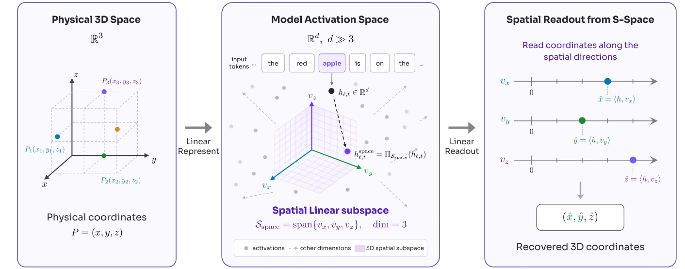

# S-Space：多模态模型内部的三维空间工作区

## 一屏概览

**研究问题。** 多模态模型能回答“杯子在左边”，但这种能力来自一个可操作的内部空间表示，还是来自局部视觉模式与语言先验？S-Space 的答案是：在中间层，物体 token 的激活里存在一个**三维线性子空间**，三个方向分别编码水平、垂直、距离坐标；它跨 prompt、跨视角、跨模态存在，能被读取，也能被因果干预。

**方法。** 对每个物体名 token 的表示 $h_{\ell,t}$，假设坐标线性可读：

$$
x=v_x^\top h_{\ell,t},\qquad y=v_y^\top h_{\ell,t},\qquad z=v_z^\top h_{\ell,t},
$$

其中 $v_x,v_y,v_z$ 是三个读出方向。方向不是训练出来的探针，而是从模型自己的判断里反推：构造“A 在 B 左边还是右边”这类成对问题，取最终答案的 logit 差 $s_p$，对两个物体 token 的激活求梯度，再用**角色反对称差**消去两个物体共享的成分，最后归一化：

$$
v_g^{\text{logit}}=\operatorname{unit}\!\left(\mathbb{E}_p\left[\frac{\nabla_{h_{\ell,q}}s_p-\nabla_{h_{\ell,r}}s_p}{2}\right]\right).
$$

对 prompt 模板与物体顺序取平均，减少模板特异的波动。

原文图 2：左侧是物理三维坐标，中间是模型激活中的三维线性子空间 $\mathcal{S}_{\text{space}}=\operatorname{span}\{v_x,v_y,v_z\}$，右侧是沿三个方向读出坐标。来源：论文 PDF 第 3 页。[查看原始来源](https://arxiv.org/pdf/2610.13527v1#page=3)

**结果。** 读出坐标足以直接回答空间关系：在 CV-Bench、EmbSpatial、SpatialTunnel 上，简单比较两个物体的读出坐标，准确率与模型直接生成相当；对 Qwen3.5-4B 这类原生空间能力较弱的模型，读出把 CV-Bench 从 **73.60** 提到 **89.36**。在 SpinBench 的视角变换题上，读出坐标 + 显式旋转把 Molmo2-ER 从 **60.96** 提到 **94.52**（加上前提关系后 **99.31**），远高于模型自己的思维链（Qwen3.6-27B 为 83.56）。干预读出方向可以把“左”变成“右”，而颜色判断基本不受影响。

**版本。** MirroS、清华大学、北京大学；Zhiyuan Shi、Xiang Li、Xingzhuo Guo 为共同第一作者，Jialong Wu 为项目负责人；arXiv `2610.13527v1`，2026-10-09，24 页（正文 9 页）；代码 Apache-2.0。分析覆盖 Molmo2-ER、MolmoAct2-Pretrain、MolmoAct2、Qwen3.5-4B、Qwen3.6-27B。

## 为什么这算“工作区”，而不只是一个探针

一个线性探针能预测坐标，可能只是因为探针偷看了别处的信息；S-Space 要证明的是这个子空间**被模型自己使用**。论文给了四类证据：

1. **可读**：投影坐标与真实物体位置（水平/垂直取框中心，深度取中位数中心化）相关；Molmo2-ER L21 的 Spearman 为水平 0.789、垂直 0.774、距离 0.521，成对差值分别为 0.871、0.872、0.688。深度轴明显最弱。读出不是分类“左/右”，而是连续几何。
2. **因果**：在 S-Space 最明显的层，沿某个轴把物体 token 的激活平移到反事实坐标，保持其余成分不变，模型的回答会从“左”翻到“右”、从“上”翻到“下”、从“近”翻到“远”；同一干预对颜色等非空间判断影响很小。这说明它不是只读相关物。
3. **持久**：换 prompt 结构（单物体提问、非空间提问、多视角）后，同一套固定读出仍能支持空间判断；多视角下，prompt 指定“View 1”还能把坐标系锚定到对应视角。
4. **超出可见**：守门员扑向画外的球，`ball` 的读出落在扑救方向；牵绳指向画外的主人；铁轨伸向隧道，`train` 落在更远的深度；“你”这个不可见观察者稳定落在距离轴的近端。语言描述（“从你身边经过” vs “朝你走来”）也能移动 `you` 的深度坐标，而机器人本身几乎不动。

这四点合起来支持一个机制图景：**感知把位置写进 S-Space，中间计算变换它，后续层读它来回答**。但“支持”不等于“完整证明”；第 4 点尤其说明这个工作区混入了语言与世界知识的先验，不只是视觉地图。

## 读数有多准，什么时候不如直接回答

在 CV-Bench（Relation+Depth，1,250 题）、EmbSpatial（1,200 题）、SpatialTunnel（1,200 题）上，直接生成与 S-Space 读出的对比：

| 模型（层） | CV-Bench 直接 / 读出 | EmbSpatial 直接 / 读出 | SpatialTunnel 直接 / 读出 |
| --- | --- | --- | --- |
| Molmo2-ER（L22） | **94.40** / 91.92 | **90.42** / 86.92 | **97.83** / 96.50 |
| MolmoAct2-Pretrain（L18） | **92.32** / 91.76 | 85.33 / **90.67** | 89.50 / **91.25** |
| MolmoAct2（L19） | **91.76** / 91.44 | 88.58 / **89.92** | 89.00 / **92.75** |
| Qwen3.5-4B（L15） | 73.60 / **89.36** | 78.50 / **86.42** | 86.33 / **90.08** |
| Qwen3.6-27B（L43） | **93.76** / 91.84 | **91.33** / 89.00 | **96.83** / 92.92 |

表：论文 Table 3（第 17 页）。加粗为该模型两种方法中更好者。层号是各模型在 COCO 选择集上扫出的最佳层（Table 2）。

读法很关键：**强模型（Molmo、Qwen3.6-27B）的读出并没有超过直接回答**，差距多在 1–4 个点；读出的大幅优势出现在 Qwen3.5-4B，以及后面的视角变换题。这说明 S-Space 里“有坐标”不等于“模型一定会用好它”；直接回答可能已经利用了同一信息，甚至利用了额外的视觉线索。S-Space 的价值更在于**诊断**：当直接回答错时，可以问“是坐标读错了，还是坐标对了但变换错了”。

## 因果干预与参考系耦合

干预的做法是：选一个物体 token，沿查询轴把它移动到反事实坐标 $p'$，保持正交于该子空间的分量不变，然后继续前向。随着编辑幅度增大，被针对的空间判断快速下降，未被针对的空间判断与颜色判断保持较好；50% 保留线用来标定“只动了目标信息”的范围。

但 S-Space 也暴露了模型的系统性错误。**参考系耦合**：模型常把图像相对方向直接当成基本方位——右=东、上=北——于是在需要基本方位的题上把“东北”答成“北”。从 Qwen3.6-27B 的思维链里读出 `east`、`north` 等 token 的坐标，可以看到 east 与 right 在 S-Space 中重合、north 与 above 重合。作者推测这与预训练数据里地图式参考系的比例有关。这不是“模型没有空间表示”，而是**表示里的参考系没有被正确解耦**。

另一个有意思的副作用：政治语义也落在这个几何里——`socialist` 偏水平轴左端，`conservative` 偏右端。这不必解释为模型真的把意识形态放进物理空间，而是说明语言中的隐喻关联与物理左右共享了部分表示结构。它同时是能力（语言知识可迁移）与污染（物理判断可能被语义先验拉偏）。

## S-Space 是怎样长出来的

论文用“同一家族、不同训练阶段”的模型做自然对照：Molmo2-ER（VLM）→ MolmoAct2-Pretrain（动作模型预训练）→ MolmoAct2（VLA）。

- **语言监督**把物理与抽象概念混进同一个工作区：要预测 `left`/`right`，模型必须把可见实体绑定到相对位置；这套压力可能在无显式坐标监督的情况下组织出稳定轴。代价是政治左右、地图方位等隐喻也进入同一几何。
- **动作监督**让局部几何更贴近可操作关系：在 InstructPart 数据上比较“整体物体”与“功能部件”的深度，读出判断的准确率从 Molmo2-ER 的 **63.1%**，到 MolmoAct2-Pretrain 的 **67.1%**，再到 MolmoAct2 的 **69.0%**。这是同一家族内的有序变化，不是跨家族因果实验，但方向清楚：**要学会操作，表示必须把“抓哪里”的几何变准**。

## 视角变换：坐标对了，计算错了

SpinBench 要求模型想象从左/右/后方看场景，再判断两个物体的左右或远近。直接把 S-Space 坐标读出来、乘上一个固定的视角旋转、再用确定性规则比较，结果如下（无前提 / 有前提）：

| 模型 | 直接 | 思维链 | S-Space + 旋转 |
| --- | ---: | ---: | ---: |
| Molmo2-ER | 60.96 / 61.81 | — | **94.52 / 99.31** |
| MolmoAct2-Pretrain | 66.44 / 56.25 | — | **96.58 / 99.31** |
| MolmoAct2 | 71.23 / 64.58 | — | **95.89 / 99.31** |
| Qwen3.5-4B | 60.96 / 60.42 | 62.33 / 72.22 | **91.10 / 97.92** |
| Qwen3.6-27B | 60.96 / 72.92 | 83.56 / 91.67 | **95.21 / 99.31** |

表：论文 Table 10（附录）。前提（premise）是把原视角的正确关系直接告诉模型，绕过感知，只考变换。

**读这张表要带一个限定：**“S-Space + 旋转”里的旋转是**外部给定的 oracle 变换**——使用 benchmark 指定的目标视角与确定性规则，不是模型自己学出来的。因此它证明的是“坐标里包含足够信息”，不是“模型会自主完成这个变换”；可比的“模型能力”列是 Direct 与 Reasoning，S-Space 列是诊断工具。

这张表是全文最强的证据：**模型内部的坐标已经足够好，失败主要发生在“对坐标做变换”这一步**。思维链确实在改善（Qwen3.6-27B 从 60.96 到 83.56），但仍远低于显式旋转读出；即使把正确前提喂进去，直接回答仍会错，而读出接近满分。跟踪思维链各阶段的 S-Space 坐标还能看到：随着推理推进，坐标逐渐对齐到目标视角——模型在内部模拟了一部分旋转，只是不完整，也不总能转成正确回答。

这也解释了为什么“更大的模型”不一定解决空间问题：感知表征可能早就够了，缺的是可靠的操作与读出接口。

## 测试时能否细化

两条路。**计算 scaling**：让模型生成更长的思维链，S-Space 坐标会逐步向目标视角旋转，但变换不完美，且最终语言回答可能仍然错。**上下文 scaling**：给更多视角或语言前提，坐标会更准；多视角 prompt steering 中，水平/垂直方向的 steering 准确率很高（Qwen3.5-4B 95.0/94.5，Qwen3.6-27B 96.5/97.5），但**深度方向只有 57–68%，仅略高于 50% 的随机水平**（水平 81–96.5%、垂直 73.5–97.5%）。这说明“用语言选视角”主要影响图像平面内的坐标，深度参考系仍难被 prompt 重锚定。

## 局限与未回答的问题

作者承认/论文可见的：

- 水平与垂直轴用的是**图像平面坐标**，没有显式解耦透视与深度；它们对成对比较够用，但不是世界坐标。
- 线性子空间是**假设**，不是从数据中唯一推出的结构；不同层、不同模型的最佳层不同（Molmo2-ER L22、MolmoAct2 L18/19、Qwen3.5-4B L15、Qwen3.6-27B L43），跨模型比较要带着层选择看。
- 读出在强模型上并不优于直接回答，说明“表示存在”与“表示被充分使用”是两件事；论文的因果干预支持后者的一部分，但不能证明模型在所有任务上都走这条通路。
- 模型覆盖不是独立样本：MolmoAct2-Pretrain 与 MolmoAct2 都源自 Molmo2-ER，Qwen3.5-4B 与 Qwen3.6-27B 既不同代也不同规模；跨模型的“有序进步”混有数据、目标与容量变化。
- 读出依赖**对象名 token**：对象必须在问题或选项里被命名；未命名物体、纯布局问题，或答案选项本身影响 token 分布时，读出的解释力会下降。论文没有讨论这个混淆。
- 主表没有置信区间或显著性检验；因果干预只做了 Molmo2-ER 一个模型（主图 L17、800 例），层扫描每层 80 例，外推到其他模型需要重新验证。
- 干预幅度大时会波及非空间信息；“非空间判断基本不变”是统计结论，不是逐样本保证。
- 抽象概念（政治左右）与物理左右共享几何，说明工作区不是干净的解耦表示；这会影响以 S-Space 作为“纯空间读数”的下游使用。

阅读后还应补上：

- 基准接近饱和：Molmo2-ER 在 CV-Bench 94.40、SpatialTunnel 97.83，剩余差异的方差没有报告；Qwen3.5-4B 的大幅提升可能更多反映“原生读出接口弱”，而不是“表示更好”。
- 没有训练时干预实验（例如用 S-Space 读出做辅助损失后，空间推理是否提升），因此“可解释”还没有闭环到“可改进”。
- 多视角 steering 的深度失败没有被解释：是深度轴本身更不可靠，还是 prompt 选择视角的机制只作用于图像平面？论文没有分离。
- 因果干预的“翻转率”与“颜色保持率”只有图，没有逐模型的表；复现需要代码与固定层。

## 在知识库里的位置

S-Space 是“世界模型作为**内部表示**”的一条线，与 [[code-as-world-executable-world-representations|Code-as-World]] 的“外部可执行表示”形成对照：一个问模型心里有没有地图，一个问能不能把地图写成可运行的代码。两者都指向 [[topics/executable-world-representations|可执行世界表示]] 的核心问题——表示是否**可操作、可验证**；S-Space 提供的是“读与改”的接口，Code-as-World 提供的是“写与跑”的接口。

对 [[WorldModelEvaluation|World Model 评测]]，它提了一个重要区分：**感知错误与计算错误要分开**。如果只看最终答案，会把“坐标对了但旋转错了”误判为“没有空间表示”。这与 [[harnesseval-w-agentifying-evaluation-of-visual-worlds|HarnessEval-W]] 把 transition correctness 拆成子问题的思路一致，只是 S-Space 拆的是模型内部，而不是评测流程。

共享机制见 [[SpatialWorkspaceInMLLMs|多模态模型的空间工作区]]。

## 证据定位

- 摘要与贡献：第 1–2 页；方法（读出方向、层选择）：第 2–4 页，Eq. 1–2。
- 坐标相关性：第 4–5 页 Figure 3–4；读出 QA：第 5 页 Figure 5、附录 Table 3–6。
- 因果干预：第 5–6 页 Figure 6–7；持久性与多视角：第 6 页 Figure 8–9。
- 超出可见物体：第 6–7 页 Figure 6；语言隐喻：第 7 页 Figure 7。
- 训练阶段对照：第 7–8 页；InstructPart：附录 C.6、Figure 14。
- 视角变换：第 7–8 页 Table 1；思维链变换：第 8 页 Figure 9；参考系耦合：第 9 页 Figure 10。
- 讨论与局限：第 9 页 §6；层扫描：附录 Table 2。
