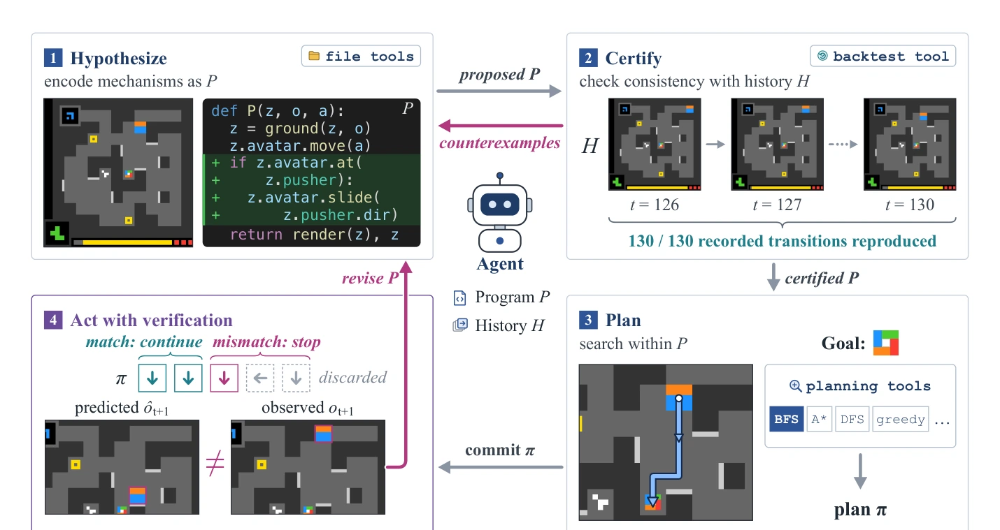

# Schema：把“对环境的理解”写成一个可执行程序

## 一屏概览

**研究问题。** LLM agent 在陌生环境里学到的规则，通常记在散文笔记里：不精确、不可执行、无法自动检验，也难以在长上下文中保持自洽。Schema 的出发点是科学家的做法——把观察组织成**可检验、可预测的理论**——并把它落成程序：智能体对环境的理解就是一个 Python 程序 $P$，既能预测下一步，也能在其中规划。

**方法。** 交互式程序归纳（interactive program induction）：智能体在持久程序工作区里**假设**（hypothesize）一个程序，用完整交互历史**认证**（certify）它，在程序里**规划**（plan），再在环境里**带验证地执行**（act with verification）。四个动作循环由模型自由编排，harness 只提供接口与回放。

**结果。** 同一个基础模型下，ARC-AGI-3 RHAE 从 58.7%（Claude Code 基线）提到 **99.2%**（Fable 5）；Opus 4.8 为 86.1%，GPT-5.6 Sol 在 max / xhigh 下为 96.7% / 91.8%。Fable 5 与 Sol(max) 各自通关全部 25 局共 183 关，19 与 21 局拿到满分；Fable 5 只用人类基线 57% 的动作数。DiG-bench 在 max effort 单次通关 21/21（三次重复均值 20.3/21）；MazeBench 在 36 小时、27,819 个动作的连续运行中超过人类前 50 的中位数。

**团队与版本。** Impossible Research、UC Berkeley、CMU（Guanning Zeng、Jiani Wang、Wenjie Ma 等 11 人，含 Angjoo Kanazawa、Andrea Zanette、Haiwen Feng）；arXiv `2609.39140v1`，2026-09-30，33 页。项目页有交互式轨迹，**没有公开代码**。

## 问题：散文为什么不够

论文的对比很直接：散文笔记可以描述“我发现了什么”，但不能回答三个问题——这条规则能否复现全部历史？能否用它推演未来？什么时候该放弃它？程序可以：它可以被执行、被回放、被搜索，也可以被证伪。

这带来一个设计上的转变：**动作同时是任务推进与实验**。每一次交互都既是得分动作，也是关于环境机制的一个样本；因此“选哪个动作”本身就是归纳过程的一部分。

## 方法：假设—认证—规划—验证执行

原文图 2：Schema 总览。智能体在持久工作区里把理解写成可执行程序 $P$；harness 用记录的历史 $H$ 检验 $P$，并在 $P$ 内按智能体选择的目标与搜索过程规划，不消耗环境动作；提交的计划逐步执行，每一步都对照预测，首次不匹配就中断并把反例交回。来源：论文 PDF，第 4 页。[查看原始来源](https://arxiv.org/pdf/2609.39140v1#page=4)

预测接口只有一行：

$$P(z_t, o_t, a_t) \rightarrow (\hat{o}_{t+1}, z_{t+1})$$

$z_t$ 是程序内部的隐藏状态，$\hat{o}_{t+1}$ 是对下一帧的预测。围绕它派生四个能力：

1. **假设。** 程序包含两部分：状态落地（把观测解析成对象、属性、关系，并保留跨步信息）与转移规则（动作如何改变这些状态）。智能体用文件工具直接改代码。
2. **认证。** 用完整历史逐条回放：对每个记录的动作计算预测，定义不匹配集合 $M(P,H_t)=\{i<t:\hat{o}^P_{i+1}\not\simeq o_{i+1}\}$，$Cert(P,H_t)\iff M=\emptyset$。不匹配就是反例，驱动下一轮修改；因为每次都重放**全部**历史，旧发现不会在修改中被悄悄丢掉。
3. **规划。** 同一个接口也是模拟器：把预测喂回自己就能 rollout，无需环境动作。目标谓词由智能体指定（完成、路点、或“能区分两个假设的局面”），搜索过程与预算也由智能体选（BFS、A*、DFS、贪心，或自己写）。
4. **验证执行。** 计划一次执行一个动作；每步先检查预测，匹配则继续，不匹配则丢弃剩余计划、把意外转移交回模型。论文明确类比模型预测控制（MPC）。

这个闭环的关键在于**认证与规划都不消耗环境动作**：错误假设在历史里被证伪，代价为零；只有历史无法裁决的问题才值得一次真实动作。

## 实验

### ARC-AGI-3

25 个公开游戏、183 关、64×64 网格。对比三种 harness：官方 basic（无辅助工具）、模型自带的 coding harness（Claude Code / Codex，可写笔记与跑代码）、Schema。

| 模型配置 | basic harness | coding harness | Schema |
| --- | ---: | ---: | ---: |
| Claude Opus 4.8 | 1.2–20.2 | 45.4 | 86.1 |
| Claude Fable 5 | 1.2–20.2 | 58.7 | **99.2** |
| GPT-5.6 Sol (xhigh) | 1.2–20.2 | 57.4 | 91.8 |
| GPT-5.6 Sol (max) | 1.2–20.2 | 62.3 | 96.7 |

表 1（正文）：RHAE 百分比。basic harness 一列是论文给出的区间；Schema 相对 coding harness 提升 34.4–40.7 个百分点。来源：论文第 4–5 页。

**消融**在 Opus 4.8、动作数最多的 10 个最难游戏、75 关、每关 2,000 动作预算下进行：完整 72.9；换成散文 58.8；去掉认证 62.3；去掉规划 59.2；去掉运行期验证 52.4。四个组件都重要，其中“运行期验证”影响最大。

四个案例分析把机制讲得很具体：CN04 第 5 关，Schema 用 279 步完成，散文版用 1,219 步；AR25 去掉认证后历史一致率从 97.7% 掉到 65.2%，完整版最终模型复现 99.6% 的历史；LS20 第 5 关，没有规划时通过全部 252 条转移检查却要手动试 233 步，有规划只要 65 步；没有运行期验证时，模型在首次不匹配后继续了 42 个动作，这类“错后继续”占十个游戏总动作的 58%。

### DiG-bench 与 MazeBench

DiG-bench 是文本形式的隐藏规则发现（70 个游戏、7 个难度层，公开 21 个）。Schema 用 GPT-6 Astra 在 max effort 下单次通关 21/21，三次重复均值 20.3/21；basic harness 在 max effort 下是 19/21，三次均值 18.0/21。作为对照，基准作者报告最强模型总体胜率 71.4%、最难两层只有 40%。

MazeBench 是一个 256 房间、100 颗宝石的长期探索环境。Schema 连续跑 36 小时、27,819 个动作，收集 33 颗宝石、访问 139 个房间，两项都超过人类前 50 的中位数。更有信息量的是程序规模：约 20,000 动作时程序有 2,012 行非注释代码，散文版笔记有 6,133 行；也就是说，**程序在增长，但比笔记更紧凑**。论文还追踪了一条规则的生命周期：在 IxG 房间学到“冰面滑行直到被挡住”，约 24,852 个动作之后（正文写“至少 20 次上下文压缩”，附录写 35 次），在 NxE 房间复用它并用 A* 找到 38 步路线，全程预测与观测一致。

## 工程接口

Schema 的 harness 只有一组很小的接口：持久程序工作区（文件工具读写）、历史回放/认证工具、规划工具（内置搜索或自定义）、以及带预测检查的动作队列。所有接口都围绕同一个 $P$，因此“改模型”与“改计划”是同一个对象的两种操作。

论文没有给出完整源码，只有项目页的交互轨迹与附录中的接口说明。这意味着它的 99.2 目前只能按论文自述与轨迹复算，不能像 [[nimi-research-tycho-repository|Tycho]] 或 [[ryanbbrown-retrodict-repository|Retrodict]] 那样做代码级核查。

## 局限与我们的判断

- **协议是条件选择。** Tycho 的论文指出：Schema 先跑 Opus 4.8，对低于 80 分的游戏用 Fable 5 重跑并保留更好的轨迹，因此 98.98 是“条件多模型选择”的结果，不是单次固定模型跑分；Retrodict 的对比表也标注了 “Fixed conditional reruns; higher result retained”，成本至少 $6,447。Schema 原文正文没有展开这一协议，读分数时要留意。
- **没有代码，复现门槛高。** 关键实现（工作区、认证工具、规划接口）只能从论文与项目页推断。
- **程序归纳的失败模式没有被系统统计。** 论文展示了成功案例与消融，但没有给出“程序写错后如何恢复”的失败分布；这类错误在长时程里可能比分数显示的更常见。
- **成本与模型绑定。** 99.2 用的是 Fable 5，Opus 4.8 只有 86.1；跨模型差异大于 harness 之间的部分差异，说明能力仍是主项。
- **它证明了什么。** 最有力的一点不是分数，而是“**认证不消耗环境动作**”这个结构性优势：错误假设可以在历史里免费证伪。这与 [[AddressableVisualMemory|可寻址视觉记忆]] 的“记录优先”是同一个直觉的两种实现——一个把证据留在像素里，一个把理解写成程序。
