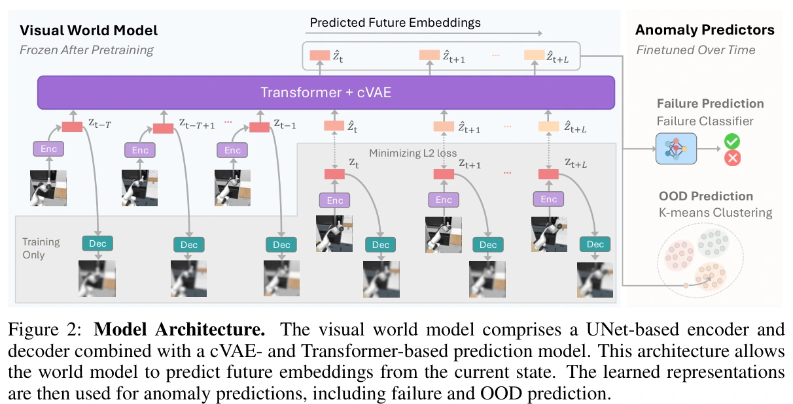
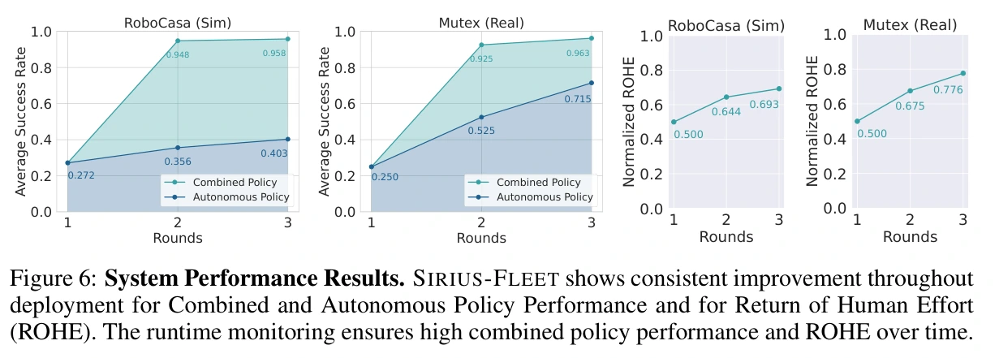

# Sirius-Fleet：世界模型监控与多任务接管

## 概览与阅读范围

Sirius-Fleet 把 [[sirius-robot-learning-on-the-job|Sirius]] 的部署—纠正—策略更新，扩展成多任务策略和自动异常监控协同更新：预训练的视觉世界模型预测未来视觉表示，按任务分别建立失败与分布外检测器；发现异常后先请求人类观察，由人决定是否接管。策略、失败分类器和异常判定范围随部署数据更新，世界模型保持冻结。

完整阅读归档的 arXiv v1 全部 28 页，包括正文、参考文献、附录 6.1–6.5 和全部图表。论文首发 2024-10-30，PDF 标明 CoRL 2024；会议论文集的出版年份不能替换所读预印本年份。原始 PDF 获取于 2026-10-18，SHA-256 为 `c33ca3b5878e40f515dee957100deb267419b6dd72c25e5cbf55181e9dad150b`。未归档项目网页或核查代码，不声称实现复现。

## 为什么把世界模型放在监控层

人类全程监督难以扩展到多个任务；仅看当前图像是否异常又可能太晚。方法用共享视觉表示支持不同任务的轻量检测器，并预测未来表示，争取在风险变成不可恢复失败前请求帮助。失败检测学习“以前人认为需要纠正的情形”，分布外检测补充“还没见过的新状态”；二者有不同覆盖范围（§3.2）。

这里的世界模型是**监控预测器**，不直接生成策略训练用的想象轨迹，也不以规划搜索替代执行策略。§3.2.1 给出的输入是图像表示历史，未给出候选动作作为条件，因此不能据名称把它写成可评估任意动作方案的动作条件仿真器。它预测经验中的任务发展趋势，动作改变后预测是否仍可信，需要另行验证。

## 视觉表示、未来预测和异常接口

世界模型 $W=(E_\gamma,D_\lambda,T_\psi)$ 包括 UNet 编码／解码器和 Transformer+cVAE 未来预测器。图像 $x_t$ 经编码得到 $z_t=E_\gamma(x_t)$，解码器以图像重建损失保留操作细节；预测器从历史 $(z_{t-T},\ldots,z_t)$ 自回归预测未来 $\hat z_{t+1:t+L}$，以未来表示重建损失联合训练。cVAE 允许采样多个可能未来，而不是只给单一路径。附录配置历史长度为 10、采样未来数为 20；OOD 配置还给出预测未来 20 步（§3.2.1、附录表 3、7）。

训练完成后冻结 $W$，每任务建立两个检测器：

- **失败分类器**：把最新一轮轨迹标为正常自主、接管前失败片段、人类控制三类，在冻结表示上用平衡采样和交叉熵训练。这些“失败”是人类介入的时序代理，不是逐状态物理失败真值。
- **分布外检测器**：对累计轨迹表示做 PCA 与 k-means；新表示到最近聚类中心的距离 $d$ 大于阈值 $\alpha_g$ 时判为任务 $g$ 的分布外状态。阈值来自验证表示距离的第 $\theta_g$ 百分位。

执行时，从 cVAE 采样 $N$ 个未来，分别对 $L$ 步未来表示评分；失败分数跨预测表示平均，OOD 距离也聚合后与阈值比较。策略本身是 Transformer，输入多视角图像、本体感知与 CLIP 任务语言表示，图像用 FiLM 条件化的 ResNet-18 编码，GMM 头输出 OSC 的 7 维位置、姿态和夹爪动作（§3.2.3、附录表 4）。

图 2，来源：上述归档 PDF，第 4 页。完整图注译文：模型架构。视觉世界模型由基于 UNet 的编码器与解码器，以及基于 cVAE 和 Transformer 的预测模型构成。该架构使世界模型能从当前状态预测未来嵌入。学得的表示随后用于异常预测，包括失败预测与分布外预测。

## 阈值与策略如何一起更新

初始 BC 策略来自人类示范。第一轮还没有检测器，必须全程人工监督；后两轮只有预测异常时请求人类监控，人类可以决定不接管，或覆盖策略动作后归还控制。采集样本记录 $(s_t,a_t,r_t,c_t)$，其中 $c_t$ 标记是否由人控制；回合数据聚合为 $D_{i+1}=D_i\cup D'$。策略用累计数据加权采样训练，失败检测器只用最近一轮介入标签更新；OOD 聚类则随着累计数据扩展覆盖（§3.1.2、3.2.3、4.1）。

OOD 阈值采用人类动作比例 $p_H$ 作为能力代理，在校准轨迹上拟合

$$
\theta_g=a+b e^{c p_H},\qquad (a,b,c)=(95.2,-17.7,-3.2).
$$

百分位数越高通常对应越大的距离阈值，从而减少分布外报警。但论文存在明确的**方向冲突**：文字声称能力变好、$p_H$ 下降时应放宽边界；代入所列参数，$\theta_g(0)=77.5$，$\theta_g(1)\approx94.5$，方向相反。原文曲线也需要连同横轴 $1-p_H$ 理解。本页保留公式和冲突，未核查代码前不擅自修改符号或声称具体实现正确。

## RoboCasa 与真机的采集和评测

仿真策略和监控覆盖 RoboCasa 的 12 个任务套件，包括开关门、微波炉、水龙头、咖啡与物体搬运；任务套件内有不同场景、布局和物体。世界模型覆盖 20 套件。附录规定初始策略每套件 50 条人类示范，每轮新增每任务 100 条含人类接管的执行轨迹；**固定的是回合数，不是纠正动作数**。三轮部署中第一轮人工全程监控，后两轮自动请求观察。仿真使用 2 个种子，每任务 50 次、共 600 次评测；固定训练 epoch 的检查点，附录称初始 1000 epoch、后续 400 epoch（§4.1、附录 6.5.2）。

真机采用 Mutex 的 50 个任务预训练世界模型；策略与监控选其中 5 套件的 10 任务，初始每任务 30 条示范，每轮每任务 60 次执行。初始 2000 epoch、后续 800 epoch，1 个种子，10 任务各 20 次、共 200 次评测。所有实验是 Franka Panda 本体，论文限制段落称参与者共五人；专家纠正为人类，不能写成脚本专家或无人闭环（附录 6.5.1、§5）。

论文正文与附录有几处需保留的协议冲突：§4.1 泛称初始策略用 50 示范训练 1200 epoch，与附录仿真 1000 epoch、真机 30 示范／2000 epoch 不一致；正文称世界模型使用 RoboCasa 20 套件 MimicGen 数据，并介绍其每任务 5000 轨迹，而附录又称世界模型每套件 50 条示范。因此**无法从此版本唯一确认仿真世界模型实际使用的是哪种数据和多少轨迹**。不能直接把数据集总规模当实际训练预算。附录还将 12 任务误写为“10 tasks”，正文的“6 个单任务世界模型”对应表 1 只列出 5 任务，均不补造遗漏结果。

## 结果：自主能力和人机完成率必须分开

**自主成功率**在关闭监控和人类帮助时测量；**CPP** 是监控与人类协作下的完成率；**ROHE** 将回报除以包含人工努力的归一化项，论文写为 $\mathbb E_\tau[\sum_t r_t^\tau]/(1+H/T)$，其中需连同论文的人类监控／干预口径理解，不能直接换算成人工小时或每次接管的成功收益。

图 6，来源：上述归档 PDF，第 8 页。完整图注译文：系统表现结果。Sirius-Fleet 的人机联合表现、自主策略表现和人工努力回报（ROHE）在部署期间持续改善。执行监控使联合策略表现与 ROHE 随时间保持较高水平。

原图标值给出 RoboCasa 自主成功率 $27.2\%\to35.6\%\to40.3\%$，即提高 **13.1 个百分点**；Mutex 为 $25.0\%\to52.5\%\to71.5\%$，即 **46.5 个百分点**。人机 CPP 后两轮分别为 RoboCasa $94.8\%,95.8\%$，Mutex $92.5\%,96.3\%$。故正文“均超过 95%”只适合最终轮，且正文“真机提高45%”也不精确等于图中差值；以图中明确数值记录。

比较 MoMaRT、PATO、ThriftyDAgger 的监控实验只覆盖 5 个 RoboCasa 任务，为原本单任务的基线逐任务训练，并对齐目标干预比例；结果支持本文协议下 CPP 和 ROHE 改善，不能推出任意机器人集群规模下的吞吐优势。附录 6.2 的失败+OOD 组合较单独检测与人类干预更吻合，例如 CoffeeSetupMug 的干预重合准确率为 99.4%，TurnOffSinkFaucet 仅45.0%；这衡量与人的判断一致性，并非校准过的真实失败概率。

## 局限及与 Harness、自改进的连接

作者限制在易于遥操作纠正的准静态任务；高速动态失败可能留不出接管时间。五名操作员、单一本体的结果不足以验证大规模人员差异和跨本体调度。论文以独立 MDP 形式化 fleet 并聚合多任务数据，没有给出大规模物理集群同时请求帮助时的排队与人力分配实测。

本库解释：它是 [[topics/interactive-policy-improvement|交互式策略改进]] 接上 [[RobotHarness|执行 Harness]] 的直接先例——监控器决定何时请求注意，控制接口交接，轨迹携带来源标签，策略和监控标准按轮次更新。但世界模型冻结、学习和阈值程序预先固定；持续更新数据和检测器并不等于 [[PhysicalRecursiveSelfImprovement|改进程序自身演化]]。对 [[topics/robot-harness-and-physical-rsi|Harness 与 Physical RSI 专题]] 更可复用的是这些组件之间的接口，而不是将 CPP 当作自主策略性能或把该系统叫作无人自进化。
