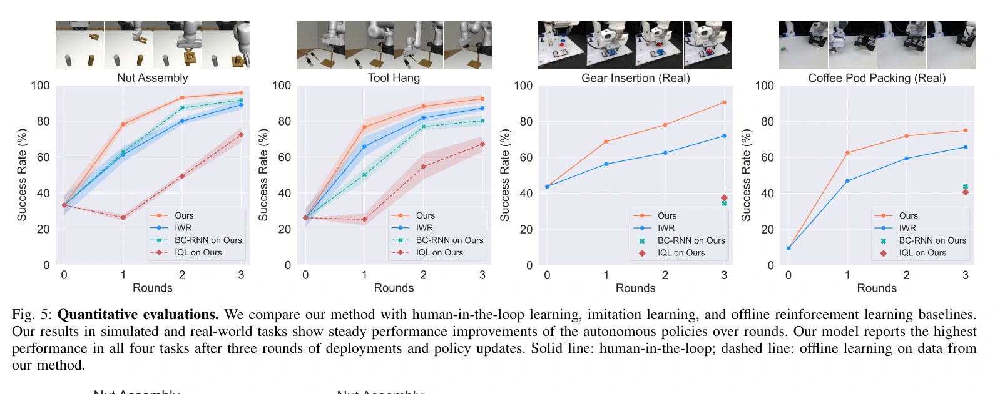

# Sirius：部署中接管与加权学习

## 概览与阅读范围

Sirius 把人类监控与遥操作接管放进持续部署过程，以接管发生的位置划分数据质量，再用加权行为克隆更新视觉策略。关键贡献不只是“多收一些纠正数据”，而是同时利用**人做了什么、何时决定接管**：提高纠正动作的训练占比，并排除接管前可能导致错误的策略动作。完整阅读归档的 arXiv v3 全部 14 页，包括正文、参考文献和附录 A–F、表 I–V；首版为 2022 年，当前阅读版本及会议为 2023 年。原始 PDF 获取于 2026-10-18，SHA-256 为 `bd0a1258b620a882642640230faae5f9034b8ec1ffb2cb436f9cda253ac862a2`；未核查代码或运行训练。

这属于 [[InteractiveImitationLearning|交互式模仿学习]]；策略访问状态后获得人类纠正，但完整轨迹由人机混合控制产生。它能连接 [[RobotHarness|机器人 Harness]] 的采集、控制权交接和版本更新，不研究工具代码或改进程序自身的演化。自动监控的后续扩展见 [[sirius-fleet-visual-world-models|Sirius-Fleet]]。

## 问题与设计动机

部署数据有不同质量：正常自主动作覆盖大量常见状态；人类纠正动作数量少却集中在困难区域；接管前的错误动作即使处于最终成功的轨迹中，也不应被盲目模仿。只对接管数据训练会丢失正常行为的多样性，直接克隆整批数据又会复制错误。作者也发现，在这些最终完成任务的数据上训练价值函数并据此加权较困难，因此选择直接使用人类干预时序作为质量代理（§III–IV）。

人机执行策略为 $\pi(\cdot\mid s)=I_H(s)\pi_H(\cdot\mid s)+(1-I_H(s))\pi_R(\cdot\mid s)$，其中 $I_H$ 表示人类是否接管，$\pi_H$ 为隐式人类策略，$\pi_R$ 为学习策略。状态既可能来自策略自主执行，也可能来自纠正后的恢复段；“在当前策略状态上采集”不能理解为整条轨迹都严格来自纯策略分布。

## 机制：把接管结构变成监督权重

每个样本保存 $(s,a,r,c)$；类别 $c$ 分成初始示范 `demo`、自主动作 `robot`、接管动作 `intv`、接管前片段 `preintv`。在每次接管前回看 $\ell=15$ 个动作，将它们标为 `preintv`；该长度对应作者所用操作员约 2 秒反应时间，属于经验配置，不是所有控制频率下通用的窗口。

设数据中类别比例为 $P(c)$，希望训练时类别比例为 $P^*(c)$，则训练目标为

$$
\max_\theta\;\mathbb E_{(s,a,c)\sim D}\left[\frac{P^*(c)}{P(c)}\log\pi_\theta(a\mid s)\right].
$$

这里权重实现类别分布重分配，不是用密度比恢复纯策略状态分布。论文设置 $P^*(\mathrm{intv})=0.5$、$P^*(\mathrm{preintv})=0$，保持 $P^*(\mathrm{demo})=P(\mathrm{demo})$，剩余份额给 `robot`。直觉是让罕见纠正进入足够多的训练批次、避免模仿失误，同时保留正常行为和初始示范。消融中纠正比例过低或过高都较差；后者会压缩数据多样性（§IV-B、IV-D、V-C）。

初始策略采用 BC-RNN：两路 ResNet-18 编码工作区与腕部图像，拼接本体感知后进入 LSTM，GMM 头输出动作分布。仿真是 OSC 7 维动作（位置、姿态、夹爪），真机采用只控制偏航的 5 维动作；不能把两类实验描述成完全相同动作接口。图像一般为 $84\times84$，Tool Hang 为 $128\times128$ 且调整了工作区相机视角（附录 C–D）。

## 一轮部署如何流动

初始人类示范训练 $\pi_1$；部署线程运行当前策略，人类持续观看，发现已发生或即将发生的错误时通过 SpaceMouse 接管，恢复到可继续状态后归还控制。记录实际执行动作及控制来源，聚合进数据缓冲；训练线程依据类别权重训练下一版策略，轮次结束再替换部署策略（§IV-A、算法 1、附录 B）。这是轮次间持续更新，并非每个动作后即时在线梯度更新。

为控制存储，缓冲满后比较五种轨迹保留策略。LFI 优先丢弃最少被干预的轨迹，保留更丰富的人类纠正；与 FIFO、FILO、随机和优先丢弃高干预轨迹相比，它在本文实验中最有效。缓冲限为 500 条时，对应 Nut Assembly 全量数据约 15%、Tool Hang 约 30%；因此“减少 85% 存储”仅适用于前者的配置。达到 90% 成功率所需 epoch 在该实验中约减半；正文引言另称三倍加速，本文以实验段落的具体定义和两倍结果为准（§IV-C、V-C）。

## 实验协议与证据

仿真在 robosuite／robomimic 的 Nut Assembly 与 Tool Hang；真机为 Panda 的 Gear Insertion 与 Coffee Pod Packing。四任务初始示范数分别为 50、80、30、30。各执行三轮更新，每轮直到新接管样本数量达到初始示范样本的三分之一；**固定的是人类动作样本预算，不是每轮回合数**。第三轮仿真分别累积 3000 余与 1600 余条轨迹。所有接管来自人类，未使用脚本专家（§V、附录 E、表 V）。

下图显示自主策略成功率随更新轮次提高。IWR 也闭环采集，而 BC-RNN 与 IQL 在 Sirius 生成的相同数据上离线训练，因此应分别理解算法差异与采集分布差异。摘要报告相对比较方法仿真约 8%、真机约 27% 的成功率提升；这不是相对于初始策略的统一增幅。

图 5，来源：上述归档 PDF，第 7 页。完整图注译文：定量评测。我们将本方法与有人参与的学习、模仿学习和离线强化学习基线比较。仿真与真实任务的结果表明，自主策略表现随轮次稳定提高。三轮部署与策略更新后，本模型在全部四项任务中表现最高。实线：有人参与的学习；虚线：在本方法收集的数据上进行离线学习。

仿真取 3 个随机种子；每训练检查点评测 100 次，再取表现最好的三个检查点平均。真机只有 1 个种子，先用五个检查点各五次筛选，再对选中的检查点评测 32 次。因此这些结果包含检查点选择，不能当作未经选择的固定最终检查点成绩。人机团队执行报告 100% 成功，论文另测无人接管的自主策略；前者不表示策略本身达到 100%。人类工作量主要按接管动作比例计算，附录还给出接管频次和持续长度（§V-B、附录 F）。

## 局限与我们的解释

每任务仅一位操作员；接管位置受反应时间、技能和风险容忍度影响。“接管前 15 步是坏动作”是有效但粗糙的代理，可能删除本来正确的动作，也不能提供同一状态的反事实最优动作。论文仍要求人类全程监控，操作时间减少不等于认知负担按同比例减少。文中“可信执行”依赖人类及时、有效介入，未给出形式安全保证。

对 [[topics/interactive-policy-improvement|交互式策略改进]] 与 [[topics/robot-harness-and-physical-rsi|Harness 专题]] 的启发是：采集系统必须保存控制来源与接管时序，训练系统必须区分纠正、正常自主动作与失败前段；但“按固定规则持续产生更好策略”尚不支持 [[PhysicalRecursiveSelfImprovement|改进程序自身递归增强]]。
