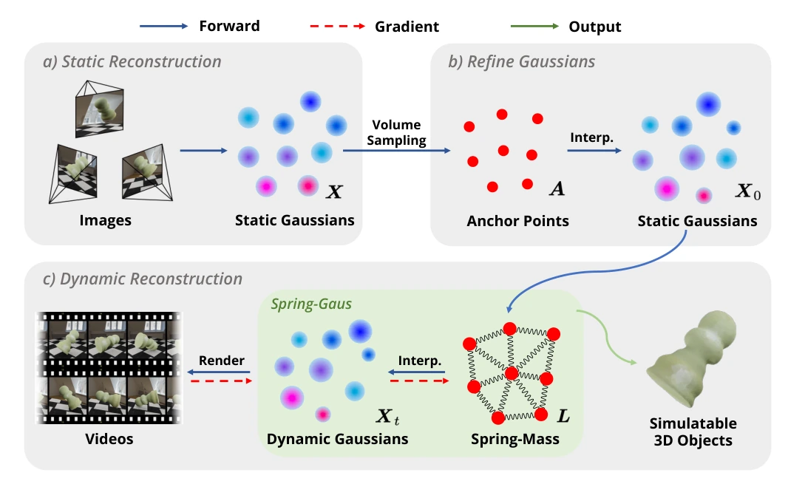

# Spring-Gaus：基于三维弹簧质点高斯模型的弹性物体重建与参数反演

## 一屏概览

**研究问题。** [[physgaussian-physics-integrated-3d-gaussians-for-generative-dynamics|PhysGaussian]] 实现了在 3D 高斯上的正向连续介质仿真，但不支持从真实视频反演物理参数；而 [[pac-nerf-physics-augmented-continuum-neural-radiance-fields|PAC-NeRF]] 虽然用可微 MPM 做系统辨识，却受限于两点：（1）MPM 需要数万个稠密粒子，若为每个粒子独立优化物理参数会导致计算代价过高与优化病态，因此 PAC-NeRF 只能假设整个物体具有**单一全局均质参数**，无法处理材质空间异质的真实物体；（2）MPM 要求预先准确指定材料的连续介质本构方程类型。**Spring-Gaus** 提出将**外观几何表示（数万个各向同性 3D 高斯核）**与**物理动力学表示（通过体积采样提取的 $N_A = 2048$ 个稀疏三维弹簧质点锚点）**显式解耦，通过反距离加权（IDW）插值驱动高斯核，并在锚点上优化逐点刚度与可微拓扑软向量，从真实多视角视频中重建可仿真、可泛化到新边界条件的弹性数字资产。[论文 §1–3](https://arxiv.org/abs/2403.09434)

原文图 2：Spring-Gaus 三阶段重建与辨识流水线。（a）静态场景重建：由多视角视频首帧重建各向同性静态 3D 高斯 $X$（固定统一缩放标量 $s_0$ 以保证空间分布均匀）；（b）高斯外观精化：对高斯核中心执行体积采样生成稀疏锚点集 $A$，并在固定锚点反距离加权（IDW）插值位置 $X_0$ 下微调每个高斯核的缩放标量 $s_i$、颜色 $c_i$ 与不透明度 $\sigma_i$ 以消除插值引起的外观漂移；（c）动态物理重建：构建可微 3D 弹簧质点系统，通过渲染视频帧与真实视频对比反传梯度，联合优化初速度、逐锚点弹簧刚度、拓扑软向量参数 $\kappa$ 与地面碰撞摩擦参数。来源：论文 PDF，第 6 页。[查看原始来源](https://arxiv.org/pdf/2403.09434v3#page=6)

**机构与版本。** 斯坦福大学、哥伦比亚大学与 UIUC（贾佳亚/Jiajun Wu 与李昀竹/Yunzhu Li 课题组）联合发布；作者为 Licheng Zhong、Hong-Xing Yu、Jiajun Wu、Yunzhu Li；录用于 ECCV 2024（本页对应 `arXiv:2403.09434v3`，2024-07-19）。

## 核心机制与数学形式化

### 1. 稀疏锚点采样、非线性弹簧力与 IDW 蒙皮插值（§3.1–3.2）

给定由 $N$ 个各向同性 3D 高斯核 $\{G_i\}_{i=1}^N$（中心 $X = \{\mu_i\}_{i=1}^N$、标量尺度 $s_i$、颜色 $c_i$、不透明度 $\sigma_i$）组成的静态重建，Spring-Gaus 首先通过体积采样算子 $\mathcal{V}$ 提取 $N_A = 2048$ 个空间锚点（anchor points）：

$$A = \{x_i\}_{i=1}^{N_A} = \mathcal{V}(X).$$

每个锚点 $x_i$ 与其 $n_k = 256$ 个最近邻锚点 $\mathcal{N}_i = \{x_{i,j}\}_{j=1}^{n_k}$ 通过弹簧连接，原长为初始时刻欧氏距离 $l_{i,j} = \|x_i^0 - x_{i,j}^0\|$。在第 $t$ 个时间步，作用在锚点 $x_i^t$ 上的弹簧恢复力 $F_{k_{i,j}}^t$ 与阻尼力 $F_{\zeta_{i,j}}^t$ 定义为（式 8–10）：

$$F_{k_{i,j}}^t = -\eta_j \cdot k_{i,j}\Bigl(\|x_i^t - x_{i,j}^t\| - l_{i,j}\Bigr)\cdot \Bigl|\|x_i^t - x_{i,j}^t\| - l_{i,j}\Bigr|^{p_k} \frac{x_i^t - x_{i,j}^t}{\|x_i^t - x_{i,j}^t\|},$$

$$F_{\zeta_{i,j}}^t = -\zeta_{i,j}\left((v_i^t - v_{i,j}^t)\cdot \frac{x_i^t - x_{i,j}^t}{\|x_i^t - x_{i,j}^t\|}\right)\frac{x_i^t - x_{i,j}^t}{\|x_i^t - x_{i,j}^t\|},$$

其中超参数 $p_k \ge 0$ 控制非线性弹性（$p_k = 0$ 退化为标准胡克定律，实验中取 $p_k = 0.5$ 以模拟大变形下的非线性硬化，附录 B）。锚点速度与位置按半隐式欧拉（semi-implicit Euler）积分并经地面碰撞边界函数 $\mathcal{B}(\cdot)$ 修正（式 11–13）：

$$\hat{v}_i^{t+1} = v_i^t + \frac{F_i^t}{m_i}\Delta t, \qquad \hat{x}_i^{t+1} = x_i^t + \hat{v}_i^{t+1}\Delta t, \qquad (x_i^{t+1}, v_i^{t+1}) = \mathcal{B}(\hat{x}_i^{t+1}, \hat{v}_i^{t+1}).$$

随后，每个高斯核中心 $\mu_i^{t+1}$ 由其在 $t=0$ 时绑定的 $n_b = 16$ 个最近邻锚点按初始距离 $d_{i,j}$ 的**反距离加权（Inverse Distance Weighting，IDW，式 14）**插值更新（实验中取 $p_b = 0.5$）：

$$\mu_i^{t+1} = \frac{\sum_{j=1}^{n_b} x_{i,j}^{t+1} \cdot (1 / d_{i,j})^{p_b}}{\sum_{j=1}^{n_b} (1 / d_{i,j})^{p_b}}.$$

### 2. 两大可微辨识设计：拓扑软向量 $\eta(\kappa)$ 与锚点级刚度降维（§3.2–3.3）

如果直接优化弹簧质点系统，会遇到两个棘手的病态问题：

1. **连接数 $n_k$ 是离散超参数，却剧烈影响整体软硬：** 每个锚点连接的邻居数 $n_k$ 越大，拓扑网越密集、物体越接近刚体；$n_k$ 越小则越松软。为了让“有效连接拓扑”可以通过梯度下降连续调节，作者引入了由单一可学习标量 $\kappa$ 控制的长度为 $n_k$ 的**软向量（Soft Vector）** $\eta = [\eta_1, \dots, \eta_{n_k}]$（式 15，给定基准连接数 $n_c = 16$）：
   $$\eta_j = \begin{cases} 1, & j \le n_c, \\ \operatorname{clamp}\bigl(2 - \exp(\operatorname{softplus}(\kappa))^{j - n_c},\, 0,\, 1\bigr), & n_c < j \le n_k. \end{cases}$$
   当 $\kappa$ 较大时，$j > n_c$ 的远端弹簧权重迅速指数衰减至 0；当 $\kappa$ 较小时，更多远端邻居弹簧被激活。
2. **从边级刚度 $O(n_k N_A)$ 降维到锚点级刚度 $O(N_A)$（式 16–17）：** 若为全部 $2048 \times 256 \approx 5.2 \times 10^5$ 根弹簧独立赋予刚度，自由度过高极易过拟合。Spring-Gaus 将所有锚点质量固定为 $m_0 = 1$、全局阻尼固定为 $\zeta_0 = 0.1$，仅为每个锚点 $x_i$ 分配一个标量刚度参数 $k_i$，并将连接 $x_i$ 与 $x_{i,j}$ 的弹簧刚度和阻尼按原长 $l_{i,j}$ 归一化：
   $$k_{i,j} = \frac{k_i}{l_{i,j}}, \qquad \zeta_{i,j} = \frac{\zeta_0}{l_{i,j}}.$$
   这样既把待优刚度参数量压缩了 $n_k = 256$ 倍（仅需优化 $N_A = 2048$ 个参数），又保留了刻画异质物体（如一半硬一半软的物体，见论文附录 C 与表 3）的空间表达能力。

### 3. 真实场景稀疏视角下的静态—动态配准与掩码中心损失（§4.2）

在真实世界数据采集中，高速动态视频往往只有稀疏的 **3 个相机视角**（$1920 \times 1080$），不足以直接重建高质量 3DGS。Spring-Gaus 采用“先在静态桌面上环拍 50–70 张图像用 COLMAP 重建高质量静态 3DGS，再通过一个 6D 连续旋转表示 $r_r \in \mathbb{R}^6$ + 平移 $t_r$ + 缩放 $s_r$ 的配准网络对齐到 3 视角动态视频首帧坐标系”的策略（§4.2）。

同时，由于真实拍摄中存在光照与曝光波动導致跨帧颜色偏差，直接优化 RGB $\mathcal{L}_1$ 损失容易受噪声干扰；因此在真实数据上改在**分割掩码图像（SAM 提取）**上计算损失，并加入掩码质心坐标损失 $\mathcal{L}_{\text{center}}$ 与 VGG16 感知损失 $\mathcal{L}_{\text{percep}}$（式 19）：

$$\mathcal{L}_{\text{real}} = (1 - \lambda_{\text{d-ssim}})\mathcal{L}_1 + \lambda_{\text{d-ssim}}\mathcal{L}_{\text{d-ssim}} + \lambda_{\text{center}}\mathcal{L}_{\text{center}} + \lambda_{\text{percep}}\mathcal{L}_{\text{percep}}.$$

## 实验结果与消融分析

### 1. 合成数据集动态重建与未来 10 帧预测（§4.3，表 1–2）

在由 MLS-MPM 生成的 7 个合成弹性物体（10 视角，前 20 帧训练辨识、后 10 帧测试未来预测）上，Spring-Gaus 与 [[pac-nerf-physics-augmented-continuum-neural-radiance-fields|PAC-NeRF]]、Dynamic 3D Gaussians（Dy-Gaus）及 4D-GS 对比如下（Chamfer Distance $\text{CD}$ 单位为 $10^3\text{ mm}^2$）：

| 任务与方法（论文表 1、表 2，7 物体平均） | $\text{CD} \downarrow$ | $\text{EMD} \downarrow$ | $\text{PSNR} \uparrow$ | $\text{SSIM} \uparrow$ |
| --- | --- | --- | --- | --- |
| **动态重建（前 20 帧）**：Dy-Gaus / 4D-Gaus | 1305 / 4.43 | 1.116 / 0.095 | — | — |
| **动态重建（前 20 帧）**：[[pac-nerf-physics-augmented-continuum-neural-radiance-fields|PAC-NeRF]] | 2.11 | 0.052 | — | — |
| **动态重建（前 20 帧）**：**Spring-Gaus（本文）** | **0.85** | **0.040** | — | — |
| **未来状态预测（后 10 帧）**：[[pac-nerf-physics-augmented-continuum-neural-radiance-fields|PAC-NeRF]] | 17.94 | 0.134 | 15.77 | 0.870 |
| **未来状态预测（后 10 帧）**：**Spring-Gaus（本文）** | **5.16** | **0.095** | **17.06** | **0.897** |

### 2. 异质物体消融实验：为什么需要逐锚点刚度与软向量 $\eta$？（附录 C，表 3）

在由不同硬度分段组成的异质物体上（论文附录 C、表 3），去掉软向量 $\eta$ 或退化为单一全局刚度 $k$ 均导致显著退化：

| 异质物体消融变体（附录表 3） | 动态重建 $\text{CD} \downarrow$ / $\text{PSNR} \uparrow$ | 未来预测 $\text{CD} \downarrow$ / $\text{PSNR} \uparrow$ / $\text{SSIM} \uparrow$ |
| --- | --- | --- |
| [[pac-nerf-physics-augmented-continuum-neural-radiance-fields|PAC-NeRF]]（全局单一参数） | 8.66 / 19.87 | 5.70 / 15.65 / 0.894 |
| Spring-Gaus（单一全局刚度 `single k`） | 3.22 / 23.02 | 6.56 / 14.45 / 0.892 |
| Spring-Gaus（去掉拓扑软向量 `w/o soft vector η`） | 0.56 / 25.36 | 13.28 / 13.91 / 0.881 |
| **Spring-Gaus（完整模型：逐锚点 $k_i$ + 软向量 $\eta$）** | **0.18 / 27.08** | **2.04 / 17.63 / 0.927** |

## 局限性与后续演进

论文附录 D 及后续研究指出了 Spring-Gaus 的三项主要边界：

1. **仅限纯弹性体，不支持塑性、流体或颗粒介质：** 因为弹簧原长 $l_{i,j}$ 与连接拓扑在仿真开始时固定不变，无法表达永久塑性形变或拓扑撕裂（多材质连续介质辨识随后由 [[gic-gaussian-informed-continuum-physical-property-identification|GIC]] 解决）。
2. **仅使用带权弹簧并缺乏严格动量守恒与主动交互控制输入：** 如同一课题组（Yunzhu Li 组）随后的 [[phystwin-physics-informed-reconstruction-and-simulation-of-deformable-objects|PhysTwin]]（§2）所剖析，Spring-Gaus 仅靠桌面自由落体回弹辨识参数，未建模人手或机械臂的主动受控交互点（control points），且过度简化的锚点归一化在复杂双手拉伸/挤压下容易导致物理求解崩溃。
3. **仅用纯平移 IDW 更新高斯中心，忽略高斯旋转与完全单目/稀疏几何补全：** Spring-Gaus 假定所有高斯核各向同性且只做位置插值（式 14），在复杂遮挡或仅靠 3 个 RGB-D 视角而无 70 视角静态扫描时，需要进一步引入三维生成式形状先验与线性混合蒙皮（LBS），这正是 [[phystwin-physics-informed-reconstruction-and-simulation-of-deformable-objects|PhysTwin]] 的核心改进方向。
