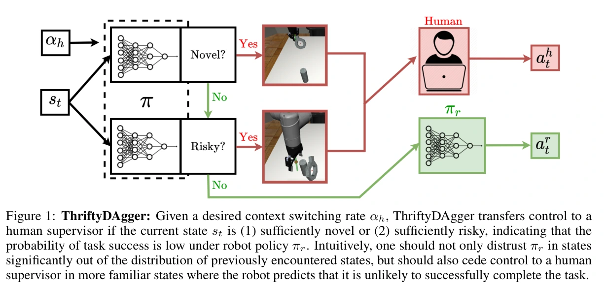

## 概览与版本

ThriftyDAgger 让机器人在“状态陌生”或“熟悉但当前策略很可能失败”时主动请求专家接管，恢复到可靠区域再交回自主控制；接管标签聚合用于模仿学习，自主与专家两类执行记录共同训练风险评估器。它解决的是接管的时机、持续时间和人工切换成本，提供了 [[hg-dagger-human-experts|HG-DAgger]] 之外的机器人主动门控方案。（§1、§4）

本次完整阅读 [PMLR 正式版](https://proceedings.mlr.press/v164/hoque22a.html) 11 页及其官方补充材料 8 页（§7.1–7.4，印刷页 12–19）。会议是 CoRL 2021，正式论文集出版年份为 **2022**，具体出版日期 2022-01-11 来自 [PMLR 第 164 卷官方元数据](https://proceedings.mlr.press/v164/) 的卷说明（“Published as Volume 164 … on 11 January 2022”），本文元数据随实际阅读正式版；2021 年预印本是同一工作而非另一项实验。原始补充 ZIP 已归档为 `raw/thriftydagger-budget-aware-interventions-supplement-2026-10-18-1752bbf450b5.zip`，其中 `thriftydagger_supplement/CoRL 2021 ThriftyDAgger appendix.pdf` 原字节另存为 `raw/thriftydagger-budget-aware-interventions-appendix-2026-10-18-dae80e2c1717.pdf`，阅读缓存为 `graph/extracts/thriftydagger-budget-aware-interventions-appendix-2026-10-18-dae80e2c1717.md`。正文与补充附录的标准提取产生了 NUL 字符，缓存已用 PyMuPDF 逐页排序文本重建；公式仍以回看的原 PDF 为准。未运行算法或审计官方代码。

## 为什么“少接管”需要同时看新颖性和风险

陌生状态缺少示范覆盖，策略集成容易分歧；但一个已反复出现的精细插入位置也可能危险，单靠不确定性会漏掉。反过来，在宽敞自由空间中与专家动作有差异不一定影响任务完成。作者因此用新颖性判断“训练覆盖是否足以信任模型”，用风险判断“当前策略从这里还能否完成任务”，避免把动作差异一概当失败风险。（§2、§4.1–4.3）

人工负担也不只是动作标签数。设 $C(\pi)$ 为每回合进入人工控制的期望次数，$I(\pi)$ 为一次接管内的期望专家动作数，$L$ 为切换到人再切回的延迟，以动作步计，原文式 2 定义：

$$
B(\pi)=C(\pi)\bigl(L+I(\pi)\bigr).
$$

较长但较少的接管可能减少切换开销，也可能增加人工动作数；因此必须分别报告切换、人工动作与自主成功率。论文将优化目标写作在人工负担预算下最小化策略与专家的监督损失，实际算法采用分位数阈值近似控制请求频率，并没有直接求解该约束最优策略。（§3）

## 模型、监督与控制接口

设机器人策略为 $\pi_r$，专家为 $\pi_h$，两者使用相同动作空间。初始专家数据 $D_h$ 用行为克隆训练策略；策略自主执行数据记为 $D_r$。**动作模仿只使用 $D_h$；$D_r$ 不自动变成正确动作监督，而是与 $D_h$ 一起训练成功风险评估器。** 每回合后更新策略与风险网络，使风险对应新策略，而非永远估计初始策略。（§4.5、补充算法 1）

新颖性 $\operatorname{Novelty}(s)$ 来自用专家数据自举训练的策略集成：对各动作维度计算网络间输出方差，再对维度平均。风险网络 $\hat Q_{\phi,G}^{\pi_r}(s,a)$ 则以目标指示器 $\mathbf1_G$ 和执行转移监督，近似当前策略到达成功集合 $G$ 的折扣概率。输入状态与候选动作，监督目标为

$$
y_t=\mathbf1_G(s_t)+(1-\mathbf1_G(s_t))\gamma\hat Q_{\phi,G}^{\pi_r}(s_{t+1},\pi_r(s_{t+1})),\qquad \mathcal L_Q=\tfrac12(\hat Q_{\phi,G}^{\pi_r}(s_t,a_t)-y_t)^2.
$$

由此定义 $\operatorname{Risk}^{\pi_r}(s,a)=1-\hat Q_{\phi,G}^{\pi_r}(s,a)$。策略仍以专家监督学习；Q 网络用于判断何时求助，不能据此把整套方法称为策略强化学习。它需要可判断成功的 $\mathbf1_G$，并非完全不需要环境反馈。（§3、§4.2，式 5–6）

**原文数学口径需保留：** 式 4 写为未来所有时刻目标指示器的折扣和，式 6 却使用到目标即截断后续累计的边界。如果目标之后持续给指示 1，前者会超过 1，而后者更接近首次命中成功的折扣概率。这里按作者实际训练损失解释风险，不把两个式子假装严格等价。另有 §4.5 指“优化式 5”、补充算法初始化指“式 4”的编号不准确，实际平方训练损失见式 6。

## 非对称门控与预算阈值

自主模式下，只要新颖性超过 $\delta_h$ **或** 风险超过 $\beta_h$，就进入专家模式。专家模式下，要同时满足真实专家／策略动作平方差小于 $\delta_r$、风险小于更严格的 $\beta_r<\beta_h$ 才交还控制。后者要求回到更稳定区域，形成滞回，减少短时间反复请求；当专家已经接管，可直接比较其动作与策略动作，不必再用集成方差代替。（§4.3）

用户指定目标请求频率 $\alpha_h$。在历史自主访问状态上，新颖性和风险的进入阈值分别取其 $1-\alpha_h$ 分位数；退出动作差阈值取专家状态上的训练后平均动作差，退出风险阈值取历史风险中位数。阈值在回合间重新计算。（§4.4）

这不是整个系统接管次数的严格预算保证：两个事件取并集、历史与未来分布也会变化。论文 $\alpha_h=0.01$ 的插入实验实测新颖性触发率 1.15%、风险触发率 0.79%，作者分别认为接近目标。不能将参数解释为“总共至多 1% 的执行步请求人类”。（§5.3）

原文图 1；完整图注译文：给定期望上下文切换率 $\alpha_h$，若当前状态 $s_t$ 足够新颖，或足够危险、即机器人策略 $\pi_r$ 的任务成功概率低，ThriftyDAgger 将控制权交给人类监督者。直观上，不仅应在显著偏离过去状态分布的位置不信任 $\pi_r$，也应在较熟悉但机器人预测无法成功完成任务的位置交还给人。来源：正式版 PDF 第 2 页；图内所有分支、动作标识与完整原注均保留。

## 仿真如何实现接管：与执行系统设计的直接关联

插入实验采用 Robosuite 的单螺母单目标 Nut Assembly：UR5e 抓取随机位姿的环并套上固定圆柱。状态 51 维，动作 5 维，为三维平移、绕竖直轴转动及夹爪开闭，底层是固定阻抗操作空间控制。**一个环境动作对应 10 个仿真步，人工模式暂停仿真等待键盘输入**，既避免无意记录无动作标签，也让末端运动稳定后再形成下一条状态。每回合成功或达到 175 动作结束。（补充 §7.3.1）

三机器人用户实验中，求助进入 FIFO 队列，人逐个服务；自主机器人在其他机器人接管期间仍可前进。人只在收到请求提示音后转去遥操作，队列清空后界面变黑提示无需求，再继续独立记忆任务。这是接管服务与排队的具体设计，但不是具备回滚、恢复分支、自动故障归因的完整自进化系统。（补充 §7.4）

## 实验协议、效果与容易混淆的指标

| 实验 | 预算与协议 | 结果 |
| --- | --- | --- |
| 仿真插入 | 30 条初始示范，2,687 动作；交互训练 10,000 环境步，$\alpha_h=0.01$；BC 额外给到 45 条／4,004 点 | 自主成功：Thrifty 73/100，HG 57/100，Lazy 48/100，BC 24/100；去掉新颖性或风险均 49/100。有接管评测 Thrifty 为 20/20（正文表 1） |
| 仿真堆块 | 30 条初始示范，1,677 点；BC 给 60 条／3,532 点；其他训练配置同插入 | 自主成功：Thrifty 52/100、HG 56/100、Lazy 40/100、BC 5/100；不支持所有仿真任务均优于 HG（补充表 5） |
| 三机器人用户实验 | 10 人，四条件随机顺序，各运行 350 步；机器人主动求助时人暂停 Concentration 配对记忆任务，HG 条件只监控机器人 | Thrifty 完成 9.2±2.0 个任务，配对 33.0±8.5 对，接管 7.9±2.1 次；Lazy 对应 5.1±1.7、20.9±7.9、10.0±2.1；摘要 80%／58% 为相对此基线的任务数／配对数增幅（正文表 2、补充 §7.4） |
| 实体线缆布置 | da Vinci 机器人；25 条初始示范／1,381 点；交互 1,500 步；输入 64×64 RGB，输出平面位移，每维不超过 1 cm | 自主成功 Thrifty 12/15、HG 10/15、BC 0/15；有接管 Thrifty 与 HG 均 15/15（正文表 3、补充 §7.3.3） |

主文表 1 中，成功训练回合的 Thrifty 每回合接管次数 0.88±1.01，低于 HG 的 1.49±0.88，但人工动作 **43.6±24.5 高于 20.3±15.6**。主表的动作／接管统计只在成功回合上计算，补充表 4 另外给全部回合累计数：Thrifty 人工动作总计 6,840（含离线），HG 为 4,392。因此“减少接管次数”不等于“减少人工标签量”，也不能拿不同成功比例下的条件均值直接估算总预算。

实体实验有额外安全过滤：障碍中心 1 cm 半径的逻辑圆禁入，侵入动作投影到边界；线缆初始形态近似固定。100% 成功是 15 个含接管回合的有限样本，不是纯自主泛化保证。仿真用户实验也将动作放大并加噪，不与单机器人原始协议完全相同。（补充 §7.3.3、§7.4.1）

## 对仿真自改进与 Harness 的含义

**来源支持：** 风险评估器与策略可以一同迭代，接管退出规则和请求队列会改变数据质量及人工成本；仅报告含人成功率会混淆策略学会的部分。[[InteractiveImitationLearning|交互式模仿学习]] 应把动作监督、风险转移数据、人工成本统计和自主评测分开记录。

**我们的解释：** 它是 [[topics/interactive-policy-improvement|仿真策略改进专题]] 中“什么时候接管、何时恢复自主”的可落地模块。若接到自进化编排，还应固定策略与风险网络版本、保存控制权切换前后的观测及真实执行动作，分别验收自主成功和人机联合表现。该论文没有让专家自动生成、没有改写工具代码，也没有提供任意失败状态分支恢复能力；这些能力要由外层系统另行验证。
