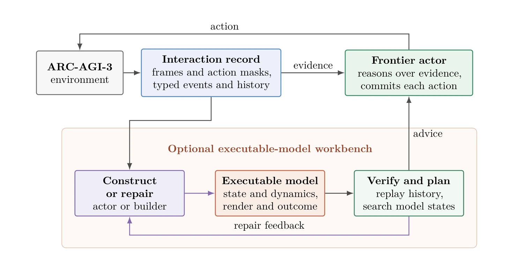

# Tycho：把“什么时候该建世界模型”当成核心问题

## 一屏概览

**研究问题。** ARC-AGI-3 要求智能体在规则未知的游戏里一边探索一边保持动作效率。Tycho 不问“能不能从交互里学出一个世界模型”——这已经有人做——而问：**什么时候值得构建、修复、使用或绕过一个模型？** 作者把这组决策称为 *active abstraction*。

**形式化贡献。** 把每个关卡抽象成**带转移发射的渲染确定性 Moore 机** $M^\ell_\theta=(S,A,s^\ell_0,\delta_\theta,q_\theta,\varepsilon_\theta)$：动作更新隐藏状态 $s$，输出映射 $q_\theta(s)=(\rho_\theta(s),\alpha_\theta(s),\omega_\theta(s))$ 给出渲染网格、可用动作与结局，$\varepsilon_\theta$ 保留动作之间的动画帧。这个形式化把隐藏状态、非单射观测、关卡边界与“任务等价模型”都摆到台面上。

**系统。** 一个 actor 只负责推理与提交动作；一个**可选**的可执行模型工作台负责构建/修复、验证与规划。同一个证据接口与动作协议下比较四种策略：无模型、actor 自建、actor 请求 builder 代建、验证失败后自动触发修复。

**结果。** 在 25 个公开游戏、183 关、Opus 4.8 的匹配比较中，四种策略分别为 79.07 / 85.36 / **88.49** / 83.07 RHAE；选定 orchestrator 后，GPT-5.6 Sol 与 Opus 5 都达到 **100.00**，分别用 7,766 与 6,641 个计分动作，human-replay midrank 为 98.5 与 100.0。最反直觉的一点是：**自动修复让模型更准，却让分数更低**。

**版本。** NIMI Research Group；Jens Lehmann（TU Dresden）、Andrei Aioanei（TIB）、Sahar Vahdati（Leibniz Hannover / TIB）；arXiv `2607.28287v1`，2026-07-30，52 页；代码以 Apache-2.0 开源，见 [[nimi-research-tycho-repository|Tycho 代码核查]]。

## 为什么要“渲染确定性 Moore 机”

ARC-AGI-3 的一帧 64×64 网格并不等于环境状态。Tycho 在论文里给了一个最小的反例：滚动视口下，屏幕相同的两个时刻（世界偏移 $x=0$ 与 $x=1$），同一个 RIGHT 动作会到达不同后继。也就是说，**观测不是马尔可夫的**，只根据当前帧推理会丢掉隐藏变量。Moore 机的拆分恰好对应智能体需要的能力：维护隐藏状态、预测动作对状态的改变、把状态渲染回观测、判断关卡完成或失败。

形式定义里几个符号值得记住：$S$ 是包含所有可见与隐藏变量的状态空间；$\rho_\theta$ 是渲染；$\alpha_\theta$ 是当前可用动作；$\omega_\theta\in\{\text{ongoing},\text{level\_complete},\text{game\_over}\}$ 是结局；$\varepsilon_\theta(s,a,s')$ 是两次结算帧之间的瞬态帧序列——它提供证据，但不能从它行动。论文另外定义了一个**外层计分协议**，把 RESET、重试、关卡推进与动作计数组合到单个关卡机之上。

原文图 1：Tycho 的任务时架构。actor 在交互记录上推理，并且是唯一提交环境动作的角色；左侧可选的可执行模型工作台负责构建或修复模型、验证并返回计划。注意“证据 → actor”与“模型 → advice”是两条独立通路：模型只是建议，actor 可以选择绕过。来源：论文 PDF，第 3 页。[查看原始来源](https://arxiv.org/pdf/2607.28287v1#page=3)

## 方法：证据契约与可选工作台

### 证据不是一锅粥

Tycho 把环境返回的东西分成几类，分别保存：可行动的结算帧（带可用动作掩码）、动作之间的动画帧、关卡完成事件、游戏结束事件，以及历史。这个区分不是整洁癖：动画帧能证明“中间发生了什么”，但不能作为决策点；关卡完成与游戏结束是**结局证据**，不是普通观测。把它们混在一起，模型会学到“看到某帧就可以行动”的错误前提。

### 四种模型维护策略

| 策略 | 谁建模型 | 何时建 | 直觉 |
| --- | --- | --- | --- |
| `no_world_model` | 不建 | — | 直接推理的强基线 |
| `single` | actor 自己 | 想建就建 | 推理与建模在同一上下文里 |
| `orchestrator` | 独立的 builder 子代理 | actor 请求时 | 把建模外包，actor 保持决策上下文干净 |
| `trigger` | builder | 验证失败或生命周期事件后 | 自动修复，追求模型精确 |

表 1：四种任务时模型维护策略。它们共享同一份交互记录与“只有 actor 能提交动作”的协议；变化的只是模型所有权、专家访问与推理分配。来源：论文第 15 页。

可执行模型的接口是自由形式的 `world_model.py`：定义 `State`、`init_state`、`transition`、`render`、`outcome`，可选 `actions`、`subgoals`、`heuristic`。`render` 允许用 `-1` 表示“真的不知道”的格子；验证器报告精确预测、已知格准确率与预测覆盖率，规划器只在当前模型表达的目标空间里搜索。模型是**建议性的**：actor 可以继续探索或直接推理。

### 为什么“更准”反而更差

匹配实验的结果值得逐行看：

| 策略 | RHAE | 完成游戏 | 完成关卡 | 计分动作 |
| --- | ---: | ---: | ---: | ---: |
| 无世界模型 | 79.07 | 19/25 | 157 | 12,997 |
| actor 自建 | 85.36 | 19/25 | 162 | 11,576 |
| orchestrator | **88.49** | 21/25 | 166 | 10,354 |
| 自动触发修复 | 83.07 | 18/25 | 162 | 9,442 |

正文 §5.1：Opus 4.8、xhigh、3,500 次模型调用、$750 推理预算的匹配比较。orchestrator 在两者都完成的 157 关上用 7,187 个动作，比直接推理少 18.9%。来源：论文第 16–17 页。

配对比较还提醒一件事：在 25 局样本里，只有 orchestrator 相对无世界模型的 +9.42 RHAE 其游戏重采样区间排除 0（[3.97, 15.76]）；orchestrator 对 single（+3.14）、对 trigger（+5.43）的区间都跨 0。稳健结论是“建模 + 委派相对不建模有分布式优势”，而不是“orchestrator 一定优于另外两种建模方式”。

`trigger` 的 accepted transition match 明显更高，但 builder 调用更多、推理花费更大、完成的关卡更少，最终 RHAE 反而低于 `single` 与 `orchestrator`。它的动作数看起来最少（9,442），但未完成尾部被预算截断（1,361，而直接推理是 4,140），所以不能把“少动作”读成效率优势。作者的解释是：**transition match 衡量的是“模拟器能否复现已观测的动力学”，不衡量“是否识别了目标”或“下一步动作是否更好”**。这解释了一个常见误判——把世界模型的预测精度当成 agent 的能力指标。

选定 orchestrator 之后，换模型得到两个满分跑：GPT-5.6 Sol（max）100.00、7,766 动作；Opus 5（xhigh）100.00、6,641 动作。API 等价成本约 $4.47k 与 $2.99k。Opus 5 只用了聚合人类基线 38.8% 的动作（少 61%），human-replay midrank 为 100.00；GPT-5.6 Sol 为 98.47。

## 工程实现

actor 的工具面很窄，只有八个：`ls`、`read_file`、`write_file`、`edit_file`、`run_python`、`set_verbosity`、`invoke_builder` 与 `take_action`（附录表 9，第 41 页）。前七个都不消耗环境动作，只有 `take_action` 结束回合并计一次分；builder 的工具面更窄，没有 `take_action`，也不能递归委派，因此“每一次计分干预都由 actor 提交”是协议保证而不是提示词约定。

官方仓库的架构与论文图一致：`tycho/agent` 管 actor、builder 与编排；`tycho/workspace` 管证据、工具、世界模型接口、验证器、规划器与文件版本；`tycho/harness` 管环境交互、重放与计分；`tycho/serving` 是 provider 无关的工具协议与三种传输；`tycho/viewer` 只做回放，不影响动作。细节见 [[nimi-research-tycho-repository|代码核查]]。

值得注意的工程约束：agent 写的 Python 与模型重放都在无网络、只读根文件系统的容器里运行；发布清单 `PUBLIC_RELEASE_MANIFEST.json` 为每个跟踪文件记录 SHA-256；论文还把一次 ls20 运行的产物逐项审计，列出“这些证据支持什么、不支持什么”。

## 局限与我们的判断

- **一个策略一次运行。** 25 局各跑一次，没有 run-to-run 方差；策略间差距（如 85.36 vs 88.49）没有置信区间，只有按游戏重采样的配对区间。
- **分数饱和。** 单关效率上限 115%，总分又被完成度封顶：183 关里有 167 关（GPT-5.6）与 171 关（Opus 5）已经达到上限。所以 88.49 与 100.00 之间的真实动作效率差异被压缩；作者用“完成关卡动作数”“未完成尾部”和“达到上限的关卡数”补充。
- **“等预算”是每局上限，不是等实际成本。** 四个匹配策略的 list-price 估算在 $5.66k–$8.03k 之间；差异主要来自 builder 调用与缓存行为，不能把“相同预算”读成“相同花费”。
- **5 个开发游戏仍在 25 局里。** `tr87`、`vc33`、`r11l`、`bp35`、`ft09` 参与过 harness 开发；完整报告保持了 scorecard 可比性，但这不是 held-out 泛化测试。
- **成本与复杂度。** 两阶段实验、四种策略、每关 3,500 次模型调用，复现成本高；$2.99k 是 Opus 5 单次跑，不是完整研究成本。
- **“active abstraction”仍是提示词层面的元推理。** 什么时候建模型由 actor 判断，没有被学习；论文的贡献是把这件事变成可测量的策略变量，而不是给出最优调度器。
- **与 VISTA 的关系。** 两者都拒绝把“当前观测”当全部状态，但路线相反：VISTA 把状态留在像素记忆里、用自然语言推理；Tycho 把状态外化成可执行程序、用验证与规划推理。完整对照见 [[topics/arc-agi-3-harness-design|ARC-AGI-3 Harness 设计]]。
