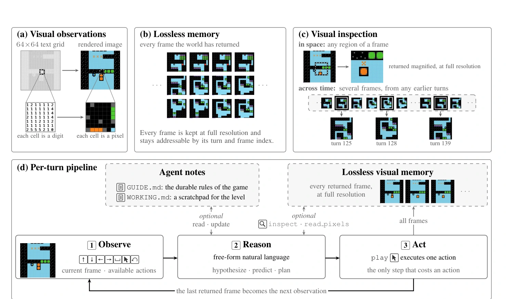
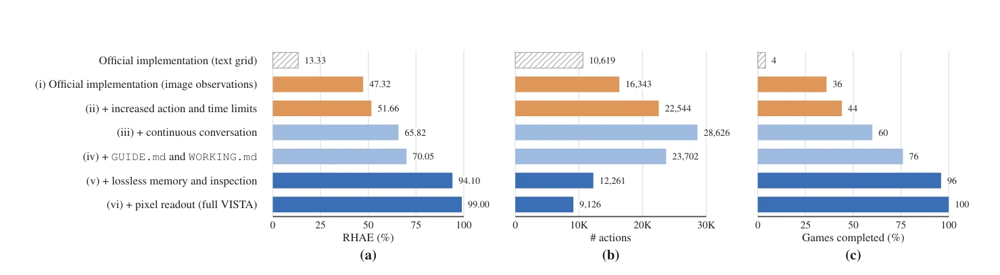
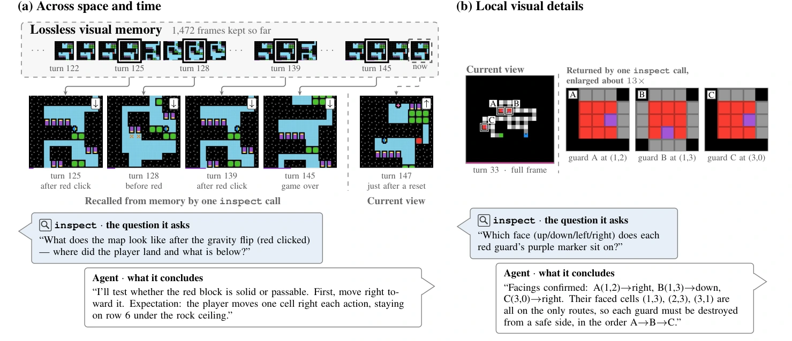

# VISTA：用可回看的像素替代被压缩的上下文

## 一屏概览

**研究问题。** 一个通用多模态模型，能否只靠看屏幕、点鼠标，在规则未知的交互式视觉游戏里自己摸索出目标与机制？VISTA 的回答是：模型已有的推理能力足够，缺的是让它在长时程里持续取回视觉证据的接口。

**核心主张。** 现有视觉 agent 把每张观测编码一次就丢弃原图；长程交互中早期观测又被上下文限制挤掉，或替换成文本摘要。问题在于模型在编码那一刻并不知道之后会需要哪个细节。VISTA 因此把“历史”移出上下文：环境返回的每一帧（包括一次动作产生的动画中间帧）都以原始分辨率存盘，模型可随时按 turn/frame 取回、按矩形裁剪放大、或读取精确像素值。论文把这种检索称为对交互历史的**显式注意力（explicit attention）**。

**主要结果。** 在 ARC-AGI-3 的 25 个公开游戏上，Claude Opus 5.0（xhigh effort）达到 RHAE 100.00，完成全部 25 局，总动作 7,302，比首次游玩的人类基线 17,135 少 57.4%；GPT-5.6 Sol（max effort）达到 99.00。作者称这是首个不依赖程序合成而达到满分或接近满分的视觉系统；同一模型在官方 minimal harness 下分别只有 40.68 与 13.33。

**范围。** 同一套 harness 迁到 GameWorld（34 个浏览器游戏、170 个任务）、AI GameStore（10 个浏览器游戏）与 BabyVision（39 道静态视觉追踪题），均大幅超过同模型的官方实现。BabyVision 没有交互历史，因此它单独检验了视觉检查工具本身的价值：准确率从 41.0% 提到 63.2%。

**机构与版本。** MIT（Qiushi Han、Keya Hu、Linlu Qiu、Cathy Wu、Kaiming He，前三位共同一作）；arXiv `2610.02200v1`，2026-10-01 提交，技术报告；更早版本是 2026-08-05 的[项目博客](https://vista-research.github.io/)。代码以 MIT 许可开源，工程细节见 [[joshhhhhan-vista-repository|VISTA 代码核查]]。

## 问题：卡住的是证据的可及性

ARC-AGI-3 把抽象推理变成交互问题：智能体面对 64×64 的彩色网格，只被告知当前可用动作（`ACTION1`–`ACTION7`，其中 `ACTION6` 是坐标点击），规则、目标、隐藏状态都要靠试。每个游戏有多个关卡，关卡共享底层机制但引入新对象或新约束，所以智能体既要跨关卡复用已推断的规律，又要持续修正理解。（[论文 §4.1，第 5 页](https://arxiv.org/abs/2610.02200)）

此前的强系统几乎都走“文本网格 + 程序合成”：把每帧编码成数字矩阵，让模型把环境抽象成可执行、可验证、可搜索的程序（Schema、Retrodict、Tycho 等）。这个方法在 ARC-AGI-3 上有效，但环境越视觉化，用显式程序表示状态、转移与目标就越困难。VISTA 换了一条路：直接看渲染图，用自然语言推理，不写程序。

作者指出的两条结构性缺陷，比“模型不够强”更具体：（[论文 §1、§3](https://arxiv.org/abs/2610.02200)）

1. **编码一次就定型。** VLM 把每张图压成一份视觉表示，后续推理只能用这份表示；而编码时并不知道后面需要哪些细节。一个在某一步“够用”的表示，可能在十步之后缺了关键信息。
2. **上下文会挤掉历史。** 长程交互中早期观测被删除或被文本摘要替代，保留什么由 harness 决定，而不是由当前推理需要决定。

因此论文的目标不是更强的模型，而是让模型在任意时刻都能重新取回原始视觉证据的接口。

## 方法：观测、记忆、检查

### 三个组件

| 组件 | 做什么 | 设计要点 |
| --- | --- | --- |
| 视觉观测 | 模型直接接收渲染图 | 保留物体外观与空间关系，让模型用已学的视觉先验去解释环境 |
| 无损视觉记忆 | 每个返回帧原样落盘，按 turn 与 frame 编号 | 与上下文解耦；存的是原始渲染，不是压缩表示或文字摘要 |
| 视觉检查 | `inspect` 取任意历史帧、裁任意矩形并放大；`read_pixels` 读取指定区域的精确颜色 | 模型自己决定看不看、看哪一帧、看多大范围 |

围绕这三件，还有两个辅助结构：`GUIDE.md` 存跨关卡、跨上下文可复用的游戏理解，`WORKING.md` 存当前关卡的草稿与计划；`history` 提供动作与结果的客观记录。`play` 是唯一改变环境的工具，其余工具只读或只改笔记。（[论文附录 A.4，第 17 页](https://arxiv.org/abs/2610.02200)）

原文图 3：VISTA 的关键设计与逐轮流水线，以 ARC-AGI-3 为例。（a）视觉观测：模型接收渲染后的视觉状态，每个格子是像素而不是数字；（b）无损视觉记忆：环境返回的每一帧都按原始形式保存，始终可按 turn 与 frame 索引寻址；（c）模型主导的视觉检查：模型在推理中自行选择要看的帧与区域，既可在空间上放大任意矩形，也可在时间上取回任意早先回合的多帧；（d）逐轮流水线：观察、推理、行动，每个返回帧都进入视觉记忆；回看历史与更新笔记是模型可选的步骤。来源：论文 PDF，第 4 页。[查看原始来源](https://arxiv.org/pdf/2610.02200v1#page=4)

### 一次 turn 的流程

每一轮，模型收到当前视觉状态与可用动作，可以查阅两份笔记；它用自由语言推理，预测动作后果，可选地调用 `inspect`/`read_pixels` 收集证据，然后调用 `play` 执行**一个**动作。一个 turn 内可以有多次工具往返，但只有一次动作真正推进环境。环境返回的全部帧进入视觉记忆，模型只看到最后一帧；动作后的 `metadata` 给出 turn、状态、进度、可用动作与本次归档的帧数，模型据此知道下一步能寻址到哪里。（[论文 §3.2](https://arxiv.org/abs/2610.02200)）

当上下文接近上限，模型先写一份简短的交接摘要，然后在全新上下文中从当前状态继续；笔记、视觉记忆与动作历史都保留。这里的关键是“换上下文”不影响“换记忆”：记忆在模型之外。

### 为什么这样有效（我们的解释，非论文原话）

视觉编码器对一张图分配的 token 数是固定的：论文测得 512×512 的观测约占 308 个图像 token。整块 64×64 棋盘铺到 512×512 时，平均每个格子分不到 0.1 个 token，颜色边界与细小标记很容易糊掉；而把 40×40 像素的区域裁出来再放大到 512×512，同样的 308 个 token 就集中到约 5×5 个格子上。**`inspect` 的本质不是“放大图片”，而是把固定的图像 token 预算重新分配到当前问题所在的区域。** 这也解释了论文的两个反直觉结果：输入放大到 4×（256×256，约 77 token）与 8× 效果相当，因为编码器本来就会下采样；放大到 16× 反而无收益，因为多出来的 token 没有带来新的有效信息。参见本文“表示与预算”一节。

`read_pixels` 补的是另一类缺口：颜色身份。ARC 的调色板只有 16 色，其中若干颜色在压缩或缩放后肉眼接近；当判断依赖“这一格到底是哪种颜色”时，与其让模型反复端详，不如直接采样 RGB 并映射成符号。它把感知题变成测量题，但不做解释——解释仍发生在语言推理里。

## 实验

### RHAE 怎么算

对游戏 $g$ 中已完成的关卡 $\ell$，设智能体动作数为 $a_{\ell,g}$、首次游玩人类完成该关的动作数上中位数为 $h_{\ell,g}$，则

$$S_{\ell,g}=\min\left(1.15,\left(\frac{h_{\ell,g}}{a_{\ell,g}}\right)^2\right)$$

未完成的关卡记 0 分。关卡权重 $w_\ell=\ell$，越靠后越重；若完成了前 $k$ 关，游戏得分为

$$S_g=\min\left(\frac{\sum_{\ell=1}^{k} w_\ell}{\sum_{\ell=1}^{n} w_\ell},\ \frac{\sum_{\ell=1}^{n} w_\ell S_{\ell,g}}{\sum_{\ell=1}^{n} w_\ell}\right)$$

第一项按完成进度封顶，第二项是加权平均。最终报告 25 个游戏 $S_g$ 的均值乘 100。因此 100 分意味着“在完成全部关卡的前提下，动作效率整体追平人类上中位数”；单关最多记 115%，用更少动作不能无限放大分数。（[论文附录 A.3，第 16 页](https://arxiv.org/abs/2610.02200)）

### 主结果

| 系统 | 程序合成 | 模型 | effort | RHAE |
| --- | --- | --- | --- | ---: |
| 官方实现 | 否 | GPT-5.6 Sol | max | 13.33 |
| 官方实现 | 否 | Claude Opus 5.0 | high | 40.68 |
| Schema | 是 | GPT-5.6 Sol | xhigh → max | 95.35 |
| Tycho | 是 | GPT-5.6 Sol | max | 100.00 |
| Tycho | 是 | Claude Opus 5.0 | xhigh | 100.00 |
| **VISTA** | **否** | GPT-5.6 Sol | max | **99.00** |
| **VISTA** | **否** | Claude Opus 5.0 | xhigh | **100.00** |

表 1（节选）：ARC-AGI-3 25 个公开游戏的系统级比较。VISTA 与程序合成路线打平，但推理完全在自然语言与像素证据上完成。来源：论文第 5 页。

这里最值得注意的不是分数，而是**两条路线的收敛**：程序合成把环境压成可执行的世界模型，VISTA 则把“世界模型”留在模型的自然语言推理里，只在需要时调取像素证据。前者可验证、可搜索；后者依赖模型的归纳能力，但在视觉复杂的环境里不需要先把状态和转移写成程序。

### 逐层消融：收益来自哪里

原文图 5：ARC-AGI-3 上逐步增强的 harness 配置（GPT-5.6 Sol，max effort，200K 上下文），分别报告（a）RHAE、（b）25 局总动作数、（c）完成的游戏比例。斜线柱是官方文本网格实现的参考成绩 13.33；配置（i）–（iv）按官方协议每次动作最多自动接收 7 帧，配置（v）–（vi）只自动接收最后一帧，改为由模型主动检查视觉记忆。来源：论文 PDF，第 6 页。[查看原始来源](https://arxiv.org/pdf/2610.02200v1#page=6)

| 配置 | RHAE | 总动作 | 完成游戏 |
| --- | ---: | ---: | ---: |
| 官方实现（文本网格） | 13.33 | 10,619 | 4/25 |
| (i) 图像观测替换文本网格 | 47.32 | 16,343 | 9/25 |
| (ii) 放宽动作与时间上限 | 51.66 | 22,544 | 11/25 |
| (iii) 连续对话 + 原生压缩 | 65.82 | 28,626 | 15/25 |
| (iv) 加 `GUIDE.md` / `WORKING.md` | 70.05 | 23,702 | 19/25 |
| (v) 加无损记忆与 `inspect` | **94.10** | 12,261 | 24/25 |
| (vi) 加 `read_pixels` | **99.00** | 9,126 | 25/25 |

这张表比总分更有信息，因为它同时暴露了“能不能玩完”和“玩得多省”：

- **动作数先升后降。** (i)–(iii) 的动作数一路涨到 28,626，并不是变笨，而是之前很多局在动作或时间上限处被迫终止；能继续玩之后，动作自然变多。(v) 引入记忆与检查后骤降到 12,261，说明模型不再靠反复试错来补偿看不清的历史。
- **最大跃迁在 (v)，而且此时每步拿到的帧更少。** (iv) 每步自动收最多 7 帧，(v) 只收最后一帧，分数却从 70.05 跳到 94.10。收益来自“可检索”，不是“喂得多”。
- **`read_pixels` 只值 5 分，却补上了最后一局。** 精确颜色不是主发动机，却是收尾条件：剩下的失败集中在需要区分相近颜色或精确坐标的局面。

### 表示与预算

把图像换回文本网格，RHAE 仍有 96.75，只比图像低 2.25，但每局 token 从 30.7M 涨到 71.9M。所以图像观测的主要收益是**成本**而非准确率：64×64 网格约 4,000 token，512×512 图像约 308 token，一次动作 7 帧就是 28K 对 2.2K。（[论文 §4.3，第 6 页](https://arxiv.org/abs/2610.02200)）

上下文与分辨率的取舍同样平坦：默认 200K 上下文得 99.00；降到 100K 只掉 0.4 分而 token 减半；升到 780K 则每局 105.7M token。输入缩放 2×/4×/8×/16× 分别约 20/77/308/1,229 个图像 token，4× 与 8× 效果相当而图像 token 少 75%，2× 明显变差，16× 没有额外收益。这三组结果指向同一结论：**瓶颈既不是分辨率也不是上下文长度，而是能不能在需要时重新取回证据。**

### 稳健性

- **3D 渲染。** 同一批游戏改成立体渲染后仍有 RHAE 84.12，但动作涨到 20,640；视觉越复杂，交互成本越高，但 84.12 仍远高于文本基线。
- **开源权重。** GLM-5.3 Flash 320B 配 VISTA 得 66.93，明显高于同模型的官方实现，说明 harness 不是某个闭源模型的专属技巧。
- **重复性。** GPT-5.6 Sol 三次运行 RHAE 为 99.00 / 98.90 / 99.23，均值 99.04 ± 0.17。

### 跨环境泛化

| 基准 | 人类参考 | 官方 minimal harness | VISTA |
| --- | ---: | ---: | ---: |
| GameWorld 成功率 | 55.3 | 40.0 | **63.3** |
| GameWorld 进度 | 64.1 | 62.9 | **79.3** |
| AI GameStore（人类中位数 = 100） | 100 | 47.3 | **140.3** |
| BabyVision 准确率 | 92.3 | 41.0 | **63.2** |

迁移只换动作适配层：GameWorld/AI GameStore 把 `play` 换成 `act`（按键、点击、输入、等待），观测换成浏览器截图；BabyVision 是单张静态图加一个问题，因此去掉笔记与历史，只保留 `inspect` 与 `read_pixels`。论文的“minimal adaptation”在工程上是成立的，但每个环境仍要写观测、动作空间与评分三件事。（[论文 §5、附录 A.1](https://arxiv.org/abs/2610.02200)）

BabyVision 这一行提供了一个干净的控制变量：没有交互历史，记忆组件无事可做，提升只能来自“对单张图做区域检查与像素测量”。41.0 → 63.2 说明视觉检查本身就有独立价值；但它离人类 92.3 仍远，说明这类细粒度空间追踪仍是模型短板。

### 定性证据

原文图 10：模型主导使用视觉记忆的两种方式。（a）跨空间与时间：棋盘被重置后，模型在一次 `inspect` 调用中取回前 22 个回合里的四帧，重建地图，并据此判断“红块是否可穿过、玩家会落在哪”。（b）局部细节：模型把三个小块放大到约 13 倍，看清每个块的紫色标记在哪一面，从而确定朝向；全幅 512×512 图中这些标记难以辨认。来源：论文 PDF，第 8 页。[查看原始来源](https://arxiv.org/pdf/2610.02200v1#page=8)

图 10 的两个例子对应两种互补的再注意：**跨时间整合证据**（把不同回合的局部观测拼成完整地图）与**按需放大局部**（把 token 预算集中到一个格子）。注意 (a) 里棋盘已经重置——如果只依赖当前帧，这段信息永久丢失；而在 VISTA 里它只是暂时不在上下文里。

## 局限与我们的判断

论文自己列了两条：模型能力仍是主因，VISTA 只是把能力“引出来”；模型发布时间晚于基准，无法排除训练数据污染，需要用 ARC-AGI-3 的私有集或全新游戏做更强检验。（[论文 §6，第 10 页](https://arxiv.org/abs/2610.02200)）

我们的补充判断：

- **“无损”是相对于渲染结果而言。** 记忆保存的是 64×64 调色板网格放大后的 PNG，对游戏状态是忠实的；但如果换成一个本身有损的观测通道（压缩视频、有噪声的相机），这套论证要重新做。
- **成本不低。** 30.7M token/局、最多 2,000 个动作、48 小时上限，且依赖订阅制 CLI 的特定版本（Claude Code 2.1.220、Codex 0.145.0）。这不是一个便宜或易复现的配置。
- **人类基线是动作数的上中位数**，本身有噪声；RHAE 100 的含义是“动作效率追平人类”，不是“能力超过人类”。
- **检索策略没有被学习。** 什么时候看、看哪一块完全由模型即兴决定，没有训练过的检索器；这也意味着换一个不擅长主动调用工具的模型，收益可能大幅缩水——GLM-5.3 Flash 的 66.93 就是一个提示。
- **一个可检验的预测。** 如果作者关于“瓶颈在证据可及性”的判断成立，那么在全新游戏（未进入训练数据）上，harness 带来的相对增益应当仍然显著；如果增益消失而绝对分仍高，更可能是污染；如果绝对分大幅下降但相对增益仍在，说明机制成立、能力不足。

## 与相邻工作的位置

- **对程序合成路线**：Schema、Retrodict、Tycho 把环境抽象成可执行程序，可验证、可搜索，但需要把状态与转移写成符号；VISTA 不建显式世界模型，把归纳留在语言推理里，用像素证据随时校正。
- **对 computer-use agent**：文本派读 DOM/可访问性树，视觉派读截图；VISTA 属于后者，但增加了一条“历史可按坐标回看”的通道，而不是只保留最近几帧。
- **对游戏 agent**：SIMA、Cradle、JARVIS-1 等同样从画面行动，但通常只维护有界视觉上下文或压缩过的经验；VISTA 的差别是把完整历史留在外部并按需检索。
- **对通用上下文管理**：[[AgentHarness|Agent Harness]] 讨论的压缩、检查点与交接在这里被具体化为“笔记 + 视觉记忆 + 换上下文”；区别是记忆单位从文本变成了可按区域寻址的像素。共享机制见 [[AddressableVisualMemory|可寻址视觉记忆]]。
