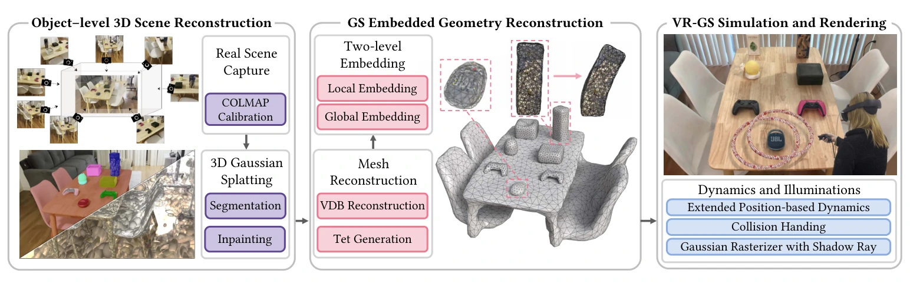
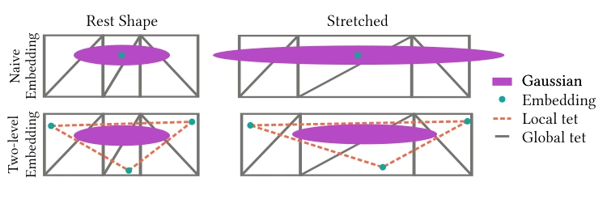

# VR-GS：面向虚拟现实实时物理交互的双层嵌入 3D 高斯系统

## 一屏概览

**研究问题。** [[physgaussian-physics-integrated-3d-gaussians-for-generative-dynamics|PhysGaussian]] 证明了可以直接在数十万个 3D 高斯核上运行显式 MPM 合成逼真形变，但逐高斯核的稠密 MPM 计算在百万核级完整室内场景中单帧耗时高达 $112\text{--}390\text{ ms}$，远无法满足虚拟现实（VR）双目立体渲染与手柄实时交互对低延迟（$>30\text{--}70\text{ FPS}$）的严苛要求；同时，当用户把桌面物体抓起移走时，原本被遮挡的支撑面会出现“黑洞”空缺，且静态烘焙的球谐光照无法提供随物体移动的动态阴影。由 PhysGaussian 同一核心团队（UCLA Chenfanfu Jiang 与犹他大学 Yin Yang 课题组）提出的 **VR-GS**，通过**“中等分辨率四面体笼网格 XPBD 仿真 + 双层四面体高斯嵌入（Two-Level Embedding）+ 3DGS 物体分割/LaMa 修补/实时阴影贴图”**，首次在单张 RTX 4090 上实现了百万高斯级真实重建场景的实时物理交互。[论文 §1–4](https://arxiv.org/abs/2401.16663)

原文图 2：VR-GS 系统流水线。从多视角实景拍摄出发，第一阶段（左）通过扩展可学习分割属性与 LaMa 2D 修复引导完成物体级 3DGS 分割与被遮挡背景修补；第二阶段（中）经内部填充、稀疏体素 VDB 重建、Marching Cubes 与 TetGen 生成包裹物体的中等分辨率四面体笼网格，并构建局部—全局双层四面体嵌入；第三阶段（右）在运行时由扩展位置动力学（XPBD）实时求解网格形变与碰撞，驱动 3D 高斯核与阴影贴图（Shadow Map）进行 VR 交互渲染。来源：论文 PDF，第 4 页。[查看原始来源](https://arxiv.org/pdf/2401.16663v2#page=4)

**机构与版本。** UCLA、香港大学、犹他大学、浙江大学、Style3D Research、CMU 与 Amazon 联合发布；共同一作为 Ying Jiang、Chang Yu、Tianyi Xie、Xuan Li，通讯/资深作者包括 Yin Yang 与 Chenfanfu Jiang；录用于 ACM SIGGRAPH 2024（`arXiv:2401.16663v2`，2024-05-04）。

## 核心机制：从逐核 MPM 到双层嵌入 XPBD

### 1. 为什么直接把高斯核嵌入四面体笼会产生“尖刺伪影”？（§3、§4.3.2）

为了把百万级 3D 高斯核的动力学降维到 $1\text{万}\sim 3\text{万}$ 顶点的四面体网格上由扩展位置动力学（XPBD，采用应变能约束与速度阻尼）实时求解，最直观的做法是**朴素单层嵌入（Naive Embedding）**：根据每个高斯核的初始中心 $\mu^0$ 找到包含它的四面体单元 $\{x_0^0, x_1^0, x_2^0, x_3^0\}$，计算重心坐标 $w_i$，并在网格变形到 $\{x_0, x_1, x_2, x_3\}$ 时用该四面体内的分段常数变形梯度

$$F = \begin{bmatrix} x_1 - x_0 & x_2 - x_0 & x_3 - x_0 \end{bmatrix} \begin{bmatrix} x_1^0 - x_0^0 & x_2^0 - x_0^0 & x_3^0 - x_0^0 \end{bmatrix}^{-1}$$

按 PhysGaussian 运动学公式更新高斯核均值与协方差：

$$\mu = \sum_{i=0}^3 w_i x_i, \qquad \Sigma = F \Sigma^0 F^T.$$

然而作者指出（§4.3.2，图 3）：**高斯核中心落在某个四面体内部，并不意味着整个各向异性高斯椭球都包含在该四面体内！** 许多扁平或细长的高斯椭球会跨越多个相邻四面体的边界。由于单个四面体内的变形梯度 $F$ 是分段常数，跨界高斯核在剧烈拉伸或扭转时只会僵硬地跟随中心所在单个四面体的局部畸变，从而刺穿网格表面形成严重的尖刺伪影（spiky artifacts）。

原文图 3：双层嵌入（Two-level Embedding）消除尖刺伪影的原理。上排（朴素嵌入）：高斯椭球跨越多个全局四面体，仅按中心点嵌入单个四面体会导致拉伸后椭圆刺出边界。下排（双层嵌入）：先用独立的局部紧致四面体（橙色虚线，Local tet）完整包裹每个高斯椭球，再将局部四面体的四个顶点分别独立嵌入全局仿真网格（灰色实线，Global tet），从而获得跨邻域平滑的平均变形梯度。来源：论文 PDF，第 5 页。[查看原始来源](https://arxiv.org/pdf/2401.16663v2#page=5)

**双层变形嵌入（Two-Level Deformation Embedding，§4.3.2）：**

1. **第一层（局部嵌入，Local Embedding）：** 为每个 3D 高斯核独立构造一个尽可能紧致的局部包围四面体（local tetrahedron），确保该高斯椭球完全位于其局部四面体内部（因此无论局部四面体如何仿射变形，椭球永远不会刺出该局部四面体）。各个高斯核的局部四面体之间互不连通。
2. **第二层（全局嵌入，Global Embedding）：** 将每个局部四面体的 4 个顶点分别通过重心坐标独立嵌入到由 TetGen 生成的全局四面体笼网格（global simulation mesh）中。当 XPBD 驱动全局网格变形时，先插值更新每个局部四面体 4 个顶点的位置，再由局部四面体的 4 个顶点算出平滑后的局部变形梯度 $F_{\text{local}}$ 来更新高斯核的 $\mu$ 与 $\Sigma$。这等价于对高斯核跨越的所有周围全局四面体做了一次空间加权滤波，彻底消除了分段常数梯度跳变引起的毛刺。

### 2. 面向可交互场景的 3DGS 资产准备与实时阴影（§4.2、§4.3.3）

要把静态多视角照片变成物体可单独抓起、移动和碰撞的交互场景，VR-GS 在离线准备阶段（总耗时约 2.5 小时，§6.3）串联了四项关键技术：

1. **内生 3DGS 物体分割（§4.2.1，式 2–3）：** 先用视频分割模型（DEVA）生成跨视角一致的伪彩色 2D 掩码 $M_{2d}$；为每个 3D 高斯核额外附加 3 个可学习的 RGB 分割属性，通过总损失 $\mathcal{L}_{\text{total}} = (1-\lambda)\mathcal{L}_1 + \lambda\mathcal{L}_{\text{SSIM}} + \lambda_{\text{seg}}\mathcal{L}_1(M_{2d}, I_{\text{seg}})$（$\lambda=0.2, \lambda_{\text{seg}}=0.1$）联合训练，使每个高斯核自动归属到具体可交互物体。
2. **被遮挡接触面的 LaMa 引导 3D 修补（§4.2.2）：** 将前景物体分割移除后，桌面原接触区会留下未重建的空洞。VR-GS 冻结空洞外的所有高斯核，利用 2D 图像修复模型 LaMa 生成多视角修复图 $I_{\text{inpainted}}$，通过 $\mathcal{L}_{\text{inpaint}} = \mathcal{L}_1(I_{\text{inpainted}}, I)$ 优化空洞处的局部高斯补丁。
3. **VDB + TetGen 仿真网格构建（§4.2.3）：** 对分割出的单个物体，先执行 [[physgaussian-physics-integrated-3d-gaussians-for-generative-dynamics|PhysGaussian]] 的内部粒子填充，再将高斯核中心点云转为稀疏体素数据结构 VDB，经 Marching Cubes 提取水密表面网格后由 TetGen 生成四面体有限元网格。
4. **高斯光栅化阴影贴图（Shadow Map，§4.3.3）：** 由于 3DGS 球谐系数将阴影死死烘焙在地面纹理上，物体被抓起后阴影不会跟随移动，严重影响 VR 用户判断物体离桌高度。VR-GS 从光源视角按式 1 的 $\alpha$-blending 渲染一张光源深度图（depth map），在主视角渲染时对每个高斯核做光源深度可见性测试，实时投射动态阴影。

## 实验性能与网格分辨率折中分析

### 1. 与 PAC-NeRF 及 PhysGaussian 的单帧耗时对比（§6.1）

在相同帧间隔 $\Delta t_{\text{frame}} = 1/25\text{ s}$ 与子步长 $\Delta t_{\text{step}} = 10^{-4}\text{ s}$（每帧 400 子步，VR-GS 每子步 1 次 XPBD 迭代）下，单张 RTX 4090 上的每帧仿真耗时（秒/帧）对比如下（§6.1 内嵌表）：

| 测试场景 | [[pac-nerf-physics-augmented-continuum-neural-radiance-fields|PAC-NeRF]]（s/帧） | [[physgaussian-physics-integrated-3d-gaussians-for-generative-dynamics|PhysGaussian]]（s/帧） | **VR-GS（本文，s/帧）** | VR-GS 相对 PhysGaussian 加速比 |
| --- | --- | --- | --- | --- |
| **Stool（凳子）** | 0.750 | 0.112 | **0.017** | **$6.6\times$** |
| **Chair（椅子）** | 0.813 | 0.219 | **0.022** | **$10.0\times$** |
| **Materials（多球体）** | 0.625 | 0.390 | **0.021** | **$18.6\times$** |

### 2. 完整 VR 交互场景性能与四面体网格分辨率折中分析（§6.1–6.2，表 1）

在 Quest Pro 头显（双目立体渲染 + 阴影贴图 + 碰撞检测 + XPBD）实测中（论文表 1）：

- 30.5 万高斯核、2.82 万网格顶点的 `Fox` 达到 **161.2 FPS**；
- 252.6 万高斯核、1.95 万网格顶点的 `Bear` 达到 **76.9 FPS**；
- 包含多物体抓取、碰撞检测（每步 5–20 次）的 `Ring Toss`（145.6 万高斯）、`Table Brick Game`（186.7 万高斯）、`Animal Crossing`（131.3 万高斯）与 `Toy Collection`（166.5 万高斯）分别维持在 **37.7 FPS**、**41.4 FPS**、**34.7 FPS** 与 **24.3 FPS**。

**关于笼网格分辨率与 XPBD 收敛性的关键工程洞察（§6.1）：** 论文通过消融网格规模（从 2K 顶点/7K 四面体的 135 FPS，到 55K 顶点/242K 四面体的 23 FPS）揭示了一个经典的[[ContactSolvers|位置动力学求解器]]现象：**并不是四面体网格越细，物理效果就越真实**——当网格加密到 55K 顶点（24.2 万四面体）时，由于实时帧预算限制了每步 XPBD 的约束投影迭代次数，细网格上的应变能约束无法充分收敛，反而导致仿真出的物体呈现出**反常的过度松软伪影（overly soft artifacts）**！因此实践中将单物体笼网格顶点控制在 $1\text{万}\sim 3\text{万}$ 之间，是兼顾高频帧率与准确刚度传递的最佳甜点。
