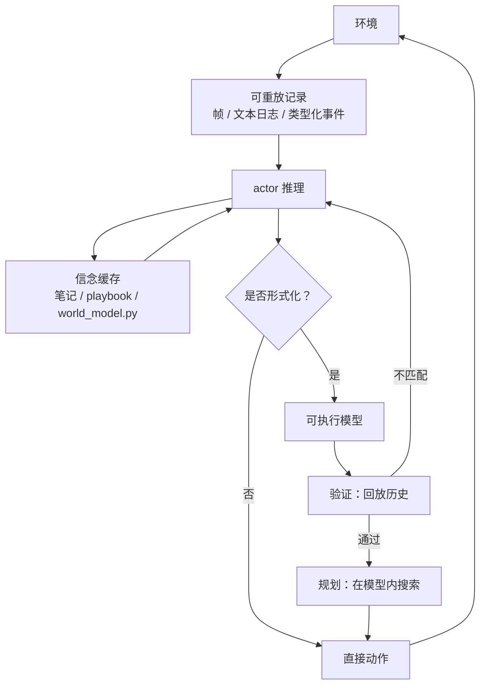

# ARC-AGI-3 Harness 设计：记录、程序与视觉证据

**当前判断：ARC-AGI-3 上接近满分的系统，差异已经不在“能否推理”，而在三件事——把什么当可重放的记录、把什么当可错的信念、以及什么时候把信念形式化成可执行模型。** 这四条路线（[[vista-a-visual-harness-for-reasoning-in-an-interactive-world|VISTA]]、[[ryanbbrown-retrodict-repository|Retrodict]]、[[tycho-active-abstraction-with-programmatic-world-models|Tycho]]、[[schema-discovering-unknown-environments-via-agentic-program-induction|Schema]]）在这个结构上收敛，但在表示与调度上分岔。

## 为什么要把它们放在一起读

单看一篇会得出错误的因果。Tycho 的 100.00 与 VISTA 的 100.00 不是同一种东西：前者用可执行 Moore 机加规划，动作 6,641；后者只存像素、用自然语言推理，动作 7,302；Retrodict 用文本日志加计划队列，99.86、动作 7,703、成本 $654；Schema 用程序归纳，用 Fable 5 达到 99.2，成本至少 $6,447。**RHAE 被单关 115% 与完成度双重封顶，分数越接近 100，动作与成本的差异越被掩盖。**

更麻烦的是协议：Tycho 的论文明确指出，Schema 的 98.98 是“先跑 Opus 4.8，低于 80 分的游戏用 Fable 5 重跑并保留更好轨迹”的条件选择；PRO-LONG 的 97.4 是 best@2；Prime Agent 的 95.5 是三次运行的较优者。**头部分数混合了架构、模型、重跑与推理预算，必须连同协议一起读。** 这也是 Retrodict 维护的 [公开 harness 对比](https://github.com/ryanbbrown/Retrodict/blob/71672e8e5adb008360f52a61ef9e2adf91a62d89/docs/arc-agi-3-harness-comparison.md)最有价值的部分：它把成本口径与跑法逐条写出来，而不是只排名次。

## 四条路线的一张表

| 系统 | 记录（真值） | 信念（可错） | 模型角色 | 结果 | 成本 | 可核查证据 |
| --- | --- | --- | --- | --- | --- | --- |
| [[vista-a-visual-harness-for-reasoning-in-an-interactive-world|VISTA]] | 全部渲染帧，按 turn/frame 存盘 | `GUIDE.md` + `WORKING.md` | 不需要；自然语言推理 + 按需 `inspect` | 100.00（Opus 5），7,302 动作 | 30.7M token/局（GPT-5.6） | 公开逐局轨迹；无官方卡 |
| [[ryanbbrown-retrodict-repository|Retrodict]] | 追加式 `log.txt`（帧、动作、差分） | `playbook.md` | 默认不建；卡关时强制升级出模拟器 | 99.86，7,703 动作 | $654，0.66B token | 远程官方卡；提交的是 84.52 旧卡 |
| [[nimi-research-tycho-repository|Tycho]] | 类型化事件 + 每回合网格/差分/死亡证据 | `world_model.py` + 笔记 | 可选工作台；四种调度策略 | 100.00（GPT-5.6 / Opus 5），7,766 / 6,641 动作 | ≈$4.47k / $2.99k | 6 张官方卡 + 完整性清单 |
| [[schema-discovering-unknown-environments-via-agentic-program-induction|Schema]] | 追加式交互历史 | 持久程序 $P$ | 中心；认证—规划—验证执行 | 99.2（Fable 5），86.1（Opus 4.8） | ≥$6,447（条件重跑） | 无代码；项目页轨迹 |

表里的成本不可直接横比：VISTA 报的是 token，Retrodict 是 API 标价，Tycho 是 API 等价估算，Schema 是保留胜出运行的成本。

## 收敛：记录高于信念

四支团队独立走到同一个结构：**一份不可篡改、可重放的记录，加一份模型自己写、允许出错的信念缓存。**

- VISTA：帧存储“什么都不丢”，笔记“只丢没写下来的”；
- Retrodict：prompt 明确“the log stays ground truth”，`playbook.md` 里每条规则要标“已对日志核对 / 仍是假设”；
- Tycho：模型只是 advice，actor 可以绕过；失败尝试的观测根不可变；
- Schema：每次修改程序都要对**全部**历史重新认证，旧发现不能在修改中悄悄消失。

[agent-memory-atlas 的对比笔记](https://github.com/neoneye/agent-memory-atlas/blob/main/notes/2026-08-06-four-arc-agi-3-harnesses-converge-on-the-same-memory.md)把这个结构称为“模型自己的总结从属于记录”，并指出它反转了多数记忆系统的默认做法（先抽取事实、再丢弃原文）。原因不神秘：在 ARC-AGI-3 里环境便宜可录、确定性可重放、且是唯一真值，而信念是可能出错的模型编的。**当纠错的对象是可重放的记录时，纠错语义几乎免费**：证伪一条规则只需删掉它，下一次从日志重新推导即可。

## 分岔：三条真正的设计选择

### 1. 记录用什么形态

- **像素**（VISTA）：保留外观与空间关系，模型用视觉先验直接看；代价是图像 token，且模型要自己决定看哪块（[[AddressableVisualMemory|可寻址视觉记忆]]）。
- **文本网格**（Tycho、Retrodict）：可 grep、可写程序、可做精确差分；代价是失去“看起来像什么”，空间关系要靠计算重建。
- **类型化事件**（Tycho 的动画/终局/死亡证据）：把“能行动的帧”与“只能当证据的帧”分开，避免从动画帧推出错误前提。

这个选择不是风格问题：它决定了模型能不能用同一套工具做“感知”和“测量”。VISTA 需要额外的 `read_pixels` 补精确颜色；Retrodict 需要 `[DIFF]` 与 `arclog` 补结构。

### 2. 模型什么时候被建立

- **Schema：中心化。** 程序是唯一知识载体，认证不过就不行动。
- **Tycho：可选工作台。** 四种策略的匹配实验说明：actor 请求 builder 代建最好（88.49）；验证失败后自动修复反而更差（83.07），因为“模拟器更准”不等于“更会玩”。
- **Retrodict：按需升级。** 默认不建模型，卡关 300 动作后由 runner 强制要求建模拟器并搜索。它把“何时形式化”从提示词建议变成流程约束。
- **VISTA：不形式化。** 把世界模型留在语言推理里，用可回看的像素随时校正。

四种做法对应四种成本结构：中心的模型最贵但最可验证；按需升级最便宜但依赖升级规则；不形式化最灵活但难以证明“它真的理解了规则”。

### 3. 验证由谁来做

- **第三方卡**（Tycho、Retrodict）：ARC Prize 服务器发卡，作者改不了；Tycho 还提交了完整性清单与六张卡。
- **自述 + 轨迹**（VISTA、Schema）：VISTA 公开逐局运行轨迹供复算；Schema 只有项目页轨迹，没有代码。
- **本地约定**（Retrodict 的 containment）：每次运行生成 `containment.json`，证明 agent 无法 import 游戏引擎——把“没作弊”变成产物。

这决定了读者能核查到什么程度：有第三方卡的系统，分数几分钟就能验；只有自述的系统，只能验“数字是否自洽”，不能验“跑法是否如描述”。

## 分数之外：动作效率与成本

| 运行 | RHAE | 动作 | 成本 |
| --- | ---: | ---: | ---: |
| Tycho（Opus 5，orchestrator） | 100.00 | 6,641 | ≈$2.99k |
| VISTA（Opus 5） | 100.00 | 7,302 | 30.7M token/局 |
| Retrodict（GPT-5.6 Sol max） | 99.86 | 7,703 | $654 |
| baseline1（GPT-5.6 Sol xhigh） | 98.97 | 8,347 | $2,722 |
| PRO-LONG（Fable 5，best@2） | 97.4 | — | $1,750 |
| Prime Agent（Opus 5，三次较优） | 95.5 | 11,245（中位跑） | ≈$944 |

这张表最值得注意的不是名次，而是**成本差近十倍而分数只差几个点**。Retrodict 的 $654 与 Schema 的 $6,447 都能“接近满分”，说明当前阶段 harness 的边际收益极不均匀；再往上，分数已经不能区分“更会玩”和“更会重跑”。

## 迁到机器人系统时，什么仍然成立

- **记录/信念分离仍然成立**：机器人日志、视频、力/触觉记录都可以作为不可变证据，策略摘要与技能库作为可错信念。
- **回放验证仍然成立**：给定确定性仿真器，可以在离线重放里证伪技能或世界模型，不消耗真机时间。
- **成本记账仍然成立**：真机试错比 token 贵得多，动作效率与人工干预应一起计。
- **不成立的是“纠错免费”**：物理状态不可回滚，一次失败可能损坏物体或环境。记录能解释失败，不能撤销失败。这是 [[RobotHarness|机器人 Harness]] 与 [[topics/robot-harness-and-physical-rsi|Physical RSI]] 必须另外处理的部分。

## 待答问题

1. 记录形态有没有任务依赖？视觉丰富、规则离散的任务是否更适合文本；空间关系复杂、颜色细微的任务是否更适合像素？
2. “何时建模型”能否被学习，而不是靠手写阈值（Tycho 的 actor 判断、Retrodict 的 300 动作）？
3. 第三方验证能否扩展到没有官方 scorecard 的领域？
4. 单局记忆（本页）与跨会话记忆（[agent-memory-atlas](https://neoneye.github.io/agent-memory-atlas/overview/) 的主题）如何衔接？目前四条路线都只在单局内工作。

## 建议阅读顺序

先读 VISTA 建立“记录与信念分离”的直觉，再读 Tycho 看形式化与调度，然后读 Retrodict 看极简日志路线的成本优势，最后读 Schema 看程序中心化的代价与收益。横向数字以 Retrodict 的对比文档为索引，但每个数字回到原论文核对——那份文档是作者自述，不是中立评测。
