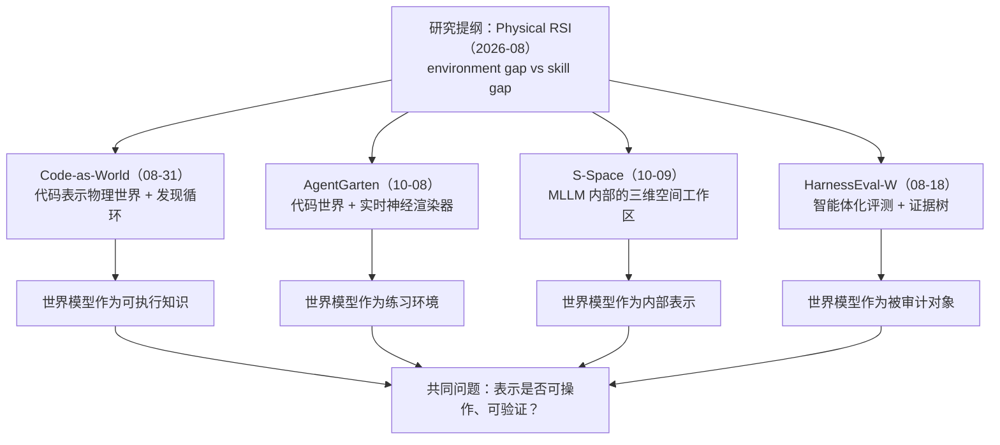

# 可执行世界表示与智能体化评测

**研究问题：如果世界模型的价值不在“生成得像”，而在“能被查询、干预、验证并用于行动”，那么表示、环境、内部机制与评测应该怎样配套？** 这个专题以 MirroS（北京无限镜元）2026 年 8–10 月的四项技术报告与一篇研究提纲为线索，但它们不是四个孤立 demo：它们分别占据“表示—环境—机制—评测”四个位置，合起来才是一条完整的主张。需要按论文原章节逐节读、逐条核对公式时，配合 [[syntheses/mirros-guided-reading|四篇论文逐节带读]]。

## 一张图看懂四条线

图为阅读后的综合示意，不是 MirroS 官方架构图；四项工作的发布时间也不是提纲设定的顺序。

| 工作 | 一句话 | 主要证据 | 最该记住的边界 |
| --- | --- | --- | --- |
| [[mirros-physical-rsi-thesis|Physical RSI 提纲]] | 物理世界的自我改进要同时改 Actor 与世界模型；OOD 是路由信号 | 立场文，无实验 | environment/skill gap 是分析框架，不是已测量的分类器 |
| [[code-as-world-executable-world-representations|Code-as-World]] | 把世界写成 $p=(C,E,A)$，从文本/视频发现可执行表示，再用轨迹生成物理监督 | QuantiPhy 159 题：9B 55.4、27B 58.6；数据 73,335 + 1,585 + 988 | 无成分/验证器消融；验证只看关键帧；刚体假设 |
| [[agentgarten-code-worlds-evolving-agents|AgentGarten]] | 代码世界管状态与规则，神经渲染器管外观；智能体跨轮写 playbook | 单 H100 36.5 FPS；掩体第 4 轮、斜坡第 10 轮；四个世界四轮曲线 | 每轮 1 episode、单模型、无 playbook 消融；不是真机 |
| [[s-space-spatial-workspace-mllm|S-Space]] | 中间层存在三维线性空间子空间，可读可干预；失败多在“变换”而非“感知” | SpinBench 60.96→94.52；Qwen3.5-4B CV-Bench 73.60→89.36 | 强模型读出未必更好；图像平面坐标；层选择依模型 |
| [[harnesseval-w-agentifying-evaluation-of-visual-worlds|HarnessEval-W]] | 评测 = 路由 + 分解 + 子代理 + 证据树，而非固定量规 | 330 case/18 模型；人类 $\rho=0.93$；WBench Physical 31.9%→71.7% | 评委仍是 VLM；只两条轴有人类锚点；case 是生成的 |

## 为什么这四条线能拼起来

**1. 表示层：代码是“可证伪的世界假设”。** Code-as-World 的核心不是“用 Python 写物理”，而是把世界拆成构成 $C$、演化 $E$、外观 $A$，让 $C,E$ 能被模拟器执行、被观测检验，$A$ 可以后置。这样，一个世界假设要么跑出与证据一致的轨迹，要么被诊断出哪一部分错了。它把“理解”从一段描述变成**可执行、可局部修改、可反事实重放**的对象。

**2. 环境层：状态与外观分开，才能同时 faithful 与 realistic。** AgentGarten 把这个分工做成系统：$f_p$ 不接收渲染观测，渲染误差不会污染状态；共享渲染器让多个代码世界复用同一套视觉接口。代价是条件（深度/法线）不包含全部状态，且世界仍要手写。它回答的是“智能体在哪练习”，而不是“世界模型怎样训练”。

**3. 机制层：模型内部是否真的有一张地图。** S-Space 把“空间推理失败”拆成感知错误与计算错误：坐标可以从中间层读出，且干预能改变判断；但强模型的直接回答已经很好，读出不一定更好；真正的瓶颈常在视角变换与参考系解耦。它给“表示是否被使用”提供了一个可操作的实验范式，而不是又一个 benchmark 分数。

**4. 评测层：分数必须能回溯到证据。** HarnessEval-W 把评测拆成轴 → skill → 子问题 → 子代理 → 证据树，并用人类 A/B 与 WBench 对照证明“分解”能提高区分度与稳定性。它评的是 rollout，不是策略闭环；它依赖 VLM 评委，因此“可解释”不等于“无偏”。

**5. 提纲层：把四者放进同一个循环。** Physical RSI 提纲说：遇到意外，先判断是世界模型解释不了（environment gap），还是策略不会做（skill gap）；前者扩展表示/环境，后者改进 Actor；两者都要回到现实验证，再内化。四项工作分别提供了“怎样表示”“在哪练习”“内部是否有表示”“怎样验收”的组件，但**没有任何一项完成了真实机器人上的完整八步循环**。

## 三个关键张力

**代码表示 vs 神经生成。** 代码给出显式状态与可编辑性，但表达力受引擎与手写规则限制；视频生成给出丰富外观，但状态藏在历史里、难以查询。AgentGarten 的折中是“代码管状态、渲染管外观”；Code-as-World 的折中是“代码管物理、生成模型管 realism”。两者都还没有回答：当外观生成与物理状态冲突时，谁说了算？

**表示存在 vs 表示被使用。** S-Space 证明坐标在中间层可读、可干预，但也显示强模型的直接回答并不差，甚至更好；Code-as-World 则通过训练把“世界空间监督”写进模型，9B 在 QuantiPhy 上超过 Gemini-3.1 Flash。前者是“诊断已有表示”，后者是“用监督塑造表示”。两种路线的接口不同：一个在推理时读，一个在训练时写。

**可解释评测 vs 可扩展成本。** HarnessEval-W 的每个 case 要跑 planner、多个 skill、多个子代理与工具；它比 FVD 贵得多，却没有给出成本曲线。更麻烦的是，评委仍是被评模型家族的 VLM：分解降低了单次判断的难度，但不能保证没有系统偏差。于是“更可解释”可能只是“更细的偏见”。

## 建议的学习顺序

不是按发布时间，而是按“先建立接口，再看证据”的顺序：

1. **先读提纲**（[[mirros-physical-rsi-thesis|Physical RSI]]，约 2,000 词）：建立 environment gap / skill gap 与八步循环的框架。读的时候把“主张”和“证据”分开——这篇没有实验。
2. **再读 Code-as-World**（[[code-as-world-executable-world-representations|论文页]]）：抓住 $p=(C,E,A)$、发现循环、两阶段训练与 QuantiPhy 数字。重点问：验证器到底在验证什么？为什么 27B 平均最高但 2S 最低？
3. **接着读 AgentGarten**（[[agentgarten-code-worlds-evolving-agents|论文页]]）：抓住“状态不读渲染”“共享渲染器”“playbook 跨轮继承”。重点问：4 轮 vs 2,500 万回合为什么不能当样本效率？每轮 1 episode 能支持多强的结论？
4. **然后读 S-Space**（[[s-space-spatial-workspace-mllm|论文页]]）：抓住线性读出、因果干预、感知—计算分解。重点问：读出在哪些模型/任务上赢，哪些不赢？为什么？
5. **最后读 HarnessEval-W**（[[harnesseval-w-agentifying-evaluation-of-visual-worlds|论文页]]）：抓住三轴八指标、路由、证据树、人类对齐与 WBench 对照。重点问：这套评测能否用来评前四篇的世界？如果不能，缺什么？
6. **回到提纲**：用四篇的证据重新标注八步循环，哪些格子有实现、哪些只有主张。

## 读完应能回答的六个问题

1. Code-as-World 的 EWR 与 Schema 的“程序化世界模型”有什么相同与不同？为什么前者需要渲染—投影，后者不需要？
2. AgentGarten 为什么坚持“代码世界不接收渲染观测”？如果渲染器很准，这个限制还有必要吗？
3. S-Space 的读出在 Molmo2-ER 上不如直接回答，却在 SpinBench 上大幅领先；这两个结果矛盾吗？各自说明了什么？
4. HarnessEval-W 把 Physical 的 pairwise accuracy 从 31.9% 提到 71.7%，这个对照控制了哪些变量？还有什么没控制？
5. 如果一个世界模型在 HarnessEval-W 上得分高，但在 Code-as-World 的反事实干预下崩溃，应该信哪个？为什么？
6. Physical RSI 的 environment gap 与 skill gap，能否用现有四项工作的输出自动区分？需要什么额外测量？

## 可以动手的对照实验

这些是学习建议，不是论文已做的实验：

- **表示消融**：在同一批视频上，比较“只有 $C+E$”“只有 $A$”“$C+E+A$”三种 EWR 的验证误差与下游 VQA；Code-as-World 没有做这个消融，但它的接口允许。
- **验证器压力测试**：把关键帧验证换成“随机抽帧 + 反事实初速度”，看多少被接受的 EWR 仍然成立；这能暴露“局部可信、机制错误”。
- **评测器交叉**：用 HarnessEval-W 评 AgentGarten 的渲染 rollout，再用代码世界真值评同一批；两者不一致的 case 最有信息量。
- **读出 vs 训练**：把 S-Space 读出作为辅助监督训练一个小的空间头，再看它是否改善视角变换；S-Space 只做了推理时读出。

## 证据边界

- 四项工作都是 **2026 年 8–10 月的 arXiv 技术报告**，不是同行评审论文；作者高度重叠（MirroS + 清华/北大），不能当作独立复现。
- 本专题的数字都来自各论文的表格或正文，未在本地复现实验；Code-as-World 的 27B 与 AgentGarten 的 agent 结果依赖闭源模型/权重。
- Code-as-World 的 QuantiPhy 是外部基准（159 题验证集），不是本文构建；AgentGarten 没有 FVD/用户研究；HarnessEval-W 没有成本与逐 case 人类标签；S-Space 的线性假设与层选择仍是开放问题。
- “Physical RSI”目前是**研究纲领**，不是已被证明的系统能力。四项工作分别覆盖表示、环境、内部机制与评测，但没有一项完成“真实机器人上的 surprise → 诊断 → 扩展世界模型 → 验证 → 内化”的完整闭环。

## 相关入口

- 世界模型与表示：[[topics/world-models-and-representations|World Models]]
- 评测：[[topics/world-model-evaluation|World Model 评测]]
- Harness 与 Physical RSI：[[topics/robot-harness-and-physical-rsi|机器人 Harness 与 Physical RSI]]
- 可执行生成世界：[[topics/simulation-ready-worlds|Simulation-ready Worlds]]

共享机制：[[ExecutableWorldRepresentation|可执行世界表示]]、[[AgentifiedEvaluation|智能体化评测]]、[[SpatialWorkspaceInMLLMs|多模态模型的空间工作区]]。
