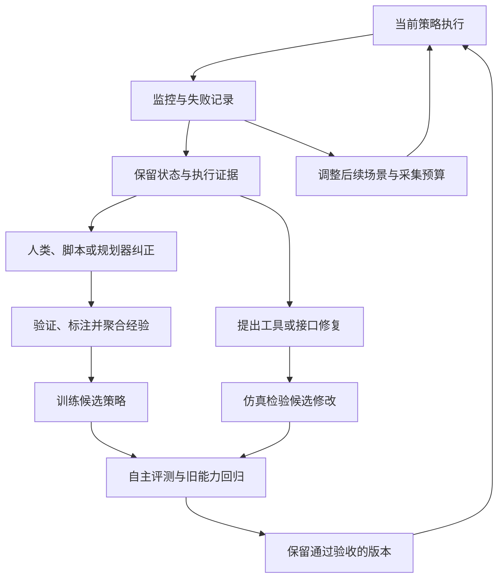

# 接管学习与仿真自改进

**研究问题：怎样把当前策略在仿真中暴露的失败变成下一版策略或系统的可靠改进？** [[InteractiveImitationLearning|交互式模仿学习]] 回答从哪些状态获得动作监督；[[RobotHarness|机器人 Harness]] 组织执行、干预、证据和验收；[[PhysicalRecursiveSelfImprovement|Physical RSI]] 追问改进程序本身是否也被改进。三者可以组合，不能仅凭“有循环”视作同一种机制。

## 从纠正内环到系统外环

这是综合设计图，不是已实现或统一验证的系统。纠正经验路径对应 DAgger、Sirius 和 FlowDAgger；采集分布路径对应 EmbodiRSI；代码候选路径对应 SimEX；诊断工具的继承见 PhysEvo。每条路径需要不同的验收，不能用仿真分数上升同时证明数据正确、代码正确和现实迁移有效。[[dagger-no-regret-imitation-learning]]、[[sirius-robot-learning-on-the-job]]、[[flowdagger-latent-space-corrections]]、[[embodirsi-data-efficient-robot-adaptation]]、[[simex-simulation-integrated-robotics-autoresearch]]、[[physevo-physical-recursive-self-improvement]]

## 沿机制选择来源

| 想解决的缺口 | 原文入口与核心差别 | 阅读时保留的条件 |
| --- | --- | --- |
| 成功示范覆盖不到学生走偏后的状态 | [[dagger-no-regret-imitation-learning|DAgger]] 聚合访问状态上的专家标签；[[hg-dagger-human-experts|HG-DAgger]] 让人决定接管 | 逐状态查询与只在干预段收集不等价，理论假设不能直接迁移到选择性接管 |
| 人不能一直纠正每个动作 | [[thriftydagger-budget-aware-interventions|ThriftyDAgger]] 用新颖性、风险和预算门控求助 | 接管次数、接管动作数、监看与切换成本不同；自主和有帮助的成功率分开 |
| 大量自主数据稀释了纠正 | [[sirius-robot-learning-on-the-job|Sirius]] 按近似人类信任给样本重权 | 接管前片段、专家片段和自主片段具有不同训练身份 |
| 多任务下何时请求帮助 | [[sirius-fleet-visual-world-models|Sirius-Fleet]] 在视觉世界模型表示上建立失败与分布外预测，并跨轮更新 | RoboCasa 中的人工交互、监控性能和自主策略性能各自评测；不等于完全无人采集 |
| 纠正一大模型的训练开销过高 | [[flowdagger-latent-space-corrections|FlowDAgger]] 把纠正反演为潜变量目标；[[rho-efficiently-adaptable-vla-models|Rho]] 将这类适配接入 VLA | 冻结生成器仍限制可表达动作；主模型冻结不等于行为或旧任务成绩不变 |
| 想反复利用同一个失败位置 | [[hi-wm-human-in-world-model|Hi-WM]] 在学习世界模型里回退并分支纠正 | 学习模型不是物理引擎；失真区域恰好可能是最需要纠正的区域 |
| 下一批数据该针对哪些失败 | [[embodirsi-data-efficient-robot-adaptation|EmbodiRSI]] 结合当前状态恢复与配置级定向采集 | 统计基于辅助采集回合，保留成功轨迹的预算不同于总尝试成本 |
| 错误根源在工具或接口 | [[simex-simulation-integrated-robotics-autoresearch|SimEX]] 用真实失败引导仿真诊断与工具修复 | 改进存于代码和技能说明，不是 VLA 权重；仿真对齐依赖智能体判断 |
| 诊断经验也需要积累 | [[physevo-physical-recursive-self-improvement|PhysEvo]] 保留任务工具与元层诊断工具 | 后续复用已有案例，改进器继承的净收益仍需独立对照 |

本表比较更新对象与证据，不组成成功率排行榜。论文特有推导、原图和数字留在来源页，跨机制的数据聚合、门控和监督身份集中在 [[InteractiveImitationLearning|概念页]]。

## 哪些工作最接近完整组合

**EmbodiRSI 是当前最直接的数据闭环桥梁。** 它从目标工作台建立仿真，监控当前策略，失败后从实际状态恢复，再用回合间归因改变后续采集。它的外层调度组织生成、训练和评测，最终自主测试关闭外部恢复。论文使用固定学习形式，尚不能仅凭两次更新把它当作改进算法本身演化的证据。[[embodirsi-data-efficient-robot-adaptation]]

**Hi-WM 与 Sirius-Fleet 分别改变纠正场所和触发机制。** 前者把人工纠正搬到可回退分支的学习环境；后者用世界模型辅助预测异常，并随策略更新监控。把这两种机制拼起来是一个可研究的设计，现有分别验证的结果不证明组合后的误报率、人工成本或现实收益。[[hi-wm-human-in-world-model]]、[[sirius-fleet-visual-world-models]]

**SimEX 与 PhysEvo 提供另一种失败吸收方式。** 它们允许持久改动进入工具和接口，PhysEvo 还允许诊断工具改变。因此不能把“智能体修好了一次任务”直接视为获得了学生可学习的动作标签；只有记录到对齐观测下实际执行的纠正、标明控制者和结果，才有机会进入动作监督训练。这是结合论文机制提出的系统设计解释。[[simex-simulation-integrated-robotics-autoresearch]]、[[physevo-physical-recursive-self-improvement]]

## Harness 设计要保护哪些接口

以下是本库的工程推演，尚未实现或验证；依据上述原文的执行与实验机制，不是它们共同采用的一套接口。

| 接口 | 至少需要的证据 | 原文提供的动机 |
| --- | --- | --- |
| 控制权交接 | 策略提出动作、实际执行动作、控制者、起止时刻及动作块剩余部分 | HG-DAgger、FlowDAgger 的接管改变执行与标签；[[PolicyDeploymentContract|动作块接口]] 需保持一致 |
| 状态恢复 | 场景／模型版本、物体与机器人状态、控制器和策略必要历史；学习世界模型还需生成状态 | Hi-WM 的回退分支与 EmbodiRSI 的当前状态恢复是不同功能 |
| 数据入库 | 专家／自主／接管前片段的身份、成功验收、筛选原因、采样单位 | Sirius 的权重、FlowDAgger 的双缓冲和 EmbodiRSI 的成功筛选各不相同 |
| 修复路由 | 可复查失败证据、修复对象、候选差异和比较条件 | SimEX 与 PhysEvo 允许修复工具，不能把接口错误全部交给更多训练数据 |
| 候选验收 | 无外部接管的留出测试、旧任务回归、真实试验和完整成本 | 人机协作完成不等于策略已学会；[[PhysicalRecursiveSelfImprovement|改进器评测]] 另需同预算对照 |

在论文中，监控器、人类／脚本专家和学生可读的信息也不同。特权状态可以用于训练时提供有效纠正，却不应悄悄进入宣称仅凭视觉执行的最终学生；这应同时体现在执行权限和实验报告中。具体设置见 [[rho-efficiently-adaptable-vla-models|Rho]] 与 [[embodirsi-data-efficient-robot-adaptation|EmbodiRSI]]。

## 如何验证一个组合设计

我们建议在同一个策略起点和任务划分上比较固定成功示范、接管聚合、自动监控加接管、失败驱动采集，以及加入代码修复后的方案。分别报告人工监看／纠正时间、专家查询、保留轨迹、总尝试、仿真步数、模型调用、训练算力和墙钟时间。只匹配“50条”或“400条”保留轨迹，不能证明采集成本相同。[[thriftydagger-budget-aware-interventions]]、[[embodirsi-data-efficient-robot-adaptation]]

采集过程的人机联合完成率、更新后自主成功率、未参与开发任务的回归表现和真机迁移应分开。若声称改进机制本身变强，还需从相同策略、数据和预算出发，比较新旧诊断／采集程序在留出问题上的修复效率，而不是只展示更晚一轮的策略更强。协议基础见 [[simulation-post-training-evaluation|冻结评测与适应评测]]、[[PhysicalRecursiveSelfImprovement|递归增益的验证]]。

## 未解问题与优先补证

- **何时纠正最划算？** 失败风险高不等于可恢复，也不等于能产生高学习收益；需要在相同总人时下比较风险门控与预期学习收益驱动采集。
- **如何判断应该改数据还是改接口？** 需要可复查的失败归因和配对候选，验证路由器是否比固定只微调或只改工具更有效。
- **失败附近的仿真有多可信？** Hi-WM 的动作响应和 SimEX 的相关行为复现能否支持未见纠正分支，需用独立真实尝试检验，不能只看画面合理或同模型打分。
- **分支数据是否提供独立信息？** 同一失败点生成许多延续会增加样本量，也可能缩窄状态覆盖；需要控制初态、分支相关性和训练曝光量。
- **改进机制的继承有没有净收益？** 冻结专家、验收规则和初始经验，比较保留诊断／采集规则前后，在新任务上的单位预算改进幅度。

以上是待验证研究问题，不是本轮实证结论；不因本次收录自动扩成新的搜集任务。更广系统演化比较沿 [[topics/robot-harness-and-physical-rsi|机器人 Harness 与 Physical RSI]]，基础与相关策略沿 [[topics/robot-policy-learning|机器人策略学习]]。
