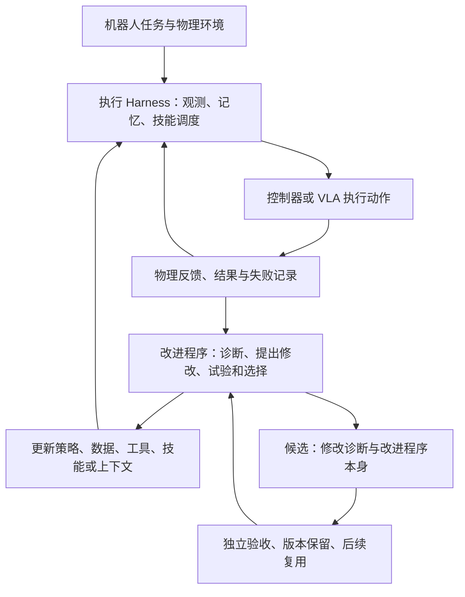

# 机器人 Harness 与 Physical RSI

**当前最清楚的趋势是：机器人能力的可改进对象，已经从模型权重扩展到技能接口、上下文、工具代码和实验组织；但任务表现提升，与改进程序本身越来越有效，仍需分别验证。** 这个判断来自下列已读原文的交叉分析，不是“所有系统都已实现 RSI”的结论。

本轮截至 **2026-10-15**，从 Graph as Policy 出发，选择完整阅读八篇原始论文，固定版本核查 GaP 公开代码的关键路径，完整阅读 Physical RSI 作者资料库的 README，并复用已有 [[simex-simulation-integrated-robotics-autoresearch|SimEX]] 精读。覆盖执行架构、系统／技能演化、真实实验自动化、数据适配与递归证据；未运行机器人系统。更广候选置于文末，不进入已证实结论。

## 先分清三个问题

上图是本库综合示意。执行反馈改变本次动作，是闭环控制；保留改动让下一次表现更好，是系统自改进；保留的改动进一步改善产生未来更新的方法，才触及严格口径的递归自改进。共享机制分别见 [[RobotHarness|机器人 Harness]] 与 [[PhysicalRecursiveSelfImprovement|Physical RSI]]，定义争议见 [[physical-rsi-research-map|作者研究框架]]。

## 已读工作：它们各自把什么变成可改进对象

日期为本次所读版本日期，不等于全部首次发表日期；均按预印本版本收录，不能把日期新或名称相似当成同一方法。

| 工作／版本日期 | 主要更新或组织对象 | 反馈与验证 | 最值得抓住的边界 |
| --- | --- | --- | --- |
| [[gap-graph-as-policy|GaP]]，07-06 | 类型化技能图的结构与参数 | 仿真排练、节点检查点；真实任务测试 | 已知工作站的 VA；购物任务没有启用自学习；[[gap-runtime-repository|真实检查点不能直接继承仿真真值]] |
| [[enpire-agentic-robot-policy-self-improvement|ENPIRE v2]]，09-20 | 策略、训练代码、实验安排 | 真实机器人收集结果，人在前期配置奖励／重置／约束 | 自主阶段依赖已建环境；接近 99% 指带反馈重试的协议 |
| [[regenharness-evidence-gated-self-improvement|RegenHarness]]，09-23 | 物理执行契约、可信状态提交和配置发布 | 证据身份／版本检查、有界恢复、回归发布协议 | 真实巡检案例已展示；RSI 定量对照主要仍是协议设计 |
| [[racap-evolvable-robot-learning|RACaP]]，09-24 | API、Harness 提示、长期经验 | 同任务／种子／预算候选比较，随后冻结评测 | 新本体需适配，不能据最终成绩声称完全零样本跨本体 |
| [[robofoundry-system-as-policy|RoboFoundry]]，09-26 | 上下文管理、技能及执行系统 | 任务修复执行检查、共享规则的记录重放与模型验收 | 从计分起点就在线演化；不与冻结策略直接排榜 |
| [[roboharness-visual-geometric-control|RoboHarness：视觉几何版]]，官方记录 09-29 | 将视觉推理变成几何约束与可执行运动 | 冻结模型、点跟踪、深度及运动学／路径检查 | 本文不是 RSI 实验；arXiv 编号 2610 与记录日期不一致，来源页保留 |
| [[simex-simulation-integrated-robotics-autoresearch|SimEX]]，09-30，复用 | 工具代码、使用说明与仿真假设 | 真实失败触发多次仿真修复试验 | 真实测试有人工重置；工具迁移不是模型权重学习 |
| [[embodirsi-data-efficient-robot-adaptation|EmbodiRSI v3]]，10-03 | 困难场景采样、恢复轨迹和策略权重 | Real-to-Sim-to-Real；仿真纠错仅用于训练 | 固定学习形式下的经验改进，不是实证算法自我重写 |
| [[physevo-physical-recursive-self-improvement|PhysEvo]]，10-06 | 任务接口／技能与元层诊断工具 | 执行反馈、候选验收、诊断工具继承 | 有元层资源复用案例，缺少分离继承净收益的完整受控实验 |
| [[robosimstudio-interactive-toolkit-rapid-real2sim|RoboSimStudio]]，10-13 | 多物理场仿真配置、物理约束与 [[gap-graph-as-policy|GaP]] 技能图 | 视频对齐 IoU／无照片六项物理门控／仿真时空反馈与真机失败回流 | 端到端 Real2Sim2Real 仅单任务先导验证；[[robosimstudio-repository|代码核查]]显示多冲程擦杆依赖接触门控插销 |

同名消歧：此处 RoboHarness 是视觉—几何接口论文 `2610.14018`；另有 *RoboHarness: Memory-driven Orchestration of Heterogeneous Robot Policies for Long-Horizon Planning*（`2607.18060`），以及同名软件包，不能混用作者、代码或实验。编码机器人 RHO（`2606.16458`）也不同于库内 [[rho-efficiently-adaptable-vla-models|Rho VLA]]。

## 从 GaP 出发，三个最有解释力的对照

**GaP → RACaP／RoboFoundry：从执行产物到系统更新面。** GaP 将机器人程序限制成可检查技能图；RACaP 进一步改变技能 API、提示和经验；RoboFoundry 还把保留、检索、使用历史信息的程序纳入修改。它们共同说明能力并不只存储在参数中，但修改自由度增大后，更难定位收益究竟来自模型、接口、已有原子技能还是更多试验。[[gap-graph-as-policy]]、[[racap-evolvable-robot-learning]]、[[robofoundry-system-as-policy]]

**GaP → RegenHarness：图连通不等于任务已完成。** GaP 的结构验证和仿真检查点回答“图能否执行、此仿真状态是否过关”；RegenHarness 进一步规定“谁有权接受进度、证据是否属于当前任务、取消后机器人是否真的停止”。如果目标是建设机器人系统，这组对照比单看成功率更有用。它还揭示静态、仿真、感知验收和真实真值四类检查不可互换。[[gap-runtime-repository]]、[[regenharness-evidence-gated-self-improvement]]

**ENPIRE／EmbodiRSI → PhysEvo：改变经验与改变改进工具。** ENPIRE 自动推进真实策略实验；EmbodiRSI 用失败选择下一轮经验并训练；PhysEvo 展示上一轮留下的诊断工具参与后续修复。最后一步更接近程序层的递归，但还需要固定起点和预算比较改进效率。它们互补，现有数字不足以判断哪条路线“更接近通用智能”。[[enpire-agentic-robot-policy-self-improvement]]、[[embodirsi-data-efficient-robot-adaptation]]、[[physevo-physical-recursive-self-improvement]]

## 关键结果怎样读，才不会混淆

| 报告中的亮点 | 可支持的结论 | 不能直接推出 |
| --- | --- | --- |
| GaP 购物混合扰动 97%，真实抓放 25/25 | 有界工作站下模块化策略有位置鲁棒性 | 任意新环境或工业长期无故障；CaP-X 输入条件也不完全匹配 |
| ENPIRE 约 99% 子任务可靠性 | 在带反馈、每子任务至多八次尝试的执行方式下有高完成率 | 单次尝试 99%，或无需前期人类配置 |
| RACaP 的 LIBERO-PRO 从 59/180 到 81/180 | 该课程与冻结评测下系统演化带来增益 | 换本体直接成功，或长任务所有类别都显著改善 |
| RoboFoundry 的 GPT-5.5 从 56.9% 到 72.7% | 同协议下系统演化提高累计表现，增幅 15.8 个百分点 | 与不允许测试时更新的研究直接比较 |
| EmbodiRSI 的 400 仿真示范加 10 真实示范，每子任务 | 在目标场景与该采集流程下降低真实示范需求 | 总成本降低 20 倍，或完整长链任务达到同样成功率 |
| PhysEvo 真实测试 21/25 | 五类实物任务的可行性，小样本且尝试间继续修订 | 冻结策略总体 84%，或递归改进器已有量化因果增益 |
| RoboHarness 的 BEHAVIOR 平均 0.44539 | 其十任务设置下的目标完成度指标 | 44.5% 整任务成功率；也不能与异本体抓取基线作纯算法比较 |
| RegenHarness 的巡检与环线案例 | 能把语音、观测、运动和通信证据连成任务记录 | 已通过大规模故障注入消融，或已证明 RSI 提升 |

每行的任务、分母、版本与原表位置均保留在对应来源页。这个表是协议检查，不是排行榜。对机器人自主性还应单独记录人工重置、示范、奖励校验、远程接管、设备维护；一次成功视频不能回答这些问题。已有 [[simex-simulation-integrated-robotics-autoresearch|SimEX]] 正好说明真实交互分钟数与完整研发成本的区别。

## 面向系统设计，值得保留的共同机制

以下是阅读后的工程建议，并非已经在本库实现或验证：

1. **先确定可变对象与固定约束。** 分清任务技能、感知接口、上下文、数据、训练程序哪些允许改，最终验收和底层约束由谁维护。参考 [[physevo-physical-recursive-self-improvement|任务／元层划分]] 与 [[regenharness-evidence-gated-self-improvement|发布边界]]。
2. **让每次失败可以定位。** 记录实际观测、调用参数、版本、物理结果和时间，避免只留语言模型总结。参考 [[gap-runtime-repository|逐节点追踪]] 和 [[simex-simulation-integrated-robotics-autoresearch|真实失败的仿真诊断]]。
3. **把尝试和保留样本分开计量。** 成功筛选、重试和恢复会改变数据分布，400 条成功轨迹不是 400 次尝试。参考 [[embodirsi-data-efficient-robot-adaptation]]。
4. **候选更新需比较，也需回归。** 相同任务、种子和预算有助于隔离改动；保留任务不能持续变成开发反馈。参考 [[racap-evolvable-robot-learning]] 与 [[physical-rsi-research-map]]。
5. **同时测执行能力与改进能力。** 冻结后的成功率、在线累计分数、达到目标所需成本、改进器迁移分别回答不同问题。形式化检查见 [[PhysicalRecursiveSelfImprovement]]。

## 未解问题与优先补证

**当前最值得研究的问题：**能否在有限真实试验预算下证明“诊断／实验选择方法的继承”比固定改进程序带来更多净收益？除了平均成功率，还需测误报成功、旧任务退化、人工介入与被拒绝试验的成本。PhysEvo 的案例、RACaP 的配对接受和 RegenHarness 的发布约束分别提供一部分机制，尚未拼成完整证据。

本轮发现但未完成全文收录的候选如下。只核实官方入口／元数据或读到摘要；“待核查问题”是研究计划，不把摘要数值写入上述知识判断。

| 优先级／缺口 | 候选原始资料 | 下一步具体核查 |
| --- | --- | --- |
| 高：自动发现技能与积累经验 | [ASPIRE，06-30 v1](https://arxiv.org/abs/2607.00272v1)；[RATS / Playful Agentic Robot Learning](https://arxiv.org/abs/2606.19419) | 技能怎样继承、哪些任务用于搜索／冻结测试，机器人与仿真适配投入 |
| 高：冻结 VLA 的执行 Harness | [Harness VLA，09-24 v5](https://arxiv.org/abs/2607.08448v5)；[Guava](https://arxiv.org/abs/2606.18363) | VLA 交接、重新定位、记忆与重试的作用，是否保持相同观测和预算 |
| 高：负结果与验收器 | [What Stops Recursive Self-Improvement in Robotics?，09-23](https://arxiv.org/abs/2609.31760)；[FailBench](https://arxiv.org/abs/2609.03611) | 123 轮实验中局部过关与最终目标的差距，验收错误怎样累积 |
| 高：概念与元层实证 | [Who Improves the Robot?，10-13](https://arxiv.org/abs/2610.18842)；[RSI-Anything，10-09](https://arxiv.org/abs/2610.13912v1) | 前者补全文分级论证；后者检查实验是否涉及真实物理反馈及改进程序增益，不能只看 world model 标签 |
| 中：可演化系统接口 | [HarnessPAI](https://arxiv.org/abs/2609.29166)；[RHO 编码机器人](https://arxiv.org/abs/2606.16458)；[记忆编排版 RoboHarness](https://arxiv.org/abs/2607.18060) | 明确可改范围、固定后端、调用证据与跨任务迁移 |
| 中：部署与中间件 | [Harness Engineering for Physical AI](https://arxiv.org/abs/2606.09416)；[Cortex Harness 官方文章](https://cortexrobot.ai/research/introducing-cortex-harness/) | 实时执行隔离、取消／恢复、人工接管与部署指标；工程文章不能冒充对照实验 |
| 基础回溯：自主学习与程序优化的前史 | [Eureka](https://arxiv.org/abs/2310.12931)；[DrEureka](https://arxiv.org/abs/2406.01967)；[SOAR](https://arxiv.org/abs/2407.20635)；[Code as Policies](https://arxiv.org/abs/2209.07753) | 固定优化循环与可继承程序改进的差别，避免把旧机制因新标签当成首次出现 |

检索还触及模型与世界模型共同改进、长期记忆、自主实验室等邻近方向；本轮没有完整覆盖。更宽资料索引可从 [[physical-rsi-research-map|作者目录]] 找候选，但需要逐篇追溯原始证据，不能把目录视作结果背书。
